# Open Earth 3D

**The Earth in 3D, city by city, from open data and the real sun.**

Open Earth 3D rebuilds real cities in 3D from open data. Buildings and their
heights come from OpenStreetMap and Overture Maps. They stand on bare-earth
terrain under aerial imagery, and the sun is computed for any date and time.
Every building's height carries its source and a measured error, and every
shadow comes from ray casting rather than a render. The result is a model you
can check, as well as look at.

It started with Sydney, as an answer to the "Opus 5.5 + Blender made a 3D
Sydney" demos: the same city, rebuilt so that it can be checked. Melbourne came
next. It grows from there one city at a time. Each new city is a config file
and a few checks, not a new codebase.

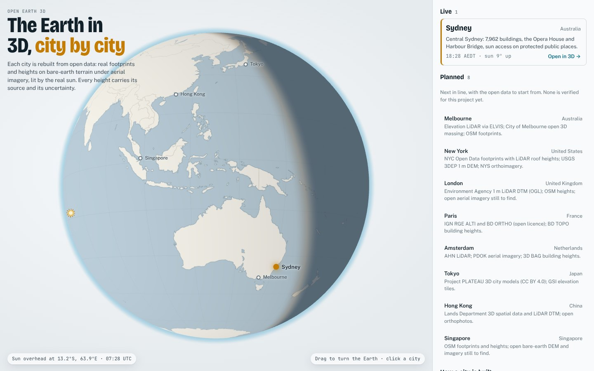

| Sydney in the browser | Height sources | Testing a tower against the planning rule |
|---|---|---|
| 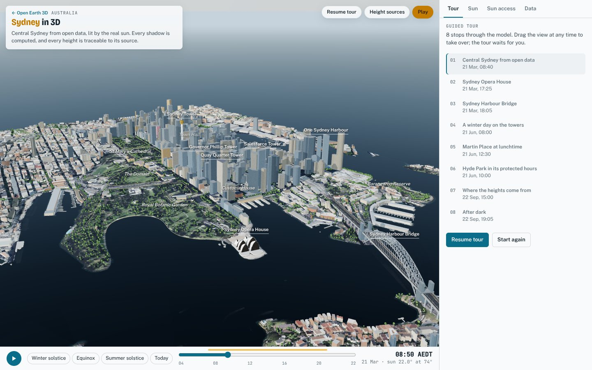 | 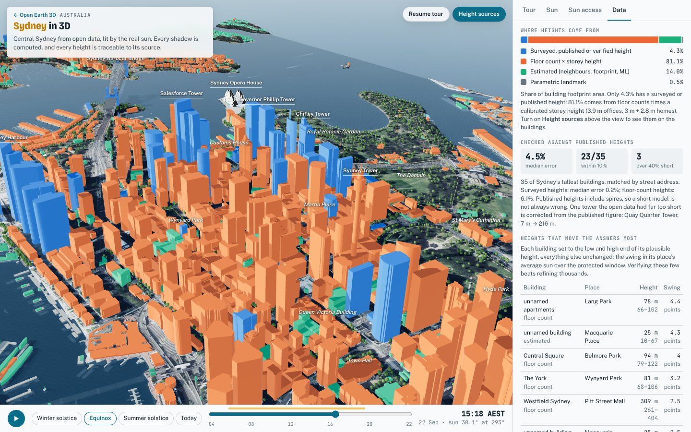 | 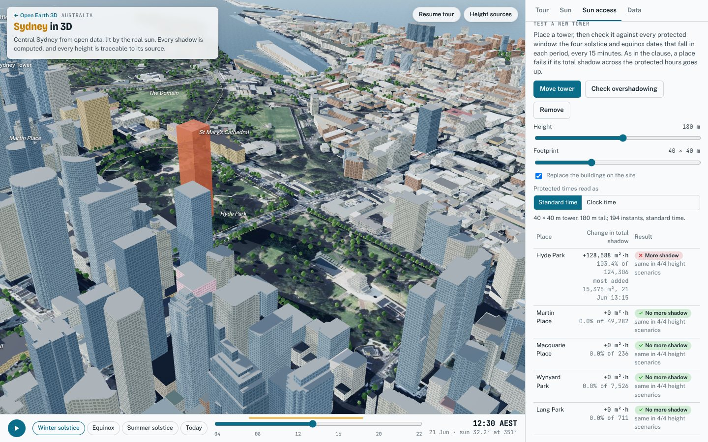 |

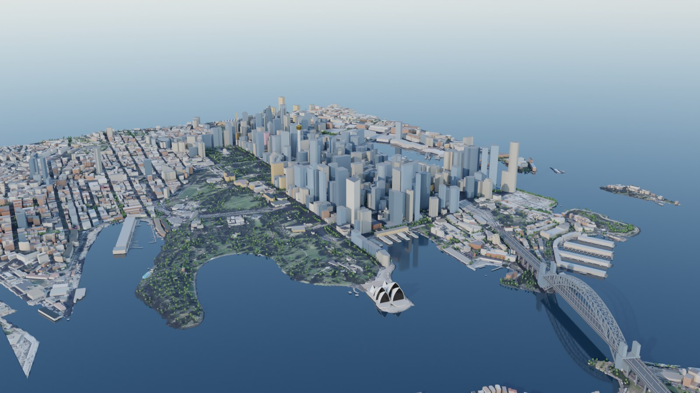

| Melbourne in the browser | Testing a tower against DDO10 | Cycles render of Melbourne |
|---|---|---|
| 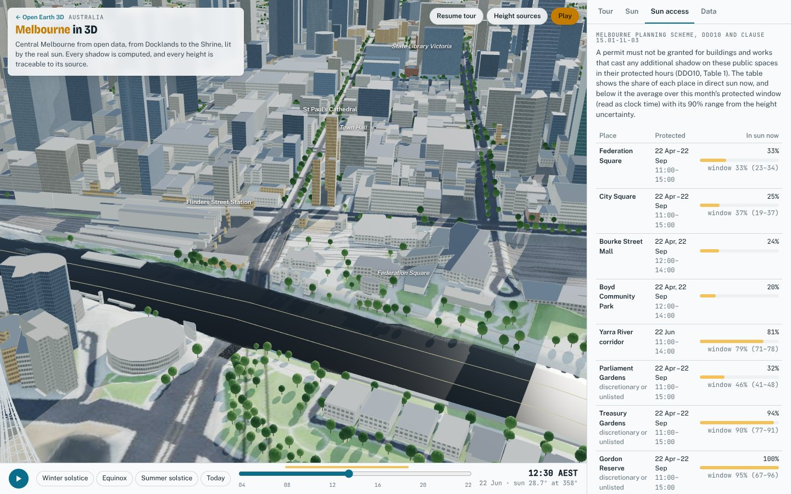 | 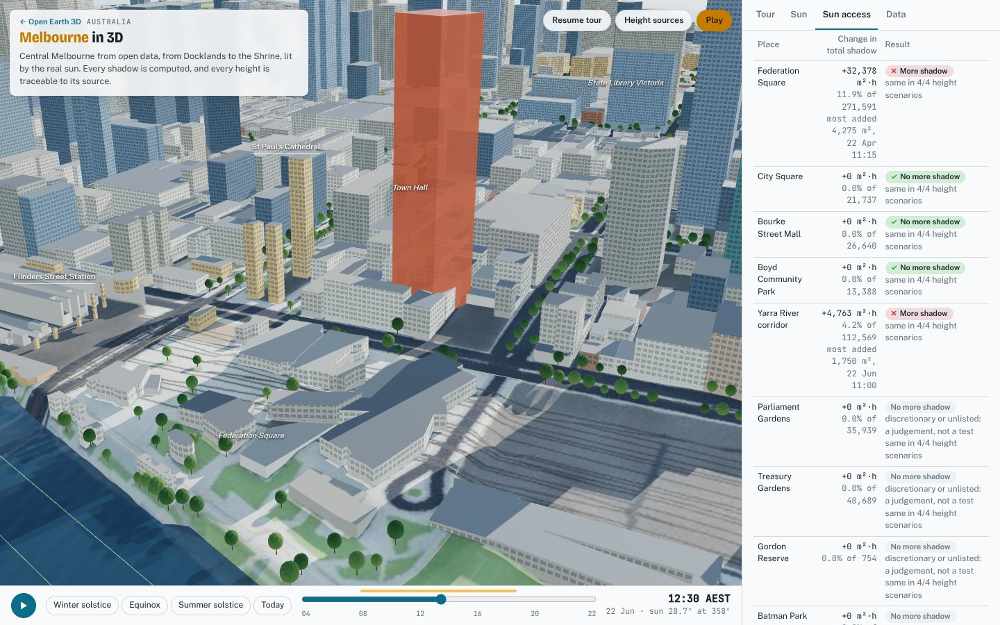 | 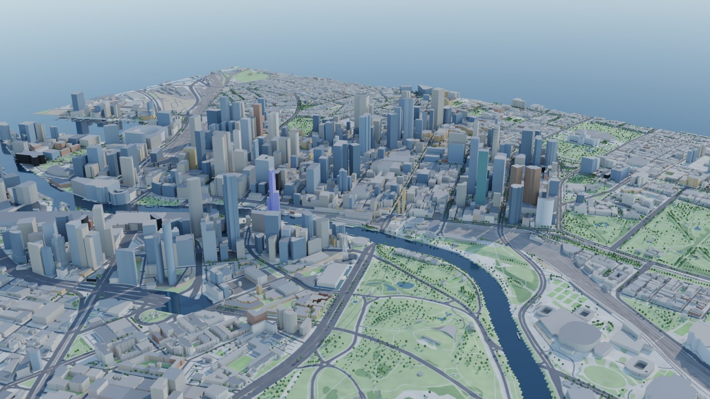 |

Buildings get LOD2 roofs, facades, shopfronts, parapets and rooftops, inferred
where the open data is silent and checked where it is not
([docs/BUILDINGS.md](docs/BUILDINGS.md)):

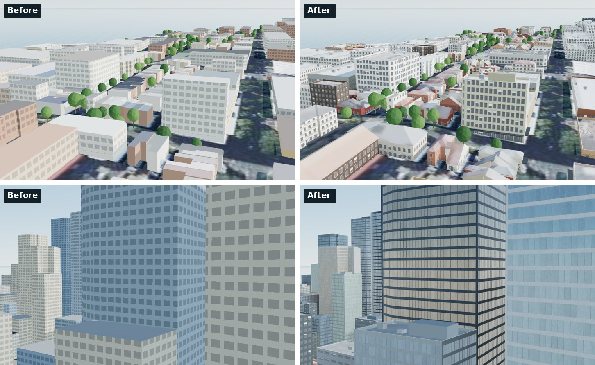

## Play it: Sydney on Foot and Melbourne on Foot

The model is also a game.
- **Sydney:** you walk the city centre as a surveyor and talk to the people who
  know it. You climb the Opera House's Monumental Steps, ride the Cross Harbour
  ferry and walk onto the Harbour Bridge with the traffic. Then you fly a
  helicopter under its deck, and find a sunny spot in Martin Place on the
  winter solstice.
- **Melbourne:** you check the midwinter sun on Federation Square, take a
  shuttle down the Yarra, and fly past the Arts Centre spire.

The people are rigged, animated characters from open (CC0) packs, recoloured so
that every passer-by looks different. Everything the characters tell you is
computed from the model as you play. Open **Play** on the globe, or go to
`#play-sydney` or `#play-melbourne`. [docs/GAME.md](docs/GAME.md) covers:
- the controls;
- what we took from Flight Simulator, Sketchbook, GTA, Ship Simulator and the
  Discovery Tour;
- where this game does better than they do.

| Under the Harbour Bridge | The Opera House's Monumental Steps | Talking to the Opera House guide |
|---|---|---|
|  |  |  |
| **Melbourne: a planner explains DDO10 in City Square** | **The river shuttle on the Yarra** | **Past the Arts Centre spire** |
|  |  |  |

**Osaka on Foot** is the same game in another city: Dotonbori at dusk, the Tombori
River Cruise, a kushikatsu chef in Shinsekai, a leopard-print obachan with candy in the
Kuromon Market, a Tigers fan, two manzai comedians, the Aqua Liner to the castle keep,
and a helicopter over Umeda. The people wear what Osakans wear (patterns and accessories
are procedural, in `web/game/people.js`) and talk like them. Open **Play** on the Osaka
card, or go to `#play-osaka`.

| Dotonbori, with shop signs | Fumi, Kuromon Market | The cast |
|---|---|---|
| 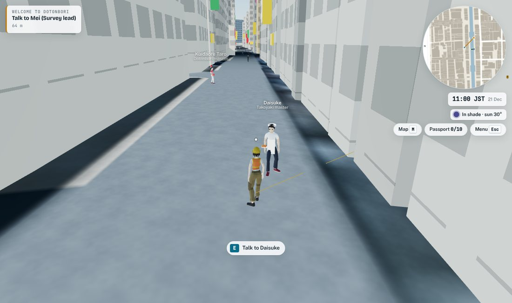 | 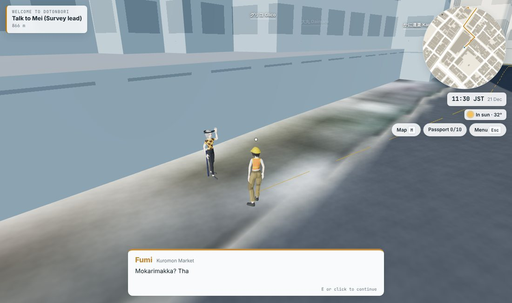 | 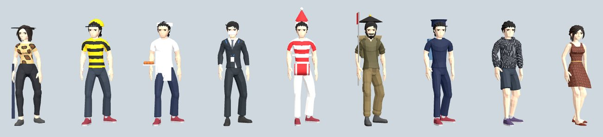 |

## Cities

| City | Status | What's in it |
|---|---|---|
| **Sydney**, Australia | **Live** | 7,962 buildings (4,190 with pitched roofs) and 6,096 trees across 3.0 × 4.8 km. The Opera House, Harbour Bridge and Sydney Tower are built to their published geometry. Sun access is tested on the public places protected by Sydney LEP 2012 cl. 6.18. Heights are checked against 35 published towers (median error 4.5%). [Case study](docs/cities/sydney.md) |
| **Melbourne**, Australia | **Live** | 13,050 buildings and 11,335 trees across 4.8 × 3.9 km, on Geoscience Australia's 5 m LiDAR terrain. That terrain agrees with 238 surveyed spot heights to 0.26 m at the median. Heights are checked against 42 published towers: 21 are matched by address, with a median error of 0.2%. Sun access is tested on the public spaces the planning scheme protects (DDO10). There is no open aerial imagery, so the ground is drawn from the map data. [City notes](docs/cities/melbourne.md) |
| **Osaka**, Japan | **Live** | 73,280 buildings across 4.5 × 6.4 km, from Umeda to Shinsekai with Osaka Castle. 89% of the roof area carries a height measured for Project PLATEAU; GSI's 5 m laser DEM is the terrain. The castle keep, Tsutenkaku, the HEP FIVE wheel and the Dotonbori signs are built to published dimensions. A winter-sun study of eight parks, and *Osaka on Foot*, a game with Osaka people. [Case study](docs/cities/osaka.md) |
| **Kyoto**, Japan | **Live** | 65,749 buildings across 3.0 × 5.0 km, 93% of the footprint area with a height measured from the air by Project PLATEAU. GSI laser terrain and aerial photographs. A game with Kyoto people, some in town from Tokyo. [Case study](docs/cities/kyoto.md) |
| **Tokyo**, Japan | **Live** | About 15,400 buildings across 3.2 × 4.8 km, from Marunouchi to Tokyo Tower. 76% of the footprint area stands at a Project PLATEAU surveyed height (median 2.8% off OpenStreetMap on 135 towers). GSI 5 m laser terrain, a parametric Tokyo Tower, and a game with Tokyo's people. [Case study](docs/cities/tokyo.md) |
| New York, United States | Planned | NYC Open Data footprints with LiDAR roof heights; USGS 3DEP 1 m DEM |
| London, United Kingdom | Planned | Environment Agency 1 m LiDAR DTM; open imagery still to find |
| Paris, France | Planned | IGN RGE ALTI, BD ORTHO and BD TOPO heights |
| Amsterdam, Netherlands | Planned | AHN LiDAR, PDOK imagery, 3D BAG heights |
| Hong Kong, China | Planned | Lands Department 3D spatial data and LiDAR DTM |
| Singapore | Planned | OSM heights; open bare-earth DEM and imagery still to find |

The planned list is a roadmap. None of those data sources has been verified
for this project yet. The order favours cities whose open data includes
measured heights (LiDAR or 3D cadastre), because heights are the weak point
of a footprint-only model (see [what the Sydney study found](docs/cities/sydney.md#52-heights-where-they-come-from-matters-more-than-how-many-there-are)).

## What every city gets

- **Buildings that look like their city.**
  - LOD2 roofs come from a straight skeleton, with eaves. The shape is mapped,
    or ruled, or drawn from the roof shapes mapped across the metro area, and
    scored against the mapped ones.
  - Facades have floors, windows, curtain walls, shopfronts and awnings, glass
    with a room behind it, and lights by the local hour.
  - Flat roofs get parapets and rooftop plant.
  - Each region has its own rules (Sydney, Japan). See [docs/BUILDINGS.md](docs/BUILDINGS.md).
- **Buildings with provenance.** Each height has a source:
  - verified from a cited source;
  - published;
  - surveyed in OpenStreetMap;
  - a floor count times a calibrated storey height;
  - a bias-corrected ML height blended with its neighbours;
  - or an estimate from nearby known heights.

  Every estimator is cross-validated, and missing heights are corrected for not
  being missing at random. The viewer can colour buildings by source.
- **Bare-earth terrain and aerial imagery** from the best open source for the
  place, checked against an independent elevation source where one exists.
  Where no imagery is openly licensed, the ground is drawn from the map data
  instead of borrowed.
- **The real sun.** The NOAA solar position (about 0.01°) is computed in the
  city's own time zone, with daylight saving taken from the platform's time
  zone database. The viewer adds live shadow maps, a sky model and lit windows
  after dark.
- **Shadow analysis** by ray casting through a 2 m surface model:
  - sun now on each public place;
  - a sun-hours map for any day;
  - a "test a new tower" check, where the city has a sun-access rule.
- **Uncertainty.** A Monte Carlo over the measured height errors gives a 90%
  range for each place's sun. It also names the buildings that shade each
  place, and ranks the heights worth verifying next.
- **Water that moves with the wind.** Each city's sea or river has FFT waves
  from its own wind, fetch and depth, after Daniel Greenheck's Tidewater. The
  water reflects the city and shows the bottom where it is shallow. Foam
  follows the kind of shore: a lap against seawalls, splash off rock and swash
  on beaches. The shoreline and the modelled bottom come from the city's own
  map data.
- **Landmarks and buildings at their real dimensions.** Landmarks are built in
  code from published dimensions. Small parts like railings, lamps, mullions,
  roof tiles and deck markings make them read as built. Every other building
  gets a curtain-wall, ribbon or punched-window facade from its class and
  height, with a parapet and its mapped storeys.
- **A guided tour** written in the city's config, with numbers filled in from
  the model.
- **A Blender twin.** `blender/build_scene.py` rebuilds the same scene
  headless with `bpy` from the same files, and renders it in Cycles.

## Run it

The built Sydney and Melbourne scenes are in the repository, so the viewer runs straight away:

```bash
cd web && python -m http.server 8000
# open http://localhost:8000 for the globe, #sydney or #melbourne for a 3D model, #play-sydney or #play-melbourne for a game
```

To rebuild a city from the raw data (about 2 minutes for Sydney), run:

```bash
pip install -r requirements.txt

# downloads (Overture over anonymous S3; unset injected AWS credentials if your shell has any)
env -u AWS_ACCESS_KEY_ID -u AWS_SECRET_ACCESS_KEY -u AWS_SESSION_TOKEN \
  python pipeline/fetch_overture.py --city sydney
python pipeline/fetch_tiles.py --city sydney         # imagery, terrain, Terrarium tiles
python pipeline/fetch_world.py                        # the globe's base map (once)

# build
python pipeline/build_scene.py --city sydney          # -> web/data/sydney
python pipeline/landmarks.py --city sydney            # -> web/data/sydney/landmarks.json
python analysis/heights.py --city sydney              # published heights vs model
python pipeline/build_scene.py --city sydney          # again, to apply reference corrections
python pipeline/game_data.py --city sydney            # paths, water, wharves, ferry routes for the game
python pipeline/fetch_people.py                       # the game's characters (once; Quaternius CC0 packs)
```

`heights.py` reads the built scene, and `build_scene.py` uses its name matches
to correct towers that the open data gets grossly wrong. On a fresh checkout,
that is why the build runs twice. The scores always use the uncorrected
open-data heights.

Checks and analyses all take `--city` and write to `cities/<city>/analysis/`:

```bash
python analysis/data_quality.py --city sydney    # ML heights vs floor counts; Terrarium vs bare earth
python analysis/dem_check.py --city sydney       # terrain vs an independent elevation service
python analysis/radar_check.py --city sydney     # building mass vs the 2000 SRTM radar surface
node analysis/sun_access.js --city sydney        # sun on each place, 21st of every month
node analysis/error_budget.js --city sydney      # numerical error and model-edge effects
node analysis/uncertainty.js --city sydney 40    # Monte Carlo ranges, shade attribution, fix list
node analysis/time_basis.js --city sydney        # standard vs clock time readings of a rule
```

To render in Blender (Python 3.13):

```bash
pip install bpy==5.2.3
python blender/build_scene.py --city sydney --samples 48   # views from city.json -> docs/images/sydney
```

## Add a city

1. Create `cities/<id>/city.json`. It holds:
   - a bounding box and origin;
   - imagery and terrain services;
   - water classes and storey heights;
   - public places, labels, a tour and Blender views.

   The schema is in [docs/ADDING_A_CITY.md](docs/ADDING_A_CITY.md).
2. Optionally add `cities/<id>/city.py` for landmark geometry and per-building
   fixes, and `reference_heights.csv` and `verified_heights.csv` for checks.
3. Run the pipeline and the checks, and read what they say about the data.
4. Mark the city `live` in `cities/index.json`.

The globe picks it up from `web/data/cities.json`.

## How it fits together

```
cities/<id>/city.json ─┐
Overture Maps ─────────┼─► pipeline/ ─► web/data/<id>/ ─┬─► web/  (globe, 3D model viewer, game; world.js, sun.js)
imagery + terrain ─────┘                                ├─► analysis/  (Python and Node checks)
                                                        └─► blender/   (bpy + Cycles)
```

The same files feed the browser, the analyses and Blender, so what you see is
what was measured. [docs/ARCHITECTURE.md](docs/ARCHITECTURE.md) covers:
- the local frame;
- the height ladder;
- the file formats;
- the sun and shadow code.

| Path | What |
|---|---|
| `cities/` | One folder per city: `city.json`, optional `city.py` hooks, reference tables, analysis outputs; `index.json` lists live and planned cities |
| `pipeline/` | Downloads (Overture, imagery, terrain, Natural Earth), scene build, roofs (`roofs.py`) and building typology (`typology.py`), landmark meshes |
| `web/` | `index.html` (globe, model and game views), `globe.js`, `world.js` (the city scene the model and the game share), `water.js` (waves, reflections, shores), `buildings.js` (walls, roofs, facades and rooftops), `city.js` (model viewer), `game/` (the game), `sun.js` (solar position, time zones, surface model, ray casting), built data in `web/data/` |
| `analysis/` | Height accuracy, data quality, terrain and radar checks, sun access, error budget, uncertainty, time basis |
| `blender/` | Headless Blender rebuild and Cycles renders (`buildings.py` builds the buildings) |
| `tools/` | `city_shot.js`: screenshots of the model viewer from listed views, for checking changes |
| `docs/` | Architecture, buildings, the game, adding a city, per-city case studies, images |

## Data and licences

Each city lists its sources in `city.json`, and the viewer shows them in its
Data tab. The shared sources are:

- **Buildings, land use, water, trees, piers, addresses:** Overture Maps
  Foundation. These are OpenStreetMap contributors (ODbL) and Microsoft ML
  Buildings (ODbL). A derived database must stay under ODbL.
- **The globe's base map:** Natural Earth (public domain).
- **Fonts:** Google Fonts (Bricolage Grotesque, Public Sans, JetBrains Mono).
- **3D library:** three.js r186 (MIT) and three-mesh-bvh (MIT), loaded as ES
  modules from a CDN.
- **Game characters:** Quaternius, Ultimate Modular Men and Ultimate Modular
  Women (CC0 1.0, public domain).
- **Water:** the wave spectrum and FFT are ported from Tidewater by Daniel
  Greenheck (github.com/dgreenheck/tidewater, MIT, © 2026 DRG Software
  Solutions LLC). Its licence notice is at the top of `web/water.js`.
- **Land cover for beaches and rock:** Overture Maps' land theme (ODbL),
  through `pipeline/shore.py`.

Sydney also uses these sources:
- NSW Spatial Services imagery and 5 m elevation (CC BY 4.0).
- Geoscience Australia 5 m LiDAR DEM (for the terrain check).
- Wikipedia's *List of tallest buildings in Sydney* (CC BY-SA), for reference
  heights.
- Sydney LEP 2012 cl. 6.18, for the protected places. Their windows were
  transcribed from secondary sources, so check the official text before
  relying on them.

Melbourne also uses these sources:
- Geoscience Australia's 5 m LiDAR DEM (CC BY 4.0), for the terrain.
- Vicmap Elevation spot heights (CC BY 4.0), for the terrain check.
- Wikipedia's *List of tallest buildings in Melbourne* (CC BY-SA), for
  reference heights.
- The Melbourne Planning Scheme (DDO10 and clause 15.01-1L-03), read from the
  Victorian government's planning API.
- No aerial imagery: none covering the city is openly licensed.

No licence has been chosen for the code yet. Until one is added, the default
copyright applies.

## Limitations

- **Open-data heights are uneven.** In central Sydney, 4% of the footprint area
  has a surveyed, published or verified height. 81% has a floor count, which
  converts to a height within 6% (median, against published tower heights).
  The remaining 14% is estimated, with a measured error. Other cities will
  differ, and the share is the first thing to check.
- **Roof shapes and facades are inferred.** About 97% of buildings have no
  mapped roof shape, so it is ruled or drawn from measured priors. Sydney's
  rules get flat or pitched right for 69% of the mapped roofs: they find 85%
  of the flat ones but miss many pitched heritage roofs. Facade styles come
  from class, height and size.
- **Setbacks and podiums appear only where OpenStreetMap maps building parts.**
  Landmarks need hand-written geometry from published dimensions.
- **Rules are transcribed, not interpreted.** A sun-access rule is encoded as
  places, periods and windows. How a court reads it (clock or standard time,
  which baseline) is reported as a range, not decided.
- **One time slice.** The model is the open data as of its Overture release,
  not the city on a given date.
