# Architecture

One config per city and one build. The outputs are plain JSON and JPEG files
that three consumers read: the browser, the analyses and Blender. Nothing is
modelled by hand except the landmarks. Those are code, and their dimensions
come from published figures.

```
cities/<id>/city.json ──┐                                      ┌─► web/          title.js, city.js, sun.js
cities/<id>/city.py ────┤                                      │
Overture Maps (S3) ─────┼─► pipeline/fetch_*.py ─► data/raw/<id>/ ─► pipeline/build_scene.py ─► web/data/<id>/ ─┼─► analysis/     *.py, *.js
imagery, terrain ───────┘                                      ▲               │                  │
                                         analysis/heights.py ──┘               └─► pipeline/landmarks.py         └─► blender/      bpy + Cycles
```

## The local frame

Each city has a transverse Mercator centred on `origin`: x east, y north,
z up, in metres. It has no grid rotation, and its scale error over a few
kilometres is a few parts per million. Coordinates are integers in decimetres
in the shipped files.

three.js is y-up, so the viewer draws a local point `(x, y, z)` at
`(x, z, -y)`. Blender is z-up and uses the local frame as it is.

## Pipeline

| Step | Script | Output |
|---|---|---|
| Vector data | `fetch_overture.py` | Buildings, building parts, water, land, land use, infrastructure, addresses and road segments in the bbox (DuckDB, anonymous S3) |
| Measured heights | `fetch_plateau.py` (backends `plateau_citygml.py`, `plateau_3dtiles.py`, vector tiles) | `data/raw/<id>/plateau.json`: Project PLATEAU footprints with measured heights, from a city's CityGML or 3D Tiles zip (HTTP range reads of the parts inside the bbox, no full download) or a vector-tile mirror of the LOD2 roof faces |
| Measured heights (France) | `fetch_ign.py` | `data/raw/<id>/bdtopo_batiment.json` (IGN BD TOPO buildings over WFS) and `lidar_mnh.tif`, `lidar_mnt.tif` (IGN LiDAR HD over WMS-R, float32 BIL in tiles); read by `measured.py` behind the PLATEAU interface |
| Rasters | `fetch_tiles.py` | Imagery tiles, the DEM (`dem.tif` + `dem.json`, from an ArcGIS ImageServer, an OGC WCS, an OGC WMS serving float BIL or a GeoJSON index of GeoTIFF tiles), a LiDAR surface model where the city has one (`dsm.tif`), and Terrarium tiles for the radar check |
| Measured buildings (the Netherlands) | `fetch_3dbag.py` | `data/raw/<id>/3dbag.json`: the 3DBAG's CityJSON tiles (from the release's `tile_index.fgb`) as one feature per LOD1.3 roof level, with its LiDAR top and the roof its LOD2.2 model has over it; read by `build_scene.BAG3D` behind the PLATEAU interface |
| Surveyed heights | `fetch_survey.py` | `survey.json`: a mapping agency's building blocks with surveyed top levels (Hong Kong's Lands Department) |
| People | `fetch_people.py` | `web/assets/people/`: the game's characters, animations and crowd copies (Quaternius CC0 packs) |
| Open water past the frame | `open_sea.py` | `sea.jpg`: Overture's ocean, bays, straits (and, where the city draws them, rivers and lakes) 40 km either side of the frame, for the edge haze (`web/world.js` `edgeHaze`, issue 57) |
| Land past the frame | `far_land.py` | `far.png` (relief and night lights), `far.jpg` (land cover's colour), `far.json`: Copernicus GLO-30, ESA WorldCover 2021, VIIRS Annual VNL V2 2024, 40 km either side of the frame (60 km at a reef site), for `web/farland.js` (issue 78) |
| Landings past the frame | `outposts.py` | game.json `outposts`, `outpost_<id>.jpg`: a small tile of ground far from the model that a ferry calls at (Queenstown's Walter Peak, 13 km across Lake Wakatipu): its terrain on a 2 m grid, its water and building masks, its photo, its buildings and its wharf as a strip surface, from a STAC DEM and photo collection and Overture; the ferry legs that call there routed over Overture's lake past the frame (`web/outposts.js`) |
| Base map | `fetch_world.py` | `web/data/world.json`, Natural Earth land, lakes and borders for the globe |
| Scene | `build_scene.py` | `scene.json`, `buildings.json`, `places.json`, `terrain.json`, `shore.png`, ground tiles; `cities/<id>/analysis/height_model.json` and `roof_model.json` |
| Levelled ground | `refresh_terrain.py` | Applies a city's `terrain.level` (ground a bare-earth survey got wrong: glass it saw through, a building it filtered out) to a built `terrain.json`, `game.json` (walking ground, paths, props) and the landmarks in `scene.json` without a rebuild, from the DEM alone (`fetch_tiles.py --only dem`); then `landmarks.py` and `game_extras.py` |
| Repainted ground | `refresh_ground.py` | Applies a city's `imagery.paint` (land use that draws the wrong ground: a construction site mapped over a paved promenade) to the drawn ground tiles of a city without aerial imagery, without a rebuild; `build_scene.py` draws the same fill in place of the land use |
| Roofs and facades | `roofs.py`, `typology.py` (called by `build_scene.py`) | Per building: a facade style, storeys, colours. Per pitched solid: a roof mesh (straight skeleton). Also shopfront frontages and rooftop plant. See [BUILDINGS.md](BUILDINGS.md) |
| Bridges over the water | `bridges.py` (run by `build_scene.py`, `landmarks.py`, `game_data.py`, `game_extras.py`), `refresh_bridges.py` | Every bridge OpenStreetMap maps over a city's rivers, canals and moats that the city's own builder does not draw (Paris's, Amsterdam's, Tsukishima's and Odaiba's do): its deck at the banks' height, in its real form and paint from city.json `bridges` (see [Bridges](#bridges-over-the-water)), in `landmarks.json`, and its deck walkable and drivable in `game.json` surfaces. `refresh_bridges.py` finds them again in a built city from the Overture layers and the game's ground; `tools/bridge_survey.py` lists any bridge still drawn by nothing |
| Landmarks | `landmarks.py` | `landmarks.json`, from the city's `landmark_meshes` hook, and any images its materials use (`landmark_assets`: a texture atlas of signs and plaques; a sheet of screen keyframes drawn with `adkit.py`); with `landmark_glows`, the light its screens throw on the street, and with `landmark_demolished`, the surveyed buildings pulled down since |
| Repairs | `osm_parts.py`, `retop.py` | a building's parts and their levels or heights from the OpenStreetMap API, and the built `buildings.json` re-heighted from a city's `retop` hook without a rebuild (Namba Parks, the Tokyo Metropolitan Government Building) |
| Game | `game_data.py` | `game.json`: walking terrain, water mask, walkable surfaces, paths, wharves, ferry routes, boardwalks, wildlife, flocks and no-go areas, travel points, NPCs and quests, and what the city's `game_extras` hook places from its landmarks (lifts, spots, overheard talk) |
| Woods | `woods.py` (run by `game_data.py`) | `woods.png` and `woods` in `places.json`: in every mapped wood, forest, scrub, park, garden, cemetery and temple ground, the trees planted from an open canopy height model (Meta and WRI, CC BY 4.0) and a mask of the ground under that canopy, which the ground shader draws as a wood's floor instead of the photo's tree tops. See [Woods](#woods-and-park-canopy) below |
| Night | `night_lights.py` (run by `game_data.py`) | `night.json`: the roads simplified for the street lights and the traffic, the mapped lamps, and the city's lighting style (lamp colours, keep side, aircraft lights, crowns, sky glow). See [NIGHT.md](NIGHT.md) |

`build_scene.py` also writes `web/data/cities.json` from `cities/index.json`,
and marks each city built or not.

`pack.py` packs each city's `buildings.json` into `buildings.bin`, which is what
the browser downloads (see [Download size](#download-size) below).

### Ground

The ground tiles are the aerial photo, resampled into the local frame at 1 m
per pixel, where the city has openly licensed imagery. Where it has none
(Melbourne), the build draws them from the vector data instead:
- land use and land cover;
- water;
- roads with their kerbs and footpaths;
- footways, cycleways and rail;
- piers;
- footprints, with contact shading and fine noise so the surface reads at
  street level.

Roofs then get neutral colours rather than a sampled photo.

### Heights: the ladder

Each building takes the best evidence available. The source is stored with the
height, and the viewer shows it.

1. **verified**: a cited, one-by-one lookup (`verified_heights.csv`).
2. **reference**: a published height, used when the open data is more than
   40% short and the match is by name (`heights.json`).
2b. **plateau** (cities with a `plateau` block): the height Project PLATEAU measured
   from the air. It replaces an OSM height or floor count, unless OSM has the building
   more than 30% (plus 6 m) taller than the survey, which means the building is newer than
   the survey and OSM keeps it. **plateau_lod1** is PLATEAU's block height for a building
   with no survey record.
2c. **lidar** and **bdtopo** (cities with an `ign` block): the 95th percentile of IGN's LiDAR HD
   inside the footprint, every part measured on its own and footprints cut into
   levels where the laser sees them; **bdtopo** where the LiDAR is blank, BD TOPO's
   surveyed eaves plus the median measured roof. An OSM height far above the laser
   is a spire, not a newer building, so the laser wins.
2d. **survey** and **lidar** (cities with a `survey` or `surface_check` block, `survey.py`):
   - a mapping agency's surveyed top level. Each footprint is cut along the
     agency's building blocks, tallest first, and each block goes to the
     footprint it fits best, so a tower's block is not cut into a podium
     mapped round it;
   - the median roof of a LiDAR surface model, for footprints the survey
     covers less than half of, and for surveyed pieces the laser saw far
     lower on blocks surveyed before the flight.

   These replace the open-data heights below them.
3. **mapped**: an OpenStreetMap `height`.
4. **floors**: OSM `building:levels` × the calibrated storey height, plus any
   roof height.
5. **ml**: the Microsoft ML height. Its measured bias is removed, and it is
   blended with the neighbour estimate.
6. **estimate**: the weighted median of known heights within 60 m. Neighbours
   of a similar footprint and the same building type weigh more.

Missing heights are not missing at random: mappers tag the prominent towers
first. The build measures this bias with the ML heights, which are an
independent measurement inside the unknown population, and corrects it per
band of neighbourhood height, shrunk towards no correction where data is thin.

Plausibility caps stop an estimate from turning a kiosk or an untagged
heritage building into a tower. The caps come from the known heights, not
constants.

Every estimator is cross-validated on the buildings with known heights. The
residuals go to `height_model.json`, and `uncertainty.js` resamples them.

### Files

- `buildings.json`
  - `b`: one row per building, `[name, class, top_m, floors, height_src,
    footprint_src, osm_id, wall_colour, roof_colour, open_data_top_m, style,
    storey_m, ground_floor_m, roof_material, seed, roof_shape, roof_src]`.
    The last seven are integer codes: `styles`, `roof_materials`,
    `roof_shapes` and `roof_sources` list them.
  - `s`: one row per solid, `[building, base_dm, min_dm, top_dm, ring_dm,
    ...holes_dm]`.
  - `r`: one row per solid with a pitched roof, `[solid, top_dm, eave_dm,
    shape, x0_dm, y0_dm, xyz, triangles, roof_triangles]`.
    - `xyz` is int16 little-endian, base64: `(x - x0, y - y0, z above the
      solid's base)` in decimetres.
    - `triangles` are vertex indices, base64: uint8 under 256 vertices, else
      uint16.
    - The first `roof_triangles` triangles are roof. The rest are gable
      walls and soffits.
    - The solid's walls stop at `eave_dm`. `Sun.unpackRoof` (`sun.js`)
      decodes a row.
  - `f`: shopfront edges, `[solid, edge, flags, ...]`. Flag 1 is a shopfront
    and flag 2 an awning; the edge is counted along the outer ring.
  - `p`: rooftop plant, `[solid, kind, x_dm, y_dm, w_dm, d_dm, h_dm,
    angle_cdeg]`. Kind 0 is a plant box, 1 a plant room and 2 a water tank.

  A building with OSM parts has several solids. Viewers and Blender treat a
  file without `r`, `f`, `p` or the style fields as flat-roofed and guess
  styles from class and height.
- `places.json`
  - `places`: `{name, lep, period, from, to, area_m2, polygons}`. `lep` means
    "protected by the city's rule".
  - `piers`: rings. The mapped pier polygons, and the decks Overture's water runs over
    that OpenStreetMap maps otherwise (`pipeline/shore.py` `decks`): any area tagged
    `man_made=pier` whatever its class (Hong Kong's Pier No. 3 car park), car parks,
    helipads and aprons mostly in the water and at ground level (not underground, as
    Amsterdam's garages under its canals, nor on a roof), and piers mapped as lines, as
    wide as the road down them (Tokyo's finger piers) or else a 3 m jetty. The infrastructure
    layer keeps OSM's tags (`source_tags`) and `level` for this. `pipeline/refresh_piers.py`
    rewrites them without a rebuild; `tools/stale_shore.py` lists where mapped land still
    lies under the built water, and `tools/coast_overlay.py` draws the water, the mask and
    the decks over the aerial photograph to check a coastline (issue 50). Their tops show
    the aerial photograph, as a flat roof does (`web/world.js`), so a wharf has its parking
    bays and kerbs rather than a plain slab.
  - Buildings out on the water that are not buildings (`pipeline/wet_buildings.py`, issue 65):
    a footprint 80% in the water and not on a mapped pier is a **deck** when it is a
    machine-learned footprint (Microsoft's) of 1,000 m² or more joined to the land (Garden
    Island's cruiser wharf), added to the piers and its solid not drawn; the deck of a
    **bridge** or an elevated road when it is a machine-learned footprint at least 20% over the
    water and half under a road Overture flags as a bridge or raises a level (Osaka's Hanshin
    loop over the Higashi-Yokobori), not drawn; and a **vessel** when OpenStreetMap tags it
    `building=ship`, `boat`, `houseboat` or `barge`, `floating=yes` or `seamark:type=hulk`, when
    its class is in `water.floating`, and for any other machine-learned footprint out there (the
    boats moored when the imagery was taken). A vessel floats at the waterline with a dark
    hull to its freeboard (by its length, 1 to 4 m) under a deck, and a lighter superstructure
    set in from the sides and amidships on a ship, added as a new building (class `vessel`;
    the hull's class is `vessel_hull`). The tags come from the OpenStreetMap API for those
    buildings only (`data/raw/<id>/osm_wet_buildings.json`). `build_scene.py` leaves the decks
    out and runs it; `refresh_piers.py` (or `python pipeline/wet_buildings.py --city <id>`)
    applies it to a built city, hiding solids as a demolished building's are, so no index moves.
  - `trees`: flat `[x, y, z, h]` in decimetres.
  - `woods`: the trees planted from the canopy (`pipeline/woods.py`), the same
    way, with the height the canopy model measured.
- `woods.png`: the ground under the woods' and parks' canopy at 2 m a pixel,
  from the north-west corner: `r` how much of the ground the wood's floor
  covers, `g` the canopy's height times 8 (m), `b` a footway under the trees,
  `a` inside a wood or park.
- `terrain.json`: a 10 m grid, int16 decimetres, little-endian, base64,
  starting at the north-west corner. Under the water the bottom is modelled, as
  below.
- `shore.png`: the shoreline at 2.5 m per pixel (`pipeline/shore.py`):
  - red is 128 + 2 × the signed distance to the shoreline (water positive,
    0.5 m steps, ±64 m);
  - green is sand on land, and in the water whether the nearest shore is sand;
  - blue is rock or a mapped cliff, the same way.

  There is no open bathymetry for the harbour or the river, so each water cell's
  depth is modelled from its distance to the nearest shore and a slope for that
  kind of shore, down to 4 m:
  - 0.04 off a beach;
  - 0.25 off rock;
  - 1.0 off a seawall or any other built edge.

  Every kind reaches the 4 m floor by 60 m out (`shore.py` `REACH_M`, `water.js`
  `SHORE_REACH`): a beach keeps its slope at the waterline and curves down to the
  floor, inside the ±64 m that red encodes. Beyond that the kind of the nearest
  shore no longer shows. On a straight slope the water off a beach stayed 2.5 m
  deep out across the bay, in a pale wedge for every stretch of sand (issue 39).
  Along the frame's edge haze the water closes over the bottom, which hazes out
  there while open sea above it does not. Out where the floor is reached the
  water hides the bottom altogether, as the open sea past the frame (which has
  none under it) does; letting a tenth of the aerial photo through there read
  as a straight band where the two met at the frame (issue 57).

  The first grid point out from the land is at most 0.3 m deep (a shelf), so on
  the 5 m grid the waterline falls at the quay's edge rather than up to a cell
  inland. Without it Osaka's river walk along the Dotonbori went under the water.
  The water shader uses the same slopes for how much of the bottom shows.

  Sydney's map holds 25 sand and 220 rock polygons from Overture's land cover.
  Melbourne's sand is sports fields, away from the river.

  **Quays** (`web/quays.js`, for the viewer and the game). The terrain grids
  (10 m in the viewer, 5 m round the player in the game) cannot turn a corner at
  a quay wall: between the last point on land and the first in the water the
  ground sloped up out of the water for up to a cell, draped with the aerial
  photo as a grey ramp. Along every shore `shore.png` does not mark as sand or
  rock, the browser now builds the seawall from the same map:
  - *the shoreline:* the zero of the signed distance, smoothed a little (two
    [1 2 1] passes, so the half-metre steps don't wobble a straight wall),
    traced by marching squares, chained and simplified (Douglas–Peucker,
    0.35 m), in pieces no longer than 6 m;
  - *the wall:* a face of dressed stone in courses (the `ashlar` pattern, with
    the tidal band up to the city's high water and grime in streaks above it)
    from below the modelled bottom up under a coping 0.9 m deep, 0.2 m out in
    the water from the line. The coping sits on the highest drawn ground behind
    it, so the ground never shows through it;
  - *the ground:* the grid points out in the water within 1.5 coarse cells of a
    quay (and points beside one that lie below the water, where the DEM took the
    river for land) are raised to the quay's level, so the ground meets the wall
    level. On the coarse grids (the viewer's 10 m, the game's far ground) only the
    points with a neighbour of the eight round them on land are raised, the cells
    that would slope from the land down to the bed: every point within the band
    was until #246, which lifted 15 m out from each bank, most of a 40-60 m river
    such as the Nihonbashi. The game's 5 m walking grid keeps the whole band, which
    a walker stands on up to the coping's edge. The ground shader discards the
    raised ground above the water from a quarter metre behind the shoreline out (a
    2.5 m mask of the band along the quays), and the
    bottom is drawn under the cells it opens;
  - *walking:* along a quay a walker stops with the toes at the coping's edge,
    its centre 0.15 m short of the wall's face as drawn (`water()`, measured to
    the faces the walls stand on and to a landmark's own seawall, landmarks.json
    `seawalls`, rather than to the 2.5 m shoreline map, whose zero lies 0.2 m
    behind the face), not at the 5 m water mask's bank, and the walker walks on
    the raised grid (`game/nav.js`).

  **Inland water** (#277: `pipeline/inland_water.py`, `web/inland.js`, for the
  viewer and the game). The sea's plane lies at the scene's 0 m, so water above
  it (a river in an inland city, a park's pond) was drawn as ground under the aerial
  photograph: the Meguro River ran between its railings as a strip of grey ground.
  Each body now stands at its own level, from Overture's base water (OpenStreetMap,
  ODbL) and the game's 5 m terrain (GSI DEM5A in Japan):
  - *walled* channels: rivers mapped only as a centre line, buffered to a width that
    may widen downstream (the Meguro River 9 to 13 m, the Shibuya River 8 m, the
    Kanda River 11 m, Kyoto's Takase River, Shirakawa and Misosogi, the canal's branch
    along the Philosopher's Path), and narrow river or canal polygons (under 15 m on
    average) or ones a city names (the Kamo Canal, the Biwako Canal at Okazaki). Each
    bank is the ground on its own side just outside the walls (the laser survey dips
    into a 10 m channel): samples 3-8 m out on that side only, smoothed over 80 m and
    never rising downstream. The water stands level across the channel, `bank_to_water_m`
    under the lower bank (4.5 m for the Meguro, a metre for a Kyoto stream), its bed
    `water_m` under that; the higher bank, on a slope, is at most 2.5 m over the lower,
    a hillside behind it staying a slope (#300: one level for both banks stood the
    Philosopher's Path canal's coping over the ground on its downhill side). Stretches in
    a culvert (`tunnel=culvert`) are left out;
  - *sunken promenades* (`terrace` on a line, #300): Kyoto's Horikawa from Oshikoji up
    to the map's edge, restored by Kyoto City (1997-2008) with a stream, paths and
    benches inside the old river and entrances from the pavements and crossings. Between
    stone walls 9.5 m apart a paved floor (granite setts) stands 0.35 m over the water and
    about 2.6 m under the street; the stream runs down its middle, 2.4 m wide between
    low stone edges; at each crossing a flight of steps (0.16 m risers, 0.3 m treads, a
    parapet on the open side) runs down along the wall from the crossing's downstream
    face, on one bank and then the other. Kyoto City's summary gives the stretch, the
    stream, the stepped weirs and the entrances but no dimensions: the depth and widths
    are read from photographs. No other live city has one; a city adds
    `"terrace": {"stream_m", "path_m", "steps_m"}` to a line in `water.inland.lines`.
    Walkers do not go down yet: the promenade is drawn, not walked;
  - *natural* water (the Kamo River, the ponds): the survey interpolates across water,
    so its level is the survey's own inside the outline (the lowest fifth within 40 m
    along a river, a third of the way up for a pond, just under its shore);
  - water a landmark draws (the Nijo Castle moats, `kyoto_moat_water`) and a city's
    `skip` list (the Keage plant's covered reservoirs) are left out.
  In the browser the terrain grids are levelled first, in place (`raise`): every
  point within 1.25 cells of a channel or inside it takes the bank's level, and under
  natural water the ground drops below its level, so the ground drawn, the walls'
  tops, the trees and what walkers stand on agree. Over a channel the ground is cut
  away by a signed-distance mask (`holeMask`: the exact distance to the walls within
  2.5 m, filtered, so its edge follows a wall to a few centimetres at 0.5 m texels;
  a plain mask left a ragged fringe of ground at the coping), and the channel is drawn:
  revetments from the bank to the bed (concrete cast in 1.5 m lifts and 10 m bays,
  grime streaks, greener and wet towards the water; or Kyoto's dressed stone, the
  `ashlar` pattern), a coping, a steel railing (the `railing` pattern), the bed, and
  the water over it, level-shaded, its ripples drifting downstream with the sun's
  glitter (`water.js patchGlitter`) and the street lights. Where a road crosses with
  no bridge model (`bridges.py`), the ground stays over the channel as a deck with a
  slab edge, an underside and railings. Only a way that crosses is a deck: a piece over
  the channel longer than 32 m, or one that does not reach over its middle, runs along
  it (the Philosopher's Path itself, the Horikawa's promenade) and was covering stretches
  of the canals with slabs. Trees planted from the canopy over a channel
  (the Meguro's cherries reach across it) stand on its bank, 0.8 m behind the wall. The
  lanes along a channel's banks are narrower than their class in the road data (the
  Meguro's run up to the railing): `bank_lanes` gives such a road `cw` in game.json, its
  carriageway's width, keeping 1.8 m from the wall and no narrower than 5.4 m (the
  traffic keeps 1.7 m off the line); `streets.js` takes its band as the carriageway and
  0.3 m (no parking along the river) and the game draws the street that wide, so a
  bank's cherries stand in the game as in the viewer, clear of the carriageway; none
  stands in a pond.

  After dark the street lights, the festival's chochin and the bonbori near the water
  are seen in it (`inland.js glints`, #300), as a long-exposure photograph of Nakameguro
  shows them: each light's mirror image under the water's level, where the line from the
  eye to it meets the water, drawn out towards the eye over every part of the water whose
  ripples tilt a reflected ray within 0.085 rad of it (from the elevation theta + 0.085
  out to theta - 0.085, or the horizon), a lamp's width across, brightest at the image and
  broken into drifting dashes further out, Fresnel-weighted and weaker for a far light.
  One additive card per light, placed in the vertex shader for the camera: no second
  render of the scene, as the sea's planar reflection is, so every tier has it, and where
  a card runs past the water's edge it is under the bank and the ground hides it.

  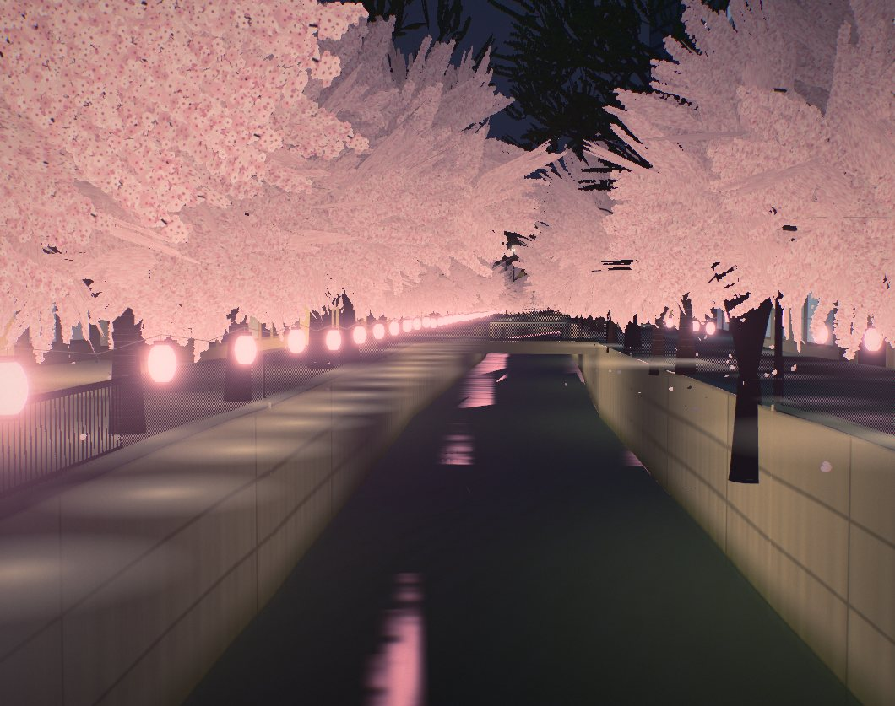
  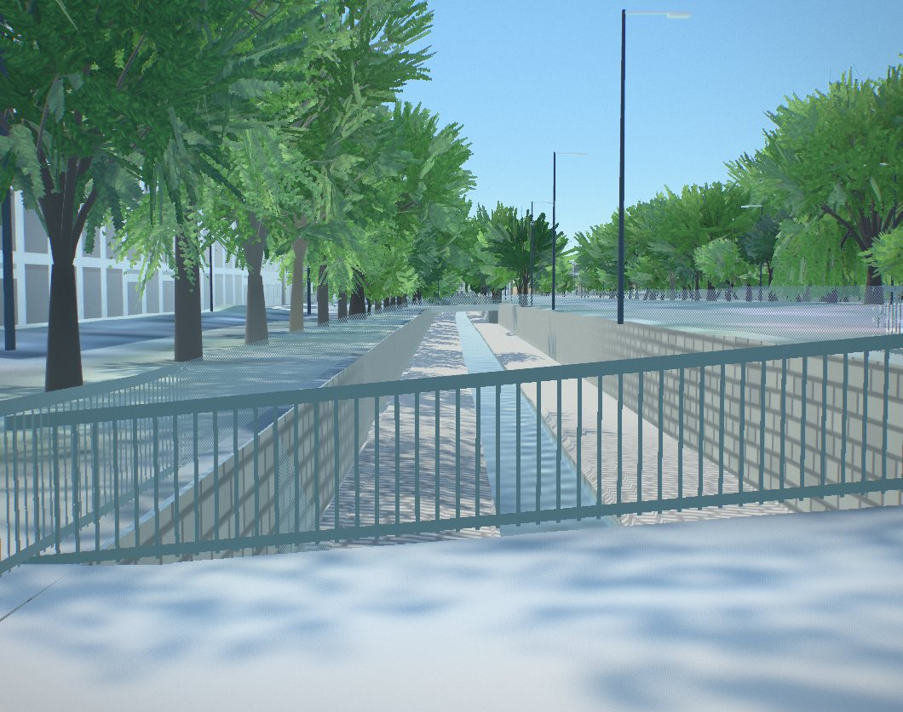 Walkers stop at a channel's railing and a pond's edge
  (`nav.js`, `keep_off`). `?inland=off` draws without, to compare.

  Live cities: Shibuya (the Meguro River, the Shibuya River's open stretch, 12 ponds),
  Shinjuku (the Kanda River, Shinjuku Gyoen's and Meiji Jingu's ponds), Kyoto (the Kamo
  River, Takase River, Shirakawa, Misosogi, the Kamo Canal, the Okazaki canal basin,
  the Gyoen's ponds), the Philosopher's Path (the canal's branch, Shirakawa, the Biwako
  Canal below Keage, the temple gardens' ponds), Fushimi Inari (the Kamo Canal, the
  mountain's ponds) and Higashiyama (the ponds). The sea-level cities keep `water.js`.
  Not drawn: Kyoto's Horikawa, whose stream runs in a sunken promenade with paths
  beside it, a shape these channels don't make.

  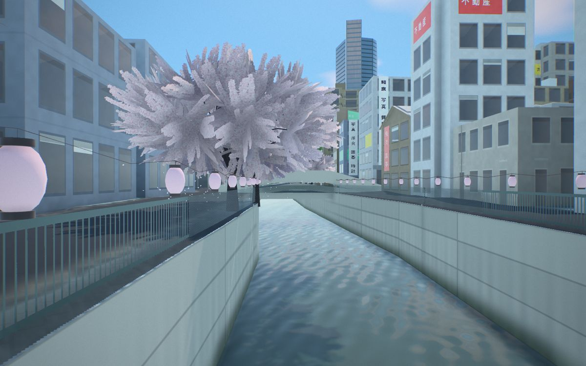
  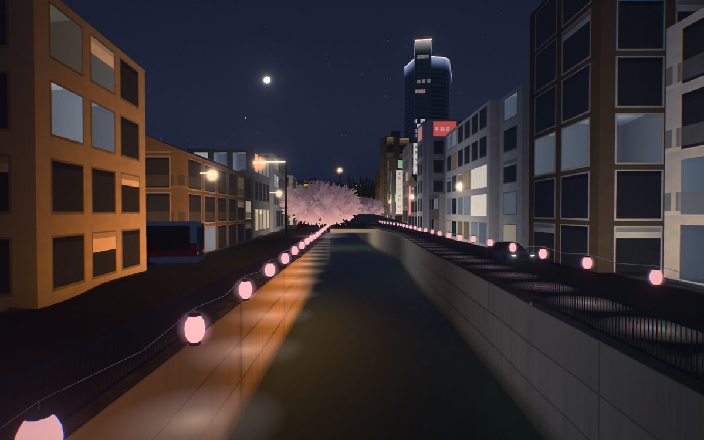
  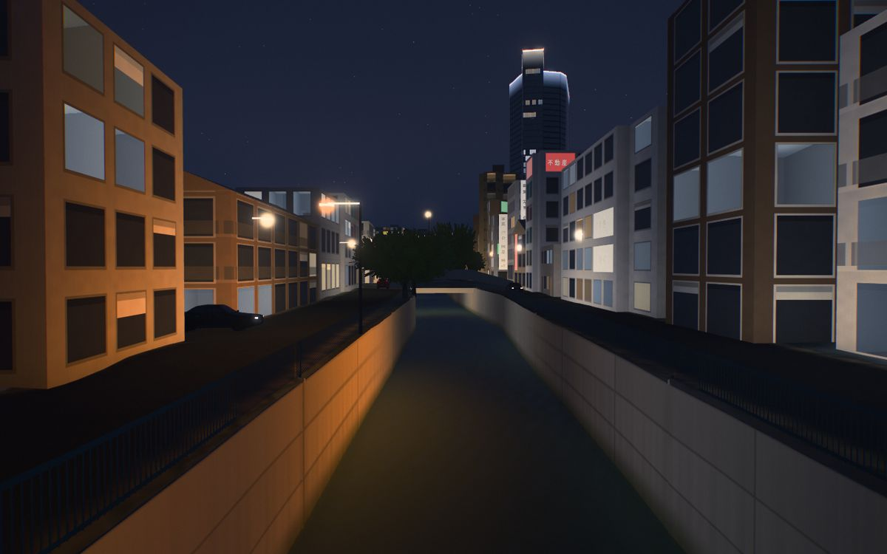
  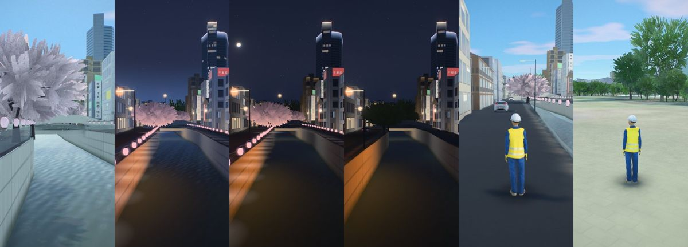
  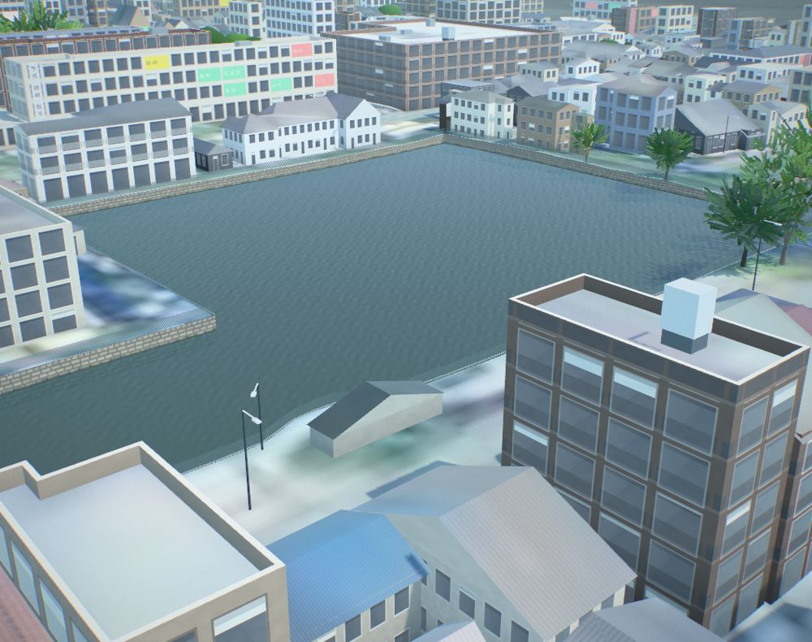
  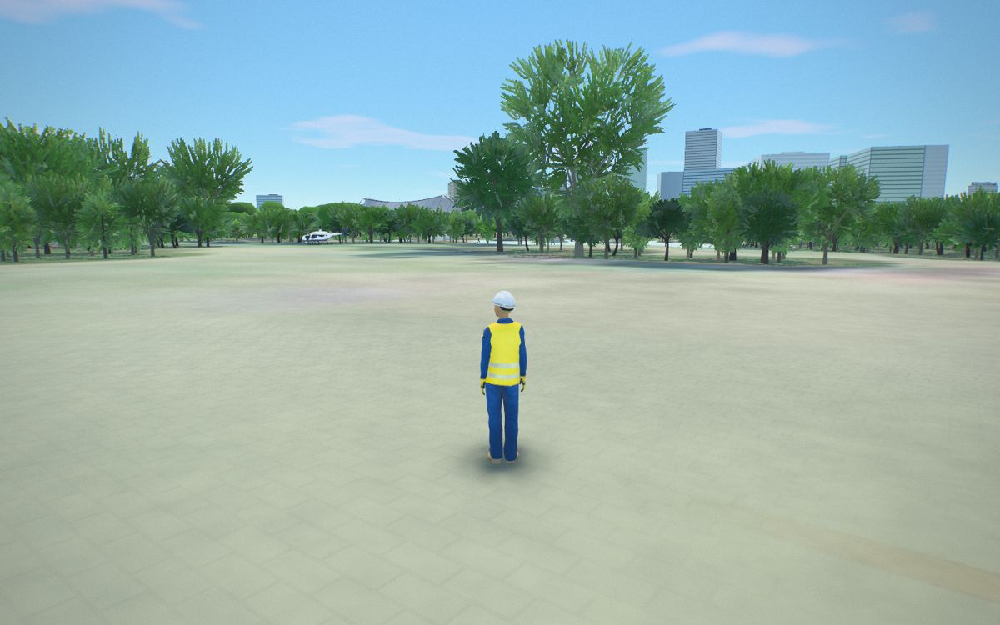

  The quay's level is the land behind it: the fine grid's points more than
  0.75 m in from the shore and above the water within 1.6 cells, nearer ones
  counting more, at least 0.4 m. A shore whose land is more than 9 m up (a
  hillside down to a moat) is left as it was, and so is a landmark's own
  seawall (`landmarks.json` `clip`: Bennelong Point). The city's stone is
  `water.seawall` in `city.json` (copied to `scene.json`). Sydney has 26 km of
  seawall, Amsterdam 140 km of canal walls, Osaka 33 km, Tokyo 22 km, Paris
  18 km, Melbourne 17 km, Hong Kong 16 km and the bayside 5 km. It takes 0.3–1 s
  at load. `?quays=off` leaves them out, to compare. The method is the
  standard one (marching squares on a distance field, as in d3-contour or
  scikit-image's `find_contours`); no outside code is used.
- `scene.json`: the frame, the terrain grid, the ground tiles, storey
  heights, landmark anchors, labels, sources, the published-heights summary,
  and a `city` block. That block is a copy of the config fields the viewer
  needs: tour, start, protection, labels and regions. It also has:
  - `shore`: where `shore.png` lies, and its slopes;
  - `water`: the city's wave and colour settings from `city.json`, and the
    stone of its seawalls (`seawall`);
  - `hidden_solids`: the solids a parametric landmark draws instead. Sydney
    Tower's shaft, turret and mast stay in `buildings.json`, so the surface
    model and every analysis still have the tower's shadow, but the renderers
    skip them.
- `landmarks.json`: `materials` and `meshes`. Each mesh is `{name, material,
  position, index, smooth, floodlit}`, with positions in the local frame, and
  `uv` (metres) where its material has a surface pattern. Materials are
  `{color, roughness, metalness}`, optionally with a `pattern`:
  - `chevron_tiles`: the Opera House roof;
  - `granite`: reconstituted granite, its slab joints, and on a stair the
    nosing of each tread and the shadow under it on each riser;
  - `deck_zones`: a deck in strips across its width;
  - `railing`: bars cut out of a strip.

  A material with `decal: true` is paving laid over a roof: it is drawn in
  front of the roof, and the game does not count it as a solid.

  The meshes are built with `pipeline/meshkit.py`, the landmarks' counterpart
  of the vehicles' `web/game/kit.js`: boxes, tubes, lathes, swept sections,
  panels and railings at real dimensions, one material per mesh.
- `uncertainty.json`: per-place 90% ranges by month, the buildings that shade
  each place, and the fix list. It is written by `analysis/uncertainty.js`.

## Viewer

`web/index.html` is one page with three views, in one look: the title screen's
blue-black and off-white type, the sun's amber as the one accent, and glass and
hairlines instead of boxes (`title.css` styles the title screen, the page's own
stylesheet the model and the game). three.js r186 loads as ES modules
through an import map (cdnjs for the core, jsDelivr for the addons and
three-mesh-bvh), and a small module exposes them as the global `THREE` the app's
scripts use. Colour management is left off: the scripts convert their sRGB
colours to linear themselves, as they did on r128. The sky keeps r128's output too:
r183 made the Sky shader's radiance linear and its sun disc far brighter, and the
environment map turned that disc into a second sun, over-lighting noon and
darkening dawn. With r128's tone curve and disc restored, a game frame differs
from r128's by 5 levels in 255 at the mean. A route script picks a view:
- `#<id>` opens a built city's 3D model;
- `#play-<id>` opens its game;
- anything else shows the globe.

The views switch in place, without reloading the page.

- **`world.js`** builds the city scene the model viewer and the game share:
  - terrain tiles under the imagery;
  - the buildings from **`buildings.js`**: walls in runs of whole bays, LOD2
    roofs with eaves, parapets, awnings and instanced rooftop plant, in one
    mesh. Its facade shader draws floors, windows, curtain walls,
    shopfronts, glass with a room behind it, lights by the local hour, and
    the height-source colours ([BUILDINGS.md](BUILDINGS.md));
  - landmarks with their surface patterns, piers and water;
  - trees (`trees.js`): the seven species of `blender/build_trees.py`, in the
    city's mix (and an area's own), instanced per species and per distance (full within 130 m,
    sparse to 520 m, a crown hull beyond), with wind in the vertex shader,
    cut-out leaf shadows, jacarandas and cherries that flower and maples that redden in season; the trees
    planted from a wood's canopy after them, sized by their measured height,
    without palms, stepping down sooner (full within 72 m, sparse to 200 m, half of them as hulls beyond), thinning out to 900 m, further from higher up (600 m and a
    third of them on a small device) where the photo's canopy takes over;
  - under a wood's canopy (`woods.png`), the ground near the camera drawn as a
    wood's floor (bare earth, leaf litter, moss, a compacted path) instead of
    the photo's tree tops, and further off the photo's canopy turned from its
    teal to the leaves' green;
  - the ground's aerial photos, with their haze taken out: the city's tiles are
    measured as they load (the darkest 2% and the mean saturation), and the
    shader takes back a share of that black level and restores some colour;
  - sky, sun and shadows. The shadow map follows the camera in whole texels
    along the sun's axes and changes size in steps, so shadow edges hold still
    as the camera moves. The sky is three.js's Preetham sky (Sky.js, MIT) with
    terms of our own: the blue hour (`twilight`), the night sky, and a golden
    hour (`uGold`) from just under the horizon to about 12° up, where the
    Preetham sky on its own is a flat grey-beige. That term keeps each pixel's
    brightness and gives it the hue a clear golden hour has: amber along the
    horizon toward the sun, blue overhead and away from it, and once the sun is
    down a peach Belt of Venus low across from it;
  - the edge haze. Over the last 250 to 500 m of the frame, everything fades into
    the fog colour, and beyond the frame there is only haze. It is three.js's fog
    chunks with the frame written in, so every fogged material takes it,
    reflections included. Within about 150 m of the camera it is held off, unless
    the camera itself is outside the model. In the game, the haze takes the sky's
    colour at the horizon (read back from the sky when the sun moves) and the
    sky's last few degrees fade into it, so the city meets the sky without a band.
    Over the sea the frame does not end: past its edge, where there is real open
    water, the water carries on to the horizon under the ordinary distance fog,
    darkening a little toward a distant sea's tone, and only over land does it
    haze out with the edge. Where the open water is comes from the city's
    `sea.jpg` (`pipeline/open_sea.py`): a land and water mask 40 km either side
    of the frame's centre at about 39 m a pixel, from Overture's base water
    theme (OpenStreetMap's coastline and water, ODbL): the ocean, bays and
    straits, less the islands in them, and for a city that draws its own rivers
    and lakes, its rivers and canals from 2 ha and its lakes and reservoirs from
    1 km² too, any water narrower than 160 m left out (a JPEG without chroma subsampling).
    Its channels are the mask blurred by 60 m, 450 m and 2.2 km; the shader
    goes from red at the frame to green 2.5 km out and blue 9 km out, so near the
    frame the sea follows the real shore (North Sydney stays land, the harbour
    runs on west to Parramatta) and far out it meets the haze over land in a
    soft gradient. Over land past the frame the haze settles from the horizon's
    tone at the frame to a distant shore's, a little darker and greener
    (`SEA_LAND`), which the distance's own fog takes back to the horizon, so an
    island or a headland out there reads as land in the haze rather than a pale
    blob. Only the water's materials take it (`OE_SEA`), and the haze makes
    the water opaque, so nothing shows through it from below. The ground's photo
    tiles are drawn only within the frame: their grid overhangs it by up to
    800 m, which lay over the open sea past it and cut it off along a straight
    line (Melbourne's bay). Until issue 57
    the edge was extruded: each point past the frame copied the shoreline at
    the frame, so the sea past it was straight bands with hard sides, sea where
    land should be, and streaks out from the corners. Before and after, from
    above and from the tour cameras toward and away from a low sun:
    `docs/images/sea-edge/*-compare.jpg` (`tools/sea_views.py` writes the views
    for `tools/city_shot.js`).
  - landings past the frame (`web/outposts.js`, `pipeline/outposts.py`, issue 237). A ferry's far wharf can lie
    beyond the frame: Queenstown's Earnslaw sails 13 km to Walter Peak. An outpost is a tile of ground there in the
    city's local frame (terrain on a 2 m grid, the aerial photo, water, wharf deck and buildings). The far land
    puts grid lines on the tile's box and drops its triangles inside (`farland.js` holes), and the tile's outer band
    blends to the far land's own surface (`surface(x, y)`, bilinear in a grid cell and so exact along the box's
    edges), so there is no seam; the edge haze treats the box as it treats the frame; `nav.js` takes its ground,
    water and building footprints, and keeps walkers off the outer half of the band. A long ferry leg skips (F) and
    waits at rates that scale with the leg, so a 12.5 km crossing passes in about 40 s. The low tier draws the tile's
    ground on a 4 m grid.
  - past the frame, the land (issue 78). Under that haze stands the land that is
    really there (`web/farland.js`, `pipeline/far_land.py`): a low terrain 40 km
    either side of the frame's centre (60 km at a reef site) from Copernicus
    GLO-30 heights at 156 m (234 m), less the trees' and buildings' share of the
    surface model, its grid lines about 40 m apart at the frame and a few hundred
    metres far out (256 x 256 cells, 128 x 128 on the low tier). It is coloured by
    ESA WorldCover 2021's land cover, each class's share of a 78 m cell, in colours
    solved from the city's own photo inside the frame against the classes' shares
    there (held toward a default and mostly to its hue, with the built-up land
    darkened to the drawn city's tone, `BUILT_SHADE`), with value noise at 30 to
    300 m for what the cells average away. Water at sea level sits under the
    sea; a lake in the hills stays, flat, in the water's colour (Lake Biwa
    behind Higashiyama), and the open sea is not drawn over land past the frame
    (`OE_FARLAND`), so the two never fight for a pixel. Its haze follows the edge
    haze's rule (`OE_FAR`): at the frame as hazed as the city there, which with
    land past it fades only a fifth of the way (`EDGE`), clearing over 350 m to a
    distant land's veil (`BASE`), then its own air rather than the view's fog:
    distance to 63% at `AIR` (30 km), or thicker from low down, since the air near
    the ground is a haze layer about a kilometre deep (`FAR_LAYER`, `FAR_AIR_LOW`
    in `world.js`), so from a tower the plain pales into haze within ten kilometres
    while from high up it stays clear; it closes to the haze only toward its outer
    edge. Seen at a low angle, built-up land gets a shade of roofs in 40 to 50 m
    blocks and is cooled and darkened toward walls in sky light, and a pixel's
    footprint is the geometric mean of its two axes, so the grain does not vanish
    where a pixel is a few metres wide and hundreds deep. After dark the
    built-up land glows: the annual VIIRS night lights of 2024 at 500 m (Annual
    VNL V2, as Cloud-Optimized GeoTIFFs on Zenodo), the radiance toned to a
    brightness with `1 - exp(-1.9 (rad / 1.9 nW) ^ 0.8)` (fitted to the Black
    Marble 2016 visual product where that is not saturated, then rolling off
    instead of clipping, so a core still reads over its suburbs; the gain keeps
    the old mean), and shared out by WorldCover's built-up share at 156 m, drawn as points of light in 24 m cells,
    more of them the brighter the land, which fade into their mean where a pixel
    covers them. A point of light keeps its energy when it is drawn wider than
    itself, and since the lights shine every way, land seen at a low angle glows
    brighter (up to four times), the band of light a city shows from a tower. The reef sites (`web/reef/farland.js`) take the same geometry
    with node materials under the reef's own air (`env.medium`), the land raised
    clear of the highest tide: the ranges behind Cairns stand on Green Island's
    horizon, and the coast's towns are a band of light at night. `?far=off`
    leaves it out, to compare; `tools/far_views.py` writes the high views out
    past each edge at noon, dusk and night for `tools/city_shot.js`.
    Before and after: `docs/images/far-land/*-compare.jpg`.

  Each building gets one of 13 facade styles from `typology.py` (terrace,
  machiya, curtain wall, ribbon office and others), with its storeys, a
  ground floor and shopfronts on the edges that face a street. Patterns fade
  to their average colour where a storey covers only a few pixels, and every
  hash is keyed by integer bay, storey and building id, so distant facades
  neither shimmer nor speckle. Flat roofs sit behind a parapet and coping;
  pitched roofs come as meshes in `buildings.json` `r`, carved inside the
  building's stated height, so the outline keeps it.

- **`water.js`** is the sea and the river for every city, after Tidewater
  (github.com/dgreenheck/tidewater, MIT), ported from WebGPU compute to WebGL2:
  - **Spectrum:** JONSWAP with the Horvath directional spread and the TMA depth
    correction. It is seeded on the CPU from the city's wind speed, wind
    direction, fetch and depth (`city.json` `water.waves`).
  - **Waves:** three FFT cascades, 256² (128² on a software renderer or a
    small screen). Each frame and cascade runs one pass that evolves the
    spectrum into four packed complex fields, 2 × log₂N Stockham inverse-FFT
    passes, and one pass that writes displacement, slopes and foam. Foam is
    made where the surface compresses and decays over time.
  - **Check:** a single wave mode comes back from the GPU as A·cos(k·x − ωt)
    to within 0.3 mm, so the FFT's orientation, direction of travel and
    dispersion are right.
  - **Surface:** a polar grid that follows the camera, each cascade faded
    where the grid is too coarse for it, and the heights calmed within 14 m of
    the shore so the water never climbs the land.
  - **Shading:** the scene's own lights on a physical material (ior 1.33):
    sun glints, the sky, unresolved slope as roughness (Cox–Munk), and a
    half-resolution planar reflection of the city, broken up by the ripples
    (off on software renderers and small screens). The output is
    premultiplied: the reflection adds on top, and the bottom shows through
    what the water column and the surface's reflection leave.
  - **Glitter:** where the waves are smaller than a pixel, the sun's lobe they
    average to, seen at a grazing angle, is hundreds of times a white wall
    (the 1 / 4 cos θv of the microfacet model). With a low sun over the water
    it filled a band from the horizon down as one blown slab, and the bloom
    carried it up into the sky as a column (issue 42). `oeGlitter` draws that
    lobe the way a photograph shows it: as facets, a pattern anchored to the
    water two or three pixels across (two octaves chosen by distance, so it
    holds still as the camera moves), the stronger the lobe the more of them
    lit, so the path is dense in its middle and sparkles at its fringe, with
    dark water between; two layers drifting with the wind make them twinkle.
    Where the FFT resolves the waves they make their own glints. Every glint
    rolls off from 6 toward 24, still white after the tone curve, so the
    bloom (ceiling 64) makes each a small star rather than a veil. The flat
    sheet takes the same (`patchGlitter`). The idea, a stochastic set of
    facets whose density follows the lobe, is from the glint literature
    (Jakob et al. 2014, "Discrete stochastic microfacet models"; Zirr and
    Kaplanyan 2016, "Real-time rendering of procedural multiscale
    materials"; Bruneton, Neyret and Holzschuch 2010 for the ocean's
    geometry-to-BRDF hand-over); no code is taken from them. The reef
    sites' ocean (`reef/ocean.js`) has its own Cox–Munk glitter from the
    resolved slope variance, drawn the same way: a fifth of it smooth, the
    rest twinkling points on a grid sized to the pixel's footprint along
    each axis, with a bloom whose input is held to 5 (`reef/post.js`). `tools/glare_probe.js <city> --tour` checks
    every tour stop, and each stop's camera turned to a low sun, for a
    glare that blooms.
  - **Shore:** foam by the kind of shore and the size of the waves:
    - a faint broken lap against a seawall;
    - splash off rock;
    - swash lines running in on a beach.

    The ground gets a wet band at the waterline and the swash on sand.
    `?water=flat` restores the old flat sheet, which is also the fallback
    where the GPU cannot render to float targets.
  - **Wakes:** a foam field round the camera, 1 m a texel at street level and
    wider from the air. Each frame an orthographic camera looking straight down
    draws everything on the wake layer (layer 5) into it: the ferries' wake
    ribbons, the foam round their hulls and the helicopter's downwash rings.
    The surface samples it at each point's rest position and turns it into
    lacy, churned foam that rides the waves.
  - **Turbid water:** where `clarity_m` is under 2 m the water column scatters
    light back, so a muddy river shows the colour picked from its aerial photo
    instead of reading black from above.

  Sydney's settings (a 5 m/s north-easterly over 4 km) give a significant wave
  height of 0.19 m, close to the fetch-limited estimate of 0.16 m. The Yarra's
  (4 m/s over 0.5 km) give 0.05 m.

  `setSun()` lights the scene for any sun position.

- **`night.js`** is the city after dark, as an aerial photograph shows it: street
  lights along every mapped road and the light they put on the ground and the lower
  floors, the traffic's head and tail lights, lit crowns and red aircraft lights on
  the towers, from `night.json`. `world.js` builds it and gives the ground, piers,
  bridge decks and walls its light map; after dark the sky turns to a designed night
  sky and the lens grades shadows blue and lights amber. See [NIGHT.md](NIGHT.md).

- **`lights.js`** is a city's nightly light show, where its config has one
  (`light_show`): searchlights from the landmarks' published tops, lasers
  between them and the floodlit landmarks cycling through colours, for a few
  minutes from the show's start time after dark. The viewer and the game share
  it.

- **`earth.js`** draws the title screen's Earth, its air and the sky, and the lens.
  By day it shows this month's Blue Marble, by night the Black Marble's lights.
  The clouds cast shadows, and the air scatters the sun (`Sun.subsolar`) by single
  scattering through a shell. The Milky Way and the Yale catalogue's stars are
  turned by the sidereal time, and bloom, a flare and the Neutral tone curve
  finish the frame.
- **`title.js`** directs the title screen: the boot and the sound gate, then a
  cold open planned on the real sky (a night pass towards the sunrise), the title
  card and the menu. A destination's beacon, reticle and card show its local time
  and sun, and the dive to it hands over to the model's loader. `score.js` is its
  synthesised sound. [TITLE.md](TITLE.md) has the details.
- **`glcare.js`** keeps a lost WebGL context from leaving a black canvas in the
  model viewer and the game (the title has its own, in `earth.js` and `title.js`).
  A phone that puts the tab away, a driver reset or memory running short takes the
  context; the frame loop then holds under a note in the loader's veil. three.js
  rebuilds its own state on `webglcontextrestored`, but every render target comes
  back empty, so `world.js` (`restoreGPU`) makes the sky's light (the PMREM
  target) and the haze again and redraws the shadow map; the post stack, the
  bloom and the water's FFT and wakes are drawn afresh each frame anyway. The
  next frames are read back, and a context that stays away 8 s, or frames that
  come back black, reload the page with the note (once a minute at most; after
  that the note offers a Reload button). The reef pages run on WebGPURenderer,
  which cannot restore a lost device, so they reload with the same note.
  `tools/tour_check.js` and `tools/game_check.js` lose the context on purpose
  (`tools/glcare_step.js`) and check the next frame is drawn and lit as before.
- **`lens.js`** is the title screen's lens as a pass: the tone curve, grade,
  flare, grain and vignette. The model viewer, the game and the city films end
  their frame on it, so every city is seen as the Earth is on the title. It also
  keeps bad pixels out of the picture. Every built-in three.js material ends in
  a guard (`guardShaders`, added to the dithering chunk) that writes no NaN and
  nothing past 1024. The bloom's bright pass drops NaN by its bits and holds a
  highlight's peak to 64 (`tameBloom`), and the lens reads its input the same
  way. On a real GPU one NaN pixel (from a zero-length normal, say) became the
  bloom's ceiling under `min()`'s IEEE minNum rule. That made a ball of blue
  light that flashed over Tokyo's palace and Kyoto's roofs as the tour moved.
  The tests use bits (`floatBitsToUint`), because a compiler's fast maths can
  fold `isnan()` away. The grain and dither use pcg3d, an integer hash (Jarzynski
  and Olano, "Hash Functions for GPU Rendering", JCGT 2020; written here from the
  paper). The old `fract(sin(x) * 43758.5)` lost its precision on GPUs at
  full-frame arguments and drew diagonal streaks across the sky.
- **`film.js`** plays a city's film (`films/<id>.mp4`, rendered from the city's
  own game by `tools/city_film.js`): a silent teaser in the destination card and
  a theatre with titles set as type from the film's cue sheet. [FILMS.md](FILMS.md)
  has the details.
- **`city.js`** is the model viewer. It drives everything city-specific from
  `scene.city`. Picking a building goes through a bounding-volume hierarchy
  (three-mesh-bvh) over the extruded buildings. One ray against Sydney's 178,683
  building triangles takes 0.04 ms instead of 13 ms. It also builds a 2 m
  surface model for ray casting, so the panel's numbers do not depend on the
  shadow map's resolution.
- **`cine.js`** holds the camera moves the viewer and the game share. A shot maps
  progress (0 to 1) to a camera pose, as a spiral round a centre that may move. The
  director plays one shot at a time and fires its cues; a skipped shot still fires
  them. The moves are:
  - the viewer's flyover, from above the model onto the first tour stop;
  - the game's start, fast travel and trig-station surveys.
- **`sun.js`** works in the browser and in Node, so the viewer and the
  analyses share it:
  - solar position (the NOAA equations);
  - local time for any IANA time zone, via `Intl`;
  - the surface model (`buildDSM`, with building ids for shade attribution).
    Solids with a pitched roof rise to their eaves and then follow the roof's
    triangles (`roofs(B)` once per city);
  - ray casting (`castRay`, `sunlit`, `blocker`, `fractionSunlit`, `litMask`).

  Ray casting skips empty space with 8-cell block maxima.

- **`sun-gpu.js`** is the same ray caster as a WebGL2 fragment shader. Each
  output pixel is one ground point, and it counts the sun positions that point
  sees. The surface model and the block maxima are float textures, so the result
  matches `sun.js` ray for ray: 87,000 of 87,000 test rays agree. The viewer uses
  it for the sun-hours map, with 2 m cells every 10 minutes, against 8 m every 20
  minutes on the CPU. A software renderer (SwiftShader, llvmpipe) is slower than
  `sun.js`, so it gets the CPU path, as does any GPU whose texture limit is
  smaller than the surface model.

- **`game/`** is the game; [GAME.md](GAME.md) describes it:
  - navigation;
  - people (`people.js`): skinned characters near the player, instanced crowd
    copies further away, all recoloured from one palette per character;
  - crowd and traffic (`actors.js`): walkers who step aside for each other and
    sit on benches in the sun or the shade, and the shared Blender cars, taxis
    and buses of `web/assets/vehicles/cars.glb` on the left, one instanced mesh
    per model and distance, with a tone shader that paints each car and lights
    its lamps after dark (box cars where the models can't be loaded);
  - helicopter and ferries (`vehicles.js`): the shared Blender models in the
    city's liveries, the harbour ferry or the river shuttle as `ferry_style`
    asks, with stand-ins built from `kit.js`, a kit of parts at real
    dimensions, where the models can't be loaded;
  - sky and light (`atmosphere.js`): clouds, the stars and the moon in their
    real places, and the post stack (three.js's EffectComposer: HDR bloom,
    the output tone curve, a grade and a vignette);
  - wildlife (`penguins.js`): a colony of little penguins in one instanced
    mesh. They are out at sea by day, come ashore in rafts after the real
    sunset and walk to burrows on the mapped rocks (`game.wildlife`);
  - gulls (`gulls.js`): a flock of silver gulls round a box of chips, which
    goes up when you walk into it (`game.flocks`);
  - rail (`rail.js`), where the city has it: street trams and a funicular on
    the rail lines OpenStreetMap maps;
  - neighbourhoods (`places.js`), where the city names them: a station sign as
    you walk into an area, things to look at up close, and conversations you
    overhear in passing;
  - HUD;
  - sound.

### "Test a new tower"

The test follows the wording of a typical sun-access rule. A place fails if
its **total shadow**, shaded area × time across its protected hours, goes up.
The check runs on the solstice and equinox dates that fall in each place's
period, every 15 minutes. The tower replaces the buildings whose footprint
centre lies on its site, so a redevelopment can also remove shadow.

Each result is re-run on four height-error scenarios drawn from the measured
errors. The protected times can be read as standard time or clock time; the
city's `protection.default_time_basis` sets the default.

### What a slow device gives up first

The game's frame rate is measured over four seconds at a time while it is being played. Below 24
frames a second it sheds one thing per window, the nice-to-haves first (`shed` in
`web/game/game.js`): the far rain streaks and the splashes (`weather.shed = 1`; the low tier
starts there), then every drop (`2`: the streets stay wet, the sky grey, the rain audible), then
the wet street's reflections (`mirror.off`), then pixels, to 85% and then 70% of the tier's. Only
when nothing is left does it suggest a lower crowd density. The people keep their realistic
models on every tier: the box-built figures (`OEActors.makePerson`) are a last resort for a
device that could load none of the people's files, and a single character that fails to load
(after `web/gltf.js`'s retries) is worn by another loaded one of the same sex instead. The tools
drive the game under `navigator.webdriver`, where the measurement is off (a software renderer
would shed everything); `tools/game_check.js` calls `shed` itself to check the order and that no
one turns into a box.

### No shader compiles in play

A shader program compiled in a frame stalls that frame until the GPU driver has finished it: tens
to hundreds of milliseconds per program on many devices, and a city's materials need well over a
hundred. Pressing Start the survey once compiled 111 programs and froze for seconds. three.js
keys each program on more than the material, so these rules hold for every page:

- **The number of lights never changes once the scene is up.** Every lit material's shader is
  built for a given count of each kind of light (and of shadow-casting ones), so a light added,
  removed or hidden, its own `visible` or any ancestor's, recompiles everything. Lights that
  come and go are made at the start, kept in the world and dimmed to 0. The helicopter's
  searchlight is in the world before its model arrives (`vehicles.js`). The car headlamp goes
  back to the world when you get out (`cars.js`). The sun stays a light below the horizon, with
  its shadow map not redrawn (`world.js`). The reef's deck lights are a fixed pool for the same
  reason. `tools/game_check.js` checks that the lights stay as they were on the title.
- **Compile ahead for the target the scene is drawn into.** `OEWorld.compile` binds the post
  stack's render target around `compileAsync`. Drawn into a target, three.js leaves the tone
  curve and the sRGB encoding to the last pass, so with the screen bound the warm-up compiled
  a variant nothing drew with. The loaders compile the scene with it, and so does anything that
  arrives later: the helicopter compiles while the title is up and joins the scene once the
  game opens. A pass the title doesn't draw (the arrival's depth of field) is compiled behind the
  loader (`atmos.warm`). A stand-in for it needs the pass's own attributes, since attributes are
  part of the variant.
- **Compile the city in slices.** `compileAsync` creates every program of the scene in one call, a
  task of 10–25 s on a software renderer. `OEWorld.compile` compiles a big object in slices of about
  50 ms, object by object, and yields between them; the loaders hold their first draw until it is
  done, since a draw would compile the rest in one frame. The mirror's clipped variant compiles the
  same way behind the title. The weather's warm-up compiles only the rain's own meshes.
- **Keep the shaders small.** What a program costs to compile grows with the code the driver is
  left with once the `#if`s are resolved, not with the text. three.js unrolls its light loops, and
  the screens' area lights (`neon.js`, up to nine) put nine copies of the linearly transformed
  cosines' evaluation into every lit shader: more than half of each program's compile on llvmpipe
  (a plain building's 38 ms against 16 without them). `lens.js` keeps that loop a loop (the lights
  are a uniform array of plain structs, which GLSL ES 3.00 indexes at run time; 21 ms, drawn the
  same). A patch that does nothing on a material is left out of its shader rather than multiplied
  by zero, which no compiler folds away: the weather's puddles and ripples only where water can
  stand (`weather.js`, not on the people), the wet street's reflection only on the street's own
  materials (`mirror.js`). `tools/shader_dump.js` writes out the shaders a city links, their size
  before and after the preprocessor and the material they are; `tools/shader_bench.js` times one
  compiled, linked and drawn, to weigh a change to it.
- **Send the data ahead of the first draw, when the GPU is free.** three.js uploads a texture or a
  geometry in the first frame that draws it. The loaders send the city's textures (`uploadSliced`)
  and then its vertex buffers (`uploadBuffers`: each slice rendered with its draw calls held, which
  sends its attributes, instance matrices and index and draws nothing) in slices of about 50 ms
  before the first draw. Each slice waits for a fence first (`caughtUp`): an upload sent behind
  queued compiles waits for them all in the call that sends it: a 1000×1200 image's `texSubImage2D`
  took 6 s in Kyoto's loader (5 ms on an idle GPU), and six 2048 px textures sent behind 24 links
  hold the main thread for a second in their calls, 84 ms with a fence passed before each
  (`tools/upload_probe.js`). It was the queue, not the size, so the uploads are not cut in rows.
  The far trees' atlas compiles its programs asynchronously and is drawn before the first frame
  (`trees.js` `bakeFar`, `Wd.ready`).
- **Share programs that differ only in uniforms.** Landmark materials key their programs by the text
  their `onBeforeCompile` chain writes (`byText` in `world.js`), not by name: in Sydney 128 landmark
  programs were 42 shaders.
- **Avoid passes that draw the whole scene with an `overrideMaterial`.** Each kind of mesh
  (plain, instanced, skinned, batched) gets its own variant of the override, and the scene's
  geometry is drawn again. The camera effects read the depth buffer the scene already wrote
  (`atmosphere.js`, as `ao.js` does). The rain's passes, which do override the scene's materials
  or change a global state built into its shaders (the occlusion map from above, the wet
  street's clipping plane in `mirror.js`), are drawn once behind the loader whatever the weather
  (`warmRain` in `game.js`), so the first rain comes on without a stall (`tools/rain_perf.js`
  measures it).

`tools/start_profile.js` measures the start. It times every frame and main-thread WebGL call
either side of the click, and lists each program compiled after the title, which objects use it
and how it differs from the nearest earlier program (a light count, a flag, the colour space).
It also ranks the attributes uploaded after the click. `RAIN=1` then puts the rain on and counts
the programs that compiles. llvmpipe compiles at first draw whatever was linked ahead, so the
asynchronous half shows only on a real GPU. Count programs here, and time them on a device.
`LOAD=1 PROFILE=1` profiles the loader instead: its longest frames, what each waited on, and the
whole load's blocking GL work by call. `tools/link_sweep.sh` runs that over every live city, one
line each, for a before and after (issue 313).

## Analyses

All analyses take `--city <id>` and write `cities/<id>/analysis/<name>.json`.

| Script | Question |
|---|---|
| `heights.py` | How far are the open-data heights from published ones? |
| `data_quality.py` | How good are the ML heights, and is the global terrain bare earth? |
| `dem_check.py` | Does the terrain agree with an independent elevation service? |
| `radar_check.py` | Does the building mass agree with the radar surface the terrain was rejected for? |
| `sun_access.js` | How much sun does each place get on the 21st of each month? |
| `error_budget.js` | Are the numerical choices (sample spacing, cell size, time step) and the model edge negligible? |
| `uncertainty.js` | What range of answers do the height errors allow? Which buildings shade each place? Which heights are worth verifying? |
| `time_basis.js` | How much does reading a rule's times as standard or clock time change the answer? |

## Blender

`blender/build_scene.py` imports `bpy` and reads the same `web/data/<id>`
files. It builds the same scene:
- terrain tiles with the imagery;
- the buildings from `blender/buildings.py`: the same walls, roofs, parapets,
  awnings and plant, with a node facade shader (windows by floor and bay, lit
  at night);
- trees, piers and landmarks, with the same geometry as the browser (the
  surface patterns are the browser's only);
- a water plane, 10 cm above sea level so that it does not share a plane with
  the shore cells.

It skips `hidden_solids`, and draws a tower that OSM maps twice only once, since
Cycles shades coincident faces black.

It lights the scene with a sun lamp placed by the same NOAA equations, in the
city's time zone, and a physical sky. It renders each view in `city.json`
`renders` with Cycles, and writes `render_log.json` with timings and counts.

Two more scripts build what every city shares, from code, with no stock assets:
- `blender/build_vehicles.py`: the helicopter, the harbour ferry, the river
  shuttle and the traffic (sedan, taxi, hatchback, SUV, van and bus), with
  ambient occlusion baked in Cycles and decimated copies for distance, into
  `web/assets/vehicles/` with a manifest, `vehicles.json`.
- `blender/build_trees.py`: twenty-one tree species grown from points in their
  crown shapes and a grass, with a leaf atlas it draws itself (4 x 6 cells, each
  cell's colours bled within the cell), in three levels of detail, into
  `web/assets/trees/` with `trees.json`. `web/trees-lineup.html`
  (`tools/trees_lineup_shot.js`) shows them in a row as the game draws them.
  - *tussock* (#286): Otago's snow tussock and hard tussock, a fountain of fine
    rolled blades about a metre high, olive at the base and straw to bleached gold
    above, as blade cards round a squat foot (`grow_tussock`, 40, 12 and 6 triangles).
    A city plants it with `trees.tussock` in city.json (world.js): `beds` scatters it
    over a landmark mesh's faces (`per_m2`), `slopes` over the open hills
    (`above_m` over the city's zero, `per_ha`, `max`, denser `near` [x, y, r, per_ha]):
    where no canopy stands (`woods.png`), 25 m off the roads (and so off their
    houses), clear of the landmarks and gentler than rock. Queenstown plants it in the
    Skyline deck's bed (which replaces the blade fans `city.py` drew) and over Bob's
    Peak and the hills, about 9,000 tufts; the light tier plants a third. Any city
    with open grassland can add it (`trees.mix` too, as a species).

## The far ground under the landmarks

The game draws its ground from the 5 m grid near the player and from every second
point of it, 10 m, further off. On a crest the 10 m triangles bridge the 5 m
ground's hollows, and a landmark's floor laid on the 5 m ground (the Skyline site on
Bob's Peak) had the far ground rising through it near its edge, by up to 2.1 m seen
from the town (#286). `world.js settleUnderFloors` lowers the 10 m points within a
cell of every landmark face that lies on the ground (near level, within 1.5 m of
the 5 m grid) to the lowest 5 m point round them and just under the face, at most
3 m; near the player nothing changes. `tools/floor_settle_probe.js <city>` measures
how far the far ground stands over the floors before and after: Queenstown 2.09 m to
none, Sydney 4.9 m (its seawall beds) to none, Tokyo 6.2 m (the moats) to none, Kyoto
and Shibuya to a few points at the frame's edge. `?settle=off` draws without.

## Curtain walls at night

`curtain_wall` (world.js PATTERNS) draws panes between mullions and a spandrel at
the foot of each storey; `spandrel` is the band's share of the storey, or its colour
with `spandrel_frac` its share (the Skyline restaurant gave a colour, and its glass
lost its bands). After dark a lit pane close to shows the room behind it: brighter
towards the ceiling, a downlight a bay under the ceiling, people standing and seated
and a table's top dark against the light, each bay a little brighter or dimmer;
further off the storey's mean, as before. `warm_share` 1 lights a restaurant warm
(#286: the Skyline's flat pale panels beside the deck).

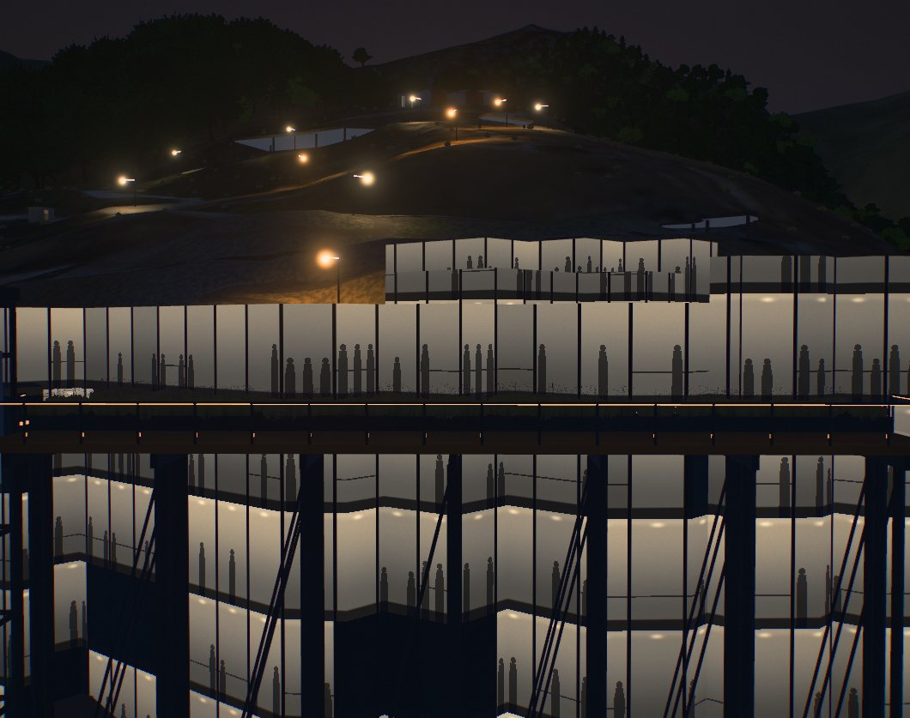
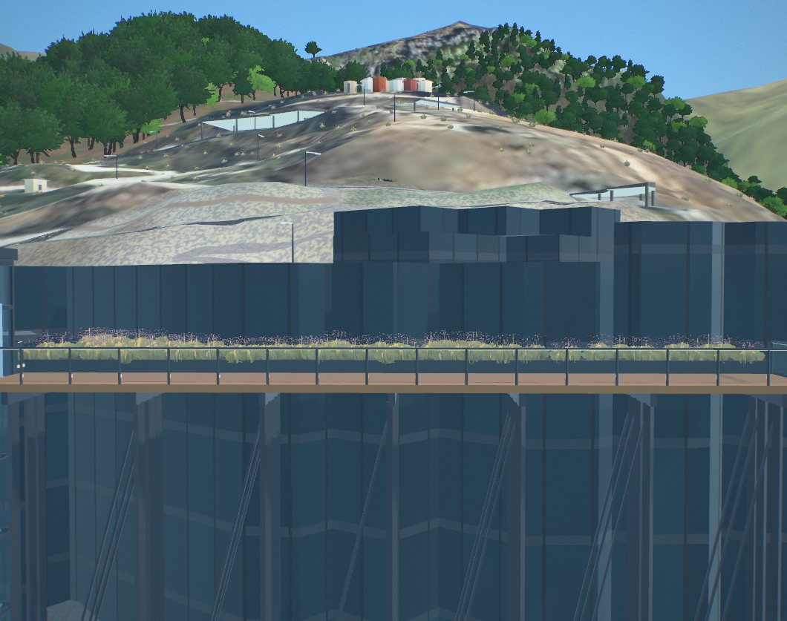

## Woods and park canopy

An aerial photograph of a wood shows the tops of its trees. Draped on the terrain
and seen from the ground, that canopy turned into a lumpy teal surface (graded,
and in a wall's shade a deep blue band), and only the trees OpenStreetMap maps one
by one stood on it: in the Kyoto Gyoen a few dozen where the photo shows
thousands (issue #54). `pipeline/woods.py` fixes this for every city:

- **Where:** Overture's land (`forest`, `wood`, `scrub`, `shrubbery`) and land use
  (`park`, `garden`, `cemetery`, `grave_yard`, `religious`, `recreation_ground`,
  `village_green`, `nature_reserve`, `grass`, ...), minus buildings, water and
  roads.
- **The canopy:** Meta and the World Resources Institute's [High Resolution
  Canopy Height Maps](https://sustainability.atmeta.com/blog/2024/04/22/using-artificial-intelligence-to-map-the-earths-forests/)
  (Tolan et al. 2024, *Remote Sensing of Environment* 300; about 1 m, global,
  from Maxar imagery of 2009-2020; CC BY 4.0), read straight from its public
  bucket (`s3://dataforgood-fb-data/forests/v1/alsgedi_global_v6_float/chm/`,
  one cloud-optimised GeoTIFF per zoom-9 quadkey) and cached in
  `data/raw/<id>/chm.npz`. Where the city has an aerial photo, a pale grey patch
  wider than about 7 m (gravel, paving, a roof) is not taken as canopy, whatever
  the model says. The model underestimates the tallest trees (its paper reports
  a mean absolute error of about 2.8 m against airborne lidar), so heights run
  a little low.
- **The trees:** the canopy's local maxima, tallest first (the usual
  individual-tree detection from a canopy height model), then the rest of the
  canopy filled at random (a Poisson-disc fill), each tree kept 3.6-6.5 m from
  the others by its height, off the footways, and 3.5 m clear of the mapped
  trees. A tree in the fill is as tall as the canopy top around it.
- **The floor:** the canopy's footprint, its small gaps closed and specks
  dropped, is `woods.png`. The ground shader (`world.js` `woodsFloor`, in the
  viewer and the game) draws it as the floor the city's park trees stand on,
  in patches at the albedos they have: bare earth, leaf litter and moss (Japan,
  Hong Kong), lawn in shade worn to earth (Australia, the Netherlands), or a
  Paris garden's stabilised sand and gravel (`FLOOR` in `woods.py`, or
  `trees.floor` in `city.json`), darker under a tall canopy, with a compacted gravel and
  earth path where a mapped footway runs under the trees. Within the distance
  the trees are drawn to, and only with the camera among the trees (below
  about 60 m above the floor); from further or higher, the photo's canopy,
  turned green, which shows the undergrowth between the crowns.
- **Shadows in a park:** the photos' shadows on a park's gravel are skylight
  blue, the same teal; inside a wood or park (`woods.png`'s alpha) the shader
  takes their colour out near the camera, where the scene casts its own.

Considered and not adopted: drawing the canopy from the photo alone (its
greenness picks up lawns and misses trees in shade), and the 10 m global canopy
height of Lang et al. 2023 (ETH, CC BY 4.0), too coarse for single trees.

### Local species (issue #69)

The woods were drawn from six street trees, so the Kyoto Gyoen, Meiji Jingu and
the palace gardens were elms and planes, and the pale plane trunks read as
grey-green columns in a wood's blue shade. The shared set now has the trees those
places are known for, grown by the same code from new crown shapes (a cone with
its trunk carried through as a leader; flat pads in tiers) and leaf cells drawn
for them (paired needles in tufts, a cedar's awls, the ginkgo's fan, a she-oak's
jointed threads):

| Species | Where | Autumn |
| --- | --- | --- |
| Japanese black pine (kuromatsu) | the Gyoen's and Kokyo Gaien's lawns, Hama-rikyu, castle and temple gardens | |
| Japanese cedar (sugi; stands for hinoki) | shrine woods | |
| Camphor (kusunoki) | shrine trees, Meiji Jingu, Osaka | |
| Zelkova (keyaki) | avenues and precincts | rust, from mid November |
| Ginkgo (icho) | street rows (Midosuji, Jingu Gaien), temple precincts | gold, late November |
| Evergreen broadleaf (Schima, Machilus; shii and kashi) | Hong Kong's hills, the laurel forest of the shrine groves | |
| Pisonia, coastal she-oak (casuarina) | the coral cays (below) | |

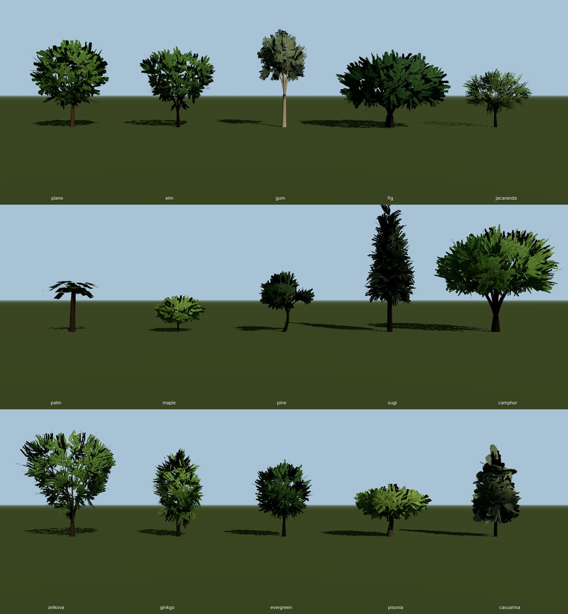
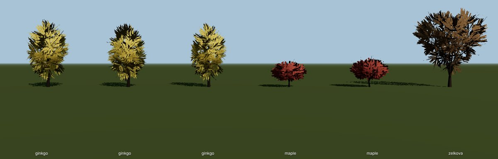

- **Mixes:** a city's `trees.mix` is its streets', `trees.woods` the mix of the
  trees planted from a wood's canopy (the street mix without its palms if it has
  none), and `trees.areas` the places with a mix of their own. An area names its
  place in OpenStreetMap (`find`, or `osm`); `pipeline/tree_areas.py` looks up
  its outline through Nominatim (ODbL), simplifies it to about 4 m into
  `cities/<id>/tree_areas.json`, and `scene.json` carries it (`cityctx.trees_cfg`).
  `web/trees.js` tests each tree against the outlines (a bounding box first). The
  Japanese maps have the Gyoen, Nijo-jo, the Honganji, Kokyo Gaien (about 2,000
  black pines), the East Gardens and the palace woods, Hibiya, Shiba Park,
  Hama-rikyu, Shinjuku Gyoen, Jingu Gaien's ginkgo avenue, Meiji Jingu, Yoyogi
  Park, Senso-ji, Kanda Myojin and Osaka Castle Park. Hong Kong's hills are
  evergreen broadleaf, its streets banyans (the fig stands in), camphors and palms.
  Species are still not mapped tree by tree: every mix is a guess from the
  cities' street-tree surveys and the parks' own guides.
- **Autumn and winter:** web/trees.js finds a leaf card's atlas cell from its uv;
  from mid November (late April in the south) the maples keep their range of
  reds, the ginkgos go gold, the zelkovas rust and the planes and elms a dull
  yellow (`FALL`), each tree a little ahead of or behind the others, and the far
  crown hulls follow `autumn_colour`. The deciduous species (`deciduous` in
  trees.json: plane, elm, maple, zelkova, ginkgo, cherry) then drop their cards one by
  one from 24 November to 14 December, in the shadow pass too, their far hulls go
  when half the leaves have, and they leaf out green from 21 March to 14 April
  (six months on in the south). Osaka's Midosuji (issue #62) is a `trees.areas`
  avenue: `tree_areas.py` widens the mapped street 22 m either side (`buffer`),
  and nine in ten of its trees are ginkgos, gold in late November and bare on
  the tour's 21 December.
- **Thin leaves at a distance:** a card's alpha averaged down the mip chain fell
  under the cut-out and the she-oak's threads, the palm's leaflets and the
  jacaranda's vanished past a few tens of metres; the leaf shader scales alpha up
  with the mip level (Ben Golus, *Anti-aliased Alpha Test*, 2017), in the city
  and on the reef.
- **Plane bark** is warmer (`#a08f78`), so a plane wood's trunks stay bark in the
  blue shade.

### The cherry (issue #147)

The Somei-yoshino (*Cerasus × yedoensis*) is Japan's cherry: most of the trees on
the moats, rivers and park walks the cities are known for in spring. The shared
set grows one like the others (`blender/build_trees.py` `cherry`): a short dark
trunk (2.3 m) forking into six limbs that spread a crown 12 m wide on a tree
under 9 m, wider than it is tall, as the photographs of Chidorigafuchi and the
Meguro River show. The atlas has a fifth row for it: its leaves (elliptic,
toothed) and its bloom, umbels of four to six five-petalled flowers on short
stalks along a bare twig, white with a blush of warm pink and a darker eye, and a
few deeper-pink buds. Every one of the cherry's cards is a bloom card
(`sakura`); `web/trees.js` shows the leaf cell beside it out of flower.

- **When:** the first flowers (kaika) come on the city's average day: Tokyo's is
  24 March, the Japan Meteorological Agency's 1991-2020 normal, and the day comes
  about four days later for each degree further from the equator
  (`SAKURA_PER_DEG`; Kagoshima 26 March, Sendai 8 April, Sapporo 1 May). A city
  whose own normal differs from its latitude's sets `trees.cherry_open`: Kyoto
  26 March, Osaka 27 March. The flowers open over a week on bare branches, every
  card at its own time in the order the leaves fall in autumn (`uSakura`); full
  bloom (mankai) holds five days, then the petals go over five more as the leaves
  come out (hazakura), and from mid April the tree is green. Its leaves turn an
  orange-red with the others in November and fall with them; in winter and until
  it flowers it shows no leaf at all. The far crown hull is the blossom's pink in
  flower. Six months on in the south.
- **Where:** a share of every Japanese city's street mix (0.05-0.08; the cherry
  is among Tokyo's three commonest street trees with the ginkgo and the zelkova)
  and its woods, and `trees.areas` for the places known for it, their outlines
  from OpenStreetMap: Chidorigafuchi Park and the 700 m moat walk (some 260
  trees, Chiyoda City), Kitanomaru Park, the Meguro River's banks (about 800,
  Meguro City; the river widened 14 m either side), Hachiko Square's two round
  planters, Ueno Park and its Sakura-dori (outline drawn along the walk from the
  Saigo statue to the fountain; about 800 trees), Sumida Park (about 600),
  Roppongi's Sakura-zaka, Aoyama Cemetery's avenue and Tokyo Midtown's garden,
  Ishikawajima Park on Tsukudajima, Shinjuku Gyoen, Kyoto's Takase canal by
  Kiyamachi and Gion Shirakawa (with elms standing in for the willows), the Kyoto
  Gyoen and Nijo-jo, the Osaka Mint's passage, the Okawa's east bank
  (Kema Sakuranomiya Park, about 4,800), Osaka Castle Park and Utsubo Park.
  Kyoto's Philosopher's Path and Maruyama Park are east of the Kyoto map.
- **Not yet:** the petals do not drift down. (The other kinds and the bark's
  bands came with issue #163, below.)
- **Sources:** JMA's sakura phenology normals (public data); the parks' and wards'
  own guides for the tree counts; OpenStreetMap (ODbL) for the outlines. No code
  or art was taken from elsewhere.

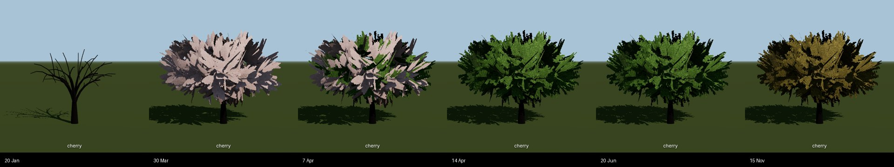
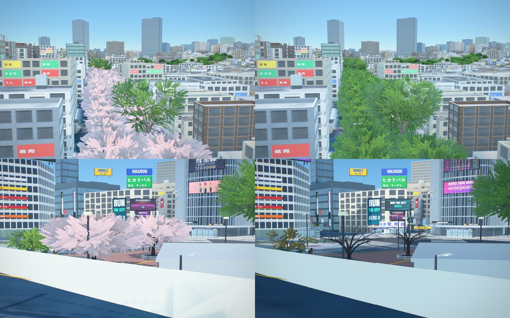

### The other cherries and the bark (issue #163)

Three more cherries join the Somei-yoshino in `blender/build_trees.py`, each with
its own bloom cell in the atlas (a sixth row: `sakura`, `shidare`, `kawazu`,
`yae`, listed in `trees.json` `atlas.sakura_cells`) and its own bloom date, an
offset in days from the Somei-yoshino's opening (`bloom_offset_d`) over a bloom
`bloom_len` times as long. `web/trees.js` keeps one bloom value per variety
(`uSakuraV`, and its leaves' `uCherryBareV`); out of flower every cherry's card
shows the cherry's leaf cell.

| Species | Form | Flower | Offset, length |
|---|---|---|---|
| `cherry` (Somei-yoshino) | low fork, crown wider than tall | white blushed pink | 0, 1 |
| `shidarezakura` (Edohigan 'Pendula') | scaffold limbs arching into a dome, curtains of thin branches to 1-3 m off the ground | smaller, a clearer pink | -4 d, 1 |
| `kawazu` (Kawazu-zakura) | small, upright | big, deep vivid pink | -37 d (mid February in Tokyo), 1.7 (a month) |
| `yaezakura` (Kanzan) | upswept vase | heavy double pompoms, deep pink, with bronze new leaves | +16 d (mid April), 1.15 |

- **The weeping crown** (`grow_weeping`): the trunk forks at 3 m into eight
  limbs that arch up to 9-10 m; from the outer half of each, eleven branches rise
  a little, turn over and hang (a cubic curve whose end tangent points down, as
  Weber and Penn's *curvature* and *down angle* parameters make a weeping
  tree, the model Blender's Sapling add-on implements). Cards hang along each
  branch from where it turns over, each growing down it and turned its own way
  round it, so the crown reads as a curtain rather than strips. 3,482 / 544 / 367
  triangles at the three distances: the most of any species, and planted only
  where a place is known for it.
- **The bark:** every cherry's bark carries `bark_bands`; `web/trees.js` draws the
  horizontal lenticels in the bark shader, in the tree's own frame: broken rows of
  short pale dashes about 14 cm apart, each row its own height, width and dash
  length, faded out where a row would be finer than a pixel, and the bark a little
  glossier (roughness 0.7) than other species'.
- **Where (`trees.areas`):** a city picks a variety per area by naming it in the
  area's `mix`, as any species. Maruyama Park: weeping cherries among the
  Somei-yoshino, and a circle on the Gion weeping cherry's spot that turns the
  park's nearest mapped trees (OSM maps none on it) into one; Kodai-ji's weeping
  cherry; Gion Shirakawa's; the Kyoto Gyoen's (the Konoe-tei's itozakura) and
  Nijo-jo's weeping and double cherries; Shinjuku Gyoen's double cherries,
  weeping cherries and a few kawazu-zakura; the Kokyo East Gardens' grove.
  Shibuya's Meguro River stays Somei-yoshino (on hold for the opening film).

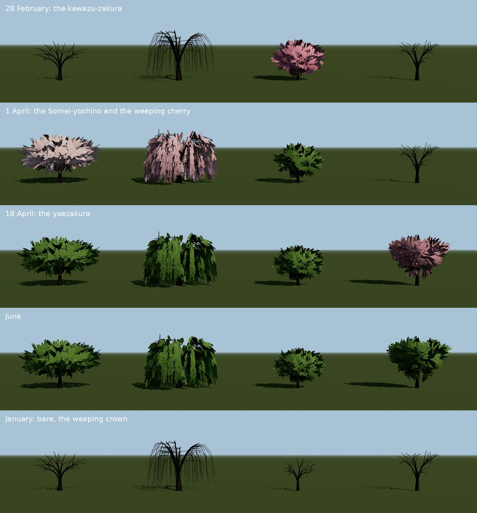

### Yozakura: the cherries lit after dark (issue #162)

In the bloom the famous spots light their cherries after dark: uplights at the foot
of each tree, and bonbori, paper lanterns on posts, along the walks. An area in
`trees.areas` with `"yozakura": true` does the same (`web/trees.js`): its cherries,
of any variety, are lit from sunset (world.js's `uNight`) while any of them is in
flower (from the first flowers to the petals' fall, the light-ups' season).

- **The uplight** is a term in the trees' own shader, no light source: each lit
  tree (a per-instance flag) adds its albedo times a warm white to its emission,
  most on the undersides of the crown and the lower boughs and falling off up the
  tree (about a third left at 9 m), as a photograph of an uplit cherry shows it:
  the blossom glowing pink against a dark sky, the tops going into the dark. It
  costs a few instructions on the trees already drawn, on every tier.
- **A pool of light** round each lit tree's foot (a soft additive disc on the
  ground, the crown's width) and round each lantern.
- **The bonbori** stand every 7 m along the footways mapped through the area
  (night.json's), on alternate sides 1.5 m off the centre line, or beside every
  other lit tree where none is mapped: a dark post, a washi shade lit warm from
  inside and a halo. On the light tier every 14 m, at most 240, and no halos.
- **The chochin** (#241): an area with `"lanterns": "chochin"` hangs paper lanterns
  on a rope along its edge instead of standing bonbori: `lantern_inset` metres inside
  its outline (for a river buffered from its line, the railings) every
  `lantern_spacing` metres (twice that on the light tier, at most 400; 1,600 on the
  others), only where a lit cherry stands within 16 m, at its foot's height. Each is
  a pink washi lantern between black lacquered rims on a cord from the rope, which
  sags between each two, with a halo and a small pool of light after dark. The
  Meguro River's festival lanterns are pink, hung along both railings.
- **The chochin's season** (#277, decided): the Nakameguro lanterns are the cherry
  blossom festival's, put up before the trees open and taken down after the petals
  fall, so they follow the festival's window, not the light-up: they hang from
  `lantern_window` [from, to] days round the city's opening day (`trees.cherry_open`,
  else `sakuraOpen` for its latitude), a week before to a fortnight after by default
  (about 18 March to 8 April in Tokyo), by day as well as at night, and are lit after
  dark. The uplights and bonbori still follow the cherries' own bloom. Their own group
  (`chochin`) carries the window (`trees.yozakura().chochinOut`).
- **Where:** Chidorigafuchi and its Ryokudo (Tokyo; the Chiyoda Sakura
  Festival's light-up), Maruyama Park and the Gion weeping cherry (Higashiyama), the
  Meguro River (Shibuya, with chochin). Ueno's Sakura-dori and Osaka's Mint are
  parked.

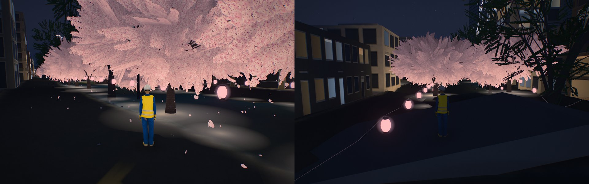
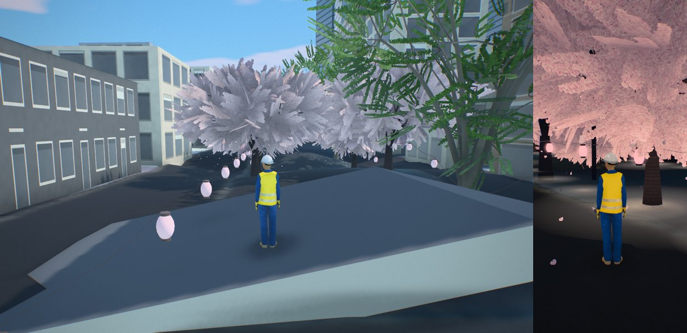

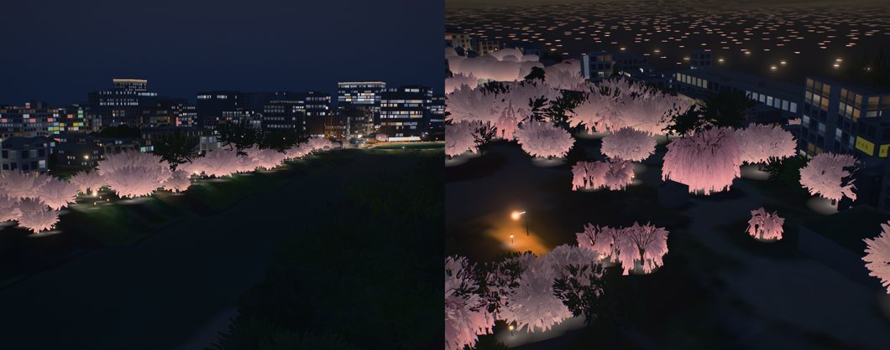
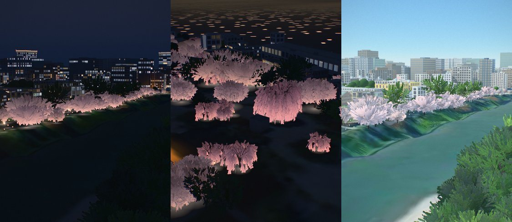

### A floor per area (issue #165)

The ground drawn under the woods' and parks' canopy near the camera (`woods.png`,
world.js `woodsFloor`) was one kind per city (`trees.floor`). An area in
`trees.areas` may now set its own `floor` (`earth`, `lawn` or `gravel`): world.js
draws the areas' outlines into a map over the woods' box when the city loads and
the floor shader reads it, the first area listed winning where they overlap. On a
gravel area the photo's gravel also loses what is left of the sky's blue in it, in
sun and in shade and at any distance, and its sunlit expanse is kept off white: the
Kyoto Gyoen's gravel read slightly blue. Set: the Kyoto Gyoen (gravel), the Kokyo
Gaien and Shinjuku Gyoen (lawn), Meiji Jingu (leaf litter, `earth`). Yoyogi's lawn
waits for Shibuya's opening film.

### Canopy outside the parks, measured heights, the Gion cherry (issue #223)

- **Canopy outside the mapped parks.** `woods.py` planted only inside mapped woods,
  parks and religious land, so the trees of a campus, of a shrine's or temple's
  grounds that OSM maps only as halls, and of the streets were missing wherever OSM
  maps no tree. Outside the mapped woods it now plants where ESA WorldCover 2021's
  tree class (10 m, CC BY 4.0, the tiles `far_land.py` reads, cached in
  `data/raw/<id>/worldcover.npz`, with one cell's slack) agrees with the canopy model:
  in the grounds (Overture land use `school`, `university`, `college`,
  `kindergarten`, `hospital`, and 45 m round every building Overture classes
  `shrine`, `temple`, `church` and the like, `fetch_overture.py --only religious`)
  with their floor and the Poisson fill, as in a park; along the streets and in
  gardens the canopy's own peaks only (crowns at least 3 m across), off the
  carriageways and footways, without a floor (the ground there is paving). Overture's
  places were tried for the shrines and temples and have too few in Japan (21 in
  Higashiyama); Overpass is not reachable from the build machines.
  The fill adds 1-4 % to each city's trees: Kyoto 17,294 to 18,266, Higashiyama
  31,371 to 31,788, Fushimi 31,183 to 31,786, Tokyo 20,921 to 21,045, Shinjuku
  32,725 to 34,002, Sydney 14,148 to 14,939, Queenstown 152,727 to 154,959. They
  are wood trees in `places.json` `woods`, so the tiers thin and step them down as
  the woods' (`keep`, `WOOD_M`), and the cost per tier moves by the same 1-4 %. The
  canopy model itself has little canopy outside the woods in these cities (in
  Kyoto 77 ha of canopy over 4 m in 1,500 ha, 68 ha of it in the woods), so the fill
  is modest. Where WorldCover calls a narrow street row built-up (its 10 m cells see
  the road and the roofs round it), the canopy is trusted too within 12 m of a
  road's centre line where the aerial photograph is greener than red or blue by
  0.015 (the open-ground test's threshold), a sunlit crown (#241, `STREET_ROW_M`,
  `GREEN_EXG`): 2.2 ha of street rows in Kyoto (196 street trees to 253), 1.4 ha in
  Sydney, 0.7 in Shibuya and Tetsugaku, 0.1-0.5 elsewhere. The rest of Kyoto's 16 ha
  of canopy without WorldCover's agreement is not along a road (gardens, banks).

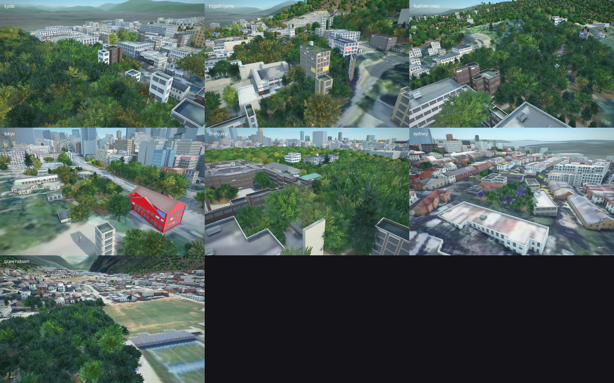

- **Measured street-tree heights.** OSM rarely gives a tree's height, so
  `build_scene.py` drew the mapped trees between 7 and 14 m.
  `pipeline/plateau_veg.py` (run by `game_data.py` after the kerbside tidy) reads
  PLATEAU 2025's CityGML vegetation (`udx/veg/`, MLIT, CC BY 4.0;
  `plateau.veg` in `city.json`): each `veg:SolitaryVegetationObject`'s `veg:height`,
  the crown top above the root ball, at its modelled crown's foot. PLATEAU surveys
  trees one by one only in its LOD3 road pilot areas: 216 tall trees in five 1 km
  meshes of the Tokyo map (Chiyoda, Chuo, Minato), 65 in one mesh of Kyoto's, none
  in Shinjuku's. Their heights are much lower than the guess (Tokyo median 5.4 m,
  90th percentile 8.1 m; Kyoto 4.7 m and 7.0 m). A mapped tree within 3 m of a
  surveyed one takes its height (15 in Tokyo, 12 in Kyoto); the other street trees
  (within 9 m of a road) take a height drawn from the survey's quantiles, the same
  for the same spot; trees in parks and precincts keep theirs. A map with no survey
  borrows a neighbour's (`plateau.veg_from`: Shinjuku Tokyo's, Higashiyama and
  Fushimi Kyoto's). The canopy height model was tried as the measure and sees almost
  none of them: none of Tokyo's 216, half of Kyoto's with a correlation of 0.4.
  **Sydney (issue #300):** the City of Sydney's tree inventory, "Trees"
  (services1.arcgis.com/cNVyNtjGVZybOQWZ, layer `Trees/FeatureServer/0`), lists each
  street and park tree in the council's area with its species, height, canopy spread,
  age and trunk diameter. Its Data.NSW mirror says "licence not specified", but the
  publisher's own record (ArcGIS item 15c4713a688a48fcb604fc343118af05, owner
  `cityofsydneyspatial`, updated 2026-11-06) gives CC BY 4.0 with the credit "City of
  Sydney"; it was read anonymously on 2026-11-07 (11,786 trees in the bbox, 10,731 in
  the frame). `trees.survey` in `city.json` names it, and `plateau_veg.py` then: gives
  each mapped tree within 3 m of a surveyed one its measured height (1,383 of OSM's
  6,026); plants, with its height, each surveyed tree no mapped tree stands within 4 m
  of (`"add": true`: 8,906, since OSM maps about a fifth of the council's trees; moved
  out of the carriageways by `kerbside.py`, 89 left out), and drops the 638 canopy
  trees `woods.py` had put within 3 m of one; and draws the other street trees (The
  Rocks, Barangaroo, the north shore, outside the council's area) from the inventory's
  heights (median 10 m, 90th percentile 20 m). The old guesses had a correlation of
  0.02 with the measured heights. The inventory's species shares by genus (brush box,
  water gum, paperbarks and eucalypts 31%, plane trees 25%, deciduous broadleaves 21%,
  evergreen broadleaves 11%, figs 5%, jacarandas 3%, palms 3%; its park trees: evergreen
  broadleaves 27%, gums 22%, palms 20%, figs 12%) are the measured `trees.mix`, but
  with them the game's check finds two cars holding each other in a CBD junction and a
  bus edging into a lamp post (the trunks' sizes change with the species, and the
  traffic's timing with them), so the guessed mix stays until that traffic hold is fixed
  (follow-up issue). NSW Spatial Services' lidar is not used: its
  files are in a requester-pays bucket. The canopy height models were measured
  against the inventory (`tools/chm_check.py`, 3,000 trees, the highest canopy within
  2.5 m of the trunk): Meta and WRI's v1 (2024) sees 45% of the trees, correlation
  0.20, median error 8 m; their CHMv2 (2026, `s3://dataforgood-fb-data/forests/v2/`,
  AWS Registry `dataforgood-fb-forestsv2`, CC BY 4.0, read anonymously) sees 59%,
  correlation 0.30, median error 6 m. Neither reads a street tree well enough to stand
  for one. ETH's global canopy height (Lang et al., 10 m) is coarser still and was not
  tried for single trees.
  **Queenstown:** no tree survey, but LINZ's 2021 LiDAR is open (`nz-elevation`, CC BY
  4.0, anonymous): with `trees.lidar`, each of the 102 mapped trees takes the highest
  return of the 1 m DSM within 2 m of it over the 1 m DEM there, where that lies between
  3 and 40 m (97 of them; median 12.3 m, 90th percentile 26.2 m, the Gardens' conifers).
- **The Gion weeping cherry on its own spot.** Maruyama Park's Gion shidarezakura
  stood on the park's nearest mapped trees, about 17 m off. Higashiyama's
  `landmark_meshes` now plants it as a landmark tree (`landmarks.json` `trees`,
  `city.py` `gion_cherry`) at 35.00388 N, 135.78090 E, 12 m tall: the lone round
  crown in the gravel plaza north-west of the Hyotan pond in the city's aerial
  photograph. Its two nearest mapped trees, 6 m west in the open plaza, are taken off,
  and the `trees.areas` circle that makes it a weeping cherry is 3 m across.

### Falling petals (issue #223)

While a cherry variety flowers its petals drift down round the nearest cherries: a
few in full bloom, most as the bloom goes over (hanafubuki, the last five days of
the fortnight), none out of flower (`petalFall` in `web/trees.js`, from the same
dates as the bloom).

- **How engines do it cheaply.** A falling leaf or petal is the textbook particle,
  and the browser engines offer two ways: a CPU or GPU-state particle system
  (a three.js falling-leaves demo on freefrontend.com moves each instance's matrix on the CPU every frame; Babylon.js's
  `GPUParticleSystem` (WebGL2 transform feedback) and the FBO particle systems for React Three Fiber keep the state
  in a texture and step it on the GPU), or *stateless* particles, whose position, drift
  and spin at any moment are a pure function of time and each instance's seed, worked out
  in the vertex shader and recycled with `mod`/`fract` over a lifetime (the approach of
  Godot's shared "wind driven falling particles" and "falling leaf" shaders). The
  stateless way needs no per-frame CPU work, no extra render target and no WebGL2
  feature, so it costs the same on three.js r128 and r186 and on a phone. Adopted:
  stateless; no code was copied (the technique only).
- **What it does.** One `Mesh` of an `InstancedBufferGeometry`: a card 10 cm long
  (a real petal is 1.5 cm, lost beyond a few metres), its obovate outline and notch
  cut in the fragment shader, white blushed pink at its base, lit by the scene as a
  `MeshStandardMaterial`. Each card falls for one turn of 6-10 s from a point in one
  of the 12 nearest shedding crowns (chosen afresh each turn, nearer crowns more often,
  and kept or skipped by that crown's shedding rate), at the speed that brings it to
  the ground 1.5 s before its turn ends, tumbling about its own axis, swaying, and
  carried 1-1.6 m/s down the breeze and spread across it; then it lies flat for the
  rest of its turn and fades. The crowns (their foot, crown radius and height from the
  tree's height) are gathered when the trees are sorted, after the camera has moved
  12 m, within 90 m.
- **Cost.** 3,000 cards (900 on the light tier), 2 triangles each: 6,000
  triangles in one draw call, no shadow pass; nothing is drawn out of flower or with
  no shedding cherry within 90 m. `trees.petals()` reports the cards and crowns for
  the tools.
- **After dark** a petal from a lit tree (`yozakura`) catches its uplights while it
  is within a few metres of the crown.

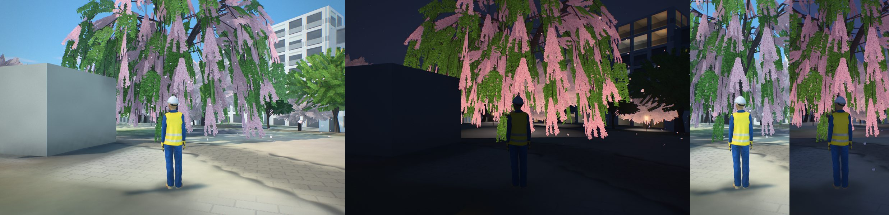

### The cays' scrub and the clumped Pisonia (issue #165)

The coral cays' beach scrub was drawn as blobs near the camera. Two shared shrubs
join the set: Scaevola (beach cabbage, `scaevola`: a mound 1-3 m high and wider than
tall of thick yellow-green spoon-shaped leaves crowded at the twigs' ends, on five
soft stems) and the octopus bush (`argusia`, *Heliotropium arboreum*: crooked
spreading stems under a rounded crown of silvery felted leaves, 3.5 m high and 5 m
across), with their own atlas cells. `web/reef/life/flora.js` draws the sites'
`scaevola` and `beach-scrub` with the first and `octopus-bush` with the second, as it
draws Pisonia and she-oaks. Pisonia grows as a clump of three trunks from one foot
(`stems`), as it does on Heron, where fallen stems re-root.

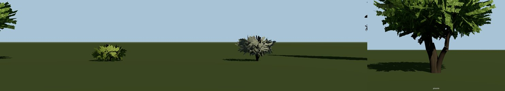

**What we looked at for the night.** Real-time engines light a festival's many
small lamps without a light per lamp: emissive meshes with a halo card or bloom
for the lamps themselves, and baked or analytic light for what they light (three.js
has no clustered lighting on WebGL; its WebGPU renderer does). Night photographs of
Chidorigafuchi, Maruyama and the Meguro River show the blossom lit pink-white from
below against a deep blue sky, the trunks and the lowest boughs brightest, and the
lanterns as warm points. **Adopted:** the analytic per-tree uplight in the shader,
emissive lanterns with a point-sprite halo and additive ground pools (our own code).

**What we looked at.** How browser engines and open-source projects draw trees:
three.js's `InstancedMesh` foliage with alpha-tested leaf cards (what the shared
trees already do); [ez-tree](https://github.com/dgreenheck/ez-tree) (MIT; a
recursive three.js branch generator with a gravity-like force that bends branches
down, CC0 bark textures from ambientCG); Blender's Sapling Tree Gen (GPL; Weber
and Penn's parametric model, with a weeping shape and per-level curvature and
down angle); Weber and Penn, *Creation and Rendering of Realistic Trees*
(SIGGRAPH 1995); SpeedTree's card-and-hull LOD scheme (proprietary, the industry
reference for the LOD steps). **Adopted:** the idea of a branch that curves down
from its turn-over point (Weber and Penn; no code from Sapling or ez-tree), drawn
with our existing card-and-hull pipeline; the bark's bands are our own shader.
**Sources:** cultivar habits and bloom times from the Japan Meteorological
Agency's normals and the parks' guides (Shinjuku Gyoen, Maruyama Park, Kawazu
town); no art was taken from elsewhere.

### The coral cays

Heron and Lady Elliot's pisonia and she-oaks and Green Island's vine forest were
the reef renderer's spheres on cylinders (`web/reef/life/geo.js`). Within 160 m of
the camera they are now the shared trees (`web/reef/life/flora.js` `SHARED`,
`geo.sharedTree`, `mats.cards`): the full tree within 55 m, the sparse one beyond;
the far rings keep the reef's own crowns and spindles. The site's leaf albedo
tints the atlas (over the species' own colour). The life module waits for them
while it loads, so they do not pop in. On Heron Island the trees drawn from the
beach are 1.08 M triangles (1.09 M before), from 30 m up 0.46 M (0.47 M); on Lady
Elliot 0.74 M (0.92 M).

### What the trees cost

`tools/woods_probe.js` counts the tree triangles drawn on foot where the woods are
thickest, and the share of them drawn again into the sun's shadow map. The far
crown hulls (200-900 m) no longer cast shadows: they stood mostly outside the
shadow map and were drawn into it for nothing. Twigs are three-sided tubes and
limbs six (a fifth fewer triangles in every full tree). Under llvmpipe, at the
desktop (high and medium draw the same trees) and low tiers:

| Where (tier) | Before: drawn / into the shadow map | After: drawn / into the shadow map | Both passes |
| --- | --- | --- | --- |
| Kyoto Gyoen 357,2590 (desktop) | 1.59 / 1.59 M | 1.66 / 1.00 M | -16% |
| Kyoto Gyoen 100,1880 (desktop) | 1.96 / 1.96 M | 2.12 / 1.36 M | -11% |
| Kyoto Gyoen 202,2002 (desktop) | 2.19 / 2.19 M | 2.36 / 1.56 M | -11% |
| Kyoto Gyoen 100,1880 (low) | 0.90 / 0.90 M | 0.96 / 0.50 M | -19% |
| Hong Kong's wooded hill (desktop) | 3.44 / 3.44 M | 3.61 / 2.06 M | -18% |
| Hong Kong's wooded hill (low) | 1.06 / 1.06 M | 1.12 / 0.74 M | -12% |
| Meiji Jingu 300,700, Shibuya (desktop) | 1.59 / 1.59 M | 1.79 / 1.16 M | -7% |
| Meiji Jingu 300,700, Shibuya (low) | 0.63 / 0.63 M | 0.71 / 0.46 M | -7% |

The camera pass draws 4-13% more (the local species are fuller trees than the elms
and planes they replace); the shadow pass a third less.

Not measured: a real GPU, a phone, WebGPU, Safari or iOS. The frame times
llvmpipe gives (seconds) say nothing about a device.

## Bridges over the water

Issue 122: the Tokyo maps built before Tsukishima and Odaiba routed their roads over the Sumida and
the moats on nothing. Now `pipeline/bridges.py` finds every bridge that Overture's infrastructure layer
(OpenStreetMap, ODbL) maps over the water: an outline, or the centre lines of its carriageways joined by
name. Where an outline and a line overlap, there is one deck, and an unnamed outline takes its line's
name. It leaves out three kinds: a bridge the city's own builder draws, an expressway's viaduct
(OpenStreetMap's layer is an order, not a height), and the names in `skip`. A deck stands at the banks'
height, at least `deck_min_m` (3.5 m, a Tokyo embankment), and is crowned 2% of its length. Over water
the model draws as ground (a palace moat whose survey stands higher than its banks, Kyoto's riverbed), it
clears that ground and ramps down to the banks. Over a ferry's course (game.json `ferries`) the middle of the span rises
until the city's boats pass under its soffit with someone standing on the upper deck, level across the
middle, as `web/game/decks.js` lifts the decks it draws; a deck the boats pass under is not a bank to
them. A deck whose road the data carries up above a bank (Kings Way over the Crown promenade) takes
`deck_z`.

Each bridge takes its form and paint by name from city.json `bridges.forms`:

| Form | Structure | Examples |
|---|---|---|
| `girder` | girder deck on piers | Kototoi-bashi, Sanjo Ohashi (timber rail and giboshi), Wadakura-bashi |
| `deck_arch` | arches under the deck, spandrel posts | Azuma-bashi, Hijiri-bashi, Princes Bridge |
| `half_through` | the middle arch rises through the deck, deck arches either side | Komagata-bashi, Tsukiji Ohashi |
| `through_arch` | tied arches over each span, hangers | Umaya-bashi |
| `truss` | through Warren truss | the Tobu line's Sumida bridge |
| `stone_arch` | masonry arches, spandrel walls, stone parapet | Nihonbashi, the Seimon Ishibashi, Mansei-bashi, Shichijo Ohashi |
| `kachidoki` | Kachidoki Bridge's bascule between two tied arches | |
| `x` | an X in plan, two decks crossing | Sakura-bashi |

The paint after dark is floodlit in its own colour, as Tokyo lights the Sumida's bridges. The Sumida's
colours are the Tokyo Metropolitan Government's (隅田川中流部著名橋色彩基本方針, set in 1984 and confirmed in
2014–15: Azuma-bashi red, Komagata-bashi blue, Umaya-bashi green, no two neighbours alike). The spans
come from the Tokyo Road Maintenance Corporation (ブリッジサポーター通信 No.11) and each bridge's record. The
other cities' bridges come from their own records (Kyoto City's 京の橋しるべ, Heritage Victoria). A
colour that no record gives is read from photographs and is approximate. These are facts and
measurements, so no licence is needed. No third-party model or texture is used.

## Download size

Issue 148: what a city costs to download before it can be played. `tools/load_size.js <city>
[play|model] [mbps] --files` opens the page with the network held to a speed, counts every file
once, raw and as GitHub Pages sends it (gzip for text types; images, models and `.bin` as they
are), and says when the data was in and when the loading screen started to fade.

### Buildings: `buildings.bin`

`pipeline/pack.py` packs `buildings.json` into `buildings.bin`, a lossless columnar encoding of the
same JSON tree, gzip-wrapped: integers as typed columns of the narrowest width, delta-coded by the
stride that compresses best (2 for the rings' x, y pairs, 3 for the roofs' x, y, z) and split into
byte planes; decimals as scaled integers; strings through a table; the roof meshes' base64 as their
int16 and index bytes. `web/pack.js` inflates it with the browser's own `DecompressionStream` and
rebuilds the object `JSON.parse` would have given, so nothing that reads it changed, except that
the roof columns arrive as `Uint8Array` (`sun.js` `unpackRoof` takes either). `world.js` falls back
to `buildings.json` for a city whose pack is missing or stale (`cities.json` `packed`) or a
browser without `DecompressionStream`. `buildings.json` stays the pipeline's source: after a step
that writes it, `python pipeline/pack.py` repacks what is stale, and `tools/check.sh` fails on a
stale pack and decodes every pack against its JSON (`tools/pack_check.js`).

| City | buildings.json | gzipped | buildings.bin | decode (Node, desktop) | JSON.parse |
|---|---|---|---|---|---|
| Shibuya | 17.76 MB | 6.44 MB | 3.76 MB | 172 ms | 82 ms |
| Kyoto | 25.71 MB | 8.90 MB | 5.29 MB | 375 ms | 272 ms |
| Osaka | 24.61 MB | 8.62 MB | 5.09 MB | 373 ms | 160 ms |
| Paris | 21.41 MB | 8.71 MB | 5.61 MB | 294 ms | 99 ms |
| Amsterdam | 14.01 MB | 4.77 MB | 2.89 MB | 243 ms | 73 ms |
| Shinjuku | 8.81 MB | 3.13 MB | 1.86 MB | 137 ms | 71 ms |
| all 20 cities | 148.4 MB | 53.3 MB | 32.4 MB | | |

The pack is 40% smaller than the gzipped JSON and a fifth of the raw. Decoding costs about 0.1–0.2 s
more than `JSON.parse` on a desktop, against 1–2 s less download at 20 Mbps for the big cities.

The live cities' `landmarks.json`, `game.json`, `terrain.json`, `places.json` and `scene.json` are
packed the same way (issues 201, 259) and decoded in a Worker (`web/pack-worker.js`), so that nothing
is parsed on the main thread at load: the landmark meshes' vertex lists arrive as typed arrays, and the
height grids (`terrain.json` and `game.json` terrain, patches and upper) and the game's water mask as
`Uint8Array`, which `world.js`, `game.js`, `hud.js` and `nav.js` read as they are (they still take base64
from the JSON, the fallback). The loader says when the files are in and the packs are unpacking, and
shows its stage under the label (`OEWorld.loadLine`).

### Shared models: meshopt

What three.js r186 can decode out of the box, surveyed for the shared models (`web/assets/vehicles`,
`trees`, `people`):

| Option | three.js r186 | Licence | For |
|---|---|---|---|
| `EXT_meshopt_compression` (meshoptimizer) | `GLTFLoader.setMeshoptDecoder`, `examples/jsm/libs/meshopt_decoder.module.js`, 29 kB of JS with its WASM inline | MIT | geometry, skins and animation; decodes at gigabytes a second, keeps every node, name and attribute |
| `KHR_draco_mesh_compression` (Draco) | `DRACOLoader`, a WASM decoder of about 300 kB fetched on first use | Apache-2.0 | static geometry; smaller than meshopt on dense meshes, but no animation, slower to decode, and it re-orders vertices |
| `KHR_texture_basisu` (KTX2, Basis Universal) | `KTX2Loader`, a WASM transcoder of about 500 kB | Apache-2.0 | textures that stay compressed in GPU memory; the transcoder outweighs what it saves on these few textures |
| `EXT_texture_webp` | built in | — | already used by the people's textures |

Adopted: meshopt, for every shared model. `pipeline/meshopt_glb.mjs` (meshoptimizer's own encoder,
1.3.0, MIT, vendored in `pipeline/vendor/meshoptimizer/`) encodes each buffer view of vertex
attributes, indices and animation in place, as the last step of `blender/build_vehicles.py`,
`build_trees.py`, `build_people.py` and `pipeline/fetch_people.py` (`pipeline/meshopt.py`). It
does not quantise to integers, re-order, merge or rename anything, so `cars.js` and `people.js`
read the same float32 arrays and nodes as before: integers and indices are lossless (a triangle's
corners may come back rotated, the same triangle wound the same way), floats go through meshopt's
exponential filter at 16 bits against each component's range (a tenth of a millimetre on a car).
Each view is decoded again and compared before the file is written. Every page makes its
`GLTFLoader` from `web/gltf.js` (the city viewer and the game through `web/index.html`'s
`THREE.GLTFLoader`, the reef's `people.js` and `life/flora.js` by importing it), which sets the
decoder and tries a failed download again twice (0.8 s, 2.4 s). Where there is no WebAssembly
(iOS Lockdown Mode, some locked-down browsers) it decodes with meshoptimizer's pure-JavaScript
reference decoder instead (1.3.0, the encoder's version, MIT, vendored in
`web/vendor/meshoptimizer/`, loaded only then): slower, but the people, trees and cars are still
the real models rather than the box-built stand-ins. `tools/check.sh` fails on a model that is
not compressed.

| Models | Before | After |
|---|---|---|
| `cars.glb` | 5.40 MB | 2.35 MB |
| `helicopter.glb` | 3.75 MB | 1.69 MB |
| `ferry.glb`, `ferry_river.glb` | 3.73 MB | 2.04 MB |
| `trees.glb` (48 species and stages), its leaf atlases WebP (`pipeline/glb_webp.py`: quality 92, the cut-out alpha exact; a fifth of the PNG) | 5.15 MB | 1.85 MB |
| the surveyors, `H_Surveyor_W.glb` + `_M` | 4.57 MB | 2.16 MB |
| the NPCs' clips, `R_clips_f.glb` + `_m` | 3.94 MB | 2.01 MB |
| all 87 shared models | 60.28 MB | 35.98 MB |

What the game downloads before Shibuya can be played (`tools/load_size.js shibuya play 40`), main before
issue 148 against the three steps (packed buildings, deferred helicopter and NPCs, meshopt):

| Shibuya `#play` | files | raw | on the wire | playable at 20 Mbps |
|---|---|---|---|---|
| before | 128 | 66.3 MB | 45.2 MB | 67.4 s |
| after | 127 | 36.6 MB | 27.7 MB | 55.3 s |

The times are on a software renderer (Mesa llvmpipe), where building the scene's shaders and
geometry, not the network, takes most of them; on a GPU the download is the larger share.

The helicopter (1.7 MB) is no longer among them: it is fetched when the player comes within 800 m of
its pad or boards it. NPCs whose characters no one within 300 m of the start wears load after the
game opens.
