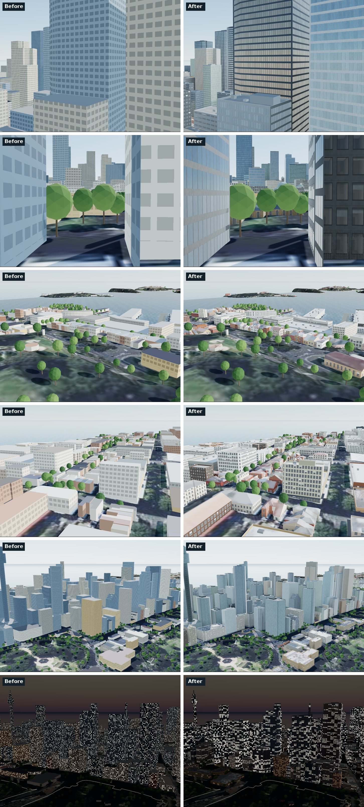
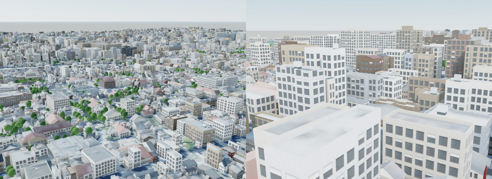

# Buildings: roofs, facades and rooftops

Footprints and heights say where a building is and how tall it is. They do not
say what it looks like. Until this change every building was a flat-topped
prism, coloured per class, with the same 3.4 × 3.6 m window grid on every wall
above 9 m. This page covers what replaced that:
- what the frontier of footprint-based 3D cities does;
- what this project took from it;
- how each part is built and checked.

| What | Where | How it is checked |
|---|---|---|
| LOD2 roofs: hipped, gabled, half-hipped, pyramidal, skillion, mansard, gambrel, barrel, dome and onion, with eaves | `pipeline/roofs.py` | Every Sydney footprint (8,441) is built and validated: area, bounds and height |
| Roof shape when none is mapped (97% of buildings) | `pipeline/typology.py` | Mapped roofs predicted by the rules alone: `cities/<id>/analysis/roof_model.json` |
| Roof shape measured from Project PLATEAU's LOD2 meshes (Kyoto: 79,889 buildings) | `pipeline/plateau_3dtiles.py` | Against the 323 roofs also mapped in OSM: flat or pitched agrees 90%, shape family 85% |
| Facade style, storeys and ground floor, shopfronts, awnings, wall and roof colours, rooftop plant | `pipeline/typology.py`, `build_scene.py` | Screenshots from street level to overview (`tools/city_shot.js`) |
| The facade drawn in the shader: windows by floor and bay, curtain walls, glass, rooms behind the glass, lights by the hour | `web/buildings.js` | three.js r186 in the integrated build, and r128; all five cities and their games run headless (`tools/city_shot.js`, `tools/game_check.js`) |
| Shadows from the same roofs | `web/sun.js` | All sun analyses re-run |
| The same buildings in Blender | `blender/buildings.py` | Cycles renders of the same views |

## 1. What the frontier does

Open data gives a footprint, a height and sometimes a floor count. Overture's
roof fields are almost empty. Measured in release `2026-10-21.0`:

| City | Buildings | `roof_shape` set | `num_floors` set |
|---|---|---|---|
| Sydney | 8,460 | 2.7% | 70% |
| Tokyo (Chiyoda) | 34,614 | 0.6% | 10% |
| Kyoto (centre) | 80,157 | 0.6% | 5% |
| Osaka (Umeda) | 22,470 | 0.4% | 11% |

So every product that builds believable cities from footprints infers roofs and
facades. Here is how they do it.

| Product | Roofs | Facades | Source |
|---|---|---|---|
| Streets GL (open source) | 12 shapes. A CGAL straight skeleton for hipped, gabled and mansard; oriented-bounding-box profiles for the rest; flat when the shape is untagged | Material texture sets. 4 m windows stretched to fit each wall run (runs break at 30° corners). Rows from the level count. Noise-lit windows | Source code, [github.com/StrandedKitty/streets-gl](https://github.com/StrandedKitty/streets-gl) |
| OSM2World (open source) | About 20 shapes: one ridge through the bounding box plus a heightfield, so no skeleton | Textured or modelled windows | Source code, [github.com/tordanik/OSM2World](https://github.com/tordanik/OSM2World) |
| Mapbox Standard | Roof shapes classified by computer vision from footprints and aerial imagery | Windows, roofs and ground floors in about 8 cities | [Mapbox blog](https://mapbox.com/blog/detailed-architecture-and-new-design-flexibility-enhance-the-latest-release-of-mapbox-standard); method not public |
| Microsoft Flight Simulator (Blackshark.ai) | Footprints, heights and roof types by ML on aerial imagery | Facades from location and context | [Press coverage](https://techcrunch.com/2020/08/17/meet-the-startup-that-helped-microsoft-build-the-world-of-flight-simulator) only |
| Google, Apple | Photogrammetric meshes, or buildings modelled by contractors | — | Not procedural |

What this project took from them:
- A straight skeleton for roofs, with hip ends turned into gables, as in Streets GL.
- Window bays fitted to each wall run between sharp corners, as in Streets GL.
- Roof shape inferred where it is not mapped, like Mapbox and Microsoft Flight Simulator. Here the inference uses published, measured priors rather than a hidden model, and is scored against the roofs that mappers did record.
- Facades evaluated as a split grammar in the shader: margins, repeated bays and floors, then sill, window and head. This is the grammar of [Müller et al. 2006](https://doi.org/10.1145/1141911.1141931) and [Wonka et al. 2003](https://doi.org/10.1145/882262.882324).
- Interior mapping ([van Dongen 2008](https://www.proun-game.com/Oogst3D/CODING/InteriorMapping/InteriorMapping.pdf)): each window shows a room, from a ray cast in the pixel shader.

## 2. Roofs

### Shape

Each solid takes the first of these that applies:
1. **Mapped.** A `roof_shape` on the building part, or on the building.
2. **Measured.** The shape, pitch and height that a LOD2 model shows for the footprint (see [Measured roofs](#measured-roofs)). Today that is Kyoto. Paris measures its roofs from LiDAR over surveyed eaves instead (shape, height and material, but not the ridge's direction, so its gables still follow the street; see [the Paris case study](cities/paris.md#3-roofs)). Amsterdam's come from the 3DBAG's LOD2.2 models, measured with the same classifier as Kyoto's ([the Amsterdam case study](cities/amsterdam.md#3-roofs)).
3. **Flat by rule.** Five or more floors, a top of 20 m or more, or a footprint of 2,000 m² or more. Also commercial or industrial buildings over 600 m², and parts of a larger building.
4. **Drawn from the region's prior** for the building's group:
   - house, semi-detached, terrace;
   - low flats, small structures, places of worship, civic, low commercial;
   - unclassed.

   The draw uses a fixed hash of the building's id, so a rebuild gives the same city.

The priors are measured from the roof shapes mapped across each metro area. Some
of the measurements:

| Group | Measured mix | Labels |
|---|---|---|
| Sydney, 1–2 floors | 87% pitched | Greater Sydney, 5,762 |
| Sydney, detached houses | 63% hipped, 33% gabled | Greater Sydney, 5,762 |
| Sydney, semi-detached | 86% hipped | Greater Sydney, 5,762 |
| Kyoto, houses | 82–89% gabled | Kyoto city, 21,188 |
| Tokyo, houses | 60% gabled, 31% hipped | 23 wards, 5,142 |
| Tokyo, 5+ floors | 90% or more flat | 23 wards, 5,142 |
| Hong Kong, village houses | 85% gabled | the SAR, 7,844 |
| Hong Kong, low flats and semis | 92% and 83% flat | the SAR, 7,844 |

A narrow, deep house carries its ridge across the long axis, along the street:
under 7.5 m wide and more than 1.8 times as deep. Sydney's terraces and Kyoto's
machiya are built this way.

**The check.** Every mapped roof shape is predicted by the rules alone, as if it
were not mapped. Shape family counts gabled and gabled across as one, and hipped,
half-hipped and pyramidal as one.

| City | Roofs scored | Flat or pitched correct | Shape family | Flat roofs found | Pitched roofs found |
|---|---|---|---|---|---|
| Sydney | 201 mapped | 68.7% | 41.3% | 84.7% | 62.0% |
| Melbourne | 51 mapped | 54.9% | 45.1% | 78.6% | 26.1% |
| Melbourne Bayside | 12 mapped | 83.3% | 41.7% | 50.0% | 90.0% |
| Osaka | 137 mapped | 67.9% | 59.9% | 85.4% | 41.8% |
| Kyoto | 337 mapped | 76.3% | 58.5% | 82.6% | 73.9% |
| Kyoto | 59,308 measured | 67.6% | 49.4% | 54.5% | 73.1% |
| Tokyo | 111 mapped | 85.6% | 81.1% | 98.9% | 37.5% |
| Hong Kong | 62 mapped | 75.8% | 69.4% | 88.1% | 50.0% |

Most of Sydney's misses are large heritage offices and colleges with pitched roofs
that the area rule makes flat. Melbourne uses Sydney's rules, and its CBD's pitched
roofs are mostly on large old buildings the rules make flat. Mapped roofs are not
a random sample, because mappers tag the interesting ones. Kyoto's measured roofs
are close to a census, and against them the rules get 68% of flat-or-pitched
right. That is about what a draw from the right mix can do without seeing the
building: in a group that is 78% pitched, a random draw from that mix is right
66% of the time.

### Measured roofs

Project PLATEAU publishes LOD2 building models, with real roof surfaces, for the
central wards of many Japanese cities. `plateau_3dtiles.py` reads Kyoto's LOD2
tiles (2,135 Draco-compressed b3dm tiles inside the bbox, out of a 1.8 GB zip by
HTTP range requests) and measures each building's roof from its triangles:

- **Roof and walls.** Triangles facing up and under 75° are roof; near-vertical ones are walls.
- **Flat** when over 70% of the roof's plan area slopes under 6°.
- **Skillion** when the sloped area's normals add up to one direction.
- **Gable or hip.** A gable stands as a wall above the eave. The wall area above the eave is set against the triangle that a gable on the short side would make: over 0.55 is gabled, 0.2–0.55 half-hipped, under that hipped.
- **Ridge direction.** Gabled across when most of the sloped area faces the ends of the footprint's long axis.
- **Pitch and height.** The area-weighted median slope, and the height from the eave (10th percentile of the sloped faces' low points) to the ridge.

79,889 of Kyoto's 80,870 PLATEAU buildings get a measured roof: 25,297 gabled
across, 12,651 gabled, 1,109 half-hipped, 1,077 hipped, 1,156 skillion and
18,830 flat among the solids built. The median pitch is 20.7°, and half lie
between 17° and 25°: close to the 4/10 slope (21.8°) of kawara roofs. Two checks:

- **Against OSM.** On the 323 buildings whose roof is both measured and mapped, the two agree on flat or pitched for 90% and on the shape family for 85%. The classifier finds 88% of the mapped gables and 90% of the flat roofs, but only 9 of 18 hips.
- **The ridge rule.** The rule that a narrow, deep house carries its ridge across holds: measured gables under 7.5 m wide and more than 1.8 times as deep run across 73–82% of the time. Wider buildings mostly run along.

Kyoto's measured mix is not used as the prior for Osaka and Tokyo. Kyoto is a
city of gabled machiya: 76% of its houses are gabled and 5% hipped, where Tokyo's
mapped houses are 31% hipped.

### Geometry

`roofs.py` builds the straight skeleton with the event-driven wavefront of
Felkel and Obdržálek (1998):
- every edge moves inwards at unit speed;
- vertices follow their bisectors;
- edge events and split events change the wavefront. A split event can merge a hole into the outline, so courtyards work.

A node's arrival time is its distance to its edges. Lifting the skeleton by
tan(pitch) × time gives a hipped roof. The other shapes are built on top of that:

| Shape | How |
|---|---|
| gabled, half-hipped, gambrel, round | Each triangular hip end whose apex has three faces is moved onto its edge. Half-hipped moves it 55% of the way |
| mansard, gambrel, round | A profile on the arrival time. The faces are sliced at the profile's breaks, so each slice stays planar |
| large footprints | When the pitch would make the roof taller than twice the cap, the roof is cut off flat at the cap: a hip roof with a deck |
| skillion | One plane, falling towards `roof_direction` |
| gabled "across" | Two planes meeting on a ridge at right angles to the long side |
| dome, onion | The footprint revolved about its centre |

**Eaves.** The roof is built over the footprint offset outwards. The depth is
0.45 m on houses, 0.25 m on terraces and 0.75 m on machiya. Then:
- the roof is lowered so it meets the walls at the eave;
- gable walls move back onto the footprint;
- soffits close the underside of the eaves and the rakes.

**Robustness.** On Sydney's 8,441 footprints the skeleton succeeds on 99.86%. The
other 12 are concave footprints with simultaneous degenerate events. A failed
roof retries on a simplified outline, then falls back to the two-plane gable,
then to flat. Every roof is checked: its faces must cover the footprint's area,
stay inside it and stay under its height.

### Height, material and colour

- **Height inside the measured top.** OSM and Overture heights include the roof, so the roof is carved inside the building's top height and the walls stop at the eave. The pitch is the region's: Sydney tile 30°, sheet metal 22° and terraces 33°; Japan kawara 24° and metal 18°. A roof may not leave less than 2.4 m of wall.
- **Material from the photo where it is clear.** That means terracotta red, or a dark neutral for slate or kawara. Otherwise the material is drawn from the region's mix for the group. In Sydney: Federation houses are 75% Marseilles terracotta; terraces are 55% corrugated iron and 30% slate.
- **Colour from the photo, leaned towards the material.** The colour is the median of the aerial photo over the footprint, leaned towards the material's own colours:
  - the published COLORBOND steel values;
  - terracotta, new to weathered;
  - slate;
  - kawara.

  It leans by 20% when the photo showed the material, and by 60% when the material was drawn. A 1 m photo median alone is too washed out to tell sheet metal from weathered tile.

## 3. Facades

`typology.py` gives each building one of 13 styles: plain, house, terrace,
apartment, office, glass (curtain wall), heritage, retail, industrial, civic,
machiya, mixed (Japanese mixed use with signs) or stone.

| Rule | Source |
|---|---|
| Curtain wall when `facade_material` is glass, an office is 40 m or taller (85%), or anything is 80 m or taller | Research synthesis |
| Heritage for churches, civic buildings and stations up to 50 m: round-headed windows, string courses, a rusticated base | Sydney sandstone civic buildings |
| Storey height from the floor count and wall height, capped by style. Above the top floor the rest of the wall is attic or parapet, because a residential floor-count height includes 2.8 m of roof | `storey` model in `city.json` |
| A taller ground floor (+1.1 m) with a shopfront on edges that face a road within 14 m. Flats and unclassed buildings get shopfronts only on main streets | Overture road segments |
| Awnings over 80% of Sydney's shopfronts; the street pent roof (hisashi) on machiya | City of Sydney, Kyoto machiya guidance |

In the browser, `buildings.js` builds the walls:
- **Runs.** A ring's edges are grouped into runs between corners sharper than 30°. Each run holds a whole number of bays, with a 0.6 m margin at each end, so no window wraps a corner. Normals are smoothed inside a run, so round towers look round.
- **Bays and floors.** The shader evaluates the grammar per pixel. Floors come from the storey and ground-floor heights. Only whole floors under the eave get windows, so the top row is never cut off.
- **Window elements.** Frames, sills and the lintel's shadow on each window. Painted timber frames on houses, terraces and heritage buildings; dark aluminium on offices.
- **Curtain walls.** Mullions every 1.5 m and an opaque spandrel at each slab, in coated glass: a tinted mirror with F0 about 0.3, varied panel by panel.
- **Glass.** Glass gets per-pixel roughness of 0.04–0.12, so it reflects the sky (three.js's PMREM environment and GGX).
- **Rooms.** A room behind each window, from a ray cast through a box one bay wide and one storey high: back wall, side walls, floor, ceiling and furniture. Blinds are drawn on 28% of punched windows.
- **Lights at night.** Windows light on an occupancy schedule for the style and the local hour. Offices light whole groups of bays; homes light by unit. Homes are warm (2700–3000 K) and offices neutral (about 3500 K).
- **Anti-aliasing.** Every edge is filtered by its screen-space derivative. Far away, the grid fades to its average window-to-wall ratio instead of shimmering.
- **Openness.** Wall vertices carry a sky-openness term. It is the mean horizon height in five directions over a 4 m model of the building tops, so street canyons and party walls are darker in ambient light.

## 4. Rooftops

- **Flat roofs:** a 0.3 m parapet, 0.5–1.3 m high by style. The deck inside shows the aerial photo, softened and leaned towards the roof's median colour.
- **Plant rooms:** buildings 30 m or taller get a plant room or lift overrun, aligned to the roof's long axis.
- **Plant boxes:** smaller roofs get plant boxes placed without overlap.
- **Water tanks (Japan):** on 30% of buildings of 4–15 floors.

All of it is deterministic. Plant and tanks are decoration: they sit on the deck
and are not part of the shadow analysis.

## 5. Regions

The city's `architecture` key picks the rules: `sydney`, `japan`, `hong_kong` or
`default`. Without the key, the country decides (AU, JP, HK). Hong Kong's region
sets only the roof priors, measured across the SAR; its walls and streets are the
defaults. `architecture_overrides` adjusts the rules for one city, and Kyoto and
Osaka have built-in adjustments:

| | Sydney | Japan (Tokyo, Osaka, Kyoto) |
|---|---|---|
| Roofs | Hipped houses and semis, gabled terraces, tile, metal or slate | Gabled houses, kawara or sheet metal, flat from 3–4 floors |
| Walls | Painted stucco and sandstock brick (terraces); red face brick and roughcast (Federation); liver and cream brick (flats); precast (offices); sandstone | Ceramic siding (over 80% of new houses); tile and painted concrete; low chroma under the Tokyo and Kyoto colour rules |
| Grids | Metric bays, 2.8–3.6 m | The 910 mm module: sliding units of 1,690 mm on 1,820 mm bays; machiya fronts of three 1.97 m bays |
| Street | Awnings over shopfronts | Shop signs on mixed-use mid-rises, backlit at night |
| City adjustments | | Kyoto: machiya, signs at 0.35 (no rooftop or flashing signs by ordinance). Osaka: signs at 1.4 |

**Paris** (`paris`, country FR) measures its roofs instead of drawing them. IGN's
LiDAR over BD TOPO's surveyed eaves gives each roof its height and its shape
(flat, mansard, hipped; gambrel or gabled where a third of the outline is party
wall), with the land tax files' material; roof source `measured`
(`pipeline/measured.py`, [the Paris case study](cities/paris.md#3-roofs)). The
region's own rules:
- roofs flush behind the cornice, ridges along the street, standing-seam zinc;
- a `haussmann` facade style for stone blocks of four to eight floors: ashlar
  courses, a rusticated base under a shop and its entresol, balconies along the
  second and top floors, railings across the other French windows, a cornice;
- dormers on the street side of mansards and tall attics, and chimney stacks on
  the party walls (rooftop kinds 3 and 4, with an absolute base);
- limestone palettes, and awnings over 45% of shopfronts.

**Amsterdam** (`amsterdam`, country NL) measures its roofs from the 3DBAG's LOD2.2
models, roof tier by roof tier. The region's own rules:
- a `grachtenpand` (canal house) facade style for a house of the canal era (built
  before 1880 by the BAG's year, or of no known year) on a lot at most 13 m wide:
  brick in courses, tall sash windows with glazing bars and a stone lintel each,
  a raised ground floor over the basement;
- a gable on each street front where the roof ends in one (the ridge runs back
  from the street), drawn from the house's year of construction on the
  Grachtenmuseum's dates: step gables to c. 1665, spout gables c. 1620-1720
  (warehouses), neck gables c. 1640-1770, bell gables c. 1660-1790, then the
  cornice (`typology.gable_type`). Each is a slab in the plane of the front, cut to
  its outline, with sandstone trims, attic windows, the loading door and its
  hoisting beam (rooftop kind 5, instanced per type in `web/buildings.js`);
- no eaves past the walls; red and glazed black pantiles, and slate;
- brick palettes, dark red-brown to purple-brown, a fifth of the fronts painted.

Sources for these numbers:
- Woollahra DCP C1 Paddington and the City of Sydney terrace guidelines;
- BlueScope's COLORBOND colour values;
- the Tokyo colour guideline and Kyoto's *The Landscape of Kyoto*;
- JSMA standard sash sizes;
- taginfo roof-shape statistics for Australia, Kanto and Kansai.

## 6. One model, three consumers

- **The browser.** Walls, roofs, parapets, coping and awnings are one mesh with packed attributes, so raycasts and the inspector still work by building. Rooftop plant is instanced. The inspector shows each building's roof and how it was chosen: ruled, drawn from the region's mix, mapped, or measured. It also shows the facade style.
- **The surface model** that ray-casts the sun (`sun.js`, `buildDSM`). A solid with a roof rises to its eaves and then follows the roof's triangles. A scenario that scales a building's height scales its roof with it.
  - In Sydney this removes 1.36 million m³ that the flat prisms counted as building (192,000 cells of 2 m, lower by 1.8 m on average).
  - The protected places barely move: Pitt Street Mall changes by +0.02 points of sun, Belmore Park's shaded share by −0.1 points, and the 90% ranges by up to ±0.8 points.
  - Protected places sit among flat-roofed towers, which is why.
- **Blender** (`blender/buildings.py`). It builds the same walls, roofs, parapets, awnings and plant. The facade grid is rebuilt from shader nodes: punched windows, curtain walls, shopfronts, whole floors, and lit rooms at night from a white-noise draw against the hour's occupancy.

## 7. Data and cost

`buildings.json` gains these fields; `docs/ARCHITECTURE.md` has the layout.
- **Per building:** style, storey and ground-floor heights, roof material, seed, roof shape and roof source, as integer codes.
- **`r`:** a roof mesh per pitched solid, base64 int16 in decimetres like the terrain grid.
- **`f`:** shopfront and awning edges.
- **`p`:** rooftop plant.

Old files without these fields still render: styles are guessed from class and height, and roofs stay flat.

The integrated build, every city rebuilt (mesh and build time in headless Chrome
on a CPU, SwiftShader):

| City | `buildings.json` before → after (gzip) | Pitched roofs | Mesh | Built in |
|---|---|---|---|---|
| Sydney | 1.51 → 3.47 MB (0.46 → 1.35) | 4,190 | 1.07 M vertices, 0.53 M triangles | about 1 s |
| Melbourne | 2.22 → 4.19 MB | 4,530 | 1.41 M vertices, 0.73 M triangles | 1.1 s |
| Melbourne Bayside | 1.42 → 3.60 MB | 6,561 | 0.82 M vertices, 0.33 M triangles | 0.7 s |
| Tokyo | 3.07 → 4.63 MB | 3,130 | 1.90 M vertices, 1.17 M triangles | 2.0 s |
| Kyoto | 9.81 → 25.71 MB (2.67 → 8.90) | 45,866, most of them measured | 5.77 M vertices, 2.46 M triangles | 4.4 s |
| Osaka | 11.12 → 24.60 MB (3.27 → 8.62) | 32,955 | 6.33 M vertices, 3.12 M triangles | 4.9 s |
| Paris | new: 21.40 MB (8.71) | 24,294, 20,002 of them measured by LiDAR | 6.31 M vertices, 3.17 M triangles | 4.6 s |

The roof meshes are most of the growth: 14.6 MB of Kyoto's file, about 320 bytes
a roof. Delta-encoding their vertices would save only 2–11% after gzip, so the
format stays as it is.

Small screens skip parapets, awnings and rooftop plant.

## 8. What is next

- **More measured roofs.** Osaka's 2020 CityGML is LOD1 only and Tokyo's vector tiles carry heights, not roof faces. Newer PLATEAU releases with LOD2 for those wards would replace their inferred roofs the same way.
- **A roof classifier on imagery.** Inputs: footprint shape, class and height, plus luminance asymmetry across the ridge in the aerial photo. Training data: about 5,800 mapped roofs in Greater Sydney, and Kyoto's 79,889 measured roofs. This is what Mapbox and Microsoft Flight Simulator do, but here it would be scored like everything else.
- **Rendering on r186.** Cascaded shadow maps (`CSM`), and screen-space ambient occlusion (`GTAOPass` or N8AO). The baked openness term covers ambient light at street scale today.
- **Sydney terrace street parapets.** These hide the roof on about 40% of Victorian terraces. Also rake overhangs on two-plane gables.
- **Headless test renders.** These use SwiftShader. Its software shadow filtering shows dotted shadow edges that a GPU does not.
