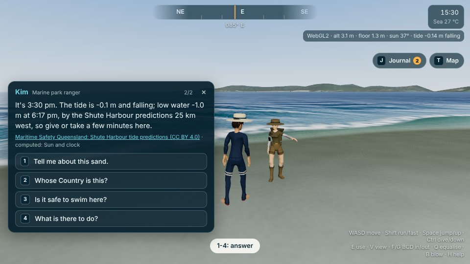
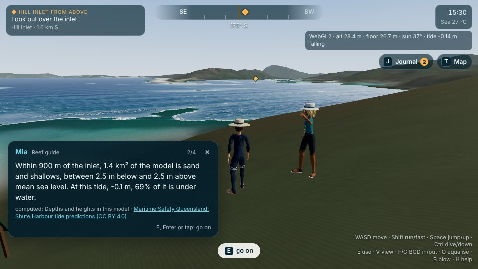
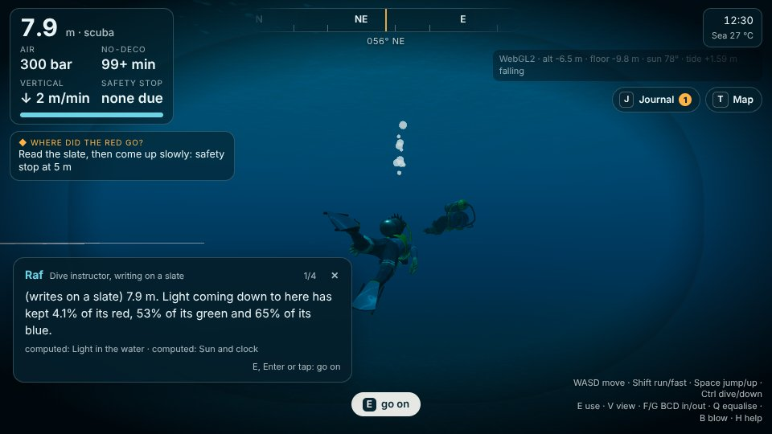
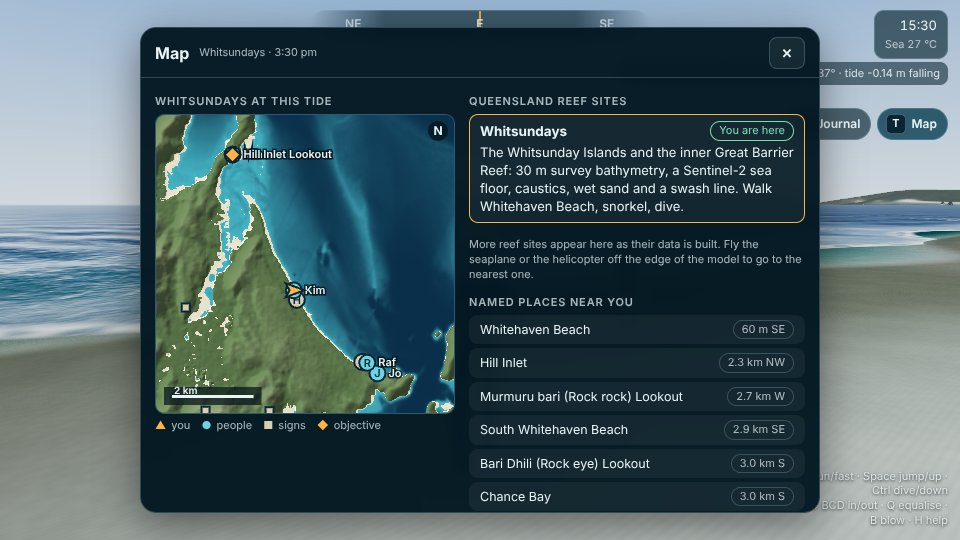
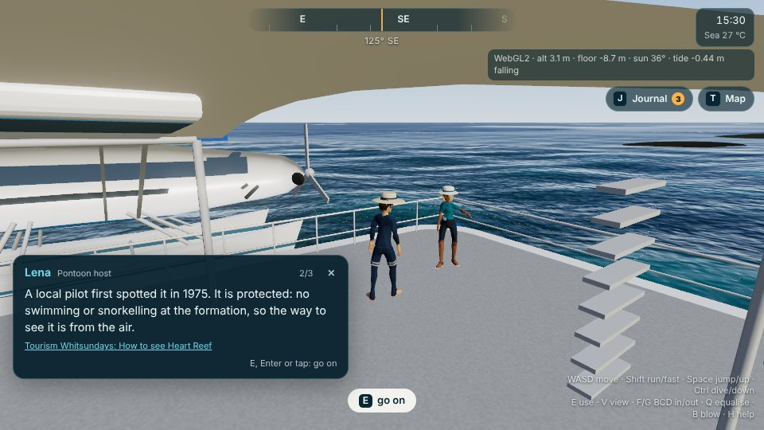
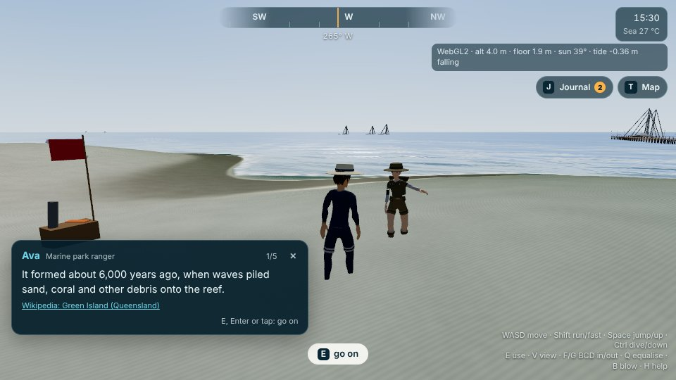
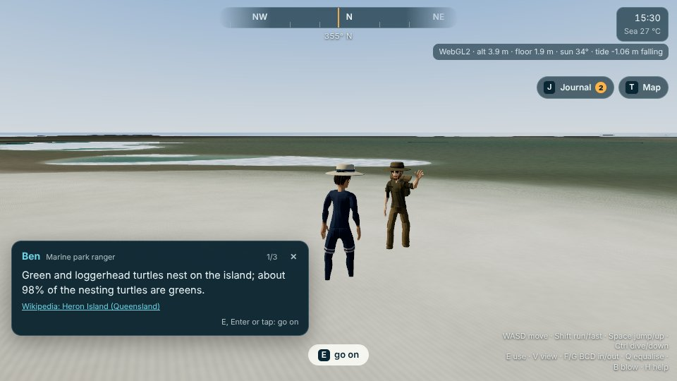
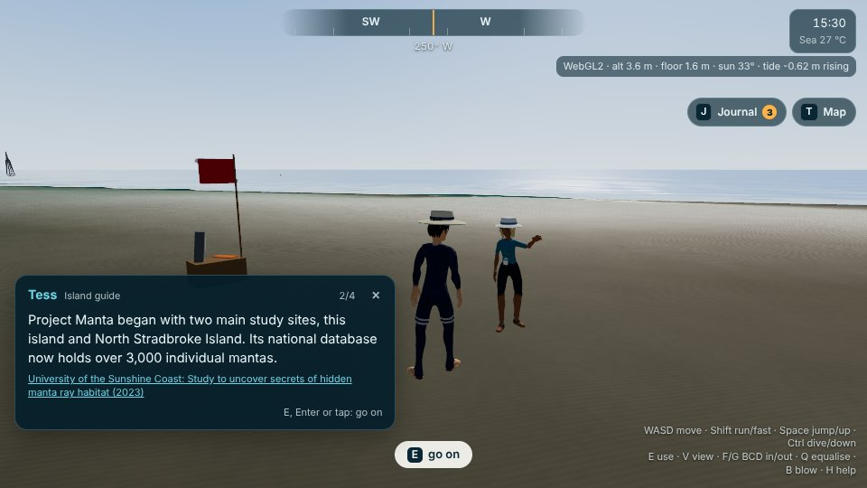

# The reef game

The game layer of the reef viewer (`web/reef/game.js`, `web/reef/game/`). You meet people at real
places, ask them things, take on small quests, board the boats and aircraft, and travel between the
Queensland reef sites. It follows the Sydney game's rule: everything a character says about the place is
computed from the model while you play, or carries a source you can open from the dialogue and the journal.

| Kim, the ranger, on Whitehaven Beach | Mia at Hill Inlet Lookout: the inlet at this tide |
|---|---|
|  |  |
| **8 m down with Raf: the slate works out where the red went** | **The map: the site at this tide, people, objective, reef sites** |
|  |  |

## Playing

| Keys | What they do |
|---|---|
| <kbd>E</kbd> | Talk, read a sign, board a boat, fly the helicopter or the amphibian, log an animal for the survey; on a line, go on |
| <kbd>1</kbd>–<kbd>4</kbd> · <kbd>Enter</kbd> · <kbd>Esc</kbd> | Answer · go on · close |
| <kbd>J</kbd> | Journal: quests, the survey log, field notes with their sources |
| <kbd>T</kbd> | Map: the site drawn from the model at the current tide, the reef sites, named places near you, and the way back to the globe |
| <kbd>F</kbd> | Step off a boat or out of a landed aircraft (the boats' own key) |

The player's own keys are unchanged (WASD, Shift, Space, Ctrl/C, V, F/G, Q, B, H, M). The Globe, Journal
and Map buttons sit under the clock (on a phone they stack down the right-hand side); Globe saves your
progress and goes back to the globe with every city. On a phone you tap a line to go on and tap an answer.
The tracked step shows top left (below the dive gauge when you are diving) with a marker on the compass and
a diamond over the target; on a screen narrower than 940 px the gauge and the tracked step move down, clear
of the compass. Progress is saved in the browser per site (`localStorage` key
`oe3d-reef-game-<site>`).

## The Whitsundays

| Who | Where (POI) | What |
|---|---|---|
| Kim, ranger | Whitehaven Beach, by the spawn | the silica sand, whose Country it is, stingers, the reef's health, the survey, where to go |
| Jo, day-boat skipper | South Whitehaven Beach | boat runs (Hill Inlet Lookout, the dive boat, Chance Bay, back up the beach), the islands, a scenic flight |
| Mia, guide | Hill Inlet Lookout | the inlet's sand and water at this tide and at the next turn of the tide |
| Raf, dive instructor | on a catamaran anchored off South Whitehaven | down to 8 m to see where the red went; the spawning-night snorkel |
| Signs | the three lookouts on Whitsunday Island with Ngaro names, and Hill Inlet Lookout | the name as mapped, the height in the model, what is in sight over the terrain |

Quests:

1. **Whitehaven sand.** Walk 200 m of the beach, then tell Kim. She explains the silica.
2. **Hill Inlet from above.** Get up to the lookout (Jo can drop you on the beach below it), hear Mia, and
   look out over the inlet.
3. **Fish ID survey.** With a mask on, get within a few metres of up to five species and log them (E). It
   needs `ctx.life`; without it the quest shows as unavailable.
4. **Where did the red go?** Raf kits you up, waits at 8 m, and writes the light left at your depth on a
   slate. Then come up slowly.
5. **Scenic flight.** Take the helicopter (Whitehaven helipad) or the amphibian, fly over Hill Inlet above
   100 m and along Whitehaven, land and step out.
6. **Lookouts with Ngaro names.** Read the three signs.
7. **Stinger suit** (October to May). Suit up at the dive kit. Kim also calls out if you head into the
   water without one.
8. **Spawning night** (only when `ctx.life.spawning.active`). Raf gives the night's sunset and moonrise;
   you can skip ahead to after dark (the page reloads with `?time=`, so the sun, moon, tide and clock
   agree), then snorkel over reef habitat for 20 s.

A site without its own file gets `game/generic.js`: a ranger at the spawn who knows the model (size,
share of sea, depth, height), the reef's health facts, Surf Life Saving Queensland's stinger advice if the
site is north of Bustard Heads, the survey, and the map.

## The other reef sites

| Lena on the Reefworld pontoon, Hardy Reef | Ava on Green Island |
|---|---|
|  |  |
| **Ben on Heron Island** | **Tess on Lady Elliot Island** |
|  |  |

**Hardy Reef** (`game/hardy-reef.js`). There is no land, so the people stand on the pontoon's deck and ride its swell.
- **Lena, the pontoon host,** gives out snorkel gear and stinger advice. She talks about Heart Reef and about how the
  water out here compares with the Whitsundays. She also has the reef's health facts, including a 2015 study of
  corals beside tourist platforms on Hardy Reef.
- **Sam, the dive instructor,** takes you down the channel wall to 12 m, where the slate works out the light left.
  That is the same guided dive as Raf's, in `generic.js` `diveQuest`.
- **Quests:**
  - **Heart Reef from the air.** Take the helicopter on the pontoon's pad or the amphibian, fly over Heart Reef above
    100 m, then land and step out.
  - **Down the wall.**
  - **The survey.**
- **Heart Reef is protected.** Swimming within 150 m of it brings up a reminder.

**Green Island** (`game/green-island.js`):
- **Ava, the ranger, on the western beach:** how the cay formed, its mapped area, the national park, stingers and the
  reef's health.
- **Noah, the snorkel guide, by the jetty:** gear, how deep the reef flat beside the jetty is at this tide, and the
  model's habitat mix there.
- **A sign at the south-east viewpoint:** what stands above the horizon from there.
- **Quests:** walk to the viewpoint, fly over the cay and out to Michaelmas Cay, and the survey.
- **Left out:** the Gungganyji name and stories for the island. Only Wikipedia was reachable, and it is a secondary
  source.

**Heron Island** (`game/heron-island.js`):
- **Ben, the ranger, on the north shore:**
  - the island and its reef, and its mapped area;
  - today's noon sun;
  - how it was found and named, and the national park;
  - turtles, seabirds and whales, said for the current month.
- **Kai, a visiting scientist, by the research station:** the station's history, and the water here against the
  Whitsundays.
- **A sign by the channel:** the wreck of the Protector.
- **Quests:**
  - **The Protector.** Read the sign, then snorkel out to the wreck at high tide. The tide model gives the time of the
    next high water.
  - **A helicopter flight** over Heron and Wistari reefs.
  - **The survey.**

**Lady Elliot Island** (`game/lady-elliot-island.js`):
- **Tess, an island guide, on the western beach:**
  - how the cay formed, and its mapped area against Wikipedia's 45 ha;
  - the Green Zone, the island's naming and the airstrip;
  - manta rays (Project Manta), turtles, whales and birds, said for the current month;
  - how blue the deep water is, ranked against the other built reef sites.
- **A sign at the old lighthouse:** its history, the guano miners and the replanting.
- **Quests:**
  - **The old lighthouse.**
  - **The survey.**
  - **A manta ray:** only when life.js has a manta species.
- **Not given:** visibility numbers. The site's attenuation is a placeholder while the offshore fits are revised.
- **No stinger lines here.** Lady Elliot Island is south of Bustard Heads, so Surf Life Saving Queensland's range does
  not cover it.

People are placed above the highest water that the site's tide model gives for the next fortnight. Where there is no
land, they stand on the pontoon deck.

## Where every fact comes from

Cited pages were fetched and read on 2026-10-28; a line says only what its page says.

| Line | Source |
|---|---|
| Whitehaven: seven kilometres; 98% pure silica; holds less heat, comfortable barefoot; no silica in local rocks, thought to be carried by currents over millions of years; fine enough to damage phones and cameras; named in 1879 by Staff Commander E. P. Bedwell after Whitehaven in Cumberland | [Wikipedia: Whitehaven Beach](https://en.wikipedia.org/wiki/Whitehaven_Beach) |
| Ngaro and Gia peoples, the Traditional Owners, also called canoe people; 74 continental islands; Cook sailed through on Sunday 3 June 1770 and named Whitsundays' Passage | [Wikipedia: Whitsunday Islands](https://en.wikipedia.org/wiki/Whitsunday_Islands) |
| Marine stingers in the islands' waters October to May | [Wikipedia: Whitsunday Islands National Park](https://en.wikipedia.org/wiki/Whitsunday_Islands_National_Park) |
| Full-body stinger suit in the ocean in the season; box jellyfish and irukandji; November to May from Bustard Heads north (generic sites) | [Surf Life Saving Queensland, 31 Oct 2023](https://lifesaving.com.au/news/swimmers-urged-to-take-advice-during-marine-stinger-season) |
| Mass bleaching 1998, 2002, 2006, 2016, 2017, 2020, March 2022; 2,900 reefs, 900 islands, 2,300 km, 400 coral species, 1,500+ fish species; fringing reefs on high islands; inner reefs spawn the week after the October full moon | [Wikipedia: Great Barrier Reef](https://en.wikipedia.org/wiki/Great_Barrier_Reef) |
| 2024: bleaching on 73% of surveyed reefs, the fifth widespread event since 2016 | [CSIRO, Reef Snapshot, 17 Apr 2024](https://www.csiro.au/en/news/All/News/2024/April/Reef-snapshot-details-widespread-coral-bleaching-on-the-Great-Barrier-Reef) |
| Spawning in the evening or at night, cued by the dark between sunset and moonrise | [Wikipedia: Coral](https://en.wikipedia.org/wiki/Coral) |
| Water absorbs red first | [Wikipedia: Color of water](https://en.wikipedia.org/wiki/Color_of_water) |
| Tide height, rising or falling, next high or low | [Maritime Safety Queensland, Shute Harbour predictions (CC BY 4.0)](https://www.data.qld.gov.au/dataset/7993f06a-f666-4231-8b9e-7f36ebaadae7/resource/0cde2f64-1684-4cc1-bbde-abe97871b862), fitted in `tide.json`; Shute Harbour is 25 km west, so times differ by minutes. The other sites name their own gauge from `tide.json` (Bugatti Reef Outer, Cairns Beacon C1, Burnett Heads, Waddy Point) |
| Heart Reef is within Hardy Reef; first spotted by a local pilot in 1975; protected, no swimming or snorkelling at the formation; best seen from the air | [Tourism Whitsundays: How to see Heart Reef](https://www.tourismwhitsundays.com.au/blog/how-to-see-heart-reef) |
| Hardy Reef an outer reef 75 km offshore; white syndromes on 31% of study corals near tourist platforms in the warmest summer month | [van de Water et al. 2015, Conservation Physiology 3: cov032](https://pmc.ncbi.nlm.nih.gov/articles/PMC4778433/) |
| Green Island: a coral cay 27 km off Cairns; formed about 6,000 years ago; no freshwater spring, a freshwater lens; vine-thicket rainforest; named by Cook on 10 June 1770 (its vegetation, or Charles Green); Green Island National Park; underwater observatory 1954 | [Wikipedia: Green Island (Queensland)](https://en.wikipedia.org/wiki/Green_Island_(Queensland)) |
| Heron Island: near the Tropic of Capricorn, 87 km north-east of Gladstone; Heron Reef with about 900 of 1,500 fish species and 72% of coral species; about 16 ha; found 12 January 1843 (HMS Fly, Bramble), named by Lt Charles Bampfield Yule; National Park 11 September 1943, eastern half in the Capricornia Cays National Park; research station since the 1950s, UQ partner 1970, fire 30 March 2007, reopened February 2009; 98% of nesting turtles green; seabirds October to April, over 120,000 white-capped noddies; humpbacks pass around early October | [Wikipedia: Heron Island (Queensland)](https://en.wikipedia.org/wiki/Heron_Island_(Queensland)) |
| The oldest and largest marine research station on the Great Barrier Reef; crown-of-thorns research in the 1960s | [Wikipedia: Heron Island Research Station](https://en.wikipedia.org/wiki/Heron_Island_Research_Station) |
| The Protector: bought by South Australia in 1884; Boxer Rebellion and both world wars; damaged off Gladstone in 1943, sunk at Heron as a breakwater; good snorkelling round the wreck at high tide | [Wikipedia: HMAS Protector (1884)](https://en.wikipedia.org/wiki/HMAS_Protector_(1884)) |
| Lady Elliot Island: southernmost coral cay, 85 km north-east of Bundaberg, about 45 ha; a vegetated shingle cay; Green Zone; excellent clarity; mantas drawn by plankton; turtles November to March, hatchlings January to April; whales June to October; 100,000 nesting birds; above the sea about 1500 BC; named 1816 by Captain Thomas Stewart (the Lady Elliot); guano 1863 to 1873, replanting from 1966; lighthouses 1866 and 1873, used until 1995, Commonwealth Heritage List 2004; grass airstrip 1969 | [Wikipedia: Lady Elliot Island](https://en.wikipedia.org/wiki/Lady_Elliot_Island) |
| Project Manta's two first study sites, Lady Elliot Island and North Stradbroke Island; over 3,000 mantas in its national database | [University of the Sunshine Coast, 2023](https://www.unisc.edu.au/about/unisc-news/news-archive/2023/june/study-to-uncover-secrets-of-hidden-manta-ray-habitat) |

Computed while you play (shown as "computed: …"):

- **Light at depth** (Raf's slate): the share of red, green and blue left at your depth is
  `exp(-K · depth · lightPath)` with `K = env.u.K` (the per-band attenuation fitted to the Sentinel-2
  imagery, red floored at pure water's absorption; `cities/<site>/analysis/optics.json`) and
  `lightPath = env.u.lightPath` (the sun's slant under water after Snell's law). That is the light term of
  `env.js medium()`, the one the renderer uses. At 8 m with a high sun: about 4% red, 52% green, 65% blue;
  red halves every 1.7 m. A torch 1 m away crosses 2 m of water: `exp(-2 K_red)`, 45% of its red.
- **Hill Inlet**: the cells of the 30 m survey grid within 900 m of the inlet between −2.5 and +2.5 m,
  and the share of them below the tide now and at the next high or low water.
- **Places**: distances and bearings between OpenStreetMap POIs (scene.json) and you; heights of lookouts
  from the terrain; "in sight" is a line-of-sight test over the terrain grid on a curved Earth (radius
  stretched by standard refraction, k = 0.13), aiming at an island's highest ground; the sea horizon's distance
  from eye height.
- **Islands' areas**: a flood fill of the terrain above mean sea level from the island's point (the cays are
  rebuilt from their mapped outlines).
- **The water at other sites**: Hardy Reef, Heron and Lady Elliot compare the deep water's colour (Rinf, blue
  over green) and Hardy the green attenuation with the other sites; here from `env.u.Rinf` and `env.u.K`
  (what the renderer uses, so refits show up), there from their `scene.json`.
- **Wall and reef flat**: depths under the pontoon and within 120 m (Hardy Reef), on the reef flat by a jetty
  and its habitat mix (Green Island), at the wreck (Heron), at the current tide.
- **The noon sun** today (Heron Island), from sun.js.
- **Sun and moon**: `sun.js` for sunset; moonrise from the same moon the viewer draws (env.js setSun).
- **Wind** from the wave bank (boats.js), **water temperature** from the dive computer (dive.js).
- **The site**: size, share of sea, deepest and highest point from the terrain grid (generic ranger).

The Ngaro and Gia content is only what the pages above say plus the lookout names as mapped. The
Queensland Parks and Wildlife Service pages on the Ngaro Sea Trail could not be fetched from the sandbox
(HTTP 403), so nothing from them is used. No character speaks as or for Traditional Owners.

## Boarding and travel

- Within about 3 m of a boardable hull (tinnie, yacht, catamaran, day boat, the amphibian, the parked
  helicopter), standing, wading or swimming at the surface: **E: board …** or **E: fly …**. Moving boats
  (over 1.5 m/s) and the scenic aircraft on their loops are not offered. Raf's dive boat stays at anchor.
- **F** steps off (boats.js decides when that is allowed in the air). You land beside the hull: in the
  water if it is deep enough, on the ground if it is walkable, otherwise on the nearest beach.
- **T** lists every `data/cities.json` entry whose `viewer` is `reef/index.html`; a site is offered as
  soon as its `data/<id>/scene.json` exists. Travel reloads with `?city=<id>`, keeps settings (`gl`, `exp`,
  `mute`, `wind`, `time`, …) and drops positions and test keys.
- Flying the helicopter or the amphibian to within 700 m of the model's edge offers the nearest other
  ready site ahead of you (or says none is built yet).

## For developers

- Content: `game/<site>.js` exports `default (G) => ({ sources, npcs, quests, signs, start, tick })`. NPCs
  are placed by POI through `G.landSpot` or `generic.js` `standNear` (dry land above the fortnight's high
  water, else the pontoon deck, else afloat); an NPC can ride a vessel (`{ vessel, local }`). A quest step
  has `text`, `target`, and completes by `check`, `on: { board | leave | talk | sign | species }` or
  `talkTo: <npc>` (which opens that person's dialogue at `node`). `generic.js` also has `ranger`,
  `surveyQuest`, `diveQuest`, `tidePage`, `slsqPages`, `reefPages`, `landArea`, `inSight`, `loadOptics`.
- `G` (also `window.__game.G`) has the helpers: `poi`, `where`, `light`, `tideTurns`, `sunset`,
  `moonrise`, `lineOfSight`, `start/advance/complete`, `note`, `transfer`, `skipTo`.
- `?gametest=1` runs a scripted test on any site and sets `window.__gametest`. With `life.js` it makes 63 checks on
  the Whitsundays, 39 at Hardy Reef, 35 at Green Island, 35 at Heron Island, 30 at Lady Elliot Island and 34 with
  `gamesite=generic`; on the Whitsundays it makes 61 with `life=0` and 64 with `life=0&lifestub=1`. Every site's test
  includes a lint: every line of every person and sign renders, and every source it cites resolves.
- `?gameshot=dialogue|journal|map|lookout|red|board` sets up the screenshots (`dialogue` takes `shotnpc`,
  `shotnode`, `shotpage`, `shotyaw`, `shotpitch`, `shotcam`).
- `?lifestub=1` installs `game/life_stub.js`; `?gamereset=1` forgets progress.

```bash
cd web && python3 -m http.server 8813 &
PORT=8813 NODE_PATH=$(npm root -g) node tools/page_eval.js "reef/index.html?still=1&gl=1&gametest=1&mute=1" "window.__gametest.fail"
PORT=8813 NODE_PATH=$(npm root -g) node tools/reef_shot.js "still=1&gl=1&gameshot=dialogue&mute=1&time=2026-10-28T05:30:00Z" out.png 1500 0
```
