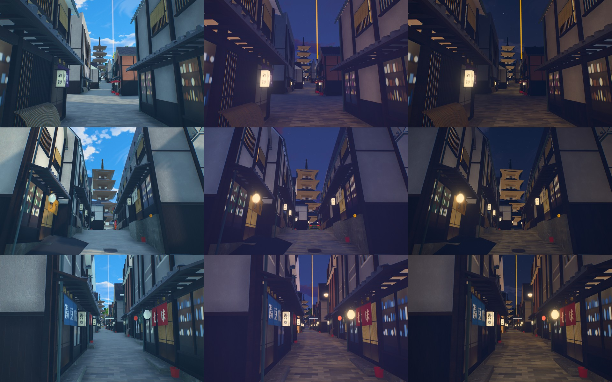
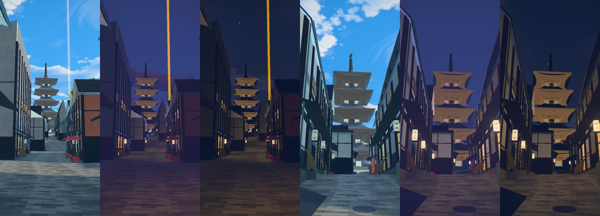
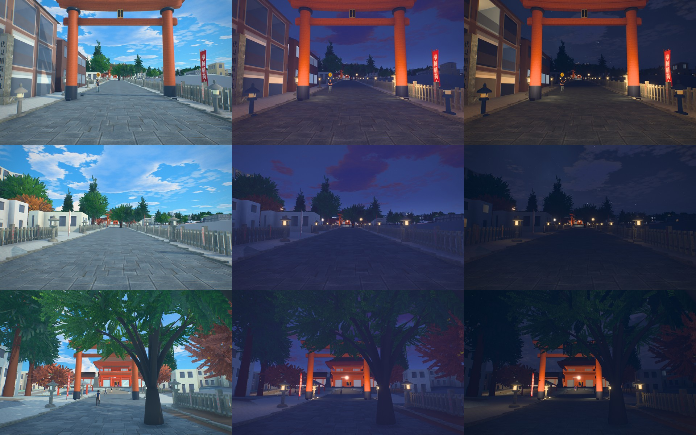
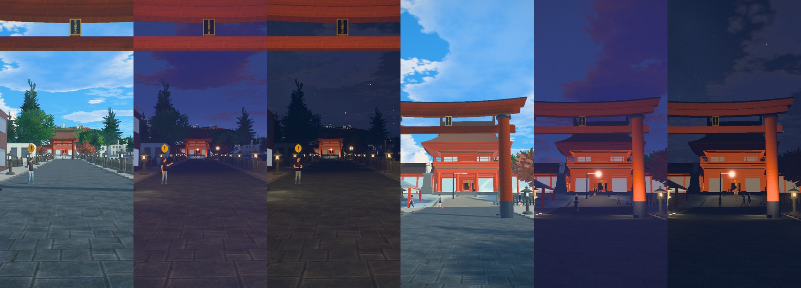

# Hero levels: a street modelled finely

Asked for in November 2026 for Tokyo's live maps: one small level per map, a street or a crossing some
200-300 m across, that reads at eye level as a photograph or a current game does, while the rest of
the map stays as it is around it. Shinjuku's is Kabukicho Ichibangai (`cities/shinjuku/hero.py`);
Shibuya's scramble is built by its own session on the same kit; Marunouchi-Ginza's (Tokyo Station) is drawn as
landmark meshes, below. Sydney's is Circular Quay West, where its game starts (`cities/sydney/hero.py`), and
Queenstown's the Skyline deck on Bob's Peak (`cities/queenstown/hero.py`): stone, timber and a water's edge
rather than a street of signs. Kyoto's two (Yasaka-dori, the Omotesando of Fushimi Inari) are on the kit with
Japanese traditional pieces, below.
Three more stand by a map's spawn: Kamakura's is the hill road above the Kamakurakokomae crossing
(`cities/kamakura/hero.py`), Tetsugaku's the head of the Philosopher's Path (`cities/tetsugaku/hero.py`),
and Kyoto's the station's north forecourt under Kyoto Tower (`cities/kyoto/hero.py`).

| What | Where |
|---|---|
| The loader, in every map's game | `web/game/hero.js` (`OEHero`), started by `web/game/game.js` from `game.hero` |
| The kit: geometry by material, the atlas, the bake, Blender and the export | `blender/hero_kit.py` |
| Parts: paving laid on the game's ground, a wall's frame with openings, windows, lamp posts, benches, bollards | `blender/hero_parts.py` |
| The measured things under a level: OpenStreetMap's map of its rectangle, in local metres | `python pipeline/hero_osm.py --city <id> --box x0 y0 x1 y1` -> `cities/<id>/hero_osm.json` |
| The ground a level is laid on: the game's own walking surface, sampled | `node tools/ground_probe.js <id> x0 y0 x1 y1 > cities/<id>/hero_ground.json` |
| Parts for a level in the open: ground draped on the terrain, retaining walls, hedges and shrubs, utility poles and wires, signs | `blender/hero_open.py` |
| The build | `python blender/build_hero.py --city <id>` (needs `pip install bpy==5.2.3` and Node) |
| A map's level | `cities/<id>/hero.py` (`build(kit)` returns geometry, atlas, materials and its centre) |
| Its place in the game | `cities/<id>/city.json` `game.hero` (copied into `game.json` by `pipeline/game_text.py`) |
| Its stills | `tools/views/<id>-hero.json`, taken with `tools/scramble_shot.js` (which waits for a hero level to load) |
| Its check | `tools/game_check.js`: walked up to, it loads and shows and hides what it replaces; left, it is let go |

## How it works

**Drawn over the city, not instead of it.** A hero level's fronts stand a few centimetres in front of the
city's own walls (the shop fronts 0.5 m, the floors above 0.22 m), and its paving 4 cm over the ground,
so the city's buildings, ground, collision and surface model need no change, and the level can come and
go. Its glass and its recesses lie between its face and the city's wall. What the city draws that the
level draws again finely (Kabukicho's tenant stacks and fascias on Ichibangai) is built into landmark
meshes of their own (`kbhero_*`, `cities/shinjuku/kabukicho.py` `in_hero`) and hidden while the level is
shown (`game.hero[].hide`).

**Streamed.** It is fetched when the camera comes within 260 m of its edge, shown within 420 m, and let go
(geometry and textures freed) past 520 m. On the low tier (phones) every texture is halved before it is
sent to the GPU, a quarter of the memory, and on a phone's lean sub-tier no side is over 1024; it is resized by
`createImageBitmap`, not through a full-size canvas. Its shaders are compiled and its textures sent in idle time
before it is first shown (`world.js` `upload`, `compile`), so it does not stall a frame.

**What cannot be seen costs nothing** (issue 358, from first principles). A level is paid for in four
currencies: bytes fetched, memory held, triangles drawn and pixels shaded. Each is spent only where the eye is:

| Cost | What decides it | How the level spends it |
|---|---|---|
| Fetched and held at all | how far the level is | nothing within 260 m: nothing fetched; past 520 m: everything freed |
| The finest geometry (glazing bars, a railing's rails, bench arms, joints) | whether it covers a pixel | a second model, `<id>_fine.glb` (`Geo.fine`, plain materials only, so no texture is held twice): fetched only when the camera is inside the level, each 22 m square of it drawn only within `fine_m` (70 m) of the camera, and never fetched on the low tier |
| Triangles and draws behind you | the view | the level is cut into squares (`meta["cell"]`, one mesh per material and square), so three.js's frustum test leaves out what is off screen; at Sydney's start about half the level |
| Texture memory | the screen's pixels, not the texture's | a material carries only the maps that show (`maps`: `"c"`, `"cn"`, `"cnr"`): bark, grass and distant render have no roughness map; on the low tier no normal or roughness maps at all and every colour map halved, on a phone's lean sub-tier no side over 1024 |
| Light after dark | nothing per frame | baked into the vertices, below: no light is evaluated at run time |

Measured on Sydney's level (`tools/mem_check.js`, the phone tier): the GPU peak went from 531 MB without the
level to 546 MB with it (budget 700), and the heap from 465 MB to 470 MB (budget 880); the fine model is never
fetched there.

**Light baked into the vertices.** After dark a street like Ichibangai is lit by its signs and shop
fronts, not by its lamps. Each lit face (a sign's panel, a fascia, a shop's glass, a vending machine,
a lantern) is a set of small area lights a metre apart, in the mean colour of what is drawn on it; every
vertex of the level sums them (the cosine at the light and at the vertex over the square of the
distance, `hero_kit.bake`), and the corners' occlusion from the walls is added, into its `_BAKE`
attribute. `hero.js` adds that light in the surface's own colour after dark (`uNight`) and lets the
occlusion take the sky's light by day. The city's street lights (`world.js` `streetLit`) still reach it,
at the share `game.hero[].street` gives (Kabukicho 0.35), since its own lamps are baked. No lightmap
texture, no second UV set, and nothing for a phone to compute.

**Materials by name** (Blender's, kept in the glTF): `win*` windows (the rooms' light is turned up with the
night; a `tint` darkens the glass by day), `glow*` lit signs (their emissive at
`game.hero[].glow`: by day and by night), `tube*` neon tubes (which stutter now and then), `win*`
windows (dark glass by day, rooms lit after dark), `ground*` what you walk on (wet in the rain; on the high
tier it takes the wet street's reflection, `mirror.js`). A material's tint (the building's colour over a
shared texture) travels in its glTF extras.

**Textures.** CC0 PBR sets from ambientCG at 1K (colour, normal, and roughness packed into glTF's
metallic-roughness image), as WebP inside the model: `PavingStones136` (Ichibangai is paved: OpenStreetMap
`surface=paving_stones`, and the ward's plans keep both streets paved), `Tiles036` (the small square
facing tiles of Japan's mixed-use buildings), `Plaster001`, `Concrete034`, `Tiles138`; and for stone, timber and a water's edge `Bricks066` (smooth coursed ashlar),
`Bricks083` (squared rubble), `PavingStones125A` (sawn granite planks), `PavingStones131` (setts), `Grass004`,
`Planks040` (grooved deck boards), `Granite005A`, `Travertine009` (sawn bedded stone), `Rock051` (schist) and
`Bark014`. A grey texture is brought to a stone's colour by a tint computed from its mean
(`hero_kit.tint_to(key, sRGB)`), so one ashlar serves Sydney's sandstone and a bluestone alike. Everything
drawn (sign panels with the tenants' names, shop interiors, rooms behind the windows, vending machine
fronts, menu boards, air conditioners, manhole covers, grates) is one atlas, drawn in Python with the
project's open fonts (`pipeline/adkit.py`).

## Kabukicho Ichibangai (Shinjuku)

From Yasukuni-dori's pavement through the red arch to Sakura-dori, 130 m of a street 8.1-9.4 m between
its fronts (OpenStreetMap; the arch's posts stand 8.6 m apart). Chosen over Omoide Yokocho by the west
exit: its alleys are roofed and lit from inside, and show little from the chase camera, while
Ichibangai is Kabukicho's threshold, its most photographed view, and the street the Shinjuku map's walks
already lead to. Night is its hero shot.

On each of the 34 fronts PLATEAU's solids give the street (`kabukicho.canyon_fronts`): the street floor's
shop front set back between dark tiled pilasters, glazed onto a lit interior (a ramen counter, a
drugstore's shelves, a bar, a lobby), aluminium mullions, a step, a lit fascia with the tenant's name,
and a noren, a half-drawn shutter or a menu board now and then; the floors above in tile or render in the
building's colour, windows set into them with frames and sills, rooms lit after dark, the names of bars
and karaoke rooms in the lower windows, air conditioners on brackets with their pipes, a drain pipe,
cable runs, a parapet and its coping; and the tenant stack standing out from the front, a panel a floor,
the real tenants' names where OpenStreetMap maps them, some edged in neon. On the street: paving, manholes
down its middle, grates along its kerbless edges, stains, shallow puddles, vending machines in clusters
of one to three, the lantern lamps, bins, beer crates, bicycles and cones.

Facts used (sources in the research below): Ichibangai 261 m long, paved, 8.1-9.4 m wide in its south
half and 9.5-11.4 m in its north; both streets planned as pedestrian zones with unified lamps and
continuous paving (Shinjuku City, Kabukicho design guideline); projecting signs asked to relate in colour
and light, "light overflowing" at night (Shinjuku City outdoor advertising guideline), and signs measured
above 1,000 cd/m² (J. Illum. Eng. Inst. Japan 106(1), 2022).

What could not be checked: the lamps' design on Ichibangai since the ward's renewal (the model keeps the
two-lantern post of `kabukicho.py`), the paving's colour and pattern (the texture is a grey interlocking
block), which fronts have shutters, vending machines and air conditioners where (placed by a seeded
draw, not from photographs), and the buildings' heights: about 20 of the 28 fronts stand at heights
estimated from their neighbours, not surveyed by PLATEAU.

## Kyoto: Yasaka-dori (Higashiyama) and the Omotesando (Fushimi Inari)

Two levels where their maps' games start, on a kit of Japanese traditional pieces over the same loader:
`blender/hero_wa.py` (town-house fronts, tiled roofs and eaves, lattices, noren, paper lanterns, torii, stone
lanterns, stone fences, banners), `cities/higashiyama/hero.py` and `cities/fushimi-inari/hero.py`. Their stills:
`tools/views/higashiyama-hero.json`, `tools/views/fushimi-inari-hero.json`.

Day, dusk and night on the high tier at 1440 x 900 (lane, pagoda, foot; torii, approach, second torii), and on
the low tier at 390 x 844:






Where they fall short of the bar, as the stills show: the shops behind the glass are drawn shelves, not rooms
(the interior mapping of `web/interior.js` is the next step for the `glow_shop` panes); the walls above the
fronts are plain plaster in a frame; the approach's trees and the buildings beside it are the map's own; and
none of it has been seen on a real GPU or a real phone, only on a software renderer.

### Only what a walker can see (issue 358, from first principles)

A level is looked at from its street, so the street decides what exists. `hero_wa.Site.seen` answers, offline,
whether a point can be seen from any eye point along the level's line (1.7 m over the ground, every 4 to 5 m):
a sight line is blocked by a building's solid when it passes under its top. The build asks it for every wall,
gable and roof triangle near the street:

- a wall facing the lane within 7.5 m is a full front; another wall is dressed (boards, plaster, a timber frame:
  a few quads) only if it can be seen, and not built at all otherwise. On Yasaka-dori that is 47 fronts and
  about 200 side walls of the 70 buildings' 300-odd; the backs and the walls between neighbours cost nothing;
- a roof triangle is tiled only if it can be seen, and only the eaves of those get round tiles and a gutter;
- the paving is not laid under the buildings.

Memory follows the same rule at run time. The level is fetched within 260 m and freed past 520 m (`hero.js`).
Its finest geometry (lattice bars, the eaves' round tiles, rafters: 84,000 of Yasaka-dori's 116,000 triangles) is the
level's fine model (`Geo.fine`, `yasaka_fine.glb`): fetched only once the camera is by the level, drawn square by
square within 45 m of it, and never fetched on the low tier: at a phone's resolution a 3 cm bar at 10 m is under a
pixel, and the drawn paper behind it carries the pattern. Both levels are cut into 24 m squares, so the squares
behind the camera are not drawn. On the low tier the normal and roughness maps
are dropped and the colour maps halved (no side over 1024 on the lean sub-tier). Light after dark is in the
vertices, so a phone computes none of it.

Materials added to the loader's names: `paper*` and `lamp*` (a shoji, a lantern) show their own colour by day
and are lit as dusk falls.

### Yasaka-dori

The lane from Higashioji-dori up to the Yasaka Pagoda (Hokan-ji), 170 m, 4.5 to 6.5 m between its fronts,
rising 9 m: the game starts at its foot, and the pagoda at the end of the stone lane is Kyoto's most
photographed street view. Sannenzaka and Ninenzaka were the other candidates: they begin 250 m from the start,
out of its sight, and their flights of steps need the surface model changed.

On each front the city's solids give: a stone footing, posts and beams a bay (about 1.9 m) apart, and bay by bay
a lattice over lit paper, a sliding lattice door under a noren, a shop's window onto its shelves, or plaster
over a boarded foot, some behind the curved bamboo guard (inuyarai); the tiled pent roof with its rafters and
round eave tiles; on two-storey houses plaster above with a slit window (mushiko-mado) or a lattice window,
some with a bamboo blind; a carved name board, an andon or a round paper lantern at the door, a copper rain
pipe. The side walls a walker sees are charred boards under plaster in a timber frame; the roofs are the
buildings' own roof meshes again in tile. The lane is granite setts wall to wall with manholes; at the doors,
tea-house benches under red parasols and red fire buckets. The city's older dressing of the lane (its setts,
flat lattices, noren and lanterns) is in meshes of its own (`yhero_*`) and hidden while the level is shown.
The lane's line is OpenStreetMap's, moved to the middle of the gap between the mapped fronts (it hugs the
south row); no generated street lamp stands on it (`night.clear`). The game's start stays on Higashioji-dori's
pavement at the lane's mouth, which already frames the pagoda down the lane: started inside the lane, the
player's car has no room to turn and the lane's own traffic is counted against the walls its mapped line hugs.

Facts used: the lane east of Higashioji-dori is narrow, one-way and stone-paved, climbing gently east
([Wikipedia](https://ja.wikipedia.org/wiki/八坂通)); its wires run under the eaves, with no poles on the lane
(Kyoto City's pole-removal plan shows Yasaka-dori as the example of eaves wiring,
[plan](https://www.city.kyoto.lg.jp/kensetu/cmsfiles/contents/0000250/250605/keikaku.pdf)), so none is built;
the district is the Sanneizaka preservation district, whose plan asks for gabled roofs in Japanese tile, tiled
pent roofs, lime plaster or Kyoto earthen walls, cedar boards at the ground floor, projecting or flat lattices,
sliding lattice doors, and timber in bengara or bare
([Kyoto City](https://www.city.kyoto.lg.jp/tokei/page/0000281761.html)); the pagoda is five storeys of three
bays, 6.4 m square at its foot, rebuilt in 1440, its height published as anything from 36.4 m to 46 m
([National Diet Library](https://crd.ndl.go.jp/reference/entry/index.php?page=ref_view&id=1000061716)).

Not checked, and invented: which house has which bays, the shops' names and noren (Kyoto's trades, not the real
tenants), the benches and buckets (placed by a seeded draw), the stone's colour and bond, the houses' heights
(PLATEAU's and estimates, some taller than the two storeys that stand there), and the pagoda itself, which
stays the city's landmark model.

### The Omotesando of Fushimi Inari Taisha

From the first great torii by JR Inari station to the Romon gate's steps, 140 m rising 7 m, with the second
torii and the gate on one straight line behind the first. The Senbon Torii are the shrine's most photographed
place, but they stand 350 m further in, behind the halls, out of sight of the start. The start itself stays
by the station, 100 m south-west of the first torii: started under the torii (tried at two points on the
approach), the game check's driving steps fail there (the autopilot's trip does not arrive, a car waits at a
narrow stretch), which is the driving's to fix before the start moves.

Built: the two torii on OpenStreetMap's gate lines (vermilion posts with black feet and ring caps, tie beam
and wedges, the lintels curving up to their ends under a black top, a plaque; floodlights at their feet, baked);
stone flags 9 m wide between kerb stones, gravel either side; stone lanterns in pairs every 12 m, lit after
dark; stone fences on the lines OpenStreetMap maps as fences and walls, with donors' names on their pillars;
the shrine's name pillar by the first torii; offering banners. The city's own torii and the approach's paving
are hidden while the level is shown (`inari_otorii_*`, `shero_*`).

Facts used: first torii, second torii, Romon and the halls stand on one line
([Wikipedia](https://ja.wikipedia.org/wiki/伏見稲荷大社)); the torii are reinforced concrete, dedicated in 1972
(the first) and 1960 (the second), of the Inari kind (ring caps under the lintel, black feet, a black top), on
no base stones; the Romon is of 1589, its steps of 1694; the buildings that stood either side of the approach
were taken down in 2020 and 2024, which is why its sides are open
([the shrine](https://inari.jp/trip/map01/), Wikipedia).

Not found, and estimated: the torii's heights and spans (from OpenStreetMap's widths, 11.5 m and 11 m, and one
guide's 9 m), the plaque's wording, the lanterns' number and spacing, the banners, the name pillar's size, the
paving's stone and pattern.

### Research for these two

| Work | What it published | Taken |
|---|---|---|
| *Ghost of Tsushima* (Sucker Punch; J. Patry, SIGGRAPH 2021, [slides](https://advances.realtimerendering.com/s2021/jpatry_advances2021/index.html)) | Stylised realism carried by light and atmosphere; indirect light from probes for a changing hour | Light first: paper and lanterns that come on at dusk, their light baked into the lane |
| *Assassin's Creed Shadows* (Ubisoft, [Inside Anvil](https://news.ubisoft.com/en-us/article/6u0kflsdY20YlnZks7rUeG/inside-anvil-the-technology-powering-assassins-creed-shadows)) | Kyoto at micropolygon detail with ray-traced light, on hardware a browser does not have | The opposite budget: real geometry only where the eye resolves it (bars, eave tiles near the walker), drawn surfaces elsewhere, nothing for what is hidden |
| *Sekiro* (FromSoftware, [CEDEC+KYUSHU 2021](https://www.siliconera.com/sekiro-environments-were-designed-to-reflect-culture/)) | Places dressed so they read as lived in; landmarks framed from where the player stands | The start moved so the first frame is the level's landmark down its axis; doors dressed with what people use |

Textures added, all CC0 1.0 from ambientCG at 1K: `PavingStones128` (setts), `PavingStones077` (flags),
`Gravel023`, `Concrete036` (weathered stone), `RoofingTiles013A` (the nearest to fired grey tile: ambientCG has
no true kawara), `Planks023A` (boards, tinted dark), `PaintedWood009C` (tinted vermilion), `Bamboo001C`. The
shop names, noren, lantern papers and boards are drawn in Python with Shippori Mincho (SIL OFL, `pipeline/adkit.py`).
## Circular Quay West (Sydney)

From First Fleet Park's edge to the taxi rank under the Overseas Passenger Terminal: 135 m of the quay in
front of the Museum of Contemporary Art, where the Sydney map's game starts, looking along the promenade to
the harbour with the Opera House across the cove on the right. Chosen over George Street in The Rocks, 100 m
west: the quay is what the start already faces, it holds the map's two most photographed things in one view
(the museum's sandstone front and the Opera House), and its ground, edge and furniture are all in the open,
where a level's detail shows.

The first pass (pull request 444) was built without a photograph of the promenade itself, and guessed: sawn
granite planks, tall twin-arm lamp posts, a sandstone coping and no rail. The second pass looked at the
place first (the photographs are listed below) and rebuilt what the guesses had wrong:

| What a walker sees | As built now | From |
|---|---|---|
| The paving | unit pavers 200 x 100 mm in a herringbone at 45 degrees to the quay, buff-grey with the odd browner one, darker soldier courses across it every 7.4 m and along the kerb and the lawn | photographs 1, 7; the bond's size is a standard paver's, not measured |
| The water's edge | a broad kerb, the quay's dark green cast-iron balustrade on it (posts 2 m apart with ball heads, a round top rail, a cross and ring in each panel), orange lifebuoys on the rail; under it the concrete face with its pour lines, tide band and weed, white fender piles with ladders | photographs 1, 7 |
| The lights | the quay's ball lights: white globes on slender dark posts along the rail and the lawn's wall, lit at dusk | photographs 2, 7 |
| The banners | white flagpoles 10 m tall between the lights, each flying a tall banner across the promenade | photographs 1, 7; the banners' art is this project's |
| The museum's front | each bay a recess running up through the storeys between flat piers, paired steel windows and a stone spandrel to a storey; pavilions of five storeys and 21.4 m, wings of six and 27.4 m with a row of small windows under a deep attic; the rain's dark runs under every coping; the tower's stepped great piers; the entrance a portal of polished brown granite with bronze doors; the cafe's flat white canopies along the wings' feet | photographs 2, 3, 8, 9 |
| The Mordant Wing | on OpenStreetMap's outline: a frameless glazed entrance two storeys high under stacked white boxes with a ribbon of glass between, the dark box with the museum's name over the way through to George Street, the black box with its glazed corner on top; the white precast wall north of it with the name at eye level and Brook Andrew's arrow on its concrete foot | photographs 4, 5 |
| The lawn | a pale concrete seat wall along the promenade, and the cabbage-tree palms along it, slender, where OpenStreetMap maps each | photographs 2, 6, 9 |

What is measured, and from where:

| Thing | Source |
|---|---|
| The museum's outline, its end pavilions (9.3 m forward, 14 m wide), the tower's face (13.2 m, 1.6 m proud), the Mordant Wing's plan, the lawn, the seat wall's line, every bench, bollard, cover and artwork, the eight Writers Walk plaques here by name | OpenStreetMap (`cities/sydney/hero_osm.json`, ODbL) |
| The ground: the lawn at 3.9-4.0 m, the promenade at 2.5 m, the slope between | the game's own surface (`hero_ground.json`: NSW Spatial Services' 5 m elevation, softened, the quay raised to its wall) |
| The quay's face | the game's shore raster (`shore.png`), read as a few straight runs with eased corners |
| The front's heights | the tower's 35 m is the map's own figure; the wings and pavilions are in the proportion photograph 2 shows against it |

Photographs looked at (Wikimedia Commons; none is reproduced, and no texture is taken from one):

| | File | Licence | Used for |
|---|---|---|---|
| 1 | AUS Sydney, Central Business District, Circular Quay 012.jpg | see its page | the promenade from above: the herringbone, the bands, the rail, the banners' poles, benches at the rail |
| 2 | Museum of Contemporary Art Australia, Sydney, 2023.jpg | CC BY-SA 4.0 | the front's composition, heights, stains, canopies, the ball lights, the palms on the lawn |
| 3 | The Museum of Contemporary Art, Sydney (former MSB Building).jpg | CC BY-SA 4.0 | the front again, the tower's piers |
| 4 | (1)Museum of Contemporary Art-3.jpg | CC BY-SA 3.0 | the Mordant Wing's entrance: boxes, glass, lettering, the arrow |
| 5 | MCA 2014.10.26.JPG | see its page | the wing's dark box and the way under it |
| 6 | The Rocks NSW 2000, Australia - panoramio (47).jpg | see its page | the lawn's seat wall |
| 7 | Museum of Contemporary Art, Sydney, NSW (7834205430).jpg | see its page | the quay from the water: the concrete face, the fender piles, the rail, globes and banners in a row |
| 8 | Sydney Museum of Contemporary Art Australia Southern entrance.jpg | see its page | the stone's coursing and joints, the polished granite of a door's surround |
| 9 | SydneyMuseumContemporaryArt gobeirne.jpg | see its page | the whole front over the lawn |

**Surfaces drawn, not scanned** (`cities/sydney/hero_tex.py`, registered with the kit by `hero_kit.register`).
No CC0 scan had the quay's herringbone or a sawn sandstone without a brick's joints (the first pass tinted
`Bricks066`, and the museum read as yellow brick), so the level draws its own, seamless, from shaped noise:
the pavers (1.6 m to a repeat at 1K: a texel is 1.6 mm, a pixel's width on the ground two metres from the eye
at 1440 px), their soldier course (512), the sandstone ashlar in 380 mm courses, the same stone under a coping
with the rain's runs (laid once up each attic, so the stains hang from the coping and nowhere else), the
quay's concrete face (laid once from kerb to water, so the tide band sits at high water) and precast concrete
(512). Only what shows carries a normal or a roughness map. The only scanned sets left are `Grass004` and
`Granite005A`.

**Texels where the eye is.** A paving seen from 1.65 m is seen at a grazing angle, and without anisotropic
filtering its joints smear to a blur four metres ahead however fine the texture: `hero.js` now sets 8x
anisotropy on a level's texture maps on the high tier, 4x on the medium one and 2x on the low one (a sampler
setting: no memory).

**The city under the level** (issue 426, `cities/sydney/museum.py`). The city's model had the museum as its
four mapped parts only; the pavilions and the Mordant Wing were the level's shells over nothing. They are in
the city's data now (the outline's remainder, cut as the level stacks it, each face 0.3 to 0.6 m behind the
level's), so they stop a walker, throw the city's shadow and stand in the visibility raster whether the level
is loaded or not. The entrance hall is left open under them, since the level draws it as a room behind glass;
what stops a walker at the glass is a wall that is not drawn, among the city's landmark meshes (`city.py`
`museum_hall`: a material of no opacity that is never a floor, as the Opera House's seat rows have; a solid
in `hidden_solids` would not do, the walking model leaves those out). `game.hero[].solid` and `.open` name
points that must be solid and must stay walkable; `tools/game_check.js` checks both, and found the first
attempt at the hall wanting.

The map's own quay wall has a sandstone-coloured coping 0.1 m over the ground along the shore raster's
stepped line; the level's pavers rise to the kerb over it in their last metre (`Level.lift`), so it does not
show.

After dark: the ball lights, the cafe canopies' and the portal's downlights, the up-lights along the
museum's foot, the hall's ceiling and the steel ovoid's holes are the bake's lights; a fifth of the windows
are lit.

Level: 71,000 triangles and 4.5 MB; fine model (the rail's crosses and rings, glazing bars, ladders, joints)
18,000 triangles and 0.5 MB, drawn within 75 m and never on the low tier.

**Its own palms.** The lawn's cabbage-tree palms were the map's shared palm, a date palm scaled to each tree's
surveyed height: a trunk a metre thick at 14 m. The level stands its own where OpenStreetMap maps each tree
(`Level.palm`: a slender ringed trunk, thirty fan leaves from upright to hanging, the oldest brown; about 600
triangles a palm, plain materials, no texture), and the map plants none there (`city.py` `landmark_treeless`).
They do not move in the wind as the map's trees do.

Where it still falls short of the bar, as the stills show: the glazed entrance does not mirror the quay as
the photograph shows; the cafe under the canopies has no tables; the palms stand still in the wind; the
balustrade, the benches and the lamp posts do not stop a walker (the map's own quay edge does, a hand's
breadth from the rail); the trees beyond the lawn, the water and the far shore are the map's, at the map's
detail; and none of it has been seen on a real GPU or a real phone, only on a software renderer.

What could not be checked: the paver's exact size and colours, the kerb's width, the balustrade's exact
casting (read from two distant photographs), the lamp posts' height, the Mordant Wing's storey heights and
setbacks (stacked after photographs 4 and 5 on the measured plan), the ovoid's dimensions, and the palms'
heights (11 to 15.5 m by a seeded draw).
## Only what the first frame sees (issue 358)

The levels by a map's spawn (Kamakura's first) apply issue 358's rule to detail: memory and shading go to
what the player can see, and the rest of the map pays nothing.

- **The level is the spawn's view, not a radius.** It is drawn from where the game opens: the road ahead, the
  walls and banks that face it, what stands in front of the horizon. Nothing behind the camera, behind a
  wall's face or past the first bend is modelled. Nissaka is 34,000 triangles and a 3.9 MB file.
- **Fine textures only there.** Seven 1K PBR sets and one 1K atlas exist only while the level is loaded
  (about 120 MB of GPU memory on a desktop with their mipmaps); on the low tier their normal and roughness
  maps are dropped and the colour halved (about 11 MB), and all of it is freed 520 m away (`hero.js`).
- **Light is distilled offline.** The street lights' pools on the road are in the vertices (`hero_kit.bake`):
  no light is added to the frame for them.
- **One surface, not layers.** The asphalt of the hill road and the lanes that meet it is one mesh on a 1 m
  grid cut to the roads' outline (`hero_open.Parts.cover`), so the terrain cannot show through it and no
  pixel of road is shaded twice; markings and patches are the only overdraw.
  It is draped on the ground the game draws (`hero_open.Ground`: game.json's 5 m terrain on each cell's two
  triangles, as `web/game/nav.js` reads it), not on the viewer's 10 m grid, which lies up to 0.3 m off it on
  this slope: enough for the hill to come through the road at the start. `tools/top_probe.js <city>
  "x,y;x,y"` names what lies on top at a point of the running game.
- **Measured.** `tools/mem_check.js kamakura` (an iPhone emulated, low tier) peaks at 379 MB of GPU memory
  with the level loaded, under the 700 MB budget.

## Nissaka and the Kamakurakokomae crossing (Kamakura)

The game opens on the hill road 日坂 above the Enoden's crossing 鎌倉高校前1号踏切, looking down it to
Route 134 and the bay: the coast's most photographed 60 m, and all of it in the first frame. The spawn was
moved 15 m down the hill, to (-446.2, 153), below the fork of the upper lane, so that the first frame is
the view the photographs take. The level (`cities/kamakura/hero.py`) runs from Route 134 over the crossing
to 66 m up the hill, with 30 m of each lane that meets it and 100 m of Route 134.

Built from the set's measured profiles (`cities/kamakura/set.json`: each road's centre line every metre
on GSI's 5 m laser terrain; the buildings' outlines; the railway's line) and placed from photographs:

- the road as one asphalt surface with trench patches, sealed cracks, the white edge lines, the zebra and
  stop lines, manholes, gullies and the long grate across the east lane's mouth; the crossing's yellow
  non-slip deck with a green strip on the west for people on foot, and the rails' flangeways;
- east: the dark rubble retaining wall under the house at the corner (battered, to the platform at 13.35 m:
  the building's base in the data is 13.0 m), a band of blocks and a glass balustrade with planting on it,
  the tan stone garage at its upper end with its shutter to the lane; a low wall and a green bank above;
- west: a raised pavement on a kerb, a split-face block wall with a clipped hedge and a timber rail, two
  notice boards (a map and a manners board, both drawn here with our own wording), the convex mirror on its
  orange post, bollards;
- overhead: six concrete utility poles with crossarms, insulators, two transformers and three LED street
  lights (baked), their wires, and the thick bundle that sags across the road above the crossing;
- signs: the pedestrian crossing's blue pentagon, no parking, the track's "keep out" boards and pipe fences;
- Route 134 with a solid centre line (the city's own was dashed) and the promenade's paving and bollards.

The gates, lamps, bell, track bed, catenary and trains stay the railway's (`web/game/rail.js`); the level
hides the set's own deck, paint, mirror and warning sign while it is shown.

Photographs looked at (Wikimedia Commons; none is reproduced, and no texture is taken from one):

| File | Author | Licence | Used for |
|---|---|---|---|
| 鎌倉高校前1号踏切20190626-P1030450.jpg | くろふね | CC BY 4.0 | the classic view: both sides' walls, the mirror, the boards, the deck's colours, the wires |
| 鎌倉高校前1号踏切.jpg | サイエンス | CC BY-SA 4.0 | the deck, the fences and boards by the track, the grate, the rubble wall's batter |
| Kamakura koukou mae Fumikiri - 02.jpg | Quercus acuta | CC0 | from further up: the bank, the lane's mouth, the poles' places |
| Kamakura High School Front Level Crossing (53150242045).jpg | Dick Thomas Johnson | CC BY 2.0 | the pavement, the kerb, the block wall, the mirror's post, the glass balustrade |

Textures: ambientCG (CC0 1.0) `Bricks089` (rubble), `Bricks066` (blocks), `Tiles143` (the garage's stone),
`Grass004` (its roughness raised: scanned at 0.26, it shone like plastic), `Asphalt031`, `Concrete034`; and a
leaf texture drawn in `hero_open.leaf_texture` for the hedges and shrubs (no CC0 hedge was found there).

Not as it is, or not checked: the heights of the walls come from the terrain behind them, not a survey; the
garage's size, the boards' wording and the poles' exact places are read off photographs; the house behind
the wall is the city's plain solid; the hedges are clipped volumes, not leaves; the notice boards are our
own drawing, not the real ones; the terrain's fold where the upper lane forks is the 5 m grid's.

## The head of the Philosopher's Path (Tetsugaku)

哲学の道 begins at Ginkakuji-bashi, where the Lake Biwa Canal's branch (疏水分線) turns south along the foot
of the hills. The view from the bridge down its first hundred metres is the photograph everyone takes of
the path. The game opened 75 m to the west, on the road, with its back to the canal; it now opens on the
path's first slabs at (282.3, 1015.3), looking down it, and Haruka, who greets you, stands there too. The
level (`cities/tetsugaku/hero.py`) is the 115 m from the bridge past the second bridge to the third.

Built on the canal's own banks (`scene.json` `inland`: the channel's outline with each bank's and the
water's height, from OpenStreetMap's line and GSI's laser terrain) and placed from photographs:

- the canal's walls: random rubble, battered, dark and wet at the waterline and green above, under a granite
  edging (drawn in front of the plain walls `web/inland.js` gives every channel);
- the path on the west bank: moss at the wall's top, compacted earth, the two rows of granite slabs (458
  stones, each of its own length, the rows out of step), a verge of moss and litter, azaleas, timber posts
  with a rope, three granite benches, the black litter bins, a walkers' board, four vending machines (lit
  after dark, baked), and at the bridge the boulder and the timber post with the path's name;
- the east bank: a mossy verge with shrubs, the lane's asphalt, three utility poles with street lights;
- a granite balustrade on each bridge's edges over the water.

**No railing.** Every walled channel was given a steel railing along its walls. The path has none
(OpenStreetMap maps ropes and hedges there, `barrier=rope`, and no photograph shows one), so a channel can
now go without: `water.inland.lines[].rail: false` in `city.json`, carried by `pipeline/inland_water.py`
into `scene.json` and read by `web/inland.js`, which also leaves the generic railing off a bridge over
such a channel. It is off for the whole 疏水分線, not only inside the level.

Photographs looked at (Wikimedia Commons; none is reproduced):

| File | Author | Licence | Used for |
|---|---|---|---|
| Philosopher’s Walk and Biwako Canal from Ginkakujibashi Bridge.JPG | そらみみ | CC BY-SA 3.0 | the view itself: walls, the hedge at the wall's top, slabs, the boulder and post, posts and rope |
| Ginkakujibashi Bridge from Philosopher’s Walk.JPG | そらみみ | CC BY-SA 3.0 | the bridge's balustrade and its wing wall |
| Tetsugaku-no-michi - Philosopher's Walk - Kyoto.jpg | Gzzz | CC BY 4.0 | the slabs' sizes and two rows, the earth, the moss on the edging, posts and rope |

Textures (ambientCG, CC0 1.0): `Bricks089` (the walls, tinted green), `Granite001A` (slabs, edging,
balustrades, benches), `Ground069` (the earth), `Moss001` and `Ground068` (their gloss taken off), `Asphalt031`.

Not as it is, or not checked: the houses and shops along the path are the city's plain solids (the timber
shop fronts of the photographs are not modelled); the cherries are the city's trees, in the season's
colours; the canal's width and the banks' heights are the map's (3.5 m; 1.0 m down to the water); the slabs'
sizes are drawn from a range, not surveyed; the bridges' balustrades are one design for all three, taken
from Ginkakuji-bashi's; the vending machines' and benches' places are OpenStreetMap's to within a few metres.

## Kyoto Station's north forecourt and Kyoto Tower's foot (Kyoto)

The game opens outside the station's Karasuma gate, and what is photographed from there is Kyoto Tower over
Shiokoji-dori. The level (`cities/kyoto/hero.py`) is that view, 110 m deep: the forecourt, the road and its
junction with Karasuma-dori, and the faces of Kyoto Tower Building (1964, nine storeys; the tower stands on
its roof and is the city's own landmark mesh).

- **The forecourt**: dark granite paving on the plaza's outline, tactile strips to the two zebras, steel
  bollards along the kerb, lamp posts (baked), three granite planters with clipped hedges, the two map
  boards with their direction headers and the three flagpoles in front of them.
- **Shiokoji-dori and Karasuma-dori's foot**: one asphalt surface, a solid centre line, lane dashes, edge
  and stop lines, the junction's four zebras, flush granite kerbs, the north pavement's blocks, and Kyoto's
  brown pavement fences.
- **Kyoto Tower Building**: on every edge of its outline that looks south or east, in front of the city's
  plain solid: a glazed street floor lit from inside between dark piers under a lit fascia ("Kyoto Tower
  Sando", the arcade's name); eight storeys, each a balcony band of dark bronze with its rail over a ribbon
  of windows (rooms drawn, lit after dark); the hotel's name in lit letters on the sixth storey; a rail round
  the roof.

Measured: the building's outline and height (31 m over 28 m) are the map's (PLATEAU on Overture); the road's
two carriageways and the crossings' places are OpenStreetMap's (`game.json` `paths`, `props`).
Photographs looked at (Wikimedia Commons; none is reproduced):

| File | Author | Licence | Used for |
|---|---|---|---|
| Kyoto Tower in front of Karasuma Entrance of Kyoto Station.jpg | そらみみ | CC BY-SA 4.0 | the forecourt's dark paving, the two map boards and their headers, the flagpoles, the building's bronze bands and lettering |
| Nidec Kyoto Tower 2024-08.jpg | Mr.ちゅらさん | CC0 | the building and the bus terminal's canopies at dusk, what is lit |
| Kyoto Tower seen from Kyoto Station, 20240821 1036 5227.jpg | Jakub Hałun | CC BY 4.0 | the building's storeys and balcony rails |

Textures (ambientCG, CC0 1.0): `Tiles138` (the forecourt), `PavingStones136`, `Granite001A`, `Asphalt031`,
`Concrete034`.

Not as it is, or not checked: the building's upper storeys step back in terraces and its corners are
rounded; here every storey stands on the outline. The storey height is the building's height over nine,
not a drawing's. The bus terminal's long white canopies, which fill the foreground of the photographs, are
still the city's plain "roof" solids: they want landmark meshes of their own (issue filed). The map boards'
faces are our own drawing. Horikawa (#322) is 3.5 km north of here and is not part of this level.

## The Skyline deck (Queenstown)

The Queenstown map's game starts on the Skyline deck on Bob's Peak, 450 m above the town, and the view from
its balustrade (Queenstown Bay, the Gardens, the Kelvin Peninsula, Cecil Peak and the Remarkables over Lake
Wakatipu) is the photograph the town is known by. Nothing else stands within 300 m of the start but the
hillside; the waterfront is far below. So the level is the deck itself, 26 m by 3.6 m: the
metres the camera is nearest to, in front of the view. The start did not move.

The deck, its steel frame, its glass and its planter are the map's own landmark meshes (`cities/queenstown/city.py`
`DECK`, from LINZ's aerial photographs and LiDAR, CC BY 4.0) and the dining room behind the glass is
`interiors.py`'s; both are left as they are. The level (`cities/queenstown/hero.py`) lays over them, a
centimetre or two proud:

| Part | How |
|---|---|
| The boards | grooved hardwood decking (ambientCG Planks040, CC0) in place of a flat colour; in the fine model the joints over the bearers every 4 m and two fixings a board |
| The balustrade | the shoe the glass stands in, a round stainless handrail, base plates; in the fine model the saddles, clamps and bolts |
| The planter's face | stacked stone in Otago schist's grey (ambientCG Bricks083, CC0) under a hardwood coping at a seat's height, with the map's tussock above it |
| On the deck | two coin-operated viewers, an interpretive panorama on a lectern (its place names are LINZ's), three backless benches, two patio heaters by the doors |
| After dark | the heaters' burners and the panel's lamp, and their light on boards and stone, baked |

The level is 2,500 triangles and 0.68 MB, its fine model 5,100 triangles and 0.14 MB: the fine model is
fetched on the deck and drawn within 40 m, and never on the low tier. A still names the deck's height with
`"floor"` in its view (`tools/views/queenstown-hero.json`), since the ground under the deck is the hillside.

What could not be checked: the viewers, the panel, the benches, the heaters and the schist cladding are
placed by design, not surveyed (photographs of the 2020s deck show a glass balustrade with a steel rail and
planting along the restaurant's glass, and no close view of its furniture was found); the boards' species
and width; the handrail's section.

## Research: how the games build a street like this, and what runs in a browser

Learned from, never copied (no look, asset or layout of theirs is used):

| Work | What it does at street level | Adopted here |
|---|---|---|
| *Like a Dragon* / *Yakuza*, Kamurocho (Ryu Ga Gotoku Studio; Dragon Engine) | Kabukicho itself, reduced to a few blocks; reusable pieces built round the multi-tenant *zakkyo* building, one tenant a floor; an engine made "for a nighttime mecca", its lighting set per time of day after measuring Kabukicho's lamps ([80.lv](https://80.lv/articles/like-a-dragon-devs-on-the-effective-reuse-of-kamuroch-map-assets), [Automaton](https://automaton-media.com/en/news/like-a-dragon-graphics-switch-to-the-dragon-engine-was-a-big-part-of-the-series-graphical-evolution-devs-say/)) | A front made of the same few parts (shop front, floors, stack) varied per building; a small, dense level rather than a large thin one; light set by the hour |
| *Ghostwire: Tokyo* (Tango Gameworks, UE 4.27) | City blocks as level units with merged materials and batch-built LODs; landmarks by hand; rain's wetness as global material parameters; ray-traced reflections, with screen-space ones smearing on wet streets ([4Gamer, CEDEC 2022](https://www.4gamer.net/games/514/G051472/20220607065/), [Unreal Engine](https://www.unrealengine.com/developer-interviews/ghostwire-taps-into-the-charm-of-tokyo-to-deliver-a-compelling-experience)) | One model per level, merged by material (40 draw calls for the street); wetness from the weather's global state (`weather.js`); planar rather than screen-space reflection for a flat street (`mirror.js`) |
| *Cyberpunk 2077* (CD Projekt Red) | Buildings and adverts placed by hand; decals over low texture density; props of known size to set the scale; colours grouped so the eye can rest ([80.lv](https://80.lv/articles/interview-how-cyberpunk-2077-s-night-city-was-built-almost-entirely-by-hand/)) | Stains, manholes and grates as decals over the paving; vending machines, crates, bicycles and cones at their real sizes; the signs' colours by trade, not at random |
| *Marvel's Spider-Man* and *Spider-Man 2* (Insomniac) | Buildings from shared kits; windows widely thought to be interior-mapped in the first, real interiors ray-traced in the second ([GDC](https://gdcvault.com/play/1026495), [Game Developer](https://gamedeveloper.com/programming/interior-mapping-rendering-real-rooms-without-geometry)) | Windows show rooms (a drawn room per window from a set of 16, lit or dark); parallax interior mapping is now shared in `web/interior.js` |
| UE5 *City Sample* (Epic) | Shape-grammar buildings from modular kits (corner, wall, entrance modules), street decals and props as meshes, light from sun, sky and emissive surfaces ([Epic](https://dev.epicgames.com/documentation/unreal-engine/city-sample-project-unreal-engine-demonstration)) | The front as a grammar (street floor, floors, parapet, stack); emissive surfaces as the night's light, baked |

In a browser (three.js r186, `WebGLRenderer`):

| Technique | Licence | Here |
|---|---|---|
| Baked light: three.js `lightMap`, or bakers such as pmndrs/react-three-lightmap | MIT | Baked offline into vertex attributes instead: no second UV set or texture, and smooth for light that changes over metres |
| CC0 PBR textures: ambientCG, Poly Haven | CC0 1.0 | Adopted (ambientCG, 1K, WebP) |
| `KTX2Loader` with Basis Universal (GPU-compressed textures) | MIT, Apache-2.0 | Not yet: the transcoder and an encoder are not in the repository; halving on the low tier stands in. The first thing to add for phones' memory |
| Interior mapping (van Dongen 2008; mohsenheydari/three-interior-mapping, three-fenestra) | technique free; MIT | Built, shared: `web/interior.js` (the Marunouchi section below) |
| `DecalGeometry` | MIT | Not needed: the level's decals lie on its own flat paving |
| `Reflector`-style planar reflection | MIT | Already the game's (`mirror.js`); the level's paving takes it |
| `SSRPass`, SSR/SSGI nodes | MIT | Not adopted: desktop-only, or WebGPU-only |
| `UnrealBloomPass` | MIT | The game's own bloom: the lit signs bloom at night |
| `LightProbe` | MIT | Not needed: the bake carries the street's own light |

## Marunouchi: Tokyo Station, drawn as landmark meshes

A hero level is a small place, two or three hundred metres across, where a map's game starts and
where the model is built to be looked at from eye level: the landmark modelled finely against its
published dimensions and photographs, real surface materials, the street's furniture, light that
reads at day, dusk and night. The rest of the map stays as it is round it.

Marunouchi's level is the one landmark, so it is built as the map's landmark meshes
(`cities/tokyo/station.py`, `pipeline/landmarks.py`) rather than as a streamed street on the kit
above: it is always on screen from the plaza, and it takes the shared PBR surfaces (`web/pbr.js`) and
rooms behind its glass (`web/interior.js`), which the kit's `win*` materials can take too.

### Why Tokyo Station

The game already started on the Marunouchi side of Tokyo Station. The station is the most
recognisable building in the district, and the plaza in front of it is a closed, walkable room.
It is about 300 m wide, between the station's 335 m front and the Marunouchi and Shin-Marunouchi
towers.

The other candidate was the Ginza 4-chome crossing, with Wako's clock tower. It needs four
landmark buildings and a crossing's traffic and signage before it reads. The station needs one
building and a plaza, so one session can take it to finished.

### What AAA cities do, and what was taken

None of the studios below published assets that can be used. What was taken from them is the way
they build a city, not how their cities look.

- **Like a Dragon / Yakuza (Kamurocho).** One small district built at very high density, every
  frontage its own. Taken: the level's scope. One room is finished to the bar; the rest of the
  map is left as the open-data model.
- **Marvel's Spider-Man 2 (Insomniac).** Modular building kits, and fake interiors behind windows
  drawn with cubemaps.
  - Taken: the facade as a kit. One bay, opening and storey grammar is applied to the measured
    outline, so the station follows OpenStreetMap/PLATEAU's footprint instead of a hand layout.
  - Interior mapping is already in `web/buildings.js` for the generic buildings. The station's
    windows are real openings: a 0.45 m deep reveal, a sash and glass, with a share lit after dark,
    and behind the glass a room drawn by interior mapping (`web/interior.js`, below).
- **UE5 City Sample (The Matrix Awakens).** Rule-built buildings from kits, with detail by LOD.
  Taken: detail by tier. The finest meshes (sashes, reveals, kerbs) carry `detail` and are not
  drawn on the low tier.
- **Cyberpunk 2077, Ghostwire: Tokyo.** Layered materials, grime at the foot of walls, wet streets
  that reflect. Taken:
  - weathering at the foot of each wall in the PBR shader (`grime_m`);
  - the wet-street mirror already in `web/mirror.js`, which the plaza's paving takes because it
    is `street_lit` paving.
- **GTA V.** Hand-made LOD chains, decals and props. Taken: street furniture as instanced props,
  one draw call per part (`landmarks.json` `props`).

In the browser:

- **PBR textures.** three.js `MeshStandardMaterial` with colour, normal and roughness maps from
  Poly Haven (CC0; ambientCG is also CC0 and is the next source), shipped as WebP.
- **KTX2/Basis.** Not adopted yet: there is no encoder in the pipeline. WebP keeps the downloads
  small (1.8 MB for every set at both sizes). The GPU cost is bounded by size per tier: 512 px and
  no roughness map on phones. KTX2 would cut that GPU memory by about 4–8×; it is the next step if
  phones need it.
- **SSR, GTAO, light probes.** The game already has contact shadows (`web/game/ao.js`), the wet
  mirror and an environment from its sky. Nothing new was added.

### The shared PBR surfaces (`web/pbr.js`)

A landmark material names a set, and the textures are repeated every `tile_m` metres of the
mesh's texture coordinates:

```json
"pbr": {"set": "brick", "tile_m": [1.4, 1.4], "vary": 0.2, "grime_m": 1.6, "grime_z": 3.2, "normal": 1}
```

- **Sets.** `web/assets/pbr/`, fetched and sized by `python pipeline/fetch_pbr.py`. Sources and
  licence are in `web/assets/pbr/LICENSE-PolyHaven.txt`.

  | Set | Poly Haven texture |
  |---|---|
  | `brick` | `red_brick` |
  | `granite_paving` | `granite_tile` |
  | `slate` | `roof_slates_03` |
  | `stucco` | `plastered_wall_04` |
  | `concrete_pavers` | `concrete_pavers_02` |

  To add a set, add it to `SETS` and run the script.
- **Colour and roughness.** The maps are divided by their set's mean (`sets.json`), so a material
  still averages to its own `color` and `roughness`. A city tunes a surface by its colour, and the
  mesh reads the same before its maps arrive.
- **Breaking the repeat.**
  - `vary` adds a slow variation of tone, taken from the world position.
  - `grime_m` darkens and roughens the foot of a wall, `grime_m` metres up from `grime_z`.
- **By tier.** High and medium load 1024 px colour, normal and roughness maps. The low tier loads
  512 px colour and normal maps only. Meshes marked `detail` (`meshkit.Mesh.detail`) are not drawn
  on the low tier.

### Rooms behind the glass (`web/interior.js`)

A landmark material with `"interior": {"room_m": [w, h, d], "win_m": [w, h]}` draws a box room behind
its glass: a ray from the eye through the pane meets the back wall, the floor, the ceiling or a side
wall. The glass's texture coordinates are metres from the opening's left jamb and sill. By day the room
is dim; after dark it takes the material's floodlit glow as its lamps, brightest under the ceiling's
light. Each room's walls are a shade of their own, some with a cabinet or a picture. Where a window
is a pixel or two the room fades to its mean colour.

### Floodlighting from below (`web/world.js` `floodFrom`)

`"flood": [from_m, to_m, roof, top, cone_m]` lights a material from the foot of its walls. The fifth
value, `cone_m`, stands a fitting every `cone_m` metres along the wall's foot, and each throws a cone
of light up the wall: bright over the fitting, widening and evening out as it rises. This is the
scalloped light a floodlit facade shows in night photographs. The station's brick and stone take one
at every 3.6 m bay.

While this was built, the floodlit copy of every landmark material was found to have lost its
shader: its `onBeforeCompile` had ended up inside a comment. So since 8 November, every city's
floodlit landmarks had lost their pattern and their fall-off after dark. It is code again.

### Tokyo Station (`cities/tokyo/station.py`)

The station's solids from its OpenStreetMap/PLATEAU outline (r4856156) are hidden, and the station
is drawn on them.

- **Wings.**
  - Three storeys of openings about every 3.6 m: real holes 0.45 m deep, each with a sash,
    transom and glass.
  - Stone work round each opening: sills, lintels and keystones.
  - Stone courses at the plinth, at each storey's sills and at the first floor's imposts.
  - Quoins at the corners and a moulded cornice at 16.7 m. JR East gives about 16.7 m for the
    eaves; this figure is unverified.
  - Slate roofs with dormers.
- **Dome pavilions.**
  - Regular octagons fitted to the mapped octagons, about 22 m across.
  - An attic of round windows up to 24.6 m.
  - Slate domes with copper hips and dormers, up to 34.8 m. JR East gives about 34.8 m to the top
    of the dome without the finial. Above that, a lantern and the finial.
- **Central pavilion.** About 28 m, under its own steep roof, with the porch's stone piers.
- **After dark.** The scheme is LPA's, from 2012. Brick and stone are floodlit warm, falling off
  up the building, and about 62% of the windows are lit. No colour temperature is published;
  about 3000 K is assumed.
- **Plaza.** The plaza opened on 7 December 2017. Sources: Tokyo Metropolitan Government, JSCE
  award, trafficnews.
  - White granite paving from the facade to the street.
  - Two lawns with granite kerbs.
  - The zelkova rows on the axis to the Palace.
  - Three-lamp posts along the rows, and bollards at the street.
- **Not yet built.**
  - The dome interiors: the eagles and zodiac reliefs.
  - The station's signage.
  - The north and south transport plazas' bus and taxi pools.
  - The exact bay rhythm. The Shinkenchiku 2012/11 drawings would give it.

#### Checked

- Stills at day, dusk and night, on a desktop and a phone, before and after:
  `tools/game_shot.js tokyo tools/views/tokyo-hero.json`.
- `tools/game_check.js` checks that the PBR surfaces load and repeat in metres.
- Starting the game on the plaza turned up a traffic bug, which is now fixed: a car parked at the kerb
  could be asked to back out of a one-way street, and then stood there for good
  (`web/game/actors.js` `canReverse`).
- The game still starts south of the plaza, by the south dome, where it did. Started on the plaza
  itself, the game check's traffic steps watch the junctions round it, and one of them
  (junction 1465) holds two cars in its box each waiting on the other for over a minute: a knot in the
  shared traffic, not in the level. The plaza start comes back once that is undone (issue 412).
- Not checked: a real GPU, WebGPU, Safari and iOS.
