# The look of a place: grade, neon, wet streets, crowd and sound

Shibuya's scramble is the reference: a hero shot by day, at dusk, at night and at night in the
rain, extending the title screen's lens (`web/lens.js`) rather than restyling it. What is built
here is general: every city's game takes the grade, every city with big LED screens
(`pipeline/screens.py`: Shibuya, Shinjuku, Osaka, Akihabara, Hong Kong) has their light, and any
city can key its own look in `game.look` in `cities/<id>/city.json`.

## What a browser can do now: the survey

Before building, we looked at what renders in a browser on ordinary hardware in 2026.

| Work | What it does | Licence | Here |
|---|---|---|---|
| three.js [SSRNode](https://threejs.org/docs/pages/SSRNode.html) and [SSGINode](https://app.unpkg.com/three@0.184.0/files/examples/jsm/tsl/display/SSGINode.js) (`examples/jsm/tsl/display`) | screen-space reflections and global illumination as TSL nodes, with MRT normals and temporal filtering | MIT | Not adopted: they are WebGPU node-material passes. The game renders through `WebGLRenderer` with an `EffectComposer` stack (bloom, the title's lens) and a reversed float depth buffer; moving it to `WebGPURenderer` is a separate project. SSR also misses everything off screen, and at a crossing the screens behind the camera are half of what a wet street reflects. |
| [pmndrs/postprocessing](https://github.com/pmndrs/postprocessing) | merged effect passes (SMAA, SSAO, depth of field, tone mapping) for WebGL | zlib | Not adopted: a second post stack beside three.js's own would double the passes the low tier pays for. Its ideas (merge effects into one pass, keep the HDR chain half-float) are already how `lens.js` works. |
| [realism-effects](https://www.npmjs.com/package/realism-effects) (0beqz) | SSGI, SSR, TRAA and motion blur for WebGL | MIT | Not adopted: built on pmndrs/postprocessing, and its last public release predates three.js r160; the v2 rewrite is unfinished. |
| [N8AO](https://github.com/N8python/n8ao) | fast screen-space ambient occlusion for three.js from the depth buffer alone: normals rebuilt from depth, half-resolution option, depth-aware denoise and upsample | CC0 1.0 | **Adopted** in its approach (`web/game/ao.js`, issue 138), written here rather than imported: N8AO reads ordinary and logarithmic depth but not three.js r186's reversed float depth, which the game draws with. The composer's target now resolves its depth for it on the medium and high tiers. |
| three.js [GTAOPass](https://threejs.org/docs/#examples/en/postprocessing/GTAOPass) (r186, `examples/jsm/postprocessing`) and GTAONode (TSL) | ground-truth AO (Jimenez et al. 2016) with Poisson denoise | MIT | Not adopted: the pass draws the scene again for its own depth and normals (a second pass over the whole city), and the node is WebGPU-only. Its horizon search is a better integral than a sample disc; worth a second look if the game moves to `WebGPURenderer`. |
| three.js [SAOPass](https://threejs.org/docs/#examples/en/postprocessing/SAOPass) (Scalable Ambient Obscurance, McGuire, Mara and Luebke, HPG 2012) | AO from a depth and a normal pass | MIT | Not adopted as a pass (it also draws the scene again for depth and normals); its falloff and estimator are the ones `ao.js` uses. |
| [pmndrs/postprocessing](https://github.com/pmndrs/postprocessing) SSAOEffect | SSAO with a normal pass, in its own effect stack | zlib | Not adopted, for the reason above: a second post stack, and a normal pass. |
| [three-gpu-pathtracer](https://github.com/gkjohnson/three-gpu-pathtracer) | a progressive path tracer for three.js scenes | MIT | Not in the game: a reference renderer for checking a grade against ground truth, too slow for play. |
| three.js `RectAreaLight` with [linearly transformed cosines](https://eheitz.github.io/research_ltc/) (Heitz, Dupuy, Hill and Neubelt, SIGGRAPH 2016) | analytic area lights: the right spread, falloff and specular shape for a rectangle of light | MIT (three.js and its LTC tables) | **Adopted** (`web/neon.js`): each big screen near the camera is an area light in the colour it is playing. |
| three.js `Reflector` (planar reflection with an oblique clip plane, Lengyel) | a mirror drawn from a mirrored camera | MIT | **Adopted** in its mechanism (`web/mirror.js`): the mirrored camera and its texture matrix, sampled by the ground's own materials in the puddles, with a clipping plane in place of the oblique near plane. |
| Screen-space planar reflections (Far Cry 5's, Unity URP SSPR) | a planar reflection by scattering the frame along the mirror | various | Not adopted: it needs compute or atomics that WebGL 2 lacks. |
| Light probes (three.js `LightProbe`, irradiance volumes) | baked indirect light | MIT | Not needed yet: the scramble's indirect light at night is mostly the screens' and the shopfronts', which the area lights and the light card carry directly. |

### The sky, the grade and an animated film's look: the second survey (issue 353)

Before the clouds, the per-region look and the light shafts were built, we looked at what draws a sky and
grades a picture in a browser, and at what is written about how animated films and games reach the look of
a painted background. Nothing below was copied as code or as art; where a source could not be opened, or its
licence could not be read, it says so.

| Work | What it does | Licence | Here |
|---|---|---|---|
| three.js `Sky` cloud layer (`examples/jsm/objects/Sky.js`, r186) | one layer of 2D gradient noise in the sky's shader: a four-octave fbm and a coverage sample (five noise calls, about twenty lattice hashes a pixel), Beer-powder shade, a Henyey-Greenstein silver lining | MIT | **Replaced** (`web/clouds.js`): its place in the dome's shader, its coverage and density uniforms and its forward lobe are kept; the shapes and the light are new. |
| Schneider and Vos, [*The Real-time Volumetric Cloudscapes of Horizon Zero Dawn*](https://www.advances.realtimerendering.com/s2015/The%20Real-time%20Volumetric%20Cloudscapes%20of%20Horizon%20-%20Zero%20Dawn%20-%20ARTR.pdf) (SIGGRAPH 2015) | Perlin-Worley noise for cumulus shapes, the Beer-powder term, a ray march of up to 64 samples | slides, no code | **Adopted in its noise only**: the texture's billow channel is a Perlin field with Worley heads on it. No march: a phone cannot pay for one in the sky. |
| [takram three-geospatial](https://github.com/takram-design-engineering/three-geospatial) (three-clouds, three-atmosphere) | volumetric clouds and Bruneton's precomputed scattering for three.js | MIT | Not adopted: a ray march and several targets of its own. |
| Shadertoy's cloud shaders (ray-marched volumes) | volumetric noise marched per pixel | CC BY-NC-SA 3.0 unless a shader says otherwise (from the headers of copies; Shadertoy's own terms could not be opened) | Not read for code and not adopted: the licence is non-commercial, and a march is too dear. |
| Hosek and Wilkie, [*An Analytic Model for Full Spectral Sky-Dome Radiance*](https://cgg.mff.cuni.cz/projects/SkylightModelling/) (2012) | a better fit than Preetham at sunset and in haze | the reference code is BSD 3-clause (as carried in Blender; not read here) | Not adopted now: the dome keeps Preetham with the hour's hue laid over it (golden hour, the blue hour, the night), which is where a painted sky departs from a measured one anyway. |
| Bruneton, [precomputed atmospheric scattering](https://github.com/ebruneton/precomputed_atmospheric_scattering); Hillaire, [*A Scalable and Production Ready Sky and Atmosphere*](https://github.com/sebh/UnrealEngineSkyAtmosphere) (EGSR 2020) | look-up tables for the whole atmosphere | BSD 3-clause; MIT | Not adopted: the tables are a render of their own at set-up and on a change of weather; no WebGL 2 port of Hillaire's was found. |
| Mitchell, [*Volumetric Light Scattering as a Post-Process*](https://developer.nvidia.com/gpugems/gpugems3/part-ii-light-and-shadows/chapter-13-volumetric-light-scattering-post-process) (GPU Gems 3, ch. 13) | light shafts: samples summed along the screen ray from a pixel to the light | book text | **Adopted** in the lens pass (`web/lens.js` `OE_SHAFTS`), without its occlusion pass: the bright sky is the light, 6 taps (4 on the medium tier, none on the low), jittered per pixel. |
| three.js `GodRaysShader`, [pmndrs `GodRaysEffect`](https://github.com/pmndrs/postprocessing), [three-good-godrays](https://github.com/Ameobea/three-good-godrays) | shafts as three blur passes, as a render of the light into its own target (60 samples), or as a march of the shadow map | MIT; zlib; zlib-style | Not adopted: each is one or more passes or renders. |
| Jimenez, [*Next Generation Post Processing in Call of Duty: Advanced Warfare*](https://www.iryoku.com/next-generation-post-processing-in-call-of-duty-advanced-warfare/) (SIGGRAPH 2014) | interleaved gradient noise | slides | **Adopted** (already the motion blur's): the shafts' taps are offset by it, so six read as haze. |
| [Khronos PBR Neutral](https://github.com/KhronosGroup/ToneMapping) | the tone curve the title's lens is built on | Apache-2.0 | Kept. The look is laid on it as a split tone, a lift and a vibrance, not as another curve. |
| AgX (Sobotka; three.js `AgXToneMapping`), [Narkowicz's ACES fit](https://knarkowicz.wordpress.com/2016/01/06/aces-filmic-tone-mapping-curve/), Uchimura's Gran Turismo curve ([glsl-tone-map](https://github.com/dmnsgn/glsl-tone-map)) | other LUT-free curves | MIT (three.js); CC0 or MIT; MIT | Not adopted: a second curve would part the game from the title screen and the films, which share this one. |
| [Tony McMapface](https://github.com/h3r2tic/tony-mc-mapface) | a display transform shipped as a LUT | MIT or Apache-2.0 | Not adopted: a LUT is a texture and a fetch more a pixel. |
| [HYG star database](https://codeberg.org/astronexus/hyg) | 119,614 stars | CC BY-SA 4.0 | Not adopted: the bright stars here are a hand list of 41 and the rest are scattered towards the galactic plane; the Milky Way is drawn from the clouds' own noise. |

What is written about the look of Makoto Shinkai's backgrounds, and what was taken from it. No frame, painting
or asset of any film or game was used, and none is imitated shot for shot:

- Shade takes the colour of what surrounds it (Shinkai, as quoted in
  [*The World of Makoto Shinkai*](https://tulip651989.wordpress.com/2014/11/20/the-world-of-makoto-shinkai/): under
  a blue sky the shadow is adjusted towards blue), and lens flares are tinted the same way. Here: the light in the
  shade is the sky's colour, the lens lifts the deepest shade towards blue or violet, and the flare takes the sun's
  colour for the hour.
- The clouds and the light carry the feeling of a scene
  ([Hikawa Ryusuke, nippon.com, 2016](https://www.nippon.com/en/views/b06802/the-independent-vision-of-anime-filmmaker-shinkai-makoto.html)).
  Here: the sky is where the work went first.
- Twilight is gradients of violet, magenta and deep gold that reach into the shadows; shadows are rich but open,
  never crushed; the highlights have a soft shoulder; colour is dense in the mid-tones
  ([a colourist's reading of *Your Name*](https://colorculture.org/your-name-cinematography-analysis/): one
  person's analysis, not a statement by the studio). Here: the clouds' palette at dusk, the shade lift, the
  existing highlight roll-off, and vibrance rather than plain saturation.
- Rain is an event: puddles that mirror the street's lights, drops and rings drawn as shapes
  ([Shinkai, JAXA's, no. 80](https://global.jaxa.jp/activity/pr/jaxas/no080/01.html)). Here: already the weather's
  and the wet street's work; the sky under rain is now a sheet with form in it rather than white.
- Nothing was found from the makers on how Genshin Impact, Breath of the Wild or Sky draw their clouds, nor on
  Persona 5's colour design; what circulates is fans' reconstruction. Persona 5 is a reference for design in
  [GAME.md](GAME.md)'s work, never for this picture.

## What was built

### The grade through the day (`web/game/atmosphere.js`)

The title's lens takes an exposure, a white balance, a saturation and a contrast keyed on the
sun's height: by day a little warmth and contrast; in the golden hour (sun at 3°) warmer; in the
blue hour (−4°) a lift and a cool balance, so the dusk sky and the first lights read together
rather than the street going grey; at night (−12°) the deepest contrast, with `uNightTone`
taking the shadows to blue and the lights to amber as before. Bloom keeps its high threshold
(6 by day, 1.6 at night), so lit walls do not bloom; only lamps, signs and screens do. All of
it is uniforms of the one pass that ends the frame (`web/lens.js`): a look costs no pass. A city
keys its own: `game.look.grade: {night, blue, golden, day}`, each `{ev, tint, sat, contrast}`.

### The sky and its clouds (`web/clouds.js`, issue 353)

The Sky's own cloud layer was one sheet of soft noise. In its place, in the same shader of the same dome (no
pass, no target, no draw), four layers are composed far to near:

- **cirrus** at 9 km: streaks bent by a slow field (a domain warp) so that they sweep and hook, broken along their
  length into strokes, and read from a coarse mip so that they are wisps rather than fine lines;
- **towers**: cumulus congestus standing on the horizon all round, shaped in azimuth and elevation like a painted
  backdrop's layer (they are tens of kilometres off, so they do not shift as you walk): a skyline of masses with
  heads on them, lit on the side the sun is on, wholly lit when the sun is behind you, rim-lit when it is behind
  them, their feet in the horizon's air;
- **altocumulus** at 5 km, a dappled sheet here and there;
- **the cumulus deck** at 1.5 km, on a sphere's shell, so it closes on the horizon 140 km off instead of running
  to infinity: banks and clear gaps, a lit side found by a second lookup of the density towards the sun, a shaded
  base in the sky's colour, a silver lining towards the sun, and the sun's glow through thin cloud.

All of it reads one tileable 256 x 256 texture made once on the CPU (billows, cells, streaks, regions; each
channel spread evenly by rank, so a cover of 0.3 hides three tenths of the sky): 10 bilinear lookups a sky pixel
against the 20 lattice hashes of the layer it replaces. The layers drift with the weather's wind (`OEWeather.S.wind`, [WEATHER.md](WEATHER.md)); under a thunderstorm the
sheet darkens and lightning lights it from within. They change shape slowly; the cover and density are the weather's
(`cloudCoverage`, `cloudDensity`, as before). Where the layers start is a hash of the map's latitude and longitude and the day, so two maps
at the same hour, or one map on two days, do not show the same sky. After dark the fair-weather cumulus thins out and softens.

The clouds' colours are not worked out per pixel. For each hour `OEClouds.light` sets a lit colour, a shade
colour and a rim colour from the sky's own zenith and horizon (worked out on the CPU, as the haze is), by a
palette keyed on the sun's height: cream and a clear blue shade by day, peach and violet in the golden hour,
rose over indigo after sunset, a pale slate over the city's glow at night, a luminous grey sheet with form in it
under an overcast, darker in rain. A cloud keyed to its sky holds its look through the tone curve at any exposure
and is never grey. The light from the sky (PMREM) is taken from the same dome, so the city is lit by the sky it
stands under; the haze at the model's edge is still the clear sky's horizon.

At night the stars go out behind cloud (each star looks up the cover in its vertex), the **Milky Way** lies where
it is that night (the galactic plane, brightest towards Sagittarius, with its rift), and on a clear night a
**shooting star** crosses now and then; both are a few lines of the dome's shader behind a uniform test.

### A look per region (`game.look.preset`, `web/game/atmosphere.js` `LOOKS`)

Two presets: `shinkai` on every Japanese map (any city whose `country_code` is `JP`, so a new one has it without
a line of configuration) and `film` everywhere else; `game.look.preset` in `cities/<id>/city.json` names another,
and `game.look.grade`, `game.look.light` and `game.sky` still override single numbers. A preset is only numbers
for what is already drawn:

| | `film` | `shinkai` |
|---|---|---|
| Sky | saturation 1.7, low towers, soft edges | saturation 1.95, towers at full height, drawn edges, a stronger rim and glow |
| Clouds' palette | natural: cream, a grey-blue shade | cream to rose lit sides, blue to violet shade |
| Night sky | a faint Milky Way, 6 shooting stars an hour | the Milky Way at full strength, 24 an hour |
| Grade (`lens.js`) | the hour's keys with a little vibrance | more vibrance, a cooler shade and warmer light (the split tone), the deepest shade lifted towards blue by day and violet at dusk |
| Light in the shade (`world.js` `shadeLight`) | the sky's colour, a little | the sky's colour, more; sunlit ground throws warm light back up onto walls (the hemisphere light's ground colour) |
| The sun in the lens | flare 0.55, shafts 0.5 | flare 0.9, shafts 1.0 |

A thunderstorm by day has its own key on top of the preset: the exposure down by three tenths and a harder
curve (`OEWeather.S.storm`), since the weather lifts the exposure under cloud so that an overcast is never grey,
which left a storm's sky pale. At night it changes nothing.

The lens pass (`web/lens.js`) gained uniforms, not passes: `uShade` and `uHiTint` (the split tone, formerly two
constants), `uShadeLift`, `uVibrance`, `uSunSeen` and `uShafts`. The flare, which the game never drove, now
follows the sun; how much of the sun's disc the frame really shows is read at five points in the lens's *vertex*
shader (twenty lookups a frame, none a pixel), so a building or a cloud in front of the sun puts the flare and the
shafts out. The shafts run only while the sun is in or near the frame and above the horizon, and are compiled
out on the low tier. The Kuwahara lens stays the overture's.

Frame cost against main (`tools/frame_cost.js`, Shibuya on foot, high tier, 1440 x 900): 420 draws, 7.60M
triangles and 70 full-screen passes writing 80.0 MB a frame, before and after: the same passes, targets and
bytes. What changed is the work inside two shaders that already ran: the sky's (fewer operations: lookups for
hashes) and the lens's (the same by night and with the sun out of frame; six more lookups a pixel on the high
tier while the sun is in it). A software renderer's frame times do not tell these apart; a real GPU was not
available.

#### Stills: before and after, every live map

Each sheet is one map from where its game starts, on foot, at 1440 x 900 on the high tier: 13:00, 35 minutes before
sunset, 18 minutes after it, 21:30, and 15:00 in rain. The upper row is main before this work (60ff3b75), the
lower row the same views after it. The eight Japanese maps have the `shinkai` preset, Sydney and Queenstown
`film`.

**Shibuya**

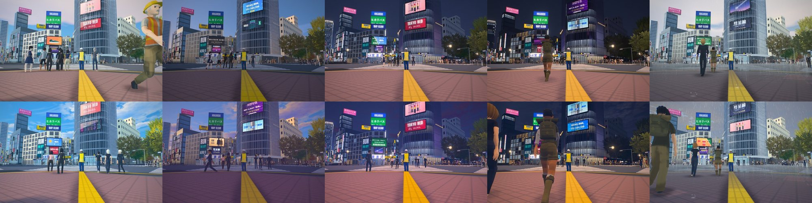

**Tokyo (Marunouchi and Ginza)**

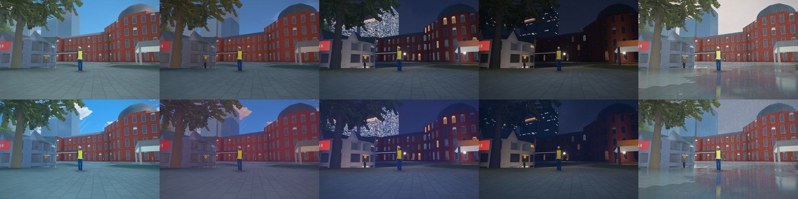

**Shinjuku**

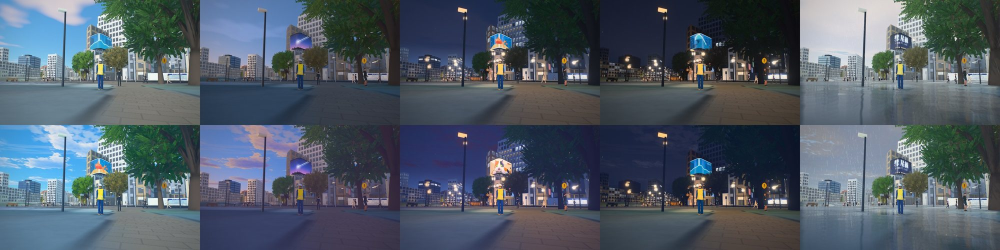

**Kyoto**

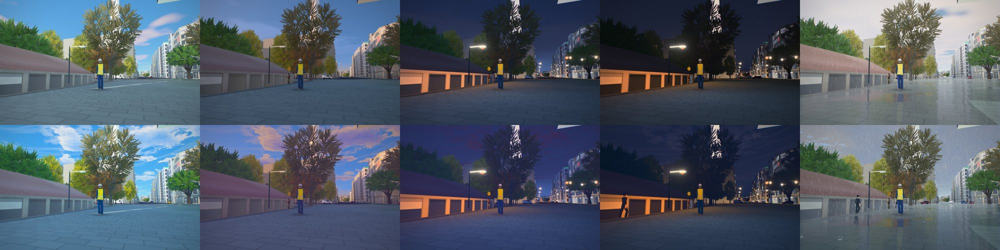

**Higashiyama**

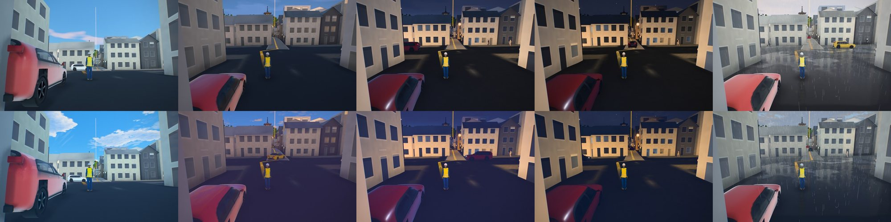

**Fushimi Inari**

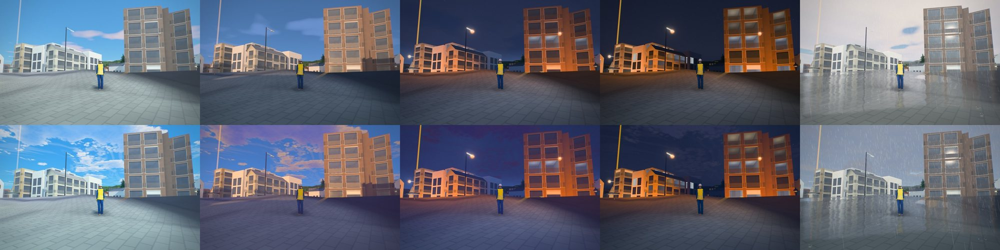

**Tetsugaku-no-michi**

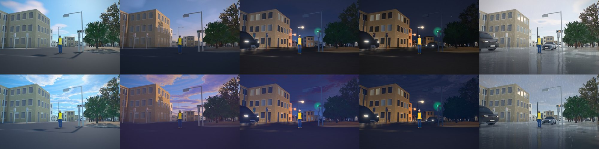

**Kamakura**

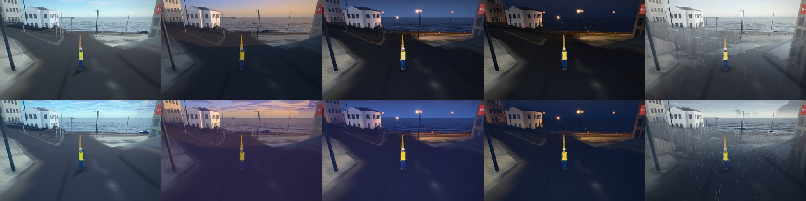

**Sydney**

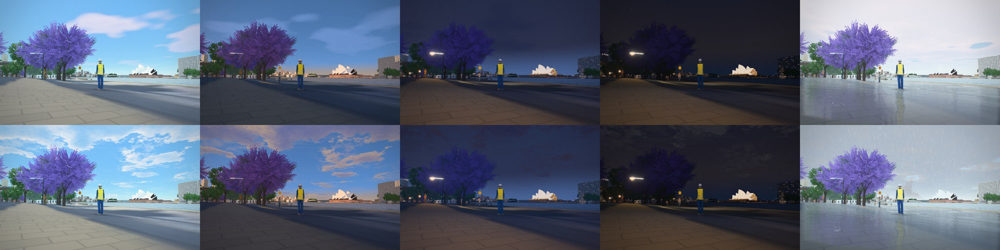

**Queenstown**

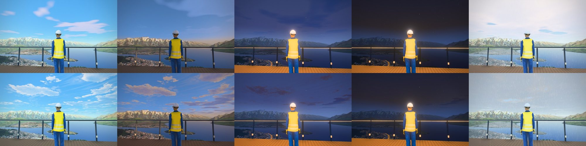

The same views at a phone's size (390 x 844, the look only; five hours across, a map to each block: Fushimi
Inari, Higashiyama, Kamakura, Kyoto, Queenstown, Shibuya, Shinjuku, Sydney, Tetsugaku-no-michi, Tokyo). These were
drawn on the high tier at a phone's frame, not on a phone: a phone picks its own tier, and on the low one the
light shafts are compiled out.

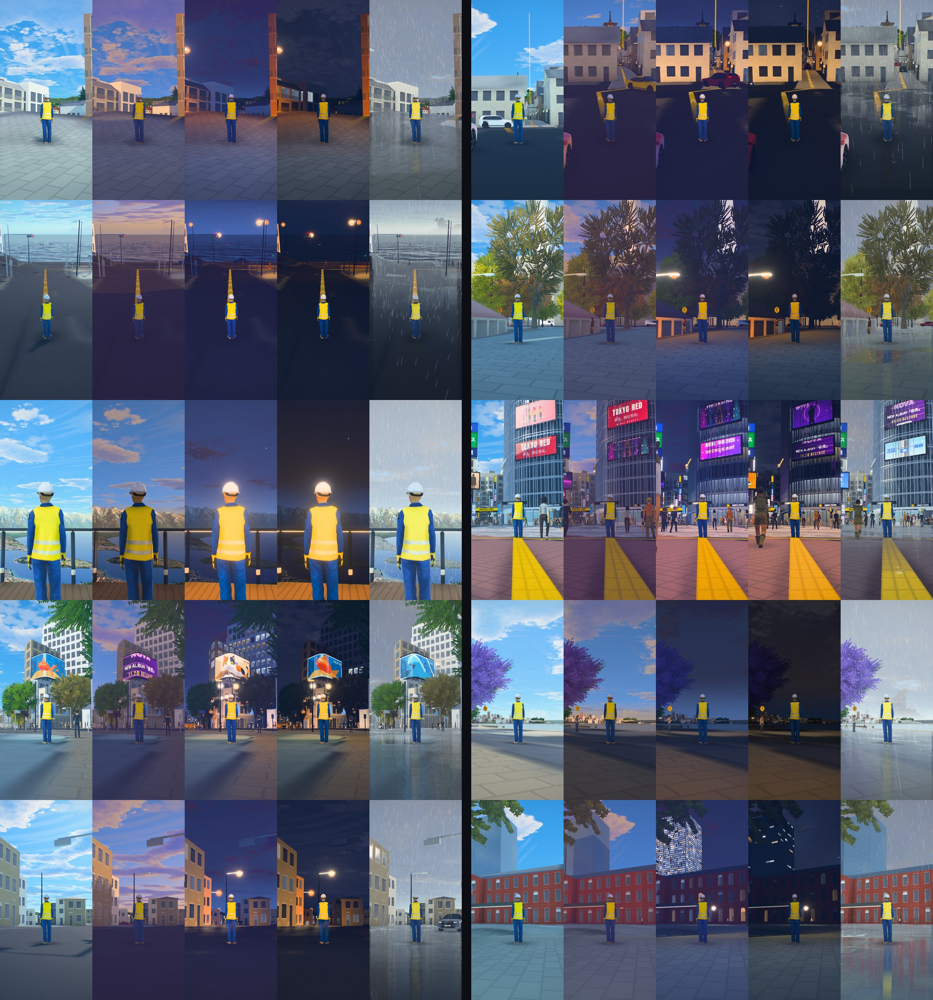

A day in 24 seconds, from before sunrise to night, over Shibuya and over Higashiyama (960 x 540, 12 frames a
second, the clouds at twelve seconds a frame): [images/look/shibuya-day.mp4](images/look/shibuya-day.mp4) and
[images/look/higashiyama-day.mp4](images/look/higashiyama-day.mp4), made with
`xvfb-run -a node tools/day_film.js shibuya out.mp4 960x540 24 12` (see the tool's header for the view). (Made before the clouds were seeded by place and day, so both start from the same sky.)

### Follow-ups (issue 372)

- **Glints on the rails.** The rails are their own material (`web/game/rail.js` `trackMesh`, `glint`): each
  vertex carries its rail's direction (`aRail`), and the rail's head takes the hair highlight of Kajiya and Kay
  (1989), sin(T, H) to the 90th, on the sun's light as its diffuse term has it (shadow, colour, angle). A track
  that runs towards a low sun shows a bright thread where the sun's reflection meets it, which moves with the eye.
  The rails had been wound face down and culled from above (only the sleepers showed, on every map with a railway,
  tram or funicular); they now have a head and two sides 0.14 m deep. The contact wire stays without a glint: at
  1.2 cm it is under a pixel from the street, and its rods are merged with the poles'.
- **A bounce that knows its ground.** A wall reads the sky visibility (`skyvis.webp`) of the ground 4 m in front
  of it, takes from it the height of the horizon there (the texture holds its mean cos^2), and asks whether the sun
  clears it; the ground term of the hemisphere light on that wall is scaled from 0.3 (a canyon's foot in shade) to
  1.25 (an open square in sun) (`web/world.js` `groundBounce`, on the city's walls and every material that takes
  the sky visibility). One texture read; nothing at night; `?bounce=off` leaves it out. It is directionless: a
  street that runs along the sun's bearing counts as shaded when it is deep, which the far sun's height field
  (`?farsun=on`) would settle where it is on.
- **Golden-hour violet.** The `shinkai` preset's golden key took shaded paving far towards violet. Its shade went
  from 0.92 / 0.90 / 1.14 to 0.95 / 0.94 / 1.06 and its lift from 0.012 / 0.006 / 0.030 to 0.008 / 0.006 / 0.016:
  still a cool shade, no longer a purple one. The owner's to judge (before/after stills of Kyoto, Shibuya and
  Kamakura were put in front of them); the old numbers are one line back.
- **Shafts at half size.** The light shafts read the bloom's bright pass, which is drawn at half size anyway: its
  alpha, which the bloom's blur never read, now holds each half-size pixel's brightness before the threshold
  (`web/lens.js` `bright`, `tBright`). Six taps of a half-size target in place of six of the full-size scene; the
  plain lens after a camera effect still reads the scene.
- **Cirrus and a sky per place and day** were done in #390.

### The screens light the street (`web/neon.js`)

Each LED screen's programme is followed on the CPU: the mean colour of every keyframe in its
sheet, the clip it is on, its hours and brightness, and the synchronised slot when all the
crossing's screens play together. The nearest screens, weighted by their size, drive a fixed
set of area lights (high tier 8, medium 4, low none), which fade from one screen to the next as
the camera moves. A screen lights the crowd, the cars, the asphalt and the facades across from
it, never what is behind it, and by day very little. The street's static pools of the screens'
light (`night.js`) stay for the far city and the low tier.

A square with no street lamp in it (the scramble) gets a light card after dark
(`game.look.fill`): a large area light over its middle, standing for the shopfronts,
floodlights and signs round it. A card may be aimed (`aim`) to light one thing from its
side: a small warm one lights Hachiko's bronze, which lamps drawn as points leave black.

### The camera (`web/game/atmosphere.js` camFx)

Depth of field and motion blur only where a camera would show them: photo mode gets an
Aperture slider (f/1.4 to f/16, focused on the focus point, the circle of confusion of a
full-frame lens at the chosen focal length), and the opening shot of a city has a shallow focus
and the camera's motion blur as it cranes in. In play there is neither. Both read a distance
pass drawn only while they are on.

The motion blur takes 12 taps along each pixel's motion, offset per pixel by interleaved gradient
noise (Jimenez, *Next Generation Post Processing in Call of Duty: Advanced Warfare*, SIGGRAPH 2014),
so its steps dissolve into a fine grain instead of standing as copies. Its streak is held to 1.2% of
the frame. A sample further off than the pixel itself is weighted down, so a far surface doesn't
smear over a near one (the background-over-foreground rule of McGuire et al., *A Reconstruction
Filter for Plausible Motion Blur*, I3D 2012, in its simplest form). A camera that jumps more than
5% of the frame in a frame (a cut, or the first frame after a stall) draws no blur. Before issue
265 it took 8 even taps up to 3% of the frame: the arrival onto Queenstown's Skyline deck drew
each edge of the rock and the deck as a row of jagged copies.

### Steep ground (`web/world.js` STEEP_ROCK, every city)

The aerial photograph is taken from straight above, so on a face steeper than about 45 degrees
each of its pixels is drawn over 1.4 to 4 metres of slope, smeared down the fall line. There the
photograph gives way to rock, blended in between 44 and 60 degrees of slope: the photograph's own
tone, blurred to some 30 m, kept to a weathered schist's albedo, with a detail projected along the
face's three axes (triplanar mapping, so nothing stretches) and a foliation's bands. The game's
ground keeps its pavers off those faces (`oeSteep`). Near the camera, where a photo pixel is
magnified past about four screen pixels, its detail is taken towards the mean over a few of its
pixels and the sky's blue is taken out of its baked shadows: the drawn grain and pavers carry the
detail there instead of a smear of the photo's roof shadows and kerb lines.

### Wet streets (`web/mirror.js`, with the weather of #95)

When the ground is wet (`OEWeather.uniforms.uWet`, the weather's), the high tier draws the city a
second time, at half size, from the camera mirrored in the ground under it, and the ground tiles,
paving and road markings take that picture by Fresnel's law for water: clear in the puddles,
blurred and smeared down the frame on the wet film between them, wavering with the asphalt's
grain and, in the rain, with rings in the puddles. Screens, signs, lamps and headlights then
reflect as long images, as they do in a photograph of Shibuya in the rain. Below the high tier
the wet street (darker, smoother: the weather's own patch) reflects the sky and, through its
lower roughness, the screens' area lights.

### Contact shadows (`web/game/ao.js`, issue 138)

By day the facades and street corners read flat because nothing darkened where they meet. On
the medium and high tiers ambient occlusion is gathered from the depth buffer alone (the city is
not drawn a second time): at half the screen's size each pixel's position comes from depth and its
normal from its neighbours, a spiral of 16 samples (8 on the medium tier) in a disc of up to 1.8 m
near the camera and a little more further off gathers the occlusion with SAO's falloff, and two
depth-aware blurs take the noise out. The frame's one full-resolution pass, the lens, darkens each
pixel by it as it reads the scene, upsampled by depth (issue 352: before, a pass of its own drew
the whole frame again for this). It fades out between 160 and 420 m, so the far city keeps the
photograph's light, and is a third weaker at night, when the light is the street's own. The low
tier is untouched.

The frame-time governor (`web/quality.js`, [PERFORMANCE.md](PERFORMANCE.md)) sets its ceiling on a
device that cannot keep up: the lite level, then off, and back when the frame time allows. `?ao=0`
turns it off, `?ao=1` keeps it whatever the governor says, `?ao=show` shows the occlusion alone;
stills take `"ao"` in their views (`tools/game_shot.js`) and `tools/ao_cost.js` measures what each
level costs.

### The crowd (`web/game/game.js`, `game.crowd`)

On the medium and high tiers a city has room for its peak crowd (`pedestrians_peak`: Shibuya
1,600 walkers, drawn skinned near the camera and as instanced low-detail copies beyond); the low
tier keeps its usual number (640), so a phone draws no more people than before. How many are out
follows the hour (`hours`: the morning commute, lunch, the evening peak, the last trains),
Friday and Saturday nights (`weekend_night`) and the weekend (`weekend`; the Shibuya
Redevelopment Association counted 260,000 people a day on weekdays and 390,000 on holidays in
2014). The crowd's looks are the `tokyo` style of `web/game/people.js`; the NPCs are cast
Rocketbox avatars.

### The crossing's sound (`web/game/audio.js`, `game.look.sound`)

The constant beds are off in play: the crowd's murmur and the screens' music were too loud and
always there, so the game keeps them silent; `?noise=1` on the game's URL brings them back. The
station's announcements and the walk signals' calls still play.

All synthesised, no recordings: the crowd's murmur (noise through two voice bands pulsing at a
syllable's rate) as loud as there are people round you; the screens' music, muffled across the
street, while they play (9:00 to midnight); and now and then the station's two-note chime
and an announcement too far off to make out. All of it is heard from the camera, so a film hears
what it sees. The walk signals' bird calls are no longer part of it: they play at every
signalled crossing, from the signal heads (`web/game/walkcalls.js`, [GAME.md](GAME.md), "Walk
signals' calls"), and `sound.signal` is ignored.

## Frame time by tier

Measured with `tools/scramble_shot.js` (the median of a run of frames at each view). In this
repository's checks that is Mesa's llvmpipe, a software renderer, which is only good for
comparing one build with another; a real GPU was not available to measure.

Shibuya, from the middle of the scramble at 21:00, 1440×900, median frame (ms), November 2026:

| Tier | main before | this change |
|---|---|---|
| low | 750, 750 | 700, 733 |
| medium | | 1,750 |
| high | 1,467 | 2,217 |

The low tier is unchanged or a little faster (no area lights, no mirror, the crowd thinned by the
hour). On the high tier the software renderer pays for every area light in every lit fragment
and for the larger crowd; on a GPU those are cheap, but this was not measured on one. A device
that runs slowly can drop a tier in About.

## Stills and the film

The film: `cities/shibuya/scramble_film.json`, 20 s of the scramble at dusk (17:08 to 17:13 on
30 October) under the game's own grade (`"grade": "game"`):
`xvfb-run -a node tools/city_film.js shibuya --spec cities/shibuya/scramble_film.json --out <dir>`.

`tools/scramble_shot.js` takes stills from free cameras with the world running, at the hours
and weather a views file names (`tools/views/shibuya-scramble.json`: from Hachiko, from the
middle of the scramble and from the Starbucks window over it, by day, at dusk, at night and at
night in the rain).
