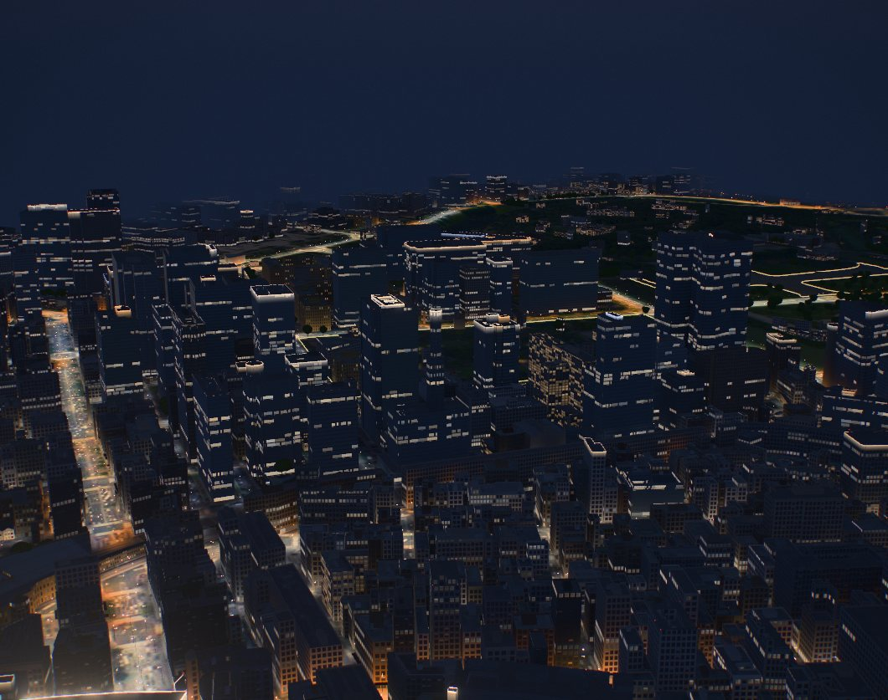
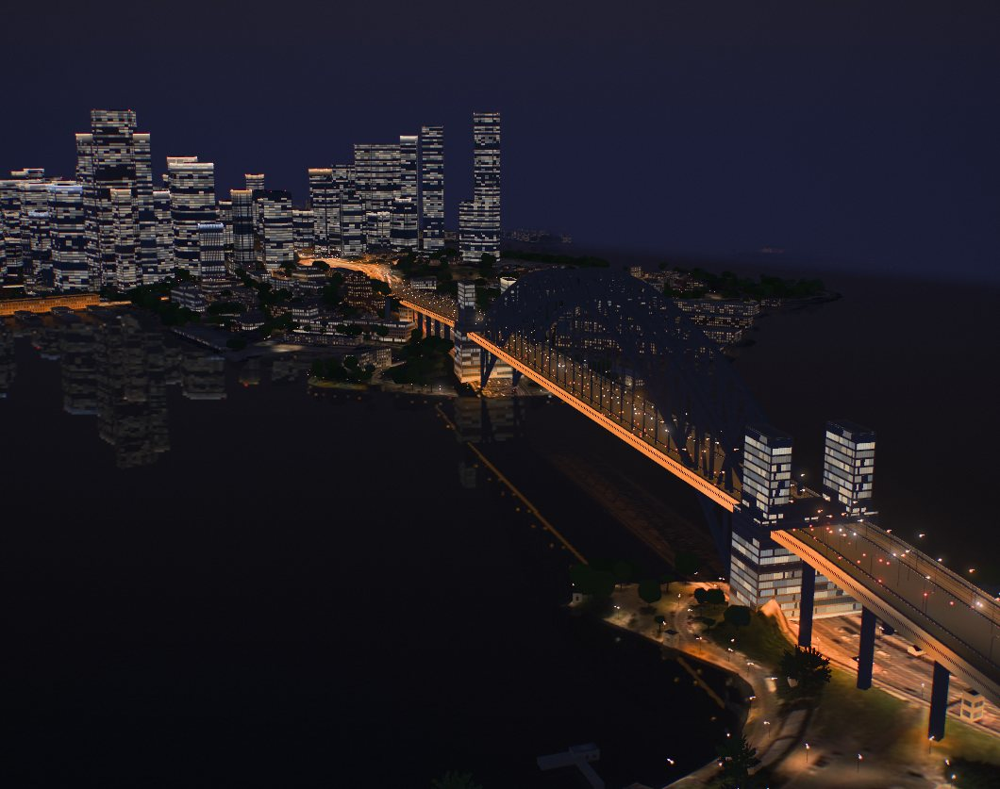
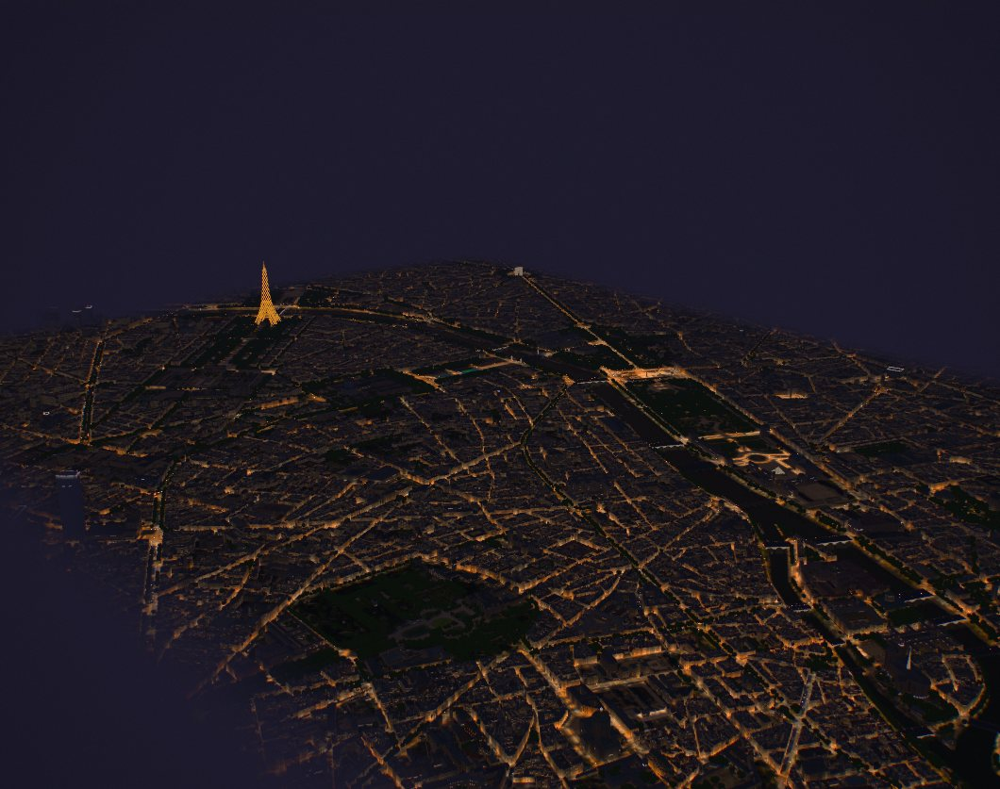
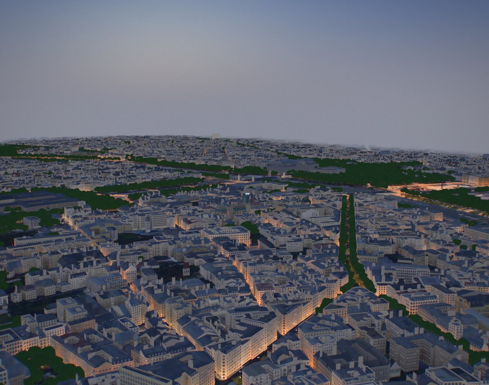
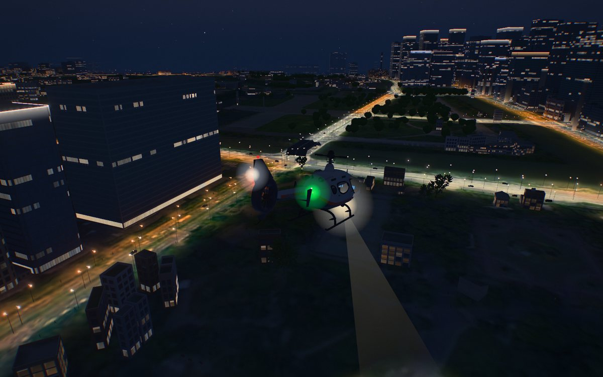
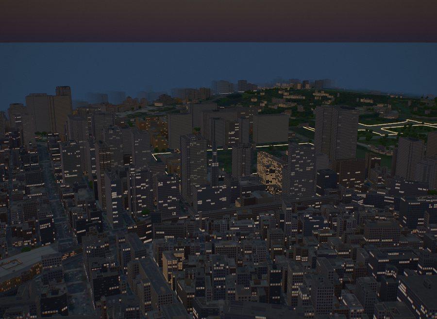

# The city at night

After dark every city shows its lights the way an aerial photograph does: lines of
street lights along every mapped road, the pavement and the foot of the buildings lit
under them, the traffic's headlights and tail lights, office towers lit floor by floor
with their crowns lit, red lights on the tallest tops, and over it all a deep blue sky
with the city's glow low on the horizon. The model viewer and the game share all of it
(`web/night.js`, `web/world.js`, `web/buildings.js`, `web/lens.js`).



| Sydney: the Harbour Bridge, its traffic and the CBD in the harbour | Paris at 23:30: the street grid from 1.5 km |
|---|---|
|  |  |
| **Paris at dusk: the boulevards light the lower floors** | **The game: Tokyo from the helicopter** |
|  |  |

Before this, the night was a grey dusk: the same Tokyo view at 21:00.



## What makes a night city read as premium

We looked at how night cityscapes are photographed and lit, and at how real-time
renderers draw night cities, before deciding what to draw.

- **The sky is never black.** Photographers shoot cities in the blue hour, or expose a
  night so that the sky stays a deep blue: the sky and the artificial light are then of
  similar brightness, both read, and the warm lights stand against a cool sky
  ([Mark Gray](https://blog.markgray.com.au/blog/blue-hour-photography),
  [Zoner](https://learn.zoner.com/making-the-most-of-the-blue-hour/),
  [Amateur Photographer](https://amateurphotographer.com/technique/get-better-night-shots-cities/)).
  The orange–blue split does most of the work.
- **A hierarchy of light, not an even grid.** Facade lighting designers contrast the
  parts of a building: the body is left dark with its windows, and the light goes to the
  crown, the verticals and the entrances, mostly in white light with its temperature
  varied rather than in colour
  ([Masterlight](https://masterlight.ee/facade-lighting-design/),
  [Alcon Lighting](https://www.alconlighting.com/blog/?p=9725),
  [IADA 2025, ZILART Tower](https://ad-c.org/winner/zilart-platinum-winner-architectural-and-facade-lighting-category-iada-2025/)).
  A tower drawn as a grid of equally bright windows looks cheap.
- **Offices light by the floor, homes by the room.** A tenant's floor, or the cleaners
  going up the building, light whole storeys; flats light one window or two. From across
  a city an office tower reads in bands.
- **Glass reflects.** At night a curtain wall is a dark mirror: blue sky above, the
  city's glow and its neighbours' lights below.
- **Many lights as materials, not light sources.** Real-time night cities draw street
  lights, windows and traffic as emissive materials rather than one light per lamp
  (the Unreal Engine *City Lights* tool reports 1–1.5 ms for a whole city this way;
  [forum](https://forums.unrealengine.com/t/released-city-lights-night-city-traffic-streetlights-and-lit-windows-without-light-actors-ue-5-1-to-5-8/2841691)),
  and per-building window lighting is procedural (Chandler, Yang and Ren 2015, cited by
  [Hlavová, *Rendering Night Cities*, 2025](https://dcgi.fel.cvut.cz/en/theses/2025/hlavoter/)).
  Faking night by thickening the haze is a known mistake
  ([Planetside forum](https://planetside.co.uk/forums/index.php?msg=271595)).

No code was taken from any of these; the ideas are general. What was adopted, and where:

| Idea | Here |
|---|---|
| A sky that stays blue, warm low down | `world.js`: after dark the sky shader blends to a designed night sky, deep blue overhead and the city's glow over the horizon (`style.skyglow`); the haze at the model's edge is the night's blue |
| Warm lights against cool shadows | `lens.js` `uNightTone`: at night the grade takes the shadows to blue and the lights to amber |
| A hierarchy on the towers | `night.js`: crowns lit on 60% of the towers over 60 m (a wash up the top storeys and a line along the parapet, mostly white); `buildings.js`: lobbies lit all night |
| Offices by the floor, homes by the room | `buildings.js`: an office's lit rooms follow its floors; each lit run has its own brightness; some rooms are under cool light |
| Glass that reflects | the environment light is drawn from the night sky, so curtain walls mirror blue above and warm below |
| Lights as materials | `night.js`: lamps, traffic and tower lights are points and strips in three draw calls; the light on the ground is one texture |

## The pieces

**Street lights.** A lamp every 28 to 44 m along each mapped road by its class, at the
kerb, on one side of a small street and staggered along both sides of a large one, 5 to
13 m up, in the city's mix of high-pressure sodium and LED. The lamps OpenStreetMap
maps (park paths, footways) are lit too. A lamp is a point of light that keeps its size
on screen as it recedes and dims more slowly than the inverse square, so the far city
still sparkles; it is brightest seen from the side, as a lamp's lens is.

**The light on the ground.** Every lamp's pool, stretched along its road and centred a
little out over it, is splatted once into a map over the model's frame (2048 texels on
the long side, 1024 on the low tier) and kept as square roots in 8 bits, with mipmaps.
The ground adds it to what it reflects, so lit asphalt shows the photo's road markings;
piers and bridge decks do too. Building walls add the light in front of them, fading up
the lower floors. A coarse mip of the same map is the glow of a busy district. Where
pools overlap (a boulevard's two rows, a bridge, a junction) the light rolls off on a
soft knee instead of adding up to white.

**Traffic.** Cars as points of light moving at the road's speed on its side of the road,
white where they come towards the camera and red where they go away, as many as the hour
has (rush hours full, three in the morning a sixth). Motorways run one way along each
mapped carriageway. In the game the real cars near the player take over within their
radius of the camera (`game.crowd.radius_m` plus 100 m; 550 m by default).

**The towers.** Red aircraft warning lights at the corners of every top above the
country's height (60 m in Japan, where they flash together forty times a minute; 90 to
110 m elsewhere, steady), and lit crowns.

**Poles.** The generated lamps stand on poles with an arm out over the road, in
instanced batches of 300 m squares drawn within 500 m of the camera.

**When.** Everything fades in as the street lights come on, about when the sun sets.
Offices empty through the evening to a few floors lit all night.

**The night sky and the haze.** The sky's own model lifts a night sky to a grey tenth
of the day's, which lit every glass tower as if under an overcast evening. After dark it
now blends to the designed sky. The environment light is drawn from it, after the haze
for the hour is set: it used to keep the previous hour's haze, so a night kept the day's
bright horizon in every reflection (the cause of the grey nights in the game too).

## The data

`pipeline/night_lights.py` writes `web/data/<city>/night.json` from the city's
`game.json` (it runs at the end of `pipeline/game_data.py`, or on its own with
`--city <id>` or `--all`): the roads, simplified to within 1 m across and 0.5 m in
height, with their class and speed; the mapped lamps; and the city's style. Bridge parts
keep their deck's height and tunnels are left out (`game_data.py`). 50 to 310 kB a city.

The style comes from defaults by country, overridden by a `night` block in
`cities/<id>/city.json`:

| Key | Meaning |
|---|---|
| `street`, `highway` | `[[colour, share], ...]`: the street lamps' colours, and the motorways' and trunk roads' |
| `keep` | the side traffic keeps to (else `game.keep`, the tram's, or by country) |
| `aviation` | `{from_m, flash}`: the height from which tops carry red lights, and whether they flash |
| `crown` | `{from_m, share, colours}`: which towers have their crowns lit, and in what light |
| `skyglow` | the colour the city's lights give the sky low down |

| Country | Street lights | Motorways | Aircraft lights |
|---|---|---|---|
| Japan | mostly 4000–5000 K LED, a little sodium | half sodium | from 60 m, flashing |
| Hong Kong | mostly sodium, some LED | sodium | from 90 m; crowns in colour too |
| France | sodium and 3000 K | mostly sodium | from 100 m |
| Netherlands | 3000 K LED, some sodium | 4000 K | from 100 m |
| Australia | 3000–4000 K LED, some sodium | 4000 K | from 110 m |

## Checking it

```bash
python3 -m http.server 8800 --directory web &
QUERY=water=high xvfb-run -a node tools/city_shot.js tokyo views.json out 1440 900
```

`tools/city_shot.js` takes its stills at the desktop tier (`TIER` for the others) and with
Mesa's llvmpipe under `xvfb-run`; `QUERY=water=high` adds the water's reflection, which a
software renderer leaves out. The stills here were taken that way. Not checked: a real
GPU, Safari and iOS.
