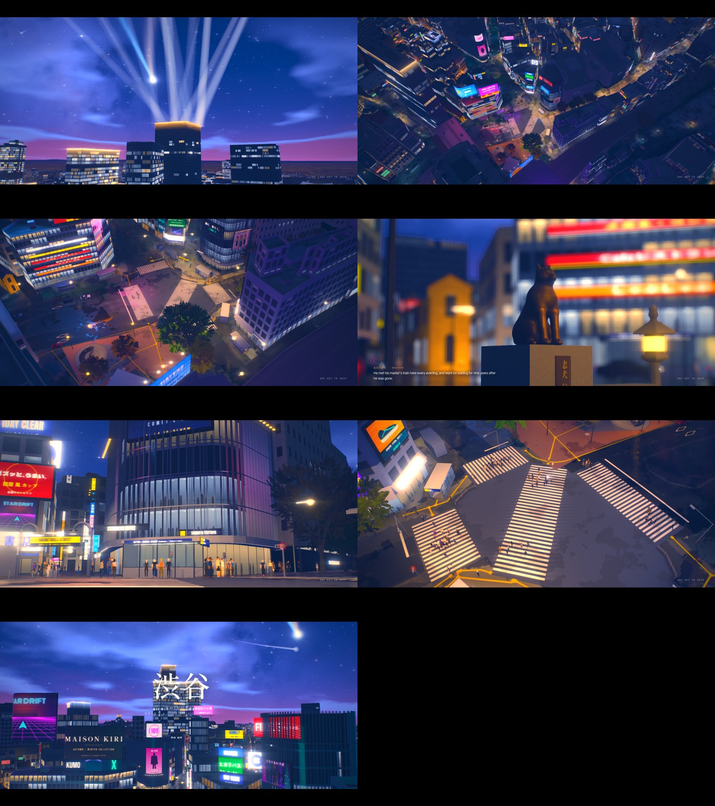

# The overture: each map's opening

The first time you play a map, control does not come to you with a camera move from the
title. It comes at the end of a short film, about forty seconds, played in the game itself:
the map's own buildings, crowd, traffic, sky and sun, cut to a score. A guide (a cherry
petal in Shibuya in spring) carries the camera through the place's signature sights and
lands on the shoulder of one person in the crowd. That person is you, and the chase camera
takes over without a cut.

| | |
|---|---|
| Spec | `cities/<id>/city.json` → `game.overture` (copied to `web/data/<id>/game.json` by `pipeline/game_text.py` and `game_data.py`) |
| Engine | `web/game/overture.js` (the shots, the guide, the air, the type, the score's playback), started by `web/game/game.js` from Play |
| Score | `web/film-score.js` (shared with the city films): the plan in `overture.score` |
| Tool | `tools/overture_film.js <city>`: `--stills` (each shot, and a clearance check), or the whole film with its score |
| Plays | the first time on that map in this browser (`oe3d-overture` in `localStorage`), and with `?overture=1`. Not on Continue, an arrival from the subway map, or with reduced motion (the plain crane plays). Any key or tap eases down to the player in under a second |

## Why it can move people: what the Shinkai films do, from first principles

What makes an opening by Makoto Shinkai (*5 Centimeters per Second*, *The Garden of Words*,
*Your Name*, *Weathering with You*, *Suzume*) land is not the drawing alone. Taking it apart:

1. **Light is the subject.** Low sun, backlight, flare, a sky that fills two thirds of the
   frame and changes colour from top to bottom. The emotion is carried by the light, not by
   the objects in it.
2. **The ordinary made sacred.** A crossing signal, a train's door, overhead wires, a vending
   machine, a puddle: everyday things seen closely and lit beautifully, against the scale of
   the city and the sky.
3. **Things in the air.** Petals, rain, dust, lens glints. They give depth, show the wind and
   make time visible. *5 Centimeters per Second* is named after the speed a cherry petal falls.
4. **Strangers and distance.** The stories are about two people separated by distance or time,
   and the crowds they pass through. A crowd is never background: it is where someone is
   missing, or found.
5. **Editing on music.** A montage of short shots of details, each a beat or two, cut to the
   score; then a breath (a held shot, near silence), then a release on the downbeat.

What this project can match, and how:

| | The films | Here |
|---|---|---|
| Light | painted | the real sun for the place, date and hour (`web/sun.js`), the title screen's grade and flare (`web/lens.js`), bloom; the overture can run a time-lapse (`lapse`) |
| Detail | painted closely in every frame | measured open data: strong at the scale of streets and skylines, weaker on a facade up close. **So the shots play to it:** backlit silhouettes, long lenses across the city, the guide close to the lens and the city behind it. A close-up is kept for what is modelled finely (Hachiko, the scramble's signals) |
| Air | drawn | the guide and a few hundred instanced petals round the camera, by quality tier |
| Strangers | characters | the game's own crowd, put on the footways round the scramble; the overture ends on one of them: you |
| Music | composed | synthesised in the page (no audio files): a piano arpeggio on I–V–vi–IV, a hush, and the downbeat on the green |
| Truth | invented | **everything in it is real and live**: the sun of today (or the hour you choose), the season decides the guide, the signal is the scramble's own, the birds are the ones Japan's crossings sing |

The last row is what an animated film cannot do and this can: the overture is never quite the
same twice. In April it is a cherry petal at sunset; in November a ginkgo leaf (Tokyo's own
tree) in the early dark with the screens lit; in midsummer a mote of light.

## Per map, or per district?

Both, at two scales, because they do two different jobs:

- **The overture (per map, about 40 s, once).** The hook: the whole place's scale and feeling,
  ending on you. One idea per map, one guide, one score. Shibuya's map is Shibuya with
  Sangenjaya, Harajuku and Omotesando; its overture stays round the scramble, where the map
  starts, rather than touring three kilometres (a travelogue is the opposite of the feeling).
- **The threshold (per district, 6–9 s, the first arrival).** When you first reach a district
  (by the map's travel or on foot), a short vignette in that district's own voice, ending in the
  station sign (`places.js`, the 駅名標 caption). Designed below; built next, on the same engine
  (a threshold is an overture of two or three shots, keyed by the area).

Each place gets its own guide and its own camera language, born from what it is, not a petal
everywhere.

## Shibuya: 交差 · Crossing

*In Shibuya, up to three thousand strangers cross at once when the lights change. Tonight, one
of them is you.*

| # | Shot | s | Picture | Sound |
|---|---|---|---|---|
| 1 | `sky` | 7 | Fade up on the roof of SHIBUYA SKY, 229 m. The camera eases towards the glass at the edge facing the scramble, the sun low beyond it. The guide rests on the ledge, trembling, then a gust lifts it over the edge. Caption: *SHIBUYA SKY · 229 m* | wind, the city far below, a drone |
| 2 | `fall` | 8 | The camera falls with it: a long descent past Scramble Square's face towards the crossing, the city opening out, the lights coming on. **Title: 渋谷 / Shibuya / 交差 · Crossing**, out of a blur, letters closing up | the riser, the hit on the title, then the piano arpeggio |
| 3 | `hachiko` | 3.5 | Hachiko, close, on a long lens; the petal brushes past his nose. Caption: *He met his master's train here every evening, and went on waiting for nine years after he was gone.* | piano |
| 4 | `screens` | 3.5 | From the kerb, up at QFRONT's screens on a long lens, the petal crossing close to the lens | piano |
| 5 | `gai` | 3.5 | Into Center Gai under its gate, the petal running ahead into the lane | piano |
| 6 | `above` | 7 | Straight down over the scramble, turning slowly, a six-minute time-lapse: the traffic runs, the crowd gathers at every kerb. **The hush**: the music holds its breath. On the downbeat every crossing turns green at once | silence but the city; on green, the hit and the birds |
| 7 | `land` | 9.5 | Down into the crowd as it surges out, the petal ahead, settling on one shoulder; over that shoulder, the chase camera. Caption: *When the lights change, up to three thousand people cross at once. Tonight, one of them is you.* Control is yours mid-step | the birds of the crossing, the chord ringing out |

You stand at the Hachiko-side kerb of the diagonal crosswalk, facing QFRONT along it, as the
walk turns green (issue #110 asks the same of the game's start).

**The crossing's birds.** Japan's audible pedestrian signals are birdsong, and since the
National Police Agency's 2003 notice the prefectures have been moving them to 異種鳴き交わし: the
two ends of a crosswalk call and answer about 1.5 s apart, a chick's ピヨ answered by ピヨピヨ on
one road and a cuckoo's カッコー answered by カカッコー on the road across it (Yamanashi, for
example, gives ピヨ to east–west crossings and カッコー to north–south ones; Shimane's 2019
guideline defines both the same-call and the different-call forms). At a scramble every
crossing walks at once, so both birds call together. Whether each crosswalk at Shibuya's
scramble has a speaker, and which call it gives, has not been checked on site.

### After dark: 星降る夜 · A night of falling stars

When the sun is more than 6° down at the hour the game starts, the map plays its night overture
(`overture.night`: what differs after dark, with its own shots, sky, grade and score). Shibuya's is
the night after rain, under a comet.

| # | Shot | s | Picture |
|---|---|---|---|
| 1 | `stars` | 6.5 | Fade up on the Milky Way; the camera tilts down to Scramble Square, its eighteen searchlights reaching into the sky, a comet over the horizon's glow and a meteor crossing |
| 2 | `deck` | 6 | At SKY EDGE on the roof, 229 m: from the comet down over the glass to the city's lights. Caption: *SHIBUYA SKY · 229 m* |
| 3 | `fall` | 5.5 | Over the edge and down the tower's face towards the scramble, the signs coming up out of the dark. The walk signals turn red and the crowd begins to gather |
| 4 | `hachiko` | 5 | Hachiko in profile on a long lens, lit warm, the wet street and the lit fronts behind him out of focus. Caption: his nine years |
| 5 | `screens` | 4.5 | From the kerb, low over the wet crosswalk, up QFRONT to its screens; the crowd waits across the junction. **The hush**; then on the downbeat every crossing turns green at once |
| 6 | `above` | 6.5 | Over the scramble as the crowd crosses from every kerb |
| 7 | `wide` | 9 | Up and back over the station side as they cross, 109 and the screens down Dogenzaka, the sky opening above. **Title: 渋谷 / Shibuya / 星降る夜**. Fade to the kerb, where control is yours |

What makes a night in these films, taken apart, and what answers it here:

| | The films | Here |
|---|---|---|
| The sky is the picture | two thirds of the frame; indigo at the top, a clearer blue lower, a rose glow where the city lifts it; stars beyond counting, cloud with lit edges | a sky painted in a shader for the overture (`overture.night.sky`, `nightSky` in `web/game/overture.js`): the gradient in four bands, the Milky Way with a warmer core, stars in three sizes and two colours, thin cloud lit from below and banks of cumulus whose thin edges take the sky's light (`banks`, `rim`) |
| Something rare in it | a comet, a meteor shower | a comet that stays where it is from shot to shot, as a comet does (`sky.comet`: bearing, height, the tails' turn and length): a straight blue tail of gas and a broad pale one of dust that curves away, which is how real comets look; the guide is a meteor, with a shower of smaller ones |
| After rain | wet asphalt carrying every sign as a long reflection | `wet: 1`: the streets wet from a shower that has passed under a clear sky (the weather's own wet look and the mirror of `web/mirror.js`; not on the low tier); the weather goes back to what it was when the overture ends and the streets dry as they would |
| Light as an event | searchlights, signals, screens | `show: true` turns CROSSING LIGHT on whatever the hour; the beams are soft cones now, brightest through their middle (`web/lights.js`); the green lands on the score's downbeat |
| The lens | glow round every lamp, streaks | more bloom (`grade.bloom`), and `anime.streak`: each lamp, sign and headlight drawn out sideways into a thin streak of its own colour, as an anamorphic lens does (`ANIME` in `web/game/atmosphere.js`) |
| Depth | the far city sinking into blue | `anime.haze`: distance into a blue-violet air, so the horizon's lights sit under the sky's glow rather than as a band |

The crowd is seen from across the junction and from above; no shot stands among it.

### The guide by season (on the game's clock)

| Dates | Guide | Why |
|---|---|---|
| 18 Mar – 20 Apr | cherry petal | Tokyo's bloom |
| 21 Apr – 24 Oct | a mote of light | the long light of summer evenings |
| 25 Oct – 20 Dec | ginkgo leaf | Tokyo's tree; the ginkgo avenue at Jingu Gaien is next door |
| 21 Dec – 17 Mar | snowflake | rare in Tokyo, and the more precious for it |

### Thresholds for Shibuya's districts (designed, next)

| District | Guide | Picture |
|---|---|---|
| Sangenjaya 三軒茶屋 | steam from the bathhouse chimney | Dusk on the triangle's lanes; the camera comes down the chimney's plume into the lane as the lamps come on one by one, past the noren of the bathhouse |
| Harajuku 原宿 | a shaft of light | From Takeshita-dori's noise through the great torii into the woods of Meiji Jingu: the city's sound drops away under the camphor trees |
| Omotesando 表参道 | the zelkova trunks | A slow track down the avenue at low height, the trunks passing like a metronome on the score's pulse; in December, their lights |

## Seeds for the other maps (one idea each, not built)

| Map | Guide | Idea |
|---|---|---|
| Shinjuku | a raindrop | *The Garden of Words*: from the cloud base, one drop falls past the towers into Shinjuku Gyoen's pond; its ripple becomes the shelter where you stand. On a dry day, a drop of dew from a maple leaf |
| Asakusa | incense smoke | From the jōkōro at Sensō-ji, the smoke climbs past the five-storey pagoda and the Skytree comes up across the Sumida |
| Akihabara | the departure melody | A Sobu line train across the Kanda river at blue hour, the signs reflected along its windows, the station melody as the score's first notes |
| Tokyo | a shinkansen | The red brick of Tokyo Station at dawn as a train glides in |
| Kyoto | a temple bell | The bell's ring seen as light passing over the tile roofs; a maple leaf in autumn; through the torii of Fushimi Inari |
| Osaka | a reflection | Into the neon reflected in the Dōtonbori canal and out of it into the street: the mirror as the cut |
| Hong Kong | the Star Ferry's wake | Across Victoria Harbour as the towers light up at eight |
| Sydney | first light | A silver gull riding the wind over the harbour as the sun reaches the sails first |
| Melbourne | a tram's spark | Down a laneway behind a tram's pantograph |
| Melbourne Bayside | a little penguin's wake | Ashore on the St Kilda breakwater at dusk |
| Paris | the sparkle | Timed so the Eiffel Tower's five minutes of sparkle land on the downbeat after dark |
| Amsterdam | a heron | Low along the canal ring, under the bridges, the carillon |
| Reef sites | a turtle hatchling | Down the beach at dusk into the water; the reef opens |

## Making one: the workflow

1. **The idea.** One sentence about what the place means, and the guide that carries it. Look
   at photographs and films of the place; pick the light (the date and hour the overture is
   best at, though it plays at the player's own).
2. **The points.** `node tools/city_film.js <city> --brief` lists the landmarks, labels and the
   sun. Write points as anchors (`["@hachiko", dx, dy, dz]`, `["label:QFRONT", 0, 0, 26]`,
   `["@scramble.lines.4.0"]`, `{"lerp": [A, B], "m": -1.2}`, `["end", ...]`) so that a rebuilt
   map moves the overture with it.
3. **The shots.** `orbit`, `move`, `chase` (behind the guide) and a last `land`; a guide path per
   shot; `drift`, `fov`, `lapse`, `title`, `caption`, `cues` (`red`, `green` on the map's
   `signal` junction). Keep it to about forty seconds and seven shots. A night overture may add
   `sky` (with `comet`, `banks`), `wet`, `show` and `anime.streak`.
4. **The score.** `score` in the film's terms (`root`, `scale`, `chords`, `tempo`, `voice`) with
   `arp`, `hush_shot`/`hush_at` and `chirp` where they fit.
5. **Check.** `xvfb-run -a node tools/overture_film.js <city> --stills` prints each shot's
   clearance over the roofs and how often a roof hides the guide, and takes a still per shot
   (`--shots a,b` for some of them);
   then take it at a phone's size (`--size 390x844`) and at night (`--time 19:30`), and render
   the film to watch it with its sound.
6. **Copy it** into the game: `python pipeline/game_text.py <city>`.

## Sources and licences

- The engine, the shapes of the petal, leaf and flake, the type and the score are this
  project's own code; three.js (MIT) draws them.
- The Shinkai films are referred to for their techniques only; nothing from them (no frame, no
  character, no music) is used.
- The crossing signals: Shimane Prefectural Police, 視覚障害者用付加装置に関する設置・運用指針
  (2019); Yamanashi Prefectural Police, バリアフリー対応型信号機; the National Police Agency's
  2003 notice as reported by Norimono News (trafficnews.jp, 「通りゃんせ」の信号消滅へ?).
- Hachiko: the dog waited at the station from his owner's death in May 1925 until his own in
  March 1935.
