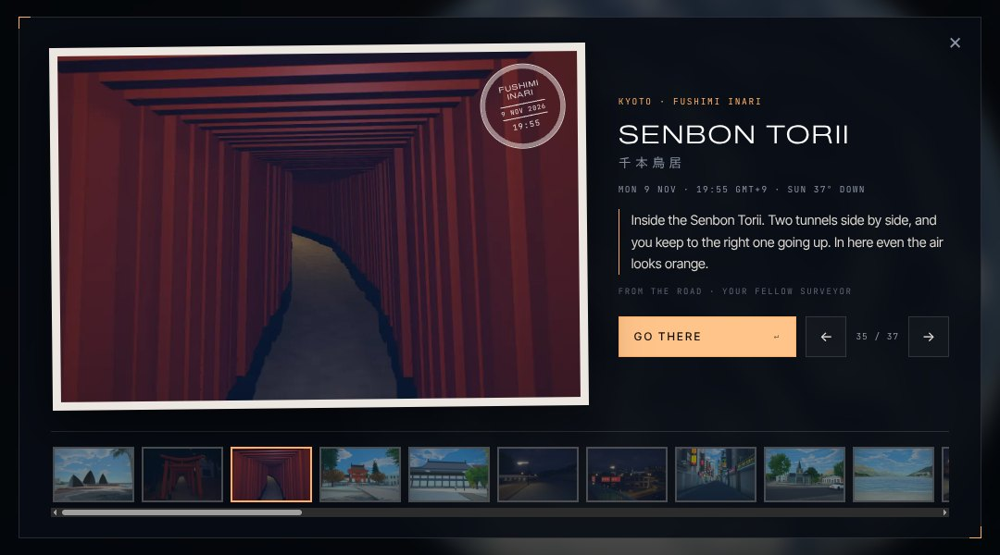
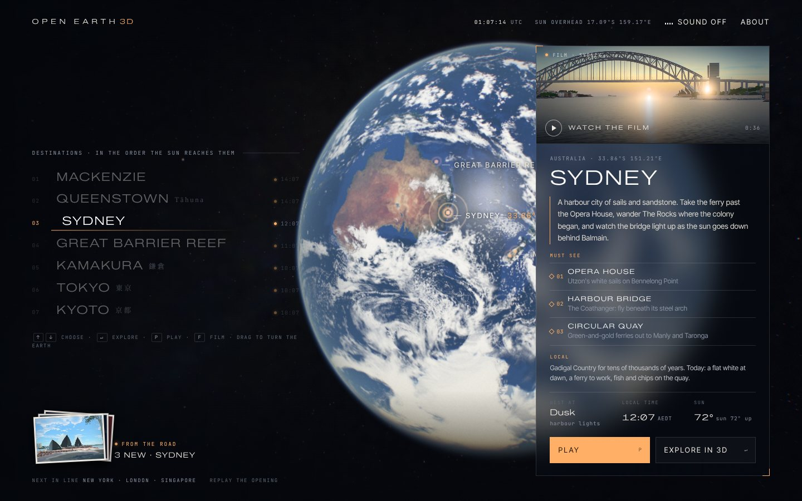
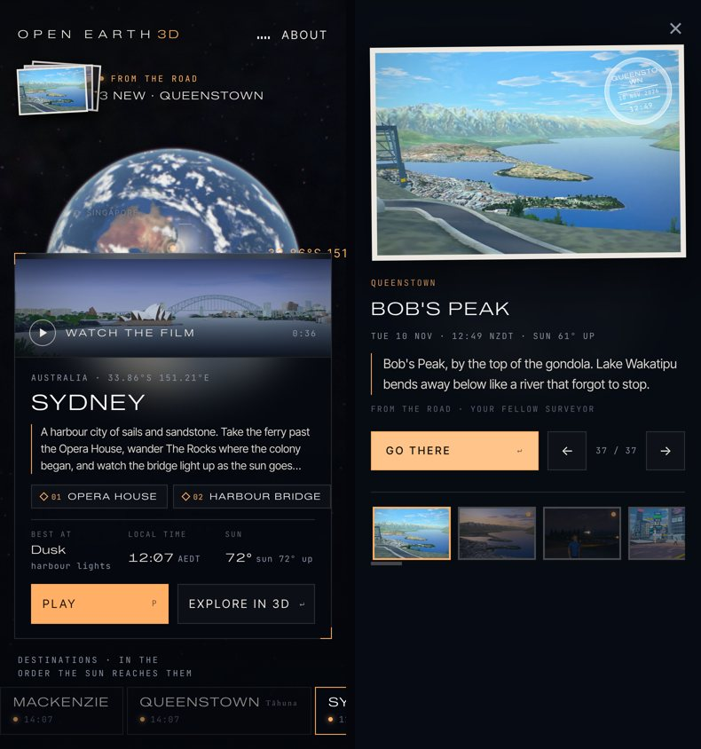

# Postcards from the road

While you are away, your surveyor keeps travelling, and sends one postcard a day. When you come back,
the title screen has a small pile of them: a photograph of your surveyor at a real spot in one of the live cities, where and when it was
taken, the sun there at that minute, and a line of their diary. **Go there** on a card dives to that
city and starts the game on the photographer's spot, in the photograph's light.



| The pile on the menu | On a phone |
|---|---|
|  |  |

That is all of it. There is no second game inside the game: no food to pack, no currency, no timers,
no notifications. The postcards are the part of the game that happens while you are not playing, and
each one is a door back into the part that happens while you are.

## Why it is built this way

The idea comes from *Tabikaeru* (Travel Frog, Hit-Point, 2017): a traveller you do not control, who
goes away on their own and sends photographs home. What makes it work is absence. The pleasure is in
coming back and finding that something happened without you.

This game's pleasure is the opposite one: being there, on foot, under the real sun. Two cores side by
side dilute each other, so only the absence is taken, and it is made to serve the presence:

| From Travel Frog | Here |
|---|---|
| The traveller leaves when it likes; you only find out | Your surveyor travels on real time while you are away; nothing to manage |
| The frog is in its photographs: that is the proof it went | The surveyor you play stands in every picture, facing the camera |
| Photographs arrive while you are away | One postcard for each day away, three at most at a visit |
| An album | The album strip under the card, and a page in each map's passport |
| Packing food and charms, clover as currency, a lottery | Left out: a second loop to tend would be a second game |
| Rare photographs as a collection to complete | Left out: no rarity, no gacha; the next card is from wherever the journey is |
| The frog's world is drawn, and you cannot go there | Every postcard is a place in the model, and one button takes you to it |

Other games this borrows a thought from, without their look: *Animal Crossing*'s letters (the world
writes to you; a visit is short and finite), *Wordle* (a small ration a day, never a backlog to work
off), *Alba* and *Pokémon Snap* (a photograph as the way a place is noticed), and *Microsoft Flight
Simulator*'s world map (the menu is the world; a picture of a place is a way into it).

What only this project can do: the postcard is true. A card dated 17:42 in Kyoto shows Kyoto in the
light the real sun gave it at 17:42 that day, by the same NOAA equations the cities use, and the place
in the picture is the place you land in.

## What the player sees

- **The pile** on the title's menu: up to three cards fanned, "From the road", how many are new and
  where the newest is from. Bottom left on a desktop, under the logo on a phone.
- **The card**: the photograph on a paper edge with a postmark (the map, the date, the minute), the
  map and the spot's name (in its own script too), the local date and time with the sun's height, one
  line of the diary, and **Go there**. Arrows, the album strip, or ← → change the card; Esc closes.
- **Go there**: the title's dive to that city, then the game's own title card over that spot, with
  "As on the postcard" chosen as the time to start at. Play starts you where the photographer stood.
- **The passport** of each map lists the postcards that came from it.

## How a journey is worked out

`web/postcards.js`, with no server. The state is one entry in `localStorage` (`oe3d-postcards`): a
seed, the time of the last visit, where the traveller is, and the album.

- A visit brings one card for each day since the last visit, by the player's own calendar (so somebody
  who looks in every morning finds one every morning), three at most. The first visit ever brings one, so a
  new player meets the idea at once. A second visit on the same day brings none.
- The newest card is dated at some hour of the last sixteen, so that a player who always looks in at the
  same hour still sees every light; the others about a day apart before
  it, none before the last visit. A card that would be dated in the small hours (00:30 to 05:00 local)
  is from the evening before instead.
- The traveller stays two or three cards in one map and then moves to another: not either of the last
  two, and one the album has fewest cards from, so the journey gets round every live map. Within a
  map, a spot the album does not have yet.
- The light of a card is the sun's over that city at that minute: `day` above 8°, `night` below -5°,
  between them `dawn` while it is rising and `dusk` while it is setting.
- The album keeps the newest 30: a month.

Telemetry (through `web/telemetry.js`, which sends nothing from automated browsers or with Do Not
Track): `postcards_shown` (how many new, unseen and in the album), `postcard_open` and `postcard_go`
(city, spot, light). The two numbers to watch are the return rate of visitors who were shown a pile,
and the share of opened cards that go on to **Go there**.

## The stills

A city names its spots in `cities/<id>/postcards.json`:

```json
{"id": "steps", "name": "The Opera House forecourt", "at": [293.9, 391.3], "look": [330, 520], "lookUp": 22,
 "lines": {"any": ["..."], "dusk": ["..."]}}
```

`at` is where the photographer stands (local metres, x east, y north), with `z` for a deck or a roof
rather than the street; `look` is what the camera looks at, `lookUp` metres over the ground the
photographer stands on; `up` raises the eye from 1.65 m, `fov` widens the lens from 46°; `native` is the
name in the place's own script. `lines` gives the diary: `any`, or a list for one light.

```
tools/postcards.sh sydney kyoto        # the stills of these maps, packed, and the index
python pipeline/postcards.py index     # the index alone, after a change to names or lines
```

`tools/postcards.sh` runs `tools/game_shot.js` on the views `pipeline/postcards.py views` writes: each
spot at four lights (25 minutes after sunrise, 11:00, 8 minutes after sunset, 100 minutes after sunset) on the day it is
run, through the game's own sky, haze and post stack at the desktop tier, in photo mode from the
photographer's eye, once nobody in the crowd is within 7 m of the lens, with the surveyor standing a few
metres in front, a little to one side, facing the camera (held low and close where it tilts up at something
tall; `pose`: [ahead, side] metres, for a place that needs its own). Each view is taken twice, once with each
of the two surveyors a player can be (`PLAYER=W_Worker`, `M_Worker`); the page shows the one the player plays. `pipeline/postcards.py pack`
crops each to 3:2 and writes `web/data/<id>/postcards/<spot>-<light>-<w or m>.webp` (960 × 640, about 50 kB), and
`index` writes `web/data/postcards.json`, which the pages read. A spot without all eight stills is left
out of the index.

While composing, `python pipeline/postcards.py views <city> --draft` gives the day view alone, and a
spot's `"clear": <metres>` lets `tools/game_shot.js` move the stand to the clearest view of `look`
within that far (the trees and buildings near the frame's middle count against a place); it prints the
place it took, to write back as `at`.

The stills are taken on the day's date, so they show that season's trees: rendered in November, the
maples are red and the jacarandas are out all year round. Rendering them again in another season is
one command; choosing among several seasons by the card's date is not built.

## Checks

`tools/postcards_check.js` (in `tools/check.sh` with the title screen):

- the data: every live city with a game has at least five spots, every spot a line for every light and
  its four stills, no still is left from a spot that was taken out, and the index matches the cities'
  spot files;
- the journey, in Node: a player who comes back at odd intervals for six weeks gets one card for each
  day away by the calendar, three at most, each dated inside the absence and not in the small hours,
  in the sun's light, two or three to a map, from every map in the end;
- the pages, on a desktop and a phone: the pile is on the menu over nothing else, the card opens with
  its picture loaded, the arrows and the album work while the title's own keys stand down, Esc closes,
  and **Go there** dives with `#play-<city>@pc-<spot>.<light>`; on the desktop the game then stands on
  the spot at the postcard's light, and its passport lists the card.

`tools/postcards_shot.js` takes stills of the pile and the viewer for a player with an album.

## Not built yet

- Seasons: one set of stills, from the day they were rendered.
- The reef sites, which have their own game and journal, and parked cities.
- Sending a card: sharing a postcard as a link that opens on that spot for someone else. The link
  form exists (`#play-<city>@pc-<spot>.<light>`); a share button and a picture for the link do not.
