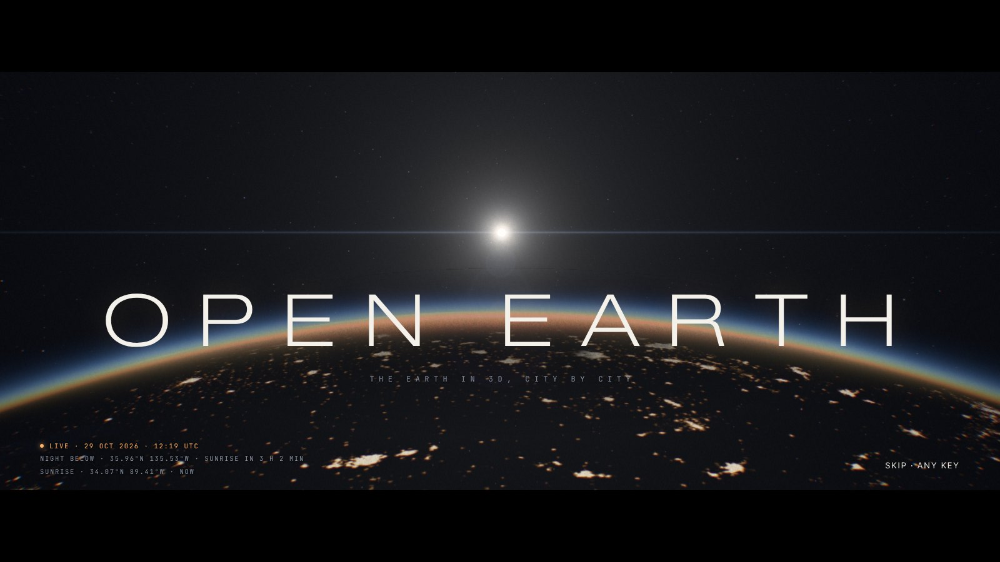
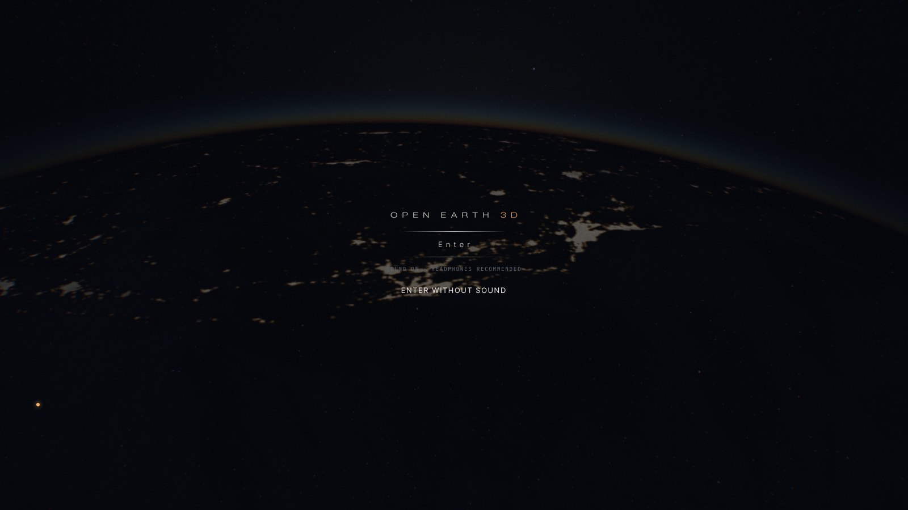
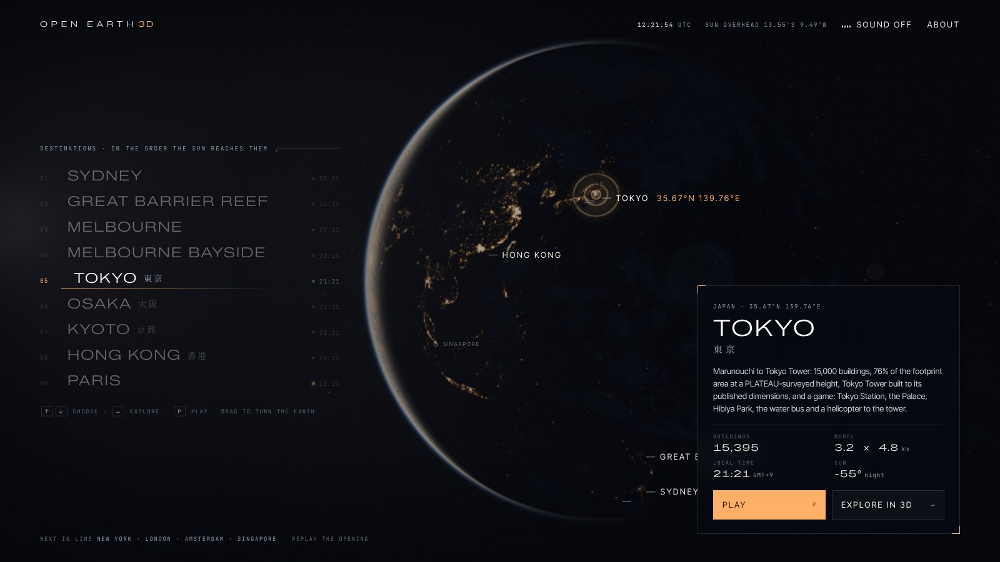

# The title screen: the Earth, now, filmed from orbit

The landing page is a title sequence. It is the first thing anyone sees, so it
works the way a film's opening or a game's title screen does: one idea, shot
well, and out of the way within ten seconds.

The idea is the project's own. The opening shows the real Earth at this minute.
The camera runs low across the night side, over the brightest stretch of it that
dawn is about to reach. It heads towards the real sun until the sun clears the
limb. The title lands on that sunrise. The camera pulls back to the whole planet
and the destinations come up, lit where they are. Nothing in it is stock footage
or a pre-rendered video. It is drawn live in three.js from NASA's imagery of the
planet, the Yale catalogue of the stars and the same NOAA solar equations the
cities use, so the sun in the title is where it is in the sky now.



| The night pass, before the sun clears the limb | The menu: the destinations, lit where they are |
|---|---|
|  |  |

## The sequence

| Time | Picture | Sound |
|---|---|---|
| Boot | The Milky Way's core comes up while the Earth's textures load. A counter names each file as it arrives: the stars, the Milky Way, the Black Marble, this month's Blue Marble, the clouds. | Silence |
| Start | It starts on its own once the Earth has loaded, without sound. **Sound** in the corner brings the score in where the shot has got to; the menu's switch does the same later. | Silence: browsers allow sound only after a click or a key |
| 0–4 s | The night pass. The camera runs about 1,000 km up towards the sun, the lights below, a 2.39:1 letterbox closing in. Captions decode on screen: the UTC time, the point below, and how long until sunrise there (or since sunset, on a dusk shot). | A low drone (two tones beating at 0.35 Hz, filtered noise); a riser from 0.8 s |
| 4.0 s | The sun clears the dense air at the limb, red, then white. The eye has been stopping down as the glow grew, so the sun arrives as a soft bead of light rather than a blow-out, with a fine anamorphic streak across the frame. **OPEN EARTH**: the letters come out of a blur one by one while the tracking closes from 0.9 to 0.34 em. The third caption gives the point on the terminator: it is sunrise (or sunset) there now. | The hit: a sub dropping from 92 to 30 Hz, a crack of noise, an A major chord with an added ninth left ringing in a long reverb |
| 6.5–10.9 s | The camera pulls back from the limb to the whole planet and swings round to the Asia-Pacific, where most destinations are. The letterbox opens, the menu comes in a line at a time, and the cities' beacons come up one by one. | A slow pad, the chord's filter breathing |
| Menu | The globe turns to each destination as it is chosen, with a survey reticle (rings at 100, 250 and 500 km). A card gives its figures, its local time and its sun. | A tick on each choice |
| Dive | Down onto the city: the camera swings over it and falls, faster and faster, with a zoom blur and the colour fringes opening, into black, where the city's loader takes over in the same dark and the same type. | A whoosh and a sub swell |

Any key, click or scroll during the opening skips to the menu. Later visits in the
same session open straight on the menu with a short pull-in; coming back from a
city pulls out from that city. With `prefers-reduced-motion` the sequence is a
cut to the menu and the globe stays still. **Replay the opening** in the footer
runs it again.

The opening is planned on the real sky each time. The sun's direction is fixed
for the shot. The camera's path is chosen among 72 great circles through the
sun's direction, and each is scored by the Black Marble's lights along the
stretch the camera will see. The idea is a dawn, where the Earth's turn carries
the ground into the sun. But the camera is always 30 to 37 degrees short of the
terminator when the sun clears the limb, and for a third of the day the night
before the dawn line is open ocean: from 12:30 to 19:30 UTC it runs from the
Pacific to the Atlantic. So the dusk side is scored too, and it wins when it is
half as bright again. Flying from the night towards the terminator, the sun
clears the limb ahead either way; the captions say which it is.
`node tools/title_check.js --sweep` scores the plan every half hour of a day:
flying to dawn only, 13 of the 48 half hours had a night pass under 15% of the
day's brightest; flying to dawn or dusk, none, and the mean is 40% brighter.
The hit is timed to the second: the camera's speed is set so that the sun clears
the dense air, the lowest 40 km, at 4.0 s after the start, and the riser is
scheduled to end there.

## What we took from where

- **Microsoft Flight Simulator 2024**: the world is the menu, and the zoom from
  the globe down to the place is the loading transition. The dive here ends in
  the city's loader, and the model's own establishing shot comes down from above.
- **Death Stranding**: a thin wordmark, widely tracked, and very few words. One
  musical gesture and silence otherwise.
- **Hitman: World of Assassination**: destinations as cards with a single line of
  place, the name in the local script (東京, 大阪, 京都, 香港), and figures
  rather than adjectives.
- **Ghost of Tsushima**: a title screen that is almost still, where only nature
  moves. Here the clouds drift, the lights glitter, and the globe turns slowly
  when nobody touches it.
- **GTA VI's trailers**: the title as a hit on a cut, the grade carrying the
  mood.
- **Igloo Inc** (Awwwards site of the year 2024): an intro rendered live rather
  than played as video, and sound designed with the motion.
- **The GitHub and Stripe globes**: the halo carries the planet's edge; the
  line between alive and too much.
- **Powers of Ten**: the zoom from the planet to the place, and back.

We avoided neon, glitch, and RGB-split as a style (Cyberpunk 2077's register):
they fight a scene lit by the real sun. Chromatic fringes are kept to the frame's
edges and the dive. The palette is space (#04060b, never pure black), off-white
type and one accent, the sun's amber.

## The picture

`web/earth.js` draws the Earth, its air and the sky; `web/title.js` directs.

- **Day**: NASA's Blue Marble Next Generation for the current month, with its
  snow and vegetation. The open ocean is darkened and greyed as it reads from
  orbit, and GEBCO relief rakes in the low sun.
- **Night**: the Black Marble 2016 lights, separated from its moonlit land (the
  lights are the red above half the blue). On large screens they come in a
  second texture at 8192 × 4096, so a pixel is 5 km. Where a texel still covers
  more than a pixel and a half, the lights break up into clusters with noise
  whose cells stay about that size on screen. Warm sodium in the suburbs, whiter
  in the cores, dimmed under cloud.
- **Clouds**: Blue Marble's composite on a shell 29 km up, drifting, lit through
  the air. Each cloud casts its shadow along the sun's direction at its height.
- **Glint**: the sun's reflection on open water, with a Fresnel sky reflection
  at grazing angles.
- **Air**: single scattering through a spherical shell, Rayleigh and Mie, with
  the Earth's shadow. It is marched per pixel with jitter, so steps show as grain,
  not bands. The sunlight that reaches the ground goes through Kasten and Young's
  air mass, which is why the terminator is warm; past the horizon the air mass
  climbs into the hundreds, so cloud tops before dawn glow a faint red. The sun
  itself is drawn inside the air with per-channel extinction, so it rises red and
  turns white.
- **Sky**: ESO's Milky Way panorama (S. Brunier), with its point stars filtered
  out and turned from galactic coordinates to the Earth's frame by the sidereal
  time. In front of it are the 9,096 stars of the Yale Bright Star Catalogue,
  sized by magnitude and coloured by spectral class, and 16,000 fainter ones
  seeded towards the galactic plane. The Moon is in its place and its phase.
- **Lens**: HDR with 4× MSAA, a wide and gentle bloom, then one pass. It adds a
  zoom blur for the dive, chromatic fringes that grow towards the edges, and the
  flare: a fine anamorphic streak, a soft veil and four faint ghosts on the line
  through the centre, all warming as the sun sinks into the air (and turned down
  under the menu). Then exposure and the tone curve. The curve keeps hue, after
  Khronos PBR Neutral, so the oceans stay blue where ACES and AgX push them
  towards purple. Its shoulder is long and exponential from 0.42, so highlights
  roll off like film instead of clipping. A light S-curve, cool shadows, grain
  weighted to the midtones, a 14% vignette and a dither for the gradients follow.
  City lights are soft-clipped before any of this, so a metropolis glows rather
  than blows out.
- **The eye adapts**: the exposure is open for the night pass, starts stopping
  down 1.4 s before the sun clears the limb, and in the menu follows how much of
  the globe is lit.

The frame renders at up to 1.75× the CSS pixels and steps down by 0.25 while
frames take longer than 26 ms, so a laptop keeps its frame rate.

## Every device

The first version drew one picture for everyone, and on an iPad it drew nothing:
the menu came up over black. The pipeline asked for about 340 MB of graphics
memory there (four 4096-pixel textures and the 8K lights with their mips, a
half-float target with 4× MSAA at 1.75× pixels, the bloom), and a tablet's
browser takes a WebGL context back long before that. Nothing noticed, so the
screen stayed black. Now the title draws what the device can afford, checks that
it drew something, and falls back to a still picture rather than to black.

**Tiers, measured.** `web/quality.js` opens a throwaway WebGL 2 context and asks
it what it can render into: a half-float texture and a 4× multisampled
half-float renderbuffer, each checked for framebuffer completeness rather than
read off the extension list. It reads the largest texture, whether the renderer
is a software one (SwiftShader, llvmpipe), the device's memory where the browser
says, the pointer (an iPad says it is a Mac; its touch screen gives it away) and
the screen. Then it loses the probe context to give its memory back.

| Tier | Who | Textures | Night lights | Target | Pixels | Air | Bloom |
|---|---|---|---|---|---|---|---|
| High | desktop GPUs | 4096 | 8192 × 4096 | half float, 4× MSAA | ≤ 1.75×, 4.2 MP | 14 × 6 steps | yes |
| Medium | tablets, weaker laptops | 4096, clouds 2048 | in the surface map | half float | ≤ 1.5×, 2.4 MP | 12 × 5 | yes |
| Low | phones, software renderers, ≤ 4 GB | 2048 | in the surface map | half float (8-bit without) | ≤ 1.25×, 1.25 MP | 8 × 4 | no |
| Still | no WebGL 2 | a still of the Earth behind the same menu | | | | | |

The graphics memory each asks for, as the page estimates it (About shows it for
the device in hand):

| Device | Before | Now |
|---|---|---|
| Desktop, 1440 × 900 at 2× | 464 MB | 464 MB (high) |
| iPad Air, 820 × 1180 at 2× | 392 MB | 161 MB (medium) |
| iPad in the Claude app, 820 × 905 at 2× | 342 MB | 148 MB (medium) |
| iPhone, 390 × 844 at 3× | 135 MB | 50 MB (low) |

**The same night on every tier.** The lights come through a curve (L to the
power 2.1) that keeps suburbs dim and cores bright. A coarser lights map averages
each city over a bigger texel, and the curve crushes averages: on the low tier
the share of lit ground in the night pass fell to half of the high tier's. The
curve's power now follows the map's resolution (2.1 for the 8K map, 1.8 at 4096,
1.55 at 2048), and the lit share is the same on all three: 9.8, 10.8 and 10.5% of
the ground on a dawn shot, 14.3, 14.4 and 13.1% on a dusk one.

**A test frame.** Before the opening, the title renders the sunlit side once and
reads the middle pixel back. If it is as dark as space (an incomplete target, a
shader the driver will not compile or miscompiles, a GL error), the pipeline
steps down in place: an 8-bit target, no MSAA, no bloom, fewer steps through the
air, at most 1× pixels. If that frame is still black, the menu runs over the
still.

**A lost context.** When the GPU takes the context back, the still shows at once.
three.js restores its own state when the context comes back; the title then
steps down, tests a frame and goes live again. A context lost while the textures
upload waits for the restore up to six seconds. A second loss stays on the still.

**While it runs.** The frame renders at the tier's pixel ratio and steps down by
0.25 while frames take longer than 26 ms, then drops the bloom past 34 ms.

**The visitor's choice.** About shows the tier, the GPU, the pixel ratio and the
memory, and offers Auto, High, Medium, Low and Still; the choice is kept.

**The cities.** The model and the game take the same tier (`OEQuality.city()`):
the pixel ratio within the tier's budget (a desktop keeps up to 2×), MSAA off on
low, a 4096 shadow map only on high, the game's half-float post stack only where
the device can draw into one (with 4×, 2× or no MSAA), and on low the lighter
world: no shopfronts, parapets, awnings or rooftop plant, smaller wave FFTs and
no reflection in the water.

**Checking it.** `tools/title_check.js` runs the title headless on a tablet, a
phone and a desktop, and with the faults injected into WebGL: no half-float
target, no WebGL 2, a context lost while loading, a context lost twice, and a
driver that draws nothing to the screen. Every one ends on the Earth or on the
still, never on black.

```bash
cd web && python3 -m http.server 8800 &
NODE_PATH=$(npm root -g) node tools/title_check.js title-check
NODE_PATH=$(npm root -g) node tools/title_check.js --sweep
```

## The type

- **Zalando Sans Expanded** (200–300) for the wordmark and the destinations, in
  capitals with wide tracking.
- **Inter Tight** for running text; **JetBrains Mono** for data, in tracked
  capitals with tabular figures.
- **Shippori Mincho** for 東京, 大阪, 京都 and **Noto Serif TC** for 香港,
  subset to those characters.

## Making the film

`tools/title_film.js` renders the opening frame by frame with its score into an
MP4. Software WebGL is far too slow for real time, so the tool holds the
sequence clock at each frame's time and draws the frame on demand
(`window.__title.still(t)`). It slows the page's CSS transitions to match and
renders the score offline (`OEScore.bounce`):

```bash
cd web && python3 -m http.server 8800 &
NODE_PATH=$(npm root -g) node tools/title_film.js opening.mp4 1280x720 24
```

## The data

`pipeline/fetch_earth.py` downloads and bakes every texture into
`web/assets/earth/`. The first view loads about 6 MB on the high tier, and about
5 MB on the others, which do without the 8K lights. `poster.jpg`, the still for a
device that cannot draw the Earth, is a frame of the high tier (29 October 2026,
09:40 UTC, over the South China Sea), fetched only when it is shown.

| File | From | Licence |
|---|---|---|
| `day-01.jpg` … `day-12.jpg` | Blue Marble Next Generation with topography and bathymetry, 2004 (NASA Earth Observatory) | Public domain |
| `surface.jpg`, `lights.jpg` | Black Marble 2016 (NASA Earth Observatory, Suomi NPP VIIRS); Natural Earth land and lakes; GEBCO_08 elevation via Blue Marble | Public domain |
| `clouds.jpg` | Blue Marble cloud composite (NASA Earth Observatory) | Public domain |
| `milkyway.jpg` | The Milky Way panorama, ESO/S. Brunier | CC BY 4.0 |
| `stars.json` | Yale Bright Star Catalogue, 5th revised edition | Public domain |
