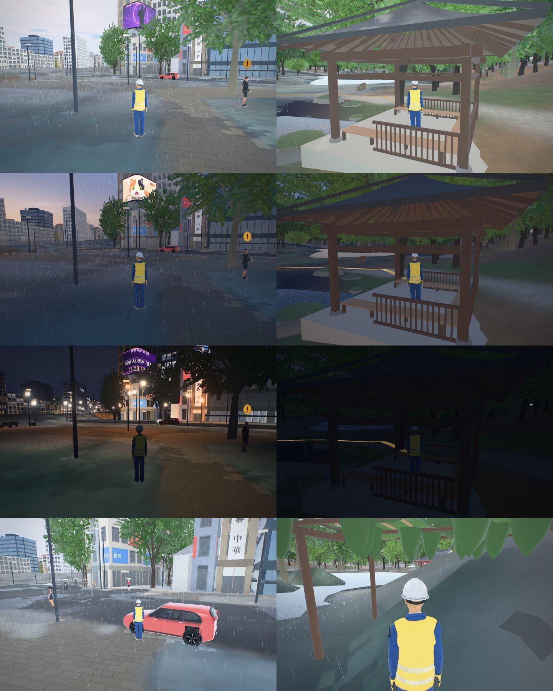
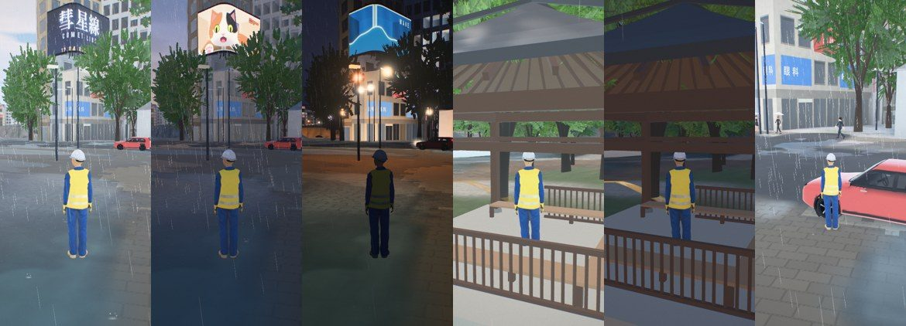
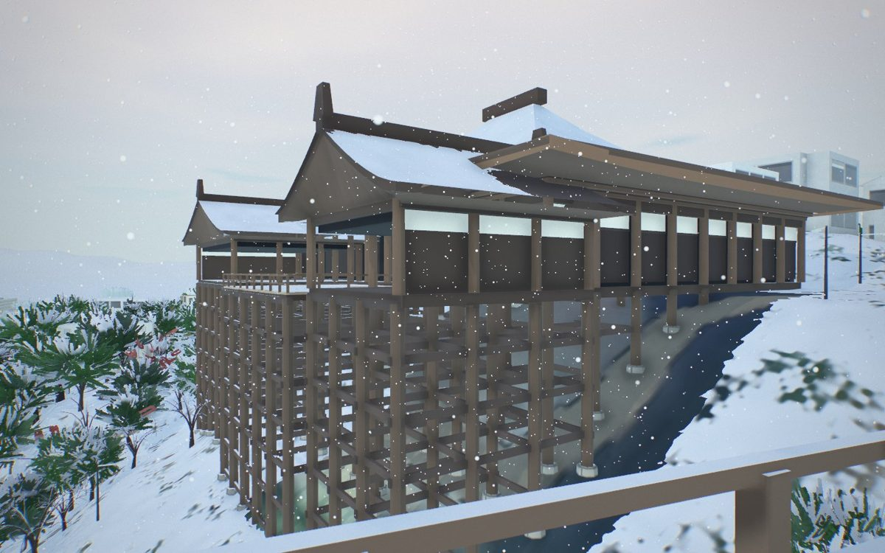
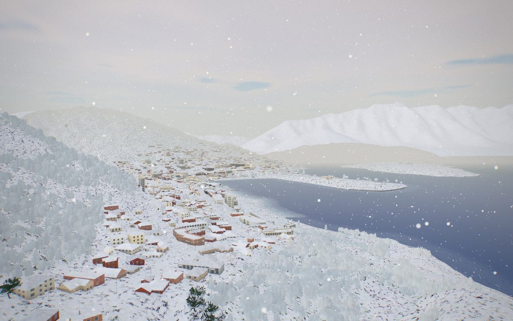
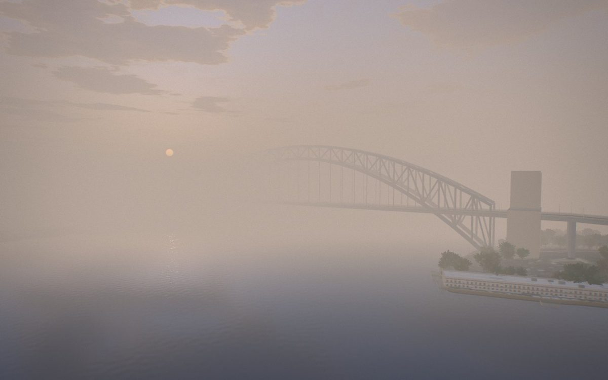
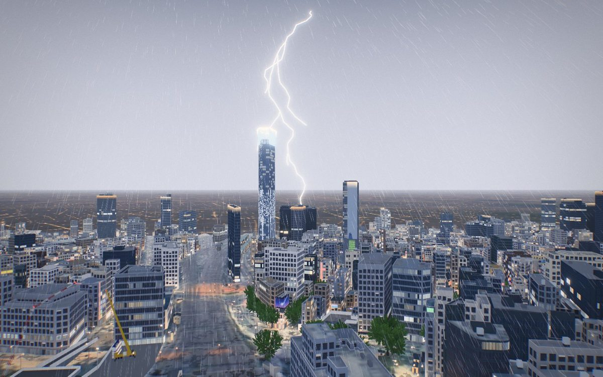
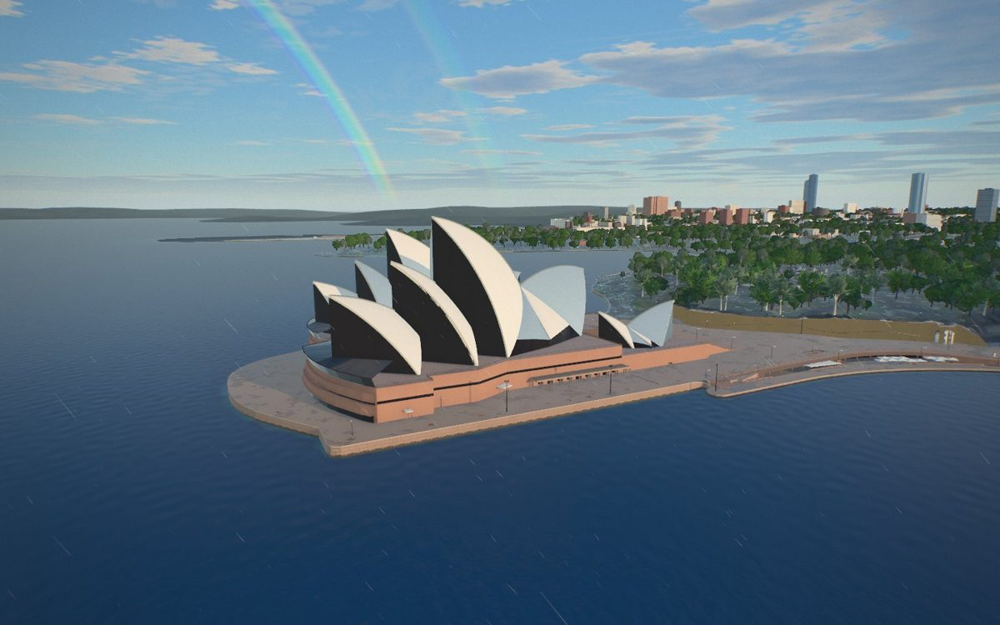
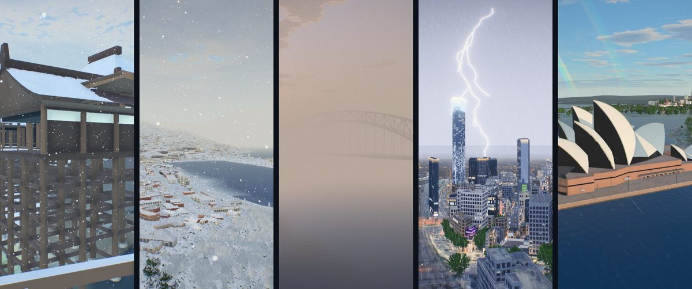

# Weather

The game has weather in every city: clear, overcast, fog, drizzle, rain, thunderstorms and snow, with
wind that gusts, ground that wets and dries and snow that settles and melts (`web/game/weather.js`).
Issue #95 began it, from Shinjuku Gyoen's rainy-season mornings, where Kaede's quest offers "Wait for
the rain in the shelter"; issue #356 gave it one state that the whole game reads, and the rest.

Shinjuku in the June rain, desktop (the street and Gyoen's shelter at day, dusk and night, the
crowd under umbrellas, the pond) and phone:

Snow at Kiyomizu-dera and over Queenstown, fog at dawn at the Harbour Bridge, a thunderstorm over Shinjuku
and the light after rain at the Opera House (issue #356), on a desktop and, below, on a phone:

The views are `tools/views/weather-356-<city>.json` (`xvfb-run -a node tools/game_shot.js <city> <views> <out> [390x844]`;
a view's `"flash"` and `"rainbow"` hold a lightning flash and a bow for the still). A film of a storm arriving
over Sydney Harbour and clearing is `cities/sydney/storm_film.json`
(`xvfb-run -a node tools/city_film.js sydney --spec cities/sydney/storm_film.json --out <dir>`): a shot's
`"weather": [[k, kind or amounts], ...]` sets the weather as the shot reaches k and `"strikes"` is its lightning.

## The weather state

One object, `OEWeather.S` (`web/game/weather.js`), is what the weather is now. Everything that depends
on the weather reads it: the sky and clouds, the trees, the water, the traffic, the sound, the diary.
Nothing keeps its own copy. It exists as soon as the script has loaded (a clear, calm day until the game's
weather starts), so a reader needs no more than `const wx = window.OEWeather && OEWeather.S`. The
game's weather eases every field frame by frame (`update`); readers only read.

| Field | Range | What it is |
| --- | --- | --- |
| `kind` | `clear` `overcast` `fog` `drizzle` `rain` `storm` `snow` | the weather in a word |
| `cover` | 0..1 | cloud cover |
| `precip` | `none` `rain` `snow` | what is falling |
| `rate` | 0..1 | how hard it falls (rain or snow) |
| `rain`, `snow` | 0..1 | the same, split |
| `mm` | mm/h | water falling, roughly: a drizzle 0.5, rain 4, a storm 25 |
| `storm` | 0..1 | a thunderstorm over the city |
| `flash` | 0..1 | lightning's light this frame |
| `wind.x`, `wind.z` | m/s | where the wind blows **to**, in the world's x and z (three.js: −z is north), gusts included |
| `windSpeed` | m/s | its length now |
| `windMean` | m/s | the steady wind under the gusts |
| `windFrom` | degrees | the compass bearing it blows **from** |
| `gust` | 0..1 | 0 in a lull, 1 at a gust's peak |
| `fog` | 0..1 | fog or mist |
| `visibility` | metres | how far one sees: clear 40 km, rain 3 km, snow 1 km, fog under 200 m |
| `temp` | °C | the air's temperature |
| `wet` | 0..1 | how wet the ground is: lags the rain, dries by sun and wind |
| `snowDepth` | 0..1 | settled snow (1 is about 12 cm) |
| `grip` | 0.35..1 | tyre grip against a dry road's: wet 0.7, snow 0.4, ice less |
| `day` | 0..1 | daylight |
| `t` | seconds | the weather's clock |
| `source` | `season` `pinned` `live` `off` | who decided it |

- `OEWeather.onChange(f)` calls `f(kind, S)` when the kind changes and returns a function that stops it.
- `OEWeather.describe()` gives a line for a HUD or a diary: "Light snow, -1°".
- Shaders read the same state as uniforms, `OEWeather.U`: `uOeWet`, `uOeRain`, `uOeOvercast`, `uOeSnow`
  (settled), `uOeSnowfall`, `uOeFog`, `uOeFlash`, `uOeT`, and `uOeWind` (a vec4: x and z in m/s, the gust
  0..1, and the metres of air that have gone by, which is what a swaying or drifting thing should
  multiply rather than time, so that a gust speeds it up without a jump).
- The game sets it: `__game.weather.set('snow')`, or exact amounts for a still or a film,
  `set({rain, snow, fog, storm, cloud, wet, snowDepth, temp, wind, windFrom, now})`.

How each field moves: cloud eases in over a few seconds and rain or snow waits for its cloud; thunder
waits for its rain; the wind is the season's mean (the climate's `wind_ms`, or the wind the city's waves
were made for) times the weather's own factor (fog 0.25, rain 1.4, a storm 2.4), with lulls and gusts
from three octaves of noise and a bearing that wanders; the ground wets in the rain and from melting
snow and dries faster in sun, wind and warmth; snow settles while it falls at 1.5° or below and melts
with warmth, sun and rain; the temperature is the normals' daily minimum near dawn and maximum in the
mid afternoon, each day a little off the mean and flatter under cloud.

## What decides it

- **The season.** `game.weather` in `cities/<id>/city.json` holds the city's mean number of days a
  month with measurable rain, from the national weather service's 1991–2020 normals, with the
  threshold that service counts from (`pipeline/weather_climate.py` lists each source). Each day of
  the year is wet or dry by a hash of its date, so a date always has the same weather; a wet day's
  rain comes in showers from a smooth noise over the hours, and some wet days stay a drizzle
  (`drizzle`, the share of them). Dry days are sometimes grey. Tokyo in June is wet about four days
  in ten: the tsuyu. For the live cities the same table has more, month by month:
  - `temp_max`, `temp_min`: the mean daily maximum and minimum. The air is at the minimum near
    05:00 and the maximum near 14:30, each day up to 3.5° off the mean, flatter under cloud.
  - `snow_days`: days on which snow was seen. A wet day is a snow day with a chance of half that
    count over the rain days (JMA counts flurries and sleet; `snow_share` changes the half), and a
    snow day is cold: between −2° and 2.6°, so some settle and some fall wet and melt. Kyoto has
    about eighteen snowy days a winter of which a dozen whiten the roofs; Tokyo two or three;
    Queenstown half a dozen in town; Sydney none.
  - `thunder_days`: on such a wet day the hardest showers are thunderstorms, mostly after noon.
  - `typhoon_days` (Japan): a day of unbroken rain and a gale between July and October.
  - `fog_days`: fog before sunrise that lifts by mid morning. On any calm clear dawn there is a
    little mist, thickest over water.
  - `wind_ms`, `wind_from_deg`: the mean wind and its prevailing bearing.
- **Live weather**, if the visitor asks for it: the menu's **Live** (see below).
- **A choice.** The pause menu's Weather row (kept for the next visit), a quest choice
  (`"action": "set_weather", "weather": "rain", "date": [6, 18], "time": "08:10"`), or the page's
  `?weather=clear|overcast|fog|drizzle|rain|storm|snow|live|now|off` (`live` is the season's, `now` the
  live conditions).
- **Automated runs** (`navigator.webdriver`: the checks, stills and films) keep a clear sky unless
  they ask, so their frames stay comparable. `tools/game_shot.js` takes `"weather"` per view.

## Live weather (opt-in)

The menu's Weather row has **Live**: the city's conditions now, from [Open-Meteo](https://open-meteo.com/)
(no key, CORS open; weather data CC BY 4.0, credited in the toast that shows the result: "Weather data by
Open-Meteo.com"). It is a request from the visitor's browser to a third party, so:

- it is made only after the visitor picks Live (or the address says `?weather=now`); the pick is kept
  like any other weather pick, and picking anything else stops the requests;
- it carries the city's own coordinates rounded to 0.01° and the list of fields, nothing else: not the
  visitor's position, no cookies, no referrer (`credentials: 'omit'`, `referrerPolicy: 'no-referrer'`);
- the answer is kept for 15 minutes (the service's own step) in `localStorage` `oe3d-weather-now`, and
  asked again only while Live stays picked;
- when it fails (offline, blocked, the service down) the season's weather carries on with no error
  shown beyond one toast at the pick.

What comes back (`current`: temperature, precipitation, snowfall, WMO weather code, cloud cover, wind
speed and direction, visibility) becomes the same amounts a pinned weather sets: codes 0–1 clear, 2 fair,
3 overcast, 45/48 fog, 51–57 drizzle, 61–67 and 80–82 rain, 71–77 and 85–86 snow, 95–99 thunderstorm; an
unknown code is read by its cloud cover. `OEWeather.S.source` says `live` while it holds.
Automated runs never ask unless the address does. docs/OBSERVABILITY.md lists the request.

## When the device cannot carry it

Rain is the dearest thing the game draws: on the high tier a wet street draws the scene a second
time for its reflections (`web/mirror.js`), the occlusion map draws it again from above, and the
streaks are thousands of blended quads; a wet street keeps its puddles' noise and reflections for
minutes after the rain. So weather that a device cannot carry is not started. The game watches its
frame rate and sheds what a slow device can do without, one step every 4 s below 24 fps
(`web/game/game.js`, `shed`): the weather goes first, then the wet street's reflections, then pixels
(down to 70% of the tier's); the people keep their models. The weather's share is `weather.shed`:

| When | What happens |
| --- | --- |
| The low tier (`web/quality.js`: a software renderer, a phone, 4 GB of memory or less) | The season's weather starts **off**: a clear sky and dry streets, and the wet look's shader code is not even compiled (`arm`). A toast says so and points at the menu |
| Shed, step 1 | **Light**: no far streaks and no splashes, the occlusion map redrawn every 2 s or 8 m |
| Shed, step 2 | **Off**: a clear sky and dry streets, with a toast. A weather the visitor picked stays, wet and grey, and loses only its drops |

The frame rate is counted only in play: not on the title screen, in the menu or in photo mode. What
was shed is remembered (`localStorage` `oe3d-weather-guard`: `light` or `off`), so the next visit
starts there. A weather picked in the menu, which now also has **Off**, is the visitor's: kept as
picked, and picking one forgets what was remembered. `?weather=` counts as a pick. Automated runs
remember nothing and start as the tier says (light on the low tier) unless the address carries
`?weatherguard`; `tools/game_check.js` steps `weather.shed` and checks it lightens, turns off,
remembers, says so, comes back on, and keeps a picked weather.

The same idea as the dynamic quality scaling of console and PC games (Unreal's scalability groups
and dynamic resolution, Unity's Adaptive Performance), ordered so that what costs the most and can go
without being missed, the weather, steps down before anything else does, by measured frame time
rather than by the device's name.

To change a city's climate, edit the table in `pipeline/weather_climate.py` and run
`python pipeline/weather_climate.py`; it writes `city.json` and copies the numbers (and every
quest's `choices`) into `web/data/<id>/game.json`. `pipeline/game_data.py` passes `weather` through.

## What it looks like

| Part | How | Tiers |
| --- | --- | --- |
| Rain streaks | Instanced quads in two shells round the camera (9 m and 30 m), world-stable (they wrap, they don't ride with the camera), each a drop's path over a 1/33 s shutter relative to the camera so a moving camera slants them, at least a pixel wide with alpha falling with their real width | high 6000 + 9000, medium 4000 + 5000, low 2200 + 2200 |
| Rain occlusion | A height map of the scene from straight above, 80 m round the camera, redrawn when the camera moves 4 m or every half second: no rain under a roof, a deck, a bridge or a tree | 256², low 128² every 1.2 s |
| Splashes | Rings and crowns popping on the tops of things within 16 m, their height from the occlusion map | 700 / 420 / 200 |
| Wet ground | Darker where porous, roughness down to 0.38, puddles in the low spots of a noise on roads and paving (0.035 roughness, flat, rippled), filling as the wetness rises and drying slowly after | all |
| Ripples | Expanding rings, one drop per cell in three offset grids, on puddles, ponds (`sk_pond`, any landmark water), rivers and the sea | all |
| Overcast light | Sun ×0.18 at full cloud, sky light up and greyer, a closer grey-blue haze (warm at night with the city in it), the sky's clouds up to 0.97 and its blue down, no stars or moon, the lens a little cooler with a touch more contrast and exposure lifted so it never goes grey | all |
| Umbrellas | The crowd puts them up as the rain comes on (fewer in a drizzle): Tokyo, Kyoto and Osaka mostly clear vinyl, elsewhere black, navy and a few colours; on the skinned people near you and the instanced crowd further off | all |
| Sound | Rain hiss and patter (synthesised noise), a drumming roof and drips under one, muffled in a car or the helicopter; the wind from a fresh breeze up, rising in the gusts; thunder, a crack and a roll near and a rumble far, after the flash by the distance at 343 m/s; cicadas on a hot day (25° and up, by daylight, not in the rain) | all |
| Wind | The state's wind sways the trees faster and wider and leans their crowns down the wind (`web/trees.js` `uGale`), raises and lowers the sea the spectrum was made for (`web/water.js` `uSea`: height with the wind's speed, eased over a minute), slants the rain and carries the flakes, petals and leaves | all |
| Snowflakes | The rain's two shells and the same instances, drawn as soft dots that fall at about a metre a second, ride the wind's run and flutter, kept out from under cover by the same occlusion map | as the rain's streaks; light: the near shell only |
| Settled snow | A term in the materials' own shaders (no geometry, no pass): white on what faces the sky and is open to it (the occlusion map), first on the flat and on slopes as it deepens, patchy at its edges, thinner where wheels and feet go (roads and paving), on roofs, the ground, tree crowns, cars and street furniture. It builds while snow falls at 1.5° or below and melts with warmth, sun and rain, wetting the ground as it goes | all tiers that run the weather |
| Wet walls and roofs | The same term: what faces the sky darkens fully, walls in streaks and less, under cover not at all; it dries by sun, wind and warmth (about 2 minutes in sun and a breeze, 5 under still cloud) | the same |
| Fog, mist, haze | Through the scene's own fog and the sky's haze band, no pass: the far distance comes in to the state's visibility, the air takes a pale tone that keeps half the hour's colour (a warm dawn mist, a night fog holding the city's glow), the sky goes into it from the horizon up, the sun weakens. Over water the mist is doubled (`web/water.js` `uMist`). From above 40 m one sees further. Falling snow and a summer afternoon over 27° shorten the view the same way | all |
| Lightning | A flash is 2 to 5 strokes 40–90 ms apart over 0.2–0.6 s. For those frames the sky's light, the air's colour and the exposure rise (no light is added and nothing is redrawn), more at night and less with distance; one flash in three reaches the ground and is drawn as a bolt, one mesh of at most 96 quads made by midpoint displacement with a few branches, bright enough for the bloom that already runs. `OEWeather.S.flash` carries it for the sky and clouds | the bolt not when shed to off |
| Rain cells | Showers and storms are heavier and lighter in cells some 500 m across that ride the wind over the map (a noise sampled where the camera is) | all |
| Rainbow | With rain falling or just gone and the sun out below 42°: the primary bow at 42° round the point opposite the sun, red outside, the secondary at 51° reversed and fainter, the sky inside a little brighter. One ring of 72 quads, added to the frame | all |
| Petals and leaves | The cherry petals (#223) now ride the state's wind; in autumn the same cards are the leaves coming off the deciduous trees, red to yellow, more of them in a wind | as the petals |

The state's uniforms, `OEWeather.U` (above), are what every patched shader reads. `OEWeather.patch(shader, {puddles, porous, water})` makes any `MeshStandardMaterial`
wet; `OEWeather.GLSL` has `oePuddle(xz)` and `oeRipple(xz, camD)` for a city's own look (Shibuya's
wet-street reflections, #112, read the same wetness).

## What it costs a frame

No weather adds a full-screen pass or a render of the scene. What each adds:

| Part | Draws | Triangles | Per pixel |
| --- | --- | --- | --- |
| Rain streaks and splashes (as before) | 3 | high 32,800, medium 19,700, low 9,600 | blended quads a pixel or two wide |
| Snowflakes | 2 (light: 1) | high 21,000 at full fall (the far shell at half), medium 13,000, low 6,600 | blended dots |
| Lightning bolt | 1, for the half second of a ground flash | at most 192 | a line a pixel or two wide |
| Rainbow | 1 while it shows | 144 | a thin ring, added |
| Settled snow, wet walls and roofs | 0 | 0 | a term in the materials' own shaders, behind one test of the state: on a dry day with no snow lying a fragment pays for the test alone; in the weather, one fetch of the cover map and four to seven value noises |
| Fog, mist, haze, the flash's light | 0 | 0 | none: the scene's fog distances and colours, the sky's haze band, a light's intensity |
| Wind in the trees and on the sea | 0 | 0 | a few multiplies in vertex shaders that ran already |
| The cover map from above (as before, for the rain) | the scene's opaque meshes within 40 m, into 256² (low 128²) | | redrawn every half second or 4 m while something falls (light: 2 s or 8 m); while the ground is only wet or snow only lies, when the camera has moved 14 m. Before #356 a wet street after rain had no map and so was wet under roofs too |
| The wet street's mirror (high tier, as before) | the scene again at half size while the ground is wet | | unchanged; snow alone does not turn it on |

Measured with `tools/weather_cost.js kyoto` (where Kyoto's game opens, the median of 14 frames a state, each
state set at once, on Mesa's llvmpipe with other renders running beside it: the milliseconds only compare
one state with another on the same run; the counts transfer). Against a clear sky:

| State | high (1280×800) | medium (1280×800) | low (390×844) |
| --- | --- | --- | --- |
| clear | 2,467 ms, 420 draws, 3.27M triangles | 2,317 ms, 416, 3.27M | 500 ms, 350, 2.61M |
| overcast | −50 ms, +3 draws, +28k | +16 ms, +3, +22k | −33 ms, −2, −4k |
| fog | +16 ms, +3, −7k | +66 ms, +3, −7k | −50 ms, +1, +18k |
| rain | +266 ms, +36, +412k | +283 ms, +36, +398k | 0 ms, +22, +183k |
| thunderstorm | +333 ms, +29, +277k | +316 ms, +37, +383k | −17 ms, +15, +161k |
| after rain, wet and drying | +250 ms, +17, +84k | +216 ms, +25, +201k | +17 ms, +17, +210k |
| snow falling | +166 ms, +24, +246k | +233 ms, +32, +345k | −17 ms, +18, +221k |
| snow lying, clear | +366 ms, +15, +145k | +350 ms, +23, +261k | +17 ms, +21, +229k |

How to read it. The draws and triangles beyond the few in the first table are the cover map: at two seconds
a frame it is redrawn in most frames of a run (in play at 60 frames a second, once in thirty while it rains
and not at all while the camera stands on lying snow), so on a GPU the steady cost of falling snow is two
draws and the shader term. The milliseconds on the high and medium tiers are that map plus the shader
term over every pixel on a software renderer, 7 to 15% of the frame; rain cost as much before. On the low
tier (no post stack, a smaller map) nothing measurable. The pass count was 80, 78 and 74 a frame on the
three tiers with a clear sky and one more from the second state on, on the high and medium tiers only; the
weather's code makes no full-screen draw, and where that one comes from was not traced. Fog and overcast
are within the run's noise of a clear sky.

What sheds (`weather.shed`, driven by `shed()` in `web/game/game.js` until the frame-budget stream's
governor replaces it): light drops the far flakes with the far streaks and splashes and slows the cover
map; off drops everything, the bolt and the bow included, and for a season's weather the material terms too
(a clear sky, dry and bare). The low tier still starts with the season's weather off.

## What was surveyed, and what was adopted

Nothing was copied; the techniques are the published ones, written for this engine.

- **Tatarchuk, "Artist-Directable Real-Time Rain Rendering in City Environments"** (ATI ToyShop,
  SIGGRAPH 2006 course notes). Adopted: rain as camera-relative streaks stretched by motion blur, in
  layers near and far, and a top-down depth map to keep rain out from under cover. Not adopted: its
  pre-rendered rain textures and its light-dependent drop shading (we light the drops by the haze's
  colour, which tracks the hour).
- **Sébastien Lagarde, "Water drop" series** (2012–13, on wet surfaces in physically based
  rendering). Adopted: wetness darkens porous albedo and lowers roughness; puddles are a separate,
  near-mirror layer that fills the low spots first; rain ripples as procedural expanding rings.
- **Rain occlusion maps** in Frostbite and Unreal Engine's weather work: the same top-down height map
  idea; here it also seats the splashes.
- **three.js examples and community demos** (instanced particle rain, `Reflector` puddles): the
  instancing is the same; a planar reflector per puddle was rejected as too costly for every city on
  a phone. Screen-space reflections are left to #112 on the medium tier and up.
- **The three.js precipitation "skills" collection** (GPL-3.0) and **Godot "Rain Puddles" shader**
  (MIT, ripple data texture): read for comparison, no code taken; their licences are noted so that
  no one copies from them without carrying the licence.
- **Climate data**: Japan Meteorological Agency, Hong Kong Observatory, Météo-France, KNMI and the
  Bureau of Meteorology 1991–2020 normals, as their climate tables give them.

## What was surveyed for #356, and what was adopted

Nothing was copied here either. Licences are given so that no one takes code without carrying them.

| Work | What it does | Licence | Here |
|---|---|---|---|
| World-normal snow masks: Unreal's and Unity's material examples; "Snow-Covered Surface" (rrh, godotshaders.com) | snow where the world normal faces up, shaped by a smoothstep, blended over the albedo | CC0 (the Godot shader) | **Adopted** as the approach (`oeSnowOn`), with depth, a noise edge, the occlusion map and a tread term added |
| Ohlsson and Seipel, "Real-time Rendering of Accumulated Snow" (SIGRAD 2004) | a depth map from above decides what is exposed to snow | paper | **Adopted** in idea: the rain's occlusion map is that map |
| three.js forum "Fast Screen-Space Snow" | snow as a post-process from depth | forum post | Not adopted: a full-screen pass |
| Deformable snow: Batman Arkham Origins (Barré-Brisebois, GDC 2014), Rise of the Tomb Raider (Michels and Sikachev, GPU Pro 7) | footprints and tracks from a height capture | talks | Not adopted: each needs a render of its own. Tracks are left for later |
| three.js `webgpu_compute_particles_snow` and `_rain` | compute-shader particles colliding with a depth capture from above | MIT | Idea only (WebGPU/TSL): here the flakes are stateless instances wrapped round the camera, as the rain is |
| three.js `LightningStrike` (yomboprime; in the examples up to r152, removed since) | a bolt by recursive subdivision with simplex noise and sub-rays, with timing | MIT | Not imported (gone from r186). The bolt here is a plain midpoint displacement with branches (Reed and Wyvill, "Visual Simulation of Lightning", SIGGRAPH 1994) |
| Kim and Lin, "Fast Animation of Lightning Using an Adaptive Mesh" (IEEE TVCG 2007) | the dielectric breakdown model | paper | Not adopted: a Poisson solve per bolt |
| Tatarchuk, ToyShop (SIGGRAPH 2006); Wenzel, "Real-time Atmospheric Effects in Games" (SIGGRAPH 2006) | lightning as a term on the materials' light and on the fog and clouds, not a light | course notes | **Adopted**: the flash raises the sky light, the air and the exposure |
| Rockenbeck, "Blowing from the West: Simulating Wind in Ghost of Tsushima" (GDC 2021) | one global wind with gust noise that grass, trees, cloth and particles all read | talk | **Adopted** as the model: one vector, three octaves of gust noise, everything reads it |
| Renard, "Wind Simulation in God of War" (GDC 2019) | a 3D fluid simulation round the player | talk | Not adopted: far too dear |
| Pierson and Moskowitz (1964); fetch-limited growth (JONSWAP) | wave height against wind speed | papers | **Adopted** loosely: height scales with the wind's speed (fetch-limited: harbours and lakes), not its square |
| Wenzel 2006 and Quilez, "Better Fog" | analytic height fog along the view ray | course notes, article | Not adopted as such: three.js's fog chunk gives materials no uniform of ours without recompiling every program, so the layer is approximated (a further view from above, doubled mist on the water's own shader) |
| Met Office and NIWA on radiation fog | clear sky, moist air, wind under about 2.5 m/s, before sunrise | guidance | **Adopted** as the rule for the dawn mist |
| Sadeghi et al., "Physically-based Simulation of Rainbows" (ACM TOG 2012); Brewer, "Rainbows and Fogbows" (NVIDIA SDK white paper, 2004) | Lorenz-Mie rainbows; a lookup by scattering angle | paper, white paper | Geometry only: 42° and 51° from the antisolar point, colours reversed in the second bow, Alexander's band; no lookup table |
| Lagarde, "Water drop" 3b and 4 (2013) | wet darkening by porosity, drying in patches, puddles last | articles | **Adopted** for walls and roofs as for the ground |
| Lightning's timing (Rakov and Uman, "Lightning: Physics and Effects"; NWS) | 3 to 5 return strokes 40–50 ms apart, a flash about half a second, one in four to the ground, thunder heard to about 16 km | book, guidance | **Adopted** |
| [Open-Meteo](https://open-meteo.com/) | current conditions, no key, CORS open | data CC BY 4.0 (server AGPL-3.0, not used) | **Adopted** for live weather, credited where shown |
| MET Norway Locationforecast; wttr.in; NWS api.weather.gov; Bright Sky; 7Timer | other free services | CC BY 4.0; Apache-2.0; public domain; DWD terms; unstated | Not adopted: MET Norway asks sites not to call it from browsers; wttr.in has no stated data source; NWS and Bright Sky cover one country; 7Timer sends no CORS header |
| Climate normals: JMA (Tokyo 47662, Kyoto 47759), the Bureau of Meteorology (066062), NIWA (Queenstown, and "The Climate and Weather of Otago", 2015) | temperatures, wind, days of snow, thunder and fog | as published | **Adopted**; `pipeline/weather_climate.py` says which figures are a table's and which a chosen shape (Queenstown's and Sydney's splits by month, the typhoon days) |

## Not yet

- Drips off a particular eave, and streams off a roof's edge: under a roof you hear drips, but they
  are not drawn.
- The quest NPCs keep their own looks (no umbrellas); the crowd carries them.
- Footprints and tyre tracks in the snow; snow on the people (their normals are skinned) and on the far trees' impostors.
- A fog layer seen from above as a layer: the scene's fog has no height term (see the survey).
- Heat shimmer: it would need a pass.
- Reef sites (`web/reef`) and the model viewer (`web/city.js`) have no weather.
- Not checked on a real GPU, WebGPU, Safari or iOS.
