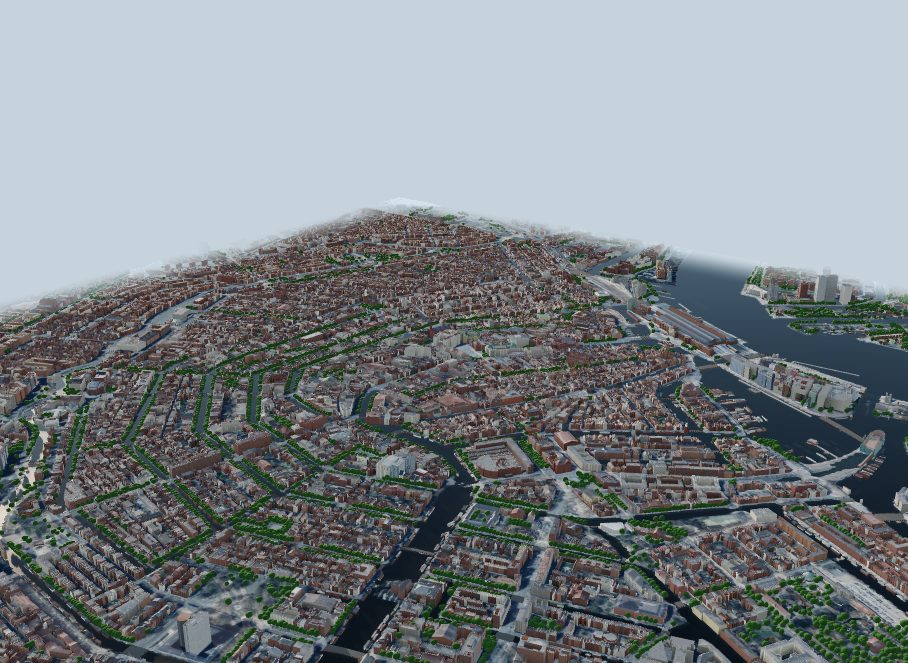
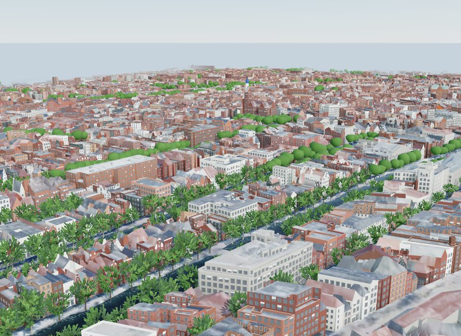
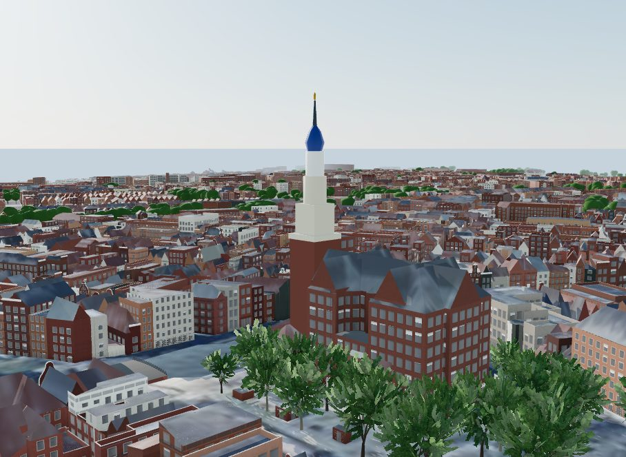
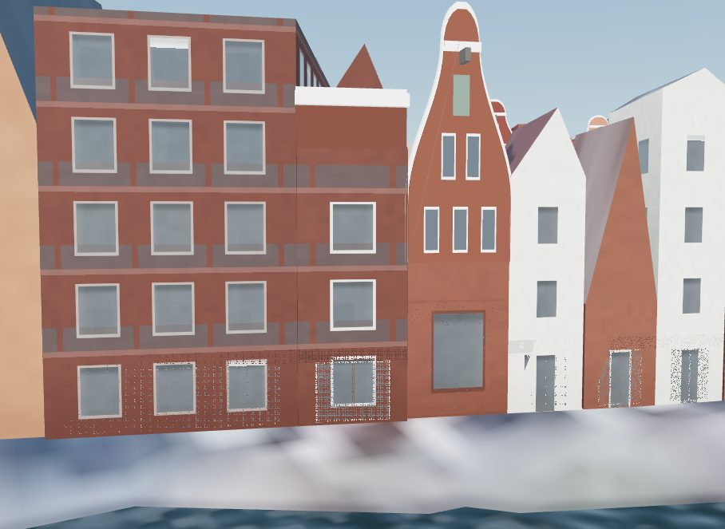
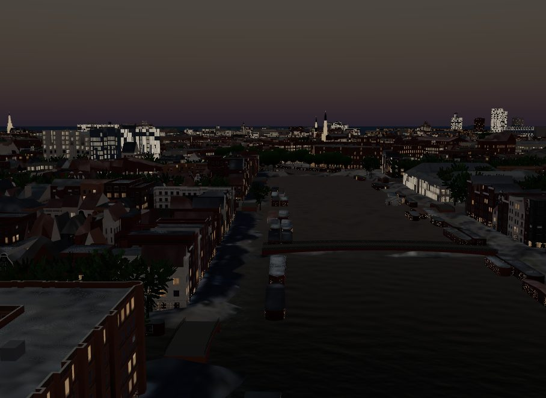
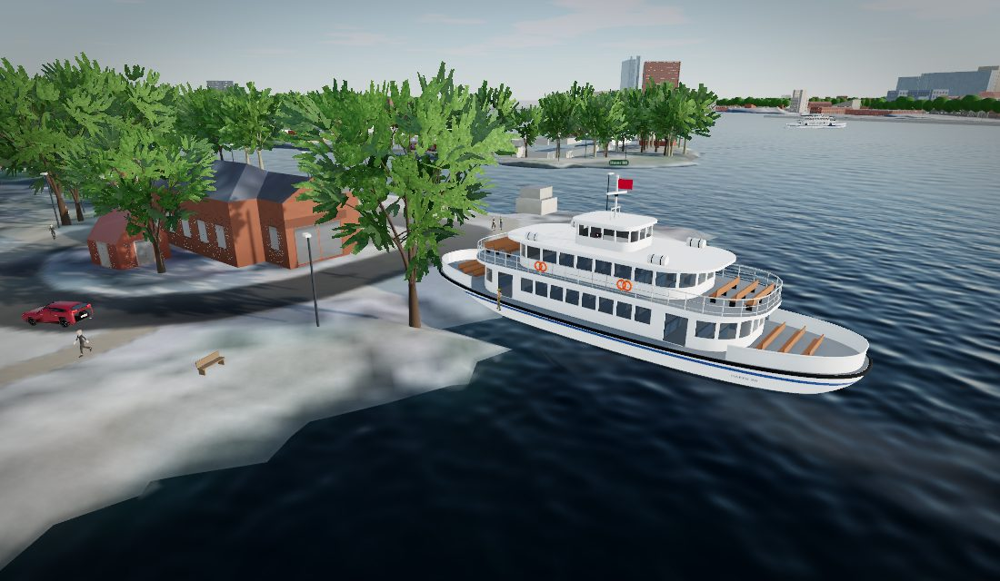
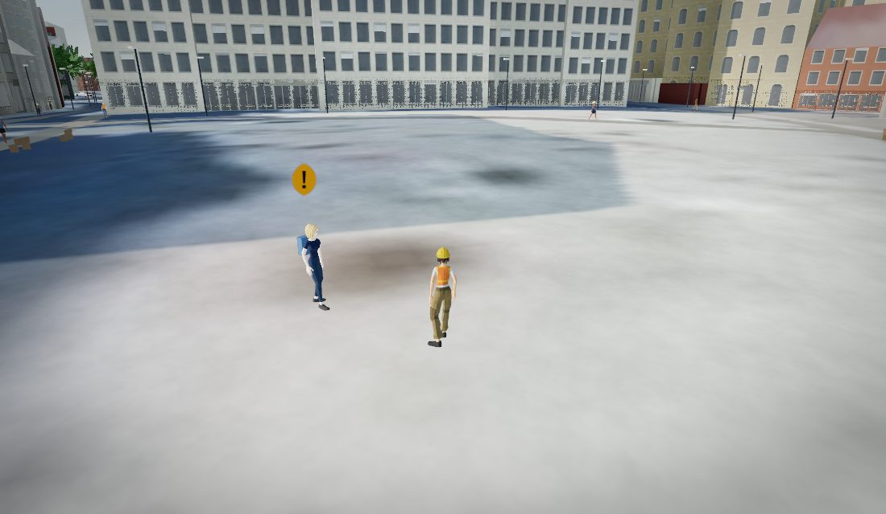

# Amsterdam: the register, the laser and the gables

Central Amsterdam from the IJ to Museumplein, and from the Westerpark to the
Plantage: 4.0 × 4.05 km of canal city. The Netherlands publishes two datasets that
make a model like this nearly exact. The BAG registers every building with its
outline and its year of construction, and the AHN measures the whole country from
the air with a laser. The 3DBAG, made by the 3D geoinformation group at TU Delft
and 3DGI, combines the two into 3D models of every building. The model takes each
building from the 3DBAG, roof tier by roof tier, and draws on each canal house the
gable its year calls for.



| The canal ring | The Westertoren | Gables of three centuries |
|---|---|---|
|  |  |  |
| **The Amstel at dusk, 21 December** | **Amsterdam on Foot: the F3 at Buiksloterweg** | **Sanne, the survey lead, on the Dam** |
|  |  |  |

## The short answer

- **Heights are measured, not guessed.** 95.8% of the footprint area takes its
  height from the 3DBAG. 83% of its buildings here were measured by AHN5 in 2023,
  14% by AHN4 in 2020 and 2% by AHN3 in 2014. Eleven published heights in the area
  agree with the model to 8.7% at the median.
- **The laser under-reads towers.** A spire is a few square metres at the top. The
  3DBAG draws it as a stack of small tiers, and its top falls short: the
  Westertoren by 6%, the Oude Kerk by 9%, the Montelbaanstoren by 13% and the
  Krijtberg's twin towers by 33%. The five old towers of the centre (three church
  towers, a gate tower and a harbour tower) are built from their published
  heights instead.
- **OpenStreetMap's heights are the laser's.** On the 28,232 buildings with both,
  OpenStreetMap's height tags agree with the 3DBAG at a median factor of 1.00, and
  90% of them within 7.5%. They are not an independent check here. Floor counts
  times a storey height are 13% off at the median.
- **Roofs are measured.** 29,915 buildings take the roof their LOD2.2 model has:
  12,870 pitched, 92% of them gabled.
- **Each canal house carries its century.** 8,395 buildings are canal houses.
  4,303 of their street fronts end in a gable, drawn from the house's year of
  construction in the register: 2,447 cornices, 718 bell, 651 neck, 342 step and
  145 spout gables.
- **The water is at NAP -0.40 m.** The canals and the IJ are both kept at 40 cm
  below the national datum. The scene's 0 m is that level, and the streets of the
  old city stand one to two metres above it.

## 1. Data

| What | Source | Licence |
|---|---|---|
| Buildings | 3DBAG v2025.09.03 (TU Delft 3D geoinformation group and 3DGI): BAG footprints, AHN heights, LOD1.3 tiers and LOD2.2 roofs | CC BY 4.0 |
| Footprints, names, classes | OpenStreetMap via Overture Maps (release 2026-10-21.0) | ODbL |
| Terrain | AHN bare earth (DTM 0.5 m) via PDOK's WCS, read at 1 m | CC0 |
| Aerial photographs | Beeldmateriaal Nederland, Actueel ortho HR, via PDOK, zoom 17 | CC BY 4.0 |
| Water, bridges, houseboats, ferry terminals | OpenStreetMap via Overture | ODbL |

`pipeline/fetch_3dbag.py` reads the release's tile index (a FlatGeobuf, through
DuckDB's spatial extension). It downloads the 69 CityJSON tiles over the area and
checks each against the index's SHA-256. Some tiles are served with
`Content-Encoding: gzip`, so the fetcher keeps the bytes as stored.

For each of the 39,736 BAG buildings, it writes one feature per LOD1.3 roof level:
64,666 tiers in all. Each tier gets:
- its outline;
- its top above the building's ground (`b3_h_maaiveld`): the highest point of the
  LOD2.2 roof over the tier where that roof is pitched, else the tier's own level;
- the roof the LOD2.2 model has over it;
- the register's year of construction and the 3DBAG's floor estimate.

The BAG writes 1005 for a building whose date is not known; the fetcher reads that
as no year.

### The scene's zero is the canals

The canals and the singels inside the city's water system are kept at a fixed
level of NAP -0.40 m (Ingenieursbureau Amsterdam and Waternet, *Grondwater effecten
van onderkeldering in Amsterdam*, 2019). The IJ and the Noordzeekanaal are held at
the same level, between -0.30 and -0.55 m (Rijkswaterstaat's level decision for the
Noordzeekanaal and the Amsterdam-Rijnkanaal). The two are normally connected, and
the canals are shut off from the IJ only at high water.

The scene's 0 m is NAP -0.40 m (`datum_offset_m` -0.4). The AHN removes water from
its terrain, so the level is the published one, not a measurement.

The Vondelpark is a polder: its ponds are kept at NAP -2.45 m, two metres lower. A
box in `water.exclude` leaves them to the aerial photograph instead of drawing them
at the canals' level. Ponds in other parks are left out the same way (class `pond`).

### The terrain

The AHN's bare earth comes from PDOK's WCS 1.0.0 in RD New. A 4 km area at 1 m is
too large for one request, so `fetch_tiles.py` reads it in tiles of 2,000 pixels
(the `wcs` terrain type with `pixel_m`). The AHN leaves voids under buildings and
over water; they are filled from their neighbours.

The ground of the old city is at NAP +0.5 to +2.5 m. No independent bare-earth
model of the same area is open: PDOK serves only the current AHN, and earlier
releases are no longer published. The terrain is therefore not checked against a
second source (see Limitations). For comparison, Terrarium, a global surface model
that includes buildings, stands 3.2 m above the AHN on open ground at the median.

## 2. Heights

`build_scene.BAG3D` reads the tiers through the same interface as PLATEAU (source
`3dbag`, footprint `D`). Each OpenStreetMap footprint is cut along the tiers over
it, tallest first, so a tower is not buried under its church.

The 3DBAG draws a tower or a spire as a stack of tiers of a few square metres each.
For the 3DBAG, a tier as small as 6 m² is kept when it stands 8 m or more over the
main roof; chimneys and dormers never reach that high. Smaller tiers on the roof are
absorbed by the main piece.

| Height source | Buildings | Footprint area |
|---|---:|---:|
| 3DBAG | 32,196 | 95.8% |
| Typical height for its kind (houseboats) | 1,131 | 2.0% |
| Estimated from neighbours | 1,894 | 1.4% |
| OpenStreetMap height tag | 134 | 0.4% |
| Floor count × storey height | 100 | 0.3% |
| Microsoft ML height, corrected | 24 | 0.1% |

The houseboats (*woonboten*) are not in the BAG, which registers their moorings
but not the boats. OpenStreetMap maps 1,231 of them as buildings; they float
(`water.floating`). 100 have a height or a floor count mapped, and keep it. The
other 1,131 stand 2.6 to 3.5 m above the water, a guess from the common ark, a
flat-roofed box on a concrete hull. They take their own source, `typical`, because
the estimate from neighbours would give them the height of the houses on the quay:
before this rule, the boats came out at a median 5.3 m and up to 21 m. They also
skewed the correction for heights that are not missing at random. Against the
boats' low ML heights, the houses on the quay made the unmapped buildings look 2.5
to 3.7 times shorter than their neighbours, compared with the mapped ones. Every
neighbour estimate was then cut by 1.6 times, or by 3.2 times where the nearest
known heights stood 15 to 30 m away. Without the boats the correction is 1.0.

### Checked against published heights

| Building | Published | Model | Error |
|---|---:|---:|---:|
| A'DAM Toren (to the top of the mast) | 100 m | 99.0 m | -1.0% |
| Rijksmuseum (highest towers) | 52.9 m | 54.4 m | +2.8% |
| Munttoren | 35 m | 33.8 m | -3.4% |
| Beurs van Berlage (clock tower) | 40 m | 38.2 m | -4.5% |
| Westertoren | 85 m | 80.0 m | -5.9% |
| Royal Palace (weathervane) | 60 m | 54.8 m | -8.7% |
| Oude Kerk tower | 67 m | 60.8 m | -9.3% |
| Zuiderkerk tower | 68 m | 61.2 m | -10.0% |
| Montelbaanstoren | 48 m | 41.6 m | -13.3% |
| Centraal Station (towers) | 45 m | 33.4 m | -25.8% |
| De Krijtberg (towers) | 50 m | 33.7 m | -32.6% |

The median error is 8.7%; eight of the eleven are within 10%. Every error but one
is short, and the shortfall grows as the top gets thinner. The laser's points thin
out on a spire, and the 3DBAG's tiers stop below its tip. The A'DAM Toren is the
exception: the laser caught its mast, about 100 m, not its roof at 80 m. The
sources are the buildings' own sites, the Dutch Wikipedia, and *Ons Amsterdam*
(each row of `cities/amsterdam/reference_heights.csv`).

## 3. Roofs

`fetch_3dbag.py` triangulates each LOD2.2 model, roof and walls, and reads each
tier's roof from the triangles over it. It uses `plateau_3dtiles.roof_of`, the
classifier that measures Kyoto's PLATEAU roofs:
- flat, where 70% of the roof's plan area slopes under 6 degrees;
- a skillion (one slope), with the direction it faces;
- gabled (the ridge along the footprint's long axis) or gabled across;
- half-hipped or hipped, from how much gable wall stands above the eaves;
- the pitch (the area-weighted median slope) and the height from eaves to ridge.

The faces are triangulated with a constrained Delaunay triangulation in their own
plane. The first version lost the faces' winding there, and half the tiers came out
roofless; the fix keeps each triangle facing the way its face does.

29,915 buildings take a measured roof: 12,870 pitched and 17,045 flat. Of the
pitched, 92% are gabled. A canal house is narrow and deep, and its ridge runs back
from the canal, so its gable faces the street.

Many houses of 1875-1925 have one steep slope to the street and a flat roof behind.
The 3DBAG models that as two tiers, so the front tier is a skillion facing the
street.

## 4. The canal houses

A canal house (*grachtenpand*) gets its own facade style (`typology.py`). It applies
to a house of the canal era, built before 1880 by the register or of no known date,
on a lot at most 13 m wide. A single canal house front is 25 to 30 Amsterdam feet,
7.1 to 8.5 m, and three windows wide (amsterdam-monumentenstad.nl). The style draws:
- brick in courses;
- tall sash windows with glazing bars, with a stone lintel over each;
- a raised ground floor over the basement.

Where the roof ends in a gable on a street, the front carries the gable of its
year. The Grachtenmuseum dates them:
- step gables (*trapgevels*) c. 1600-1665;
- spout gables (*tuitgevels*) c. 1620-1720, mostly on warehouses;
- neck gables (*halsgevels*) c. 1640-1770;
- bell gables (*klokgevels*) c. 1660-1790;
- raised cornices through the 18th century, and plain cornices after 1790.

`typology.gable_type` draws from those ranges, weighted where they overlap.
`build_scene.gable_props` puts each gable in the plane of the front, from the eaves
to 0.9 m over the ridge. `web/buildings.js` draws it from five instanced meshes, one
per type: the brick body, its sandstone trims, the windows of the attic floors, the
loading door and its hoisting beam.

The register's year is the year of the building, not of its front. Many
17th-century houses were given a new front in the 18th century, so the gable
follows the date the register keeps.

## 5. Landmarks

- **Towers.** The Westertoren (85 m, 1638), the Zuidertoren (68 m), the Oude Kerk's
  tower (67 m), the Montelbaanstoren (48 m) and the Munttoren (35 m) are drawn from
  their published heights, each in the stages of a 16th- or 17th-century
  Amsterdam tower:
  - a brick shaft, square or round;
  - stone and timber stages that narrow as they rise;
  - the Westertoren's imperial crown, and a gilt finial.

  The stages' proportions come from photographs. A tower inside its church's
  footprint is centred under the 3DBAG's highest tiers.
- **Bridges.** OpenStreetMap outlines 225 bridges over the canals, the Amstel and
  the IJ. Each is built on its outline:
  - a deck from bank to bank at the measured ground of the two banks;
  - a crown of 4% of its length;
  - a brick arch springing just above the water;
  - iron railings.

  The decks are walkable in the game.

## 6. Amsterdam on Foot

The survey starts on the Dam with Sanne, the survey lead, and runs as three lines
in any order:
- **The canal ring.** Pieter, a building historian on the Herengracht, explains the
  gables and sends you to find a step gable, a neck gable and a bell gable. The
  survey lens names a house's gable and when that type was built. Femke plays the
  Westertoren's carillon. Two doors down the Prinsengracht is the Anne Frank House;
  Anne could hear these bells from the Secret Annex.
- **The IJ.** Joost puts you on GVB's free F3 ferry to Buiksloterweg, which leaves
  every six minutes by day and crosses in under five (gvb.nl, eyefilm.nl). Noor, at
  the Eye, shows you the A'DAM Toren, which the laser measured to the top of its
  mast.
- **The winter sun.** Mei, a student on the Rembrandtplein, asks for a spot in
  direct sun between 10:00 and 14:00 on 21 December. At solar noon (12:38) the sun
  stands 14.2 degrees high, and the houses round the square cast shadows 60 to 80 m
  long. Then a stroopwafel from Fatima at the Albert Cuyp market.

Report back to Sanne for the eighth stamp. The crowd is the tallest in this project
(a Dutch man averages 1.83 m), dressed for rain and a bicycle, and the odd passer-by
carries tulips. No helicopter flies here: there is no pad in the old city, and none
is invented.

A scripted playthrough earns all eight stamps. It finds the three gables through the
lens itself, rides the F3, and finds the December sun on the Rembrandtplein.

### Sun on the squares, 21 December

| Place | Mean share of the place in direct sun, 10:00-14:00 |
|---|---:|
| Westerpark | 82% |
| Wertheimpark | 72% |
| Museumplein | 68% |
| Sarphatipark | 63% |
| Leidseplein | 30% |
| Nieuwmarkt | 28% |
| Waterlooplein | 17% |
| Rembrandtplein | 15% |
| Dam | 11% |
| Spui | 6% |

Amsterdam has no sun rule for its squares, so these are measured for information.
The numerical error, against finer samples, a finer surface model and finer time
steps, is at most 0.51 percentage points (`analysis/error_budget.js`).

## 7. Limitations

- **No independent terrain check.** The AHN is the only open bare-earth model of the
  Netherlands that PDOK serves today.
- **Towers fall short in the data.** The five tallest are parametric; others, such
  as the Krijtberg's towers and Centraal Station's, keep the 3DBAG's lower tops.
- **Gables follow the building's year, not the front's.** A refronted house gets the
  gable of its original year. Houses whose roof does not end in a gable on a street
  get none.
- **Houseboat heights are a guess** (2.6-3.5 m) for the 1,131 with nothing mapped.
- **Churches take the generic heritage facade:** storeys of round-headed windows
  rather than tall church windows.
- **The radar check is weak here.** SRTM's surface excess over the terrain correlates
  with the model's block heights at r 0.50-0.65 (100-200 m blocks), against 0.70-0.79
  in Paris. Amsterdam's blocks are low and even, and SRTM's 30 m cells blur them.

## 8. Reproducing it

```bash
env -u AWS_ACCESS_KEY_ID -u AWS_SECRET_ACCESS_KEY -u AWS_SESSION_TOKEN \
  python pipeline/fetch_overture.py --city amsterdam
python pipeline/fetch_tiles.py --city amsterdam
python pipeline/fetch_3dbag.py --city amsterdam
python pipeline/build_scene.py --city amsterdam
python pipeline/landmarks.py --city amsterdam
python analysis/heights.py --city amsterdam
python pipeline/build_scene.py --city amsterdam
python analysis/data_quality.py --city amsterdam
node analysis/error_budget.js --city amsterdam
node analysis/time_basis.js --city amsterdam
python analysis/radar_check.py --city amsterdam
node analysis/sun_access.js --city amsterdam
node analysis/uncertainty.js --city amsterdam 40
python pipeline/game_data.py --city amsterdam
```
