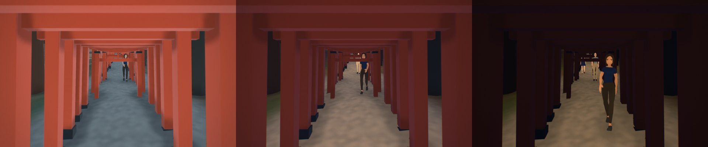
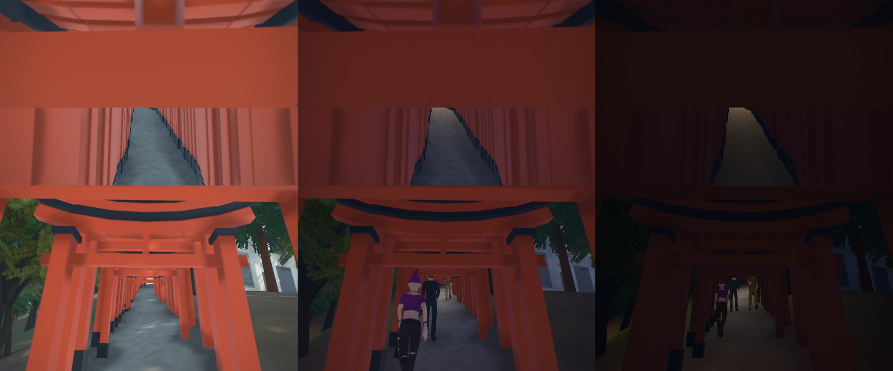
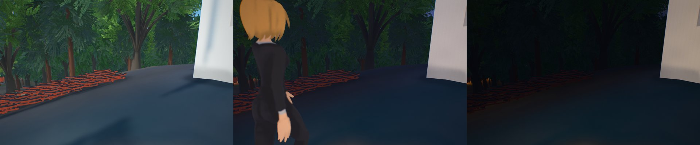
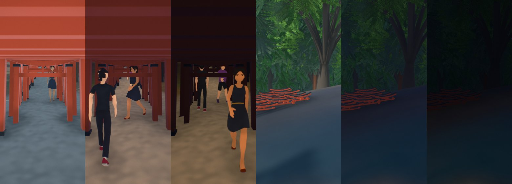
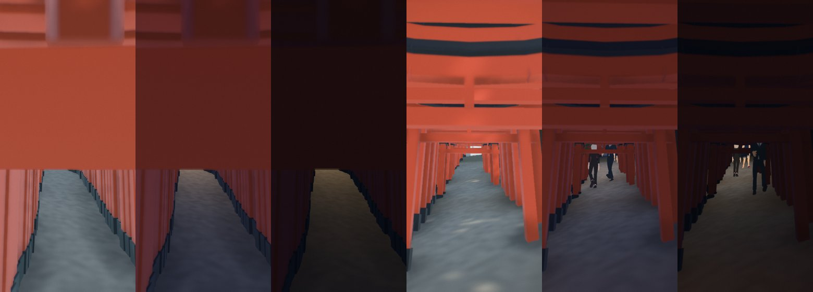

# Fushimi Inari: the shrine and the mountain of torii

A map of Fushimi Inari Taisha and Inari-yama, 2.2 × 1.3 km, from JR Inari station to the summit
(一ノ峰, 233 m). It is one of the Kyoto maps beside [Central Kyoto](kyoto.md) and
[Higashiyama](higashiyama.md); figures and sources are in [kyoto-sights.md](kyoto-sights.md).

## Data

The sources are those of the other Kyoto maps:

- **Buildings**: 5,331 Overture footprints. 93.7% of the footprint area has a height from PLATEAU
  Kyoto City 2022 (CC BY 4.0).
- **Terrain**: GSI DEM5A laser terrain.
- **Imagery**: GSI aerial photographs at zoom 18.
- **Paths**: OpenStreetMap's paths, lamps and torii round the mountain, kept in
  `cities/fushimi-inari/inari_osm.json` (ODbL).

## What is built in code (`cities/fushimi-inari/city.py`, `pipeline/kyotokit.py`)

- **The Romon (楼門, 1589)**: a two-storey gate of about 14 m, vermilion under hinoki bark, with its
  corridors out to the ends of the mapped outline.
- **The foxes**: one either side of the gate, on tall plinths, sculpted as signed distance fields
  (`pipeline/sculptkit.py`). The one on the right as you face the gate holds a jewel; the one on the
  left holds a key. Each wears a red bib.
- **The worship halls**: the open outer worship hall (外拝殿, 1840) with gilt lanterns under its eaves,
  and the inner worship hall.
- **The main hall (本殿)**: rebuilt in 1499, with its front slope carried out over the steps.
- **The Senbon Torii**: one torii at a time along each of the two mapped tunnels, at the count OSM's
  survey gives, from a note on the ways (2014): 382 in one and 399 in the other.
- **The mountain's torii**: placed along the shortest mapped footpaths from the Okusha Hohaisho by
  Kumataka-sha and Mitsutsuji to Yotsutsuji, then round the summit by the 三ノ峰, 二ノ峰 and 一ノ峰 shrines
  and back. They stand about 0.65 m apart, with random gaps, none within 7 m of a shrine, and a gap of
  3.6 m wherever another path joins.
- **The side paths** (#167): torii line three legs off the round as well, each the shortest mapped way,
  where it is not the round's: Mitsutsuji down to Araki-jinja and the north approach, Yotsutsuji up to
  Kojin-ga-mine (田中社神蹟, the view over the city), and Gozendani to the Kiyotaki falls (清明舎).
  (Okusha to Kumataka-sha is the round's first leg; OSM maps no second way between them.) With the
  round and the Senbon Torii that is about 4,400 torii on the paths.
- **The otsuka's miniature torii**: the faithful leave small torii, 30 cm to 1 m, by the thousand on the
  otsuka (お塚), the stone mounds dedicated to their own name of Inari. Rows of them, 50 to 120 a mound,
  stand behind each shrine and memorial stone OpenStreetMap maps along the torii-lined ways, facing the path and
  kept 1.5 m off it: about 3,250. Path and votive torii together make about 7,650 of the roughly 10,000
  the shrine speaks of; the rest stand on paths and mounds OpenStreetMap doesn't map.
- **Sizes**: the shrine sells a donated torii by its 号, the pillar's diameter in sun (寸, 3.03 cm),
  from 5号 to 10号 (the shrine's offering list; Japanese guides quote the same grades). Here: 5号 for
  the small path torii, 6.5号 in the Senbon Torii (photographs against the 2 m width OSM gives the
  tunnels), 7号 for the usual mountain torii, 10号 for the large ones, 1.5号 at the otsuka.
- **How the torii are drawn**:
  - Five sizes, instanced (`landmarks.json` "props").
  - Each is vermilion, with black feet and a black lintel, and a ring at the heads of its pillars (稲荷鳥居).
  - A donor's name runs in black down the back of each pillar, so it shows as you come down.
- **The torii are solid** (#167): the path torii stand closer than a walker is wide, so each side of a
  run of them is one wall from pillar to pillar, from the ground to 1.15 m (over a walker's knee, under the camera, which the landmarks' coarse cells would otherwise lift over the torii's roofs), broken where the run
  is (a shrine, a fork, a gap of a metre or more). The walls are landmark meshes (`torii_hit_*`) in a
  material that is solid but never drawn (opacity 0), cut into 48 m chunks drawn only within their own
  radius, so `web/game/nav.js` lays them into its fine cells like any landmark's posts and nothing in
  the shared code changed. Walkers and the player keep between the pillars.

- **The great torii** on the Omotesando.
- **Stone lanterns** at the 154 lamps OpenStreetMap maps along the paths, lit after dark.
- **Trees**: planted from the canopy model, as the shared trees; species are not mapped, so the mix
  is a guess: Mount Inari's sacred wood is cedars (standing for cypress too) and evergreen oaks, with a
  few maples and cherries in the shrine's precinct, outlined from OpenStreetMap.

## The game: Fushimi Inari on Foot

From Hommachi-dori, south of JR Inari station (where the player's car has a kerb with room to drive off), through the Romon, you meet a shrine attendant, then a shopkeeper at the mouth
of the Senbon Torii, then a hiker resting at Yotsutsuji, where Kyoto opens out to the west.

## What is approximate

- **The torii**:
  - The 号 of each torii is a grade per kind, not each torii's own; heights are read from photographs.
  - The spacing on the mountain paths, and where the gaps fall, is not surveyed.
  - The Senbon Torii's counts come from OSM's survey note, not from the shrine.
  - The side paths are chosen from guides and maps of the mountain (the round and the ways off it to
    Araki-jinja, Kojin-ga-mine and Kiyotaki); OSM doesn't tag which of its ways are torii-lined.
  - The otsuka's rows stand where OSM maps a shrine or a memorial stone, not on each mound.
- **The halls**: their heights are read from photographs and PLATEAU's blocks.
- **The Romon**: its width is the usual three bays, about 10 m.
- Not checked on: a real GPU, WebGPU, Safari or iOS.
