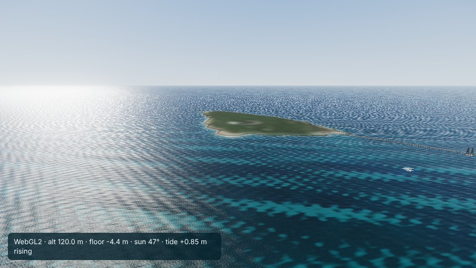
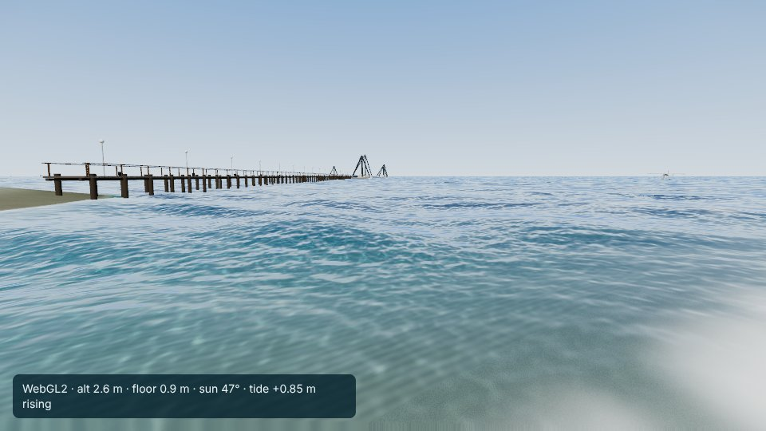

# Green Island

Viewer: `web/reef/index.html?city=green-island`. Config: `cities/green-island/city.json`. Checks:
`cities/green-island/analysis/` (`optics.json`, `poi_check.json`).

## Area

26.6 x 33.6 km (bbox 145.89-146.14 E, 16.535-16.84 S; origin 146.015 E, 16.6875 S): Green Island and its reef, and the
Arlington reef complex to the north (Arlington Reef, Upolu Cay, Vlasoff Reef, Michaelmas Reef and Cay), the offshore
reefs of the Cairns day trips. The Cairns waterfront (27 km south-west) is left out: reaching it as well would take
about 45 km, and 20 km of turbid inshore water would bias the one scene-wide Kd that the reefs are inverted with; the town
would also be flat, with no buildings in this pipeline. Boats from Cairns enter through a gate in the south-west corner.

## Data

- Terrain: AusSeabed GBR 30 m, grid A (142-147 E, 10-17 S, read from the COG header), cached in `data/raw/_gbr/A.tif`.
  Range -70.1 to +19.7 m (the top is the canopy on Green Island, below); no no-data.
- The cays: the survey model's land on Green Island is the forest canopy, 15-20 m high. `build_marine.py` rebuilds
  Green Island, Michaelmas Cay and Upolu Cay from their OpenStreetMap outlines: beach from 0 m at the mapped waterline to
  the highest astronomical tide (1.56 m above MSL, MSQ) at the vegetation line, the vegetated interior to 3.0 m
  (assumed: no published survey height was found), the reef flat around it held below -0.3 m.
- Imagery: 14 Sentinel-2 passes, each covering both MGRS tiles 55KCB and 55KDB (28 products), 19 Oct 2025 to 26 Oct
  2026, cloud limit 20% (at 12% only 7 passes cover both tiles). No-data share 0.
- Seam: the first composite (the clearest 14 scenes of each tile, as for the Whitsundays) changed character at the
  western edge of 55KDB, where the tile overlap starts and the pixels see the union of two sets of dates. `fetch_sentinel.py`
  now keeps whole passes and mosaics their tiles into one layer; the seam is no longer visible in `ground.jpg` or
  `habitat.png`, and the blue band's column-to-column change across the tile edge equals its typical value.
- Tide: MSQ predictions for Cairns Beacon C1 (open water in Trinity Bay, 18 km west-south-west), 2025 and 2026, fitted to
  1.7 and 1.4 cm RMS (largest error 6.2 cm); range -1.55 to +1.66 m about MSL. MSQ lists Green Island as a secondary
  place of Cairns with high and low water 6 minutes earlier; the beacon's tide runs about 6 minutes ahead of the Cairns
  inlet gauge's, with 4% less M2.

## Optics (compared with the Whitsundays)

| | Green Island | Whitsundays |
|---|---|---|
| Rinf blue / green / red | 0.0304 / 0.0145 / 0.0063 | 0.0264 / 0.0156 / 0.0013 |
| Kd blue / green | 0.054 / 0.099 /m | 0.054 / 0.080 /m |
| sand albedo blue / green | 0.197 / 0.323 | 0.117 / 0.175 |
| sand brightness spread 1-15 m, raw to inverted | blue 89 to 28%, green 135 to 23% | blue 103 to 43%, green 136 to 29% |

- Rinf is bluer than inshore (blue:green 2.10 against 1.69); red Rinf (0.0063) is high for deep clear water, as at
  Hardy Reef.
- Kd is not lower than inshore: blue equal, green higher (0.099). The fit reads how the brightest floor darkens with
  depth, and here the brightest shallow floors are the cays' white sand and reef-flat sand while the floors at 8-12 m are
  darker lagoon and seagrass, so substrate is read as attenuation. The depth check improves (green 135 to 23%), so the
  inversion is consistent, but the water in the viewer is probably murkier in green than the real reef.
- Habitat (scaled by 1.767): shallow floor sand 46%, seagrass and algae 18%, reef 15%, rubble 21%. Green Island's
  dark reef flat east of the cay comes out as reef and algae.
- `ground.jpg` and `habitat.png` (previews checked): no seam after the fix, no cloud residue visible on the reefs; the
  deep floor is the smoothed fill with its olive rings.

## Places

| POI | source | check on the built terrain |
|---|---|---|
| Green Island (way 104227384) | OSM | 3.0 m, forest |
| Western beach (relation 9767809, unnamed) | OSM | 0.9 m, beach |
| Green Island jetty, outer end (way 144064542, ferry terminal node 5877123720) | OSM | 4.5 m deep, land within 300 m |
| Green Island helipad (way 700778220) | OSM | 0.6 m |
| Viewpoint, south-east shore (node 6221607877) | OSM | 1.2 m |
| Green Island reef (relation 14074188, unnamed) | OSM | 1.4 m deep |
| Snorkelling beside the jetty | nominal, where QPWS describes snorkelling | 1.4 m deep, reef flat |
| Arlington Reef, Vlasoff Reef, Michaelmas Reef | OSM | 2.1-4.0 m deep |
| Michaelmas Cay, Upolu Cay (islets) | OSM | 1.6 m (sand cays at HAT) |
| Anchorages west of Green Island and south-west of Michaelmas Cay | nominal | 8.8 and 7.5 m |
| Gate toward Cairns | nominal | 14.3 m |

No dive or snorkel sites are mapped in OSM or Overture here. Spawn: on the upper sand of the western beach south of the
jetty (1.8 m, above the highest tide), facing west; the player starts walking (checked in the viewer). Start: 120 m up
north-west of the cay, looking south-east at the island and jetty.

## Harbour layout (checked with `window.__boats`)

Three yachts at the Green Island anchorage and two at Michaelmas Cay with tenders, the jetty with two moored yachts and
a cat, the helicopter on its pad, the seaplane at the jetty, six public moorings, and all five traffic routes connected
(ferry from the gate to the jetty, 11.1 km; Michaelmas Cay cruise, 26.2 km; two yachts; the dive tender), plus the
scenic helicopter and seaplane. The viewer builds the jetty from the shore nearest to the jetty's water end: its root is
about 70 m south of the mapped root and it runs west rather than north-west.

## Known problems

- Green Kd (above); habitat is inferred, not surveyed.
- The cays' interior height (3.0 m) is an assumption.
- Upolu Cay is 5 cells of the 30 m grid; Michaelmas Cay 27.
- The jetty position (above). A viewer option to build a jetty along a mapped line (OSM way 144064542) would fix it.
