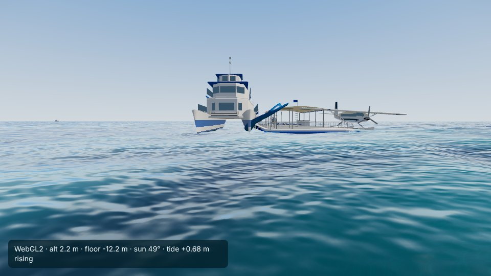
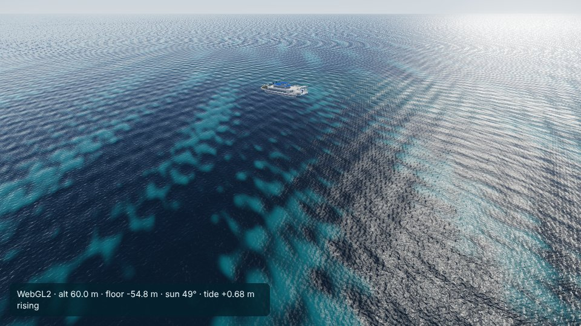

# Hardy Reef

Viewer: `web/reef/index.html?city=hardy-reef`. Config: `cities/hardy-reef/city.json`. Checks:
`cities/hardy-reef/analysis/` (`optics.json`, `poi_check.json`).

## Area

28.2 x 27.6 km (bbox 149.03-149.30 E, 19.62-19.87 S; origin 149.165 E, 19.745 S): Hardy Reef with Heart Reef, Hook
Reef across the channel, Line Reef to the north and Bait Reef to the west. The first config ran 6 km further south over
open water 40-80 m deep; the box was moved north and west to take in all of Line Reef and Bait Reef. There is no land.

## Data

- Terrain: AusSeabed GBR 30 m (2020), grid C (148-154 E, 18-24 S, read from the COG header), cached in
  `data/raw/_gbr/C.tif` and shared with the Whitsundays and Heron Island. Range -84.3 to +1.5 m MSL, no no-data. The
  crop is now cut on whole grid pixels with two pixels to spare; the first crop's transform carried a fractional
  offset, which shifted the model by up to half a pixel (Reefworld's spot reads 8.6 m now, 7.0 m before).
- Imagery: 14 Sentinel-2 L2A scenes, all MGRS tile 55KGU (one tile covers the box, so no seam), 1 Oct 2025 to
  6 Oct 2026, mean solar zenith 33.4 degrees (`optics.json` lists the product ids). Bands B1-B4 and B8.
- Tide: MSQ predictions for Bugatti Reef Outer, 2025 and 2026, fitted to 0.8 and 0.7 cm RMS (largest error 3.7 cm);
  range -1.52 to +1.87 m about MSL. Bugatti Reef is on the outer reef 120 km east-south-east; it was chosen over
  Shute Harbour (73 km south-west, on the mainland) because MSQ's 2026 tidal planes give the outer reef a smaller tide
  (spring range 2.08 m at Bugatti, 2.4 m at Hook Island, 2.77 m at Shute Harbour). MSQ publishes nothing for Hardy Reef.

## Optics

Kd comes from two independent estimates (`pipeline/qaa.py`, `build_marine.py`): the depth fit (how the brightest floor
darkens with depth) and QAA (Lee's quasi-analytical algorithm on water deeper than 40 m, with Lee et al. 2005 for Kd).
QAA is used unless the fit passes a quality test (residual sd of ln(R - Rinf) at most 0.06 and the inverted sand
brightness within 20% across 1-15 m); red keeps the pure-water floor, 0.40 /m.

| Kd /m | fit | QAA | used | sand spread 1-15 m: raw, with fit, with QAA |
|---|---|---|---|---|
| blue (492 nm) | 0.063 (sd 0.118) | 0.063 | 0.063 QAA | 60%, 33%, 33% |
| green (560 nm) | 0.076 (sd 0.047) | 0.092 | 0.076 fit, passes | 112%, 16%, 27% |
| red (665 nm) | 0.245 | 0.337 | 0.40 floor | |

The Whitsundays for comparison (QAA from a fresh composite; rebuilt with it since): fit 0.054 / 0.080, QAA 0.090 / 0.108,
and QAA brings their sand spread from 47% to 18% (blue) and 37% to 29% (green). So, QAA against QAA, Hardy's water is
clearer than the inner Whitsundays' in both bands, as expected offshore; the depth fits had said otherwise because the
Whitsundays' fit is biased low by their pale shallow sand.

- QAA inputs: deep-water reflectance 0.0320 / 0.0274 / 0.0137 / 0.0053 at 443 / 492 / 560 / 665 nm less a near-infrared
  offset of 0.0037 (water absorbs the near infrared, so that is the atmospheric correction's residual or glint), giving
  Rrs 0.0090 / 0.0075 / 0.0032 / 0.0005 /sr. Without that offset Rrs(665) passes QAA's 0.0015 /sr switch to the turbid
  branch and Kd(492) comes out 0.29, so the offset matters. QAA: a(492) 0.039 /m, bb(560) 0.0045 /m, eta 1.80.
- Rinf (the inversion's deep-water reflectance, offset included) 0.0279 / 0.0141 / 0.0055.
- Habitat (thresholds scaled by 1.178): shallow floor sand 43%, rubble 52%, reef 4%, seagrass and algae 1%. Inferred, not
  surveyed; the Hardy reef flat probably carries more live coral than this.
- `ground.jpg` and `habitat.png` (previews checked): no seam (one tile), no cloud residue or glint visible on the reefs;
  the deep floor is the smoothed fill. Heart Reef is a 2-3 pixel bright speck in its pool and is not resolved as a heart.

## Places

All positions are OpenStreetMap objects (Nominatim, also in Overture 2026-10-21.0), checked on the built terrain
(`pipeline/check_marine.py`):

| POI | kind | depth on the 30 m model |
|---|---|---|
| Reefworld (node 2360082104, man_made=pier, floating=yes) | pontoon | 8.6 m on the wall top; 32 m 60 m to the west |
| Heart Reef (node 3502863694) | reef | about 5 m |
| Hardy, Hook, Line, Bait reefs (ways) | reef | 2-5 m |
| Bait Reef, west side (nominal) | anchorage | 5-9 m |
| Toward Airlie Beach (nominal) | gate | 70 m |

Not mapped: the channel and the lagoon have no name in OSM or Overture. OSM also has 'Hardy Reef Pontoon' (node
5611360021, tourism=attraction) 1 km east on the reef flat; which pontoon it stands for is not stated, so it is left out.

Spawn: on the pontoon's deck with the dive kit (`spawn.deck`, viewer 782bbd9); the fallback is in the water off the
pontoon's south end, about 15 m deep. Start: 260 m up south-east of Heart Reef looking north-west over its pool.

## Harbour layout (checked with `window.__boats`, viewer 782bbd9)

The pontoon sits on its mapped spot (`harbour.pontoon.exact`) with its helipad, helicopter, seaplane, docked day cat
and its own dive moorings; the navigation grid is 60 m (`harbour.nav_cell`), so the day cruise, the dive tender, the
yacht to Bait Reef and the pontoon's shuttle all connect; two yachts at Bait Reef; the scenic helicopter and seaplane.
The player starts walking on the deck.

## Known problems

- Under water there is no coral or fish yet (`life.js`); the floor is the inverted Sentinel-2 colour with caustics.
- QAA rests on Sentinel-2 L2A over water, which keeps some sky reflection; the near-infrared offset takes out a flat
  part of it. Green Kd from QAA (0.092) is probably on the high side; the fit (0.076) is used here.
- The 30 m model smooths the channel wall; the real wall is steeper.
