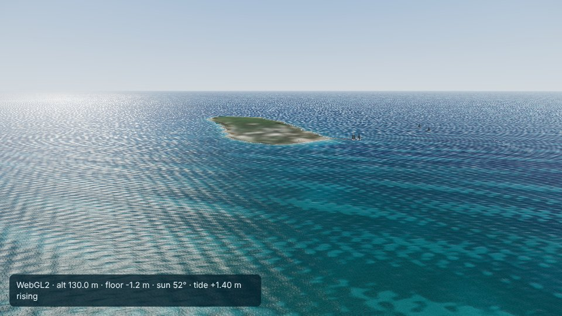
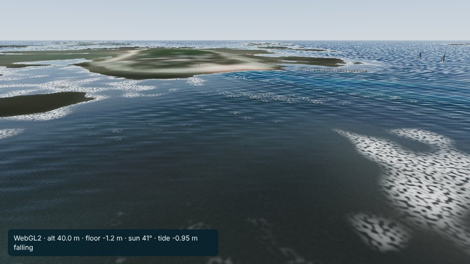

# Heron Island

Viewer: `web/reef/index.html?city=heron-island`. Config: `cities/heron-island/city.json`. Checks:
`cities/heron-island/analysis/` (`optics.json`, `poi_check.json`).

## Area

19.4 x 14.3 km (bbox 151.82-152.01 E, 23.39-23.52 S; origin 151.915 E, 23.455 S): Heron Reef with the cay at its western
end, Wistari Reef across the channel to the south-west, and the open water around them.

## Data

- Terrain: AusSeabed GBR 30 m, grid C, the cache shared with Hardy Reef and the Whitsundays. Range -52.1 to +11.6 m;
  no no-data. The +11.6 m is the forest canopy; the cay is rebuilt from its OpenStreetMap outline (`build_marine.py`
  cays(): beach from 0 m at the waterline to the highest astronomical tide, 1.81 m above MSL from MSQ's tidal planes, at
  the vegetation line, interior 3.0 m; Wikipedia gives 3.6 m for the highest point near the western tip, about 3 m for
  the southern dune ridge and about 1 m for the north-eastern dunes). 242 cells, 187 inland.
- Imagery: 14 Sentinel-2 passes over MGRS tiles 56KLU and 56KLV (28 products), 3 Oct 2025 to 20 Sep 2026. The first
  search stopped at 100 results (the oldest months fell off); `fetch_sentinel.py` now follows the STAC result pages
  (119 scenes, 40 passes covering both tiles).
- Tide: MSQ predictions for Bundaberg's standard port gauge at Burnett Heads, 2025 and 2026, fitted to 1.4 cm RMS (largest
  error 5.7 cm); range -1.53 to +1.80 m about MSL. MSQ refers Heron Island to Gladstone (80 km west-south-west, in the Port
  Curtis harbour: 33 minutes later, range x 0.71). Burnett Heads (153 km south-south-east) is closer to Heron in both size
  (spring high and low water +1.16 / -1.17 m against Heron's +1.21 / -1.09 m and Gladstone's +1.62 / -1.62 m) and timing
  (about 10 minutes early where Gladstone is 33 minutes late). Neither is an offshore gauge. The portal's 2024 and 2025
  resources of the separate 'Burnett Heads' storm-surge gauge contain Bugatti Reef Outer's file and are not used.

## Optics (compared with the Whitsundays)

| | Heron Island | Whitsundays |
|---|---|---|
| Rinf blue / green / red | 0.0245 / 0.0091 / 0.0021 | 0.0264 / 0.0156 / 0.0013 |
| Kd blue / green | 0.063 / 0.098 /m | 0.054 / 0.080 /m |
| sand albedo blue / green | 0.423 / 0.587 | 0.117 / 0.175 |
| sand brightness spread 1-15 m, raw to inverted | blue 78 to 31%, green 128 to 51% | blue 103 to 43%, green 136 to 29% |

- Rinf is the clearest-looking of the sites in green (0.0091; blue:green 2.7): oceanic water.
- Kd is higher than inshore, which is not plausible for Heron's water: the reef flat is bright sand at 0-3 m and the
  floors at 8-20 m around the reef are darker, so the fit reads substrate as attenuation; the extrapolated sand albedo
  (0.42 / 0.59) is too high for real sand. The green check (51% after inversion) is the weakest of the sites.
- Habitat (scaled by 2.556): shallow floor rubble 38%, sand 36%, reef 23% (mostly the reef slopes and crest), seagrass and
  algae 4%.
- `ground.jpg` and `habitat.png` (previews checked): no seam, no cloud residue on the reef; a purple cast at the reef's
  north-east edge, as in parts of the Whitsundays.

## Places

| POI | source | check on the built terrain |
|---|---|---|
| Heron Island (way 723708198) | OSM | 3.0 m |
| Beach, north shore (relation 10558459) | OSM | 1.1 m |
| Jetty (ferry terminal node 4058359824, pier way 1023505426) | OSM | 3.0 m deep, land within 300 m |
| Heron Island Helipad (way 544294114) | OSM | 2.4 m |
| Wreck of HMCS Protector (way 569784277) | OSM (Nominatim) | 3.4 m deep, at the channel entrance |
| Heron Island Research Station (way 1218662882) | OSM (Nominatim) | 3.0 m |
| Heron Reef (relation 10033046, unnamed in OSM), Wistari Reef (way 403368963) | OSM | 2.3 and 3.4 m deep |
| West of the cay, off the channel | nominal | 8.1 m |
| Gate toward Gladstone | nominal | 29 m |

Spawn: upper sand of the north shore, 1.9 m (above the highest tide), facing the sea. Start: 130 m up north-west of the
cay looking south-east across the island and Heron Reef. At low tide the reef flat dries around the cay, as it does.

## Harbour layout (checked with `window.__boats`)

Two yachts with tenders west of the cay, the jetty with two yachts and a cat (the real jetty has no marina berths; the
viewer's marina adds them), the helicopter on its pad, six public moorings, the island launch from the gate to the jetty
(12.6 km), a yacht and a dive boat (all routes connect) and a scenic helicopter.

## Known problems

- Kd (above); habitat inferred, not surveyed. No dive sites mapped.
- The interior height (3.0 m) flattens the real 1-3.6 m relief.
- The viewer's marina puts moored yachts on Heron's small jetty.
