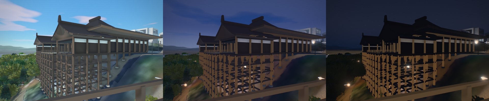
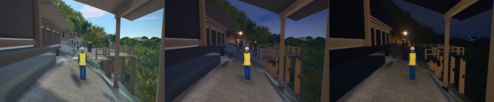
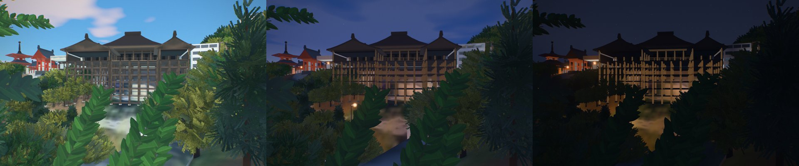
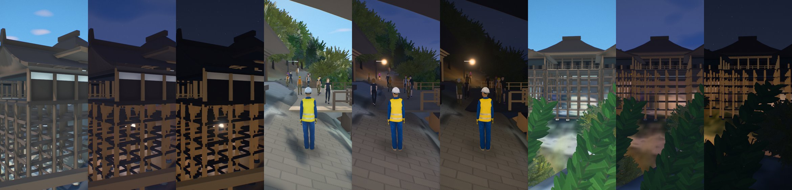
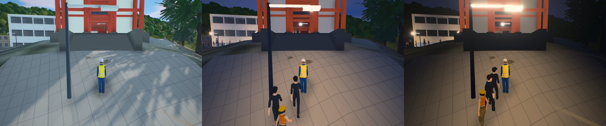
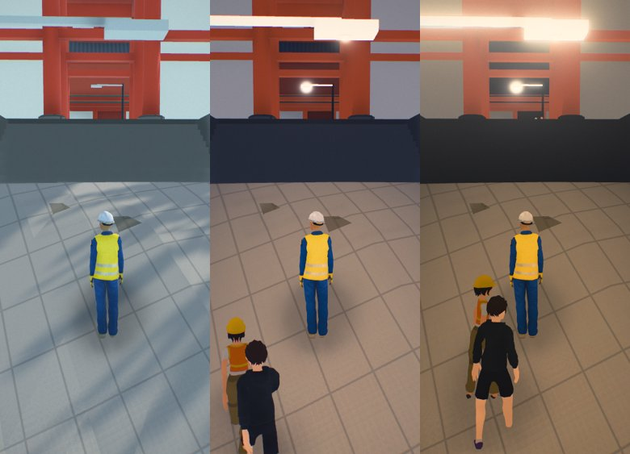
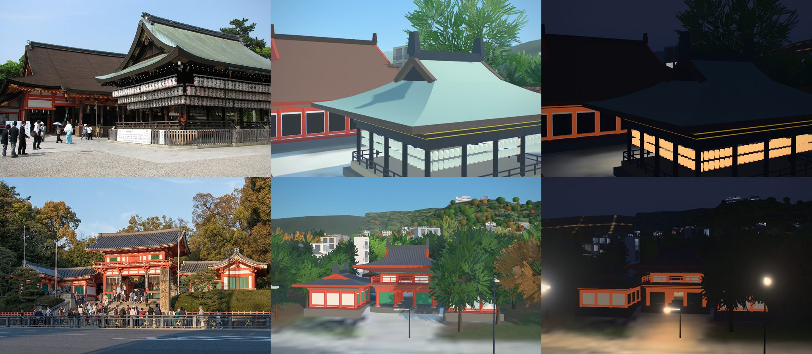
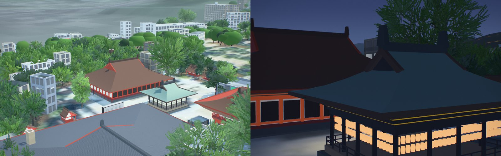
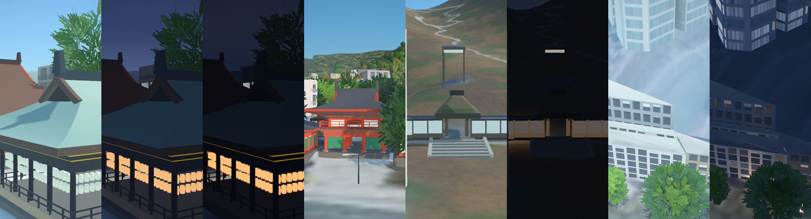
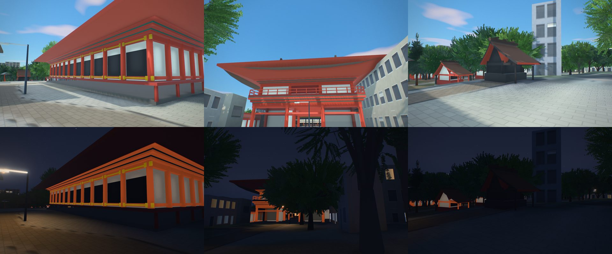

# Higashiyama: Kiyomizu-dera and the stone lanes

A map of Kyoto's Higashiyama, 1.8 × 1.8 km from Gojo-dori to Yasaka Shrine: Kiyomizu-dera on its
hillside, the preserved lanes of Sannenzaka (産寧坂) and Ninenzaka (二寧坂), and the Yasaka Pagoda. It
is one of the Kyoto maps (`cities/index.json`, group Kyoto) beside [Central Kyoto](kyoto.md) and
[Fushimi Inari](fushimi-inari.md). The figures and their sources are in [kyoto-sights.md](kyoto-sights.md).

## Data

| | |
|---|---|
| Buildings | 7,090 (Overture footprints; 94.6% of the footprint area at a PLATEAU-measured height) |
| Heights and roofs | Project PLATEAU Kyoto City 2022 (MLIT, CC BY 4.0), LOD1 heights and LOD2 roof shapes |
| Terrain | GSI DEM5A, 5 m bare earth from airborne laser survey; the lanes climb about 60 m to the temple |
| Imagery | GSI seamless aerial photographs, zoom 18 |
| Fine detail | OpenStreetMap (ODbL) round the temple and the lanes, `cities/higashiyama/kiyomizu_osm.json` (`pipeline/osm_detail.py`) |

The machiya rules of the Kyoto map (`architecture_overrides`: two-storey wooden fronts, few signs)
apply here too.

## What is built in code (`cities/higashiyama/city.py`, `pipeline/kyotokit.py`)

Each building stands on the footprint OpenStreetMap maps for it, facing the way it faces; its PLATEAU
block is hidden from the renderers and kept in the surface model.

- **The Main Hall (本堂, 1633)**: about 36 m across and 31 m deep, about 18 m high (National Diet
  Library; the temple). The floor is set level with the hillside behind the hall, from the laser terrain.
  The body sits under a hipped roof of hinoki bark, with the wing corridors running forward either side
  of the stage under their own gabled roofs.
  - **Its roof** (#167) is a material of its own: bark laid in courses finer than the smaller halls',
    darker and greyer, and the thick cut edge of the bark (軒付) round the eaves, following their rise to
    the corners.
  - **Its inside**: the outer hall and the inner sanctum (内陣) are dark behind the posts, under a dark
    ceiling, with the gilt shrines (厨子) of the Kannon and its attendants at the back. The outer walls are
    boards and shitomi lattices with a band of white plaster above the nageshi, as photographed, not
    white walls, so the hall no longer reads light grey through its open sides from the Okunoin.
- **The Stage (舞台)**: about 200 m² of hinoki boards (the temple), on the mapped outline, on eighteen
  keyaki pillars (the temple's count): six across the front, three rows deep, about 0.64 m thick
  (photographs, against the railing), on stone footings, tied by through-beams (懸造) every 2.4 m in
  both directions. The Main Hall's front stands on more of them, every 3.4–3.8 m.
- **Each hall's own roof curve** (#167): the sweep of each roof (`ROOFS` in `city.py`: the exponent of
  `archkit.japanese_roof`'s profile, flat at the eaves and steep at the ridge, and the corners' lift as a
  share of the overhang) is read side on from photographs of that roof: the Main Hall's and the
  Okunoin's bark roofs sag deepest and barely lift at the corners (1.9 and 1.8, lift 0.12–0.14), the
  tiled Sutra Hall, Founder's Hall and Asakura-do are stiffer and turn up more (1.45–1.5, 0.26–0.3).
- **Vermilion buildings**: the Deva Gate (仁王門, two storeys, about 10 × 5 m, 14 m high), the West
  Gate, the Three-storey Pagoda (about 31 m), the Bell Tower, the Sutra Hall, the Founder's Hall and the
  Todoroki Gate. The Koyasu Pagoda, about 15 m, stands across the valley.
- **Bare timber buildings**: the Okunoin, and the Asakura-do, Shaka-do and Amida-do.
- **The covered corridor** (OSM w1340239544 and w1272415075, #161) from the Shaka-do past the Amida-do
  to the Okunoin: the Amida-do stands back behind it, the corridor under a lean-to of bark on posts;
  at the Okunoin it comes onto the veranda along the hall's whole front, crosses it and leaves past the
  hall's south-west corner. The veranda and the stage out from it (on its own OSM outline, w893859575,
  shallow and wide: 3.6 × 12 m) are one floor, level with the way from the Amida-do, with the railing
  on the valley side alone. Both are walked as strips (`game_surfaces`).
- **The West Gate's steps** (OSM w339551498, #161): the gate stands on its stone platform 1.8 m over the
  terrace west of it; ten granite steps run down its front between stone side walls to where the mapped
  way starts, walked as one strip, the ground not drawn over them. The terrace below is granite flags
  laid over the aerial photograph, whose trees' shadows lay on it (#187), on the ground the game draws.

- **The Otowa Falls**: three streams from the rock under a timber roof, at the OSM node 音羽の滝 不動明王.
- **The Yasaka Pagoda (八坂の塔, 1440)**: five storeys, 46 m, bare timber and white plaster under tiles.
- **Yasaka Koshin-do (八坂庚申堂)**: strings of kukurizaru, cloth monkeys bound hand and foot, on frames
  at its gate on Yasaka-dori (at the OSM node 庚申堂). The frames' size and the colours are read from photographs.
- **The lanes**: stone setts along OpenStreetMap's lines for 産寧坂, 二寧坂, 一念坂, 清水坂 and 八坂通,
  and stone steps on the mapped flights of steps. Every low building whose front faces a lane gets:
  - a lattice (格子) over the ground floor;
  - a noren in the doorway, with words drawn in open fonts (清水焼, 八ツ橋, 七味, 抹茶...);
  - a paper lantern at every other door, lit after dark.

  The words on the noren are typical of the street, not the real shops' names.

## The game: Higashiyama on Foot

- **The route**: it starts on Higashioji-dori at the foot of Yasaka-dori, looking up the street to the
  pagoda (the lane itself is too narrow to park the player's car in), and climbs Ninenzaka and Sannenzaka to a
  Kiyomizu-yaki potter, then Kiyomizu-zaka to a monk at the Deva Gate.
- **Koshin-do**: the first quest stops at the kukurizaru, where *Crimson School Trip* (2018) puts Shinichi
  and Ran with the pagoda behind them.
- **The Conan quest**: Mika, a Detective Conan fan on her pilgrimage, sends you to three spots:
  - **the Stage**, walkable as a strip at the floor's height;
  - **the Okunoin's stage**, the view from which the whole Main Hall is photographed;
  - **the Otowa Falls**.
- **Conan in Kyoto**: Kiyomizu-dera is in *Crossroad in the Ancient Capital* (2003). In *Crimson School
  Trip* (2018), Shinichi and Ran are photographed with the stage behind them. The game names these
  places and copies nothing of the films' art.

## Reference games: what was taken and what was not

*Assassin's Creed Shadows* (2025), *Like a Dragon: Ishin!* (2023) and *Onimusha: Way of the Sword*
(2026) all build Kiyomizu-dera ([kyoto-sights.md](kyoto-sights.md#6-kyoto-in-video-games-what-to-learn-not-copy)).
Taken as ideas only, in this project's own look:

- Landmarks as compass points, visible from the lanes.
- Detail spent in the first 3 m of the shop fronts.
- Lanterns at dusk.

Not taken: any of their art, models or layouts. Their shortened climbs are not taken either: here the
climb is the real one.

## Maruyama Park and the Philosopher's Path (#164)

Maruyama Park is inside this map: its cherries round the Gion weeping cherry are a `trees.areas`
entry in `cities/higashiyama/city.json`, outlined from OpenStreetMap (円山公園).

The Philosopher's Path (哲学の道, Ginkaku-ji to Nanzen-ji along the Lake Biwa Canal's branch, about
35.010–35.027 N, 135.790–135.796 E) is outside every map. It came in as a **district of its
own** ([tetsugaku.md](tetsugaku.md)), not by growing this one. Growing Higashiyama north to 35.03 and east to 135.80 would take it
from about 3.3 km² to about 11.6 km², roughly three times the buildings and ground tiles, and every
visit to Kiyomizu-dera would load them. A district of its own (about 135.784–135.800 E,
35.006–35.030 N, 3.9 km², the size of this map) loads only for those who choose it, and adds one game
check to the runs that shared code needs, a cost in computer time once per change rather than in
load time for every player. It holds a walk of its own too: Ginkaku-ji, Honen-in, the path's cherries,
Eikan-do and Nanzen-ji with the canal's aqueduct (水路閣) and the Keage incline. Its cherries are planted along the
canal from photographs, the way `trees.areas` and the mapped trees are here.

## Yasaka-jinja's halls (#263)

八坂神社's own buildings had been PLATEAU's windowed blocks. `yasaka_jinja()` in `cities/higashiyama/city.py`
now builds them on their OpenStreetMap outlines, side by side with photographs on Wikimedia Commons (compared,
not copied):

- **The honden (本殿, w88108397, 1654, National Treasure)**, in the Gion style: the sanctuary and the worship hall
  under one great hipped-and-gabled roof of hinoki bark, its eaves low all round (5.6 m) and its gable small near
  the 14.6 m ridge (PLATEAU's top), vermilion posts and white walls on a floor raised 1.3 m, a veranda all round.
- **The West Gate (西楼門, w105449683, 1497)**: a two-storey vermilion gate under **tiles** (not bark), green lattice
  windows (連子窓) in its outer bays, standing at the top of its steps; 11 m over its platform, scaled from the
  people on its steps (PLATEAU had 9.0 m). Its two wings (翼廊) either side, unnamed PLATEAU solids of 12.9 and
  17.2 m (the trees over them), are low vermilion halls with white walls and green lattice under tiled roofs,
  6.5 m to the ridge.
- **The South Gate (南楼門, w88108386)**: a two-storey vermilion gate at PLATEAU's 15.0 m, under bark (no photograph
  was reached; see below).
- **The Buden (舞殿, w105449709)**: the open dance pavilion, a stage of hinoki on a stone base between dark lacquered
  posts, its railing, three rows of white paper lanterns under the eaves all round (lit after dark), and a big
  hipped-and-gabled roof of copper gone pale green, its gables east and west as the photograph shows them
  (`pipeline/arcades.py` had given it a grey tiled slab on posts).
- **The Tokiwa-den (常磐殿) and the reception halls (常磐新殿)**: vermilion halls under tiled hipped-and-gabled roofs.
  **The Noh stage (能舞台)**: a hinoki floor open on three sides under a gabled bark roof.
- **The small shrines (末社, 摂社)**: every named shrine under 70 m² in the precinct (Eki-jinja, Utsukushi-gozen-sha,
  Hiyoshi-sha and the rest) in the flowing style (流造): the sanctuary on a stone base, the bark roof's front slope
  running on over its steps, at a small shrine's height (2.6 m + 0.45 m per metre of the square root of its
  area). PLATEAU had measured the trees over them: Hiyoshi-sha's 12 m² stood 15 m tall.

**A shared fix.** `kyotokit.hall()`'s post and door loops reused the name `k`, so every hall took the number of its
front bays as its roof's sweep instead of the one asked for: the roofs read as a flat skirt with a narrow tent
in the middle. Kiyomizu-dera's, Eikan-do's and Fushimi Inari's halls now have the curves their `ROOFS` and calls
give them. `hall()` also takes `gable_at` (how far down the gables reach).

| Photograph | Author | Licence |
|---|---|---|
| [Yasaka Shrine main buildings.jpg](https://commons.wikimedia.org/wiki/File:Yasaka_Shrine_main_buildings.jpg) | Chris Gladis (MShades) | CC BY 2.0 |
| [Nishiromon Gate, Yasaka Shrine, Kyoto, West view 20190416 1.jpg](https://commons.wikimedia.org/wiki/File:Nishiromon_Gate,_Yasaka_Shrine,_Kyoto,_West_view_20190416_1.jpg) | DXR | CC BY-SA 4.0 |

**Checked against photographs (#272).** Commons answered this time, slowly:

- **The South Gate** is under **hinoki bark**, as drawn (a close photograph of 2024 shows the bark's courses and
  the snow guards): its ridge now carries the shrine's three gold crests (左三つ巴) on either face. Trees no longer
  stand in a gate's way: the steps before the South and West Gates, the gates' width and 22 m out, are kept clear of
  the mapped trees (one stood on the South Gate's axis, on its steps).
- **The honden's front** is open: its bays stand open between the vermilion posts onto the dark of the worship hall,
  white boards over them, and gold fittings (金具) run along the head and floor beams with plates at every post
  (photographs of 2017–19); it had been drawn as dark lattice doors.
- **The small shrines:** Ōkuninushi-sha (大国主社), behind its stone torii, is in black lacquer with gold fittings
  (2023), and is drawn so. A photograph of another small shrine in the precinct (unnamed in its caption) shows it in
  bare, weathered wood inside a shelter. The others stay vermilion until a photograph says otherwise.

Still not checked: the Tokiwa-den's and the reception halls' roofs and colours (no photograph of either was found on
Commons) and the other small shrines' colours.

| Photograph | Author | Licence |
|---|---|---|
| [South Tower Gate of Yasaka Shrine in Kyoto, 20240820 1706 5167.jpg](https://commons.wikimedia.org/wiki/File:South_Tower_Gate_of_Yasaka_Shrine_in_Kyoto,_20240820_1706_5167.jpg) | Jakub Hałun | CC BY 4.0 |
| [Honden of Yasaka Jinja.jpg](https://commons.wikimedia.org/wiki/File:Honden_of_Yasaka_Jinja.jpg) | Immanuelle | CC BY-SA 4.0 |
| [Yasaka Shrine subshrine torii.jpg](https://commons.wikimedia.org/wiki/File:Yasaka_Shrine_subshrine_torii.jpg), [Yasaka Subhsrine.jpg](https://commons.wikimedia.org/wiki/File:Yasaka_Subhsrine.jpg) | Immanuelle (2023) | CC BY-SA 4.0 |

## What is approximate

- The stage's eighteen pillars stand on an even grid across the mapped outline, not each surveyed.
- The roofs' curves are read from photographs, not from measured drawings.
- The Okunoin's floor level (115.45 m) is taken from the corridor's ends on GSI's terrain.
- The West Gate's flight is as steep as the mapped way's foot allows (0.18 m risers, 0.32 m treads).
- The Yasaka Pagoda's first-storey width is an estimate from its 13.5 m footprint, which is traced at
  the eaves.
- Jishu-jinja is under restoration until about 2027–28 and is left as PLATEAU's blocks.
- Trees are planted from the canopy model; species are not mapped, so the mix is a guess
  (`trees` in `cities/higashiyama/city.json`): evergreen oaks, cedars (standing for cypress too),
  black pines and a few maples on the hills, and maples and cherries thick in Kiyomizu-dera, Maruyama
  Park and Kodai-ji, outlined from OpenStreetMap. Cherries open on 26 March, maples redden from mid
  November.
- Not checked on: a real GPU, WebGPU, Safari or iOS.
