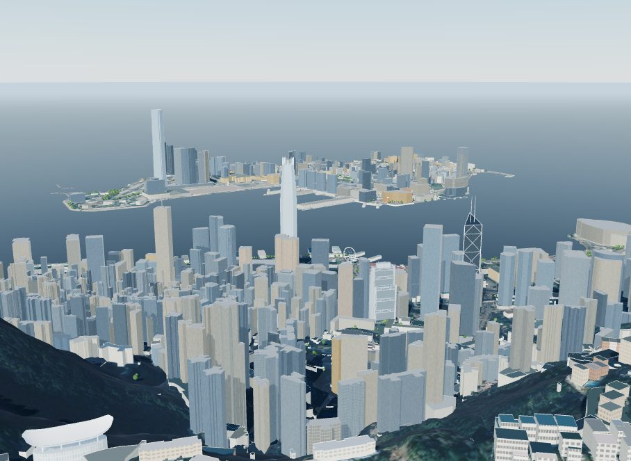
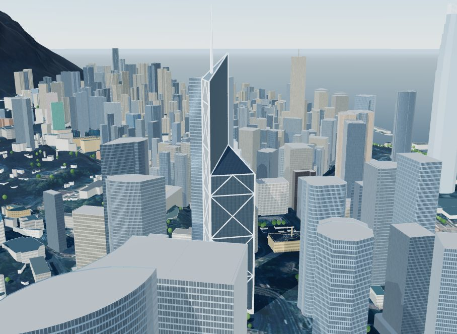
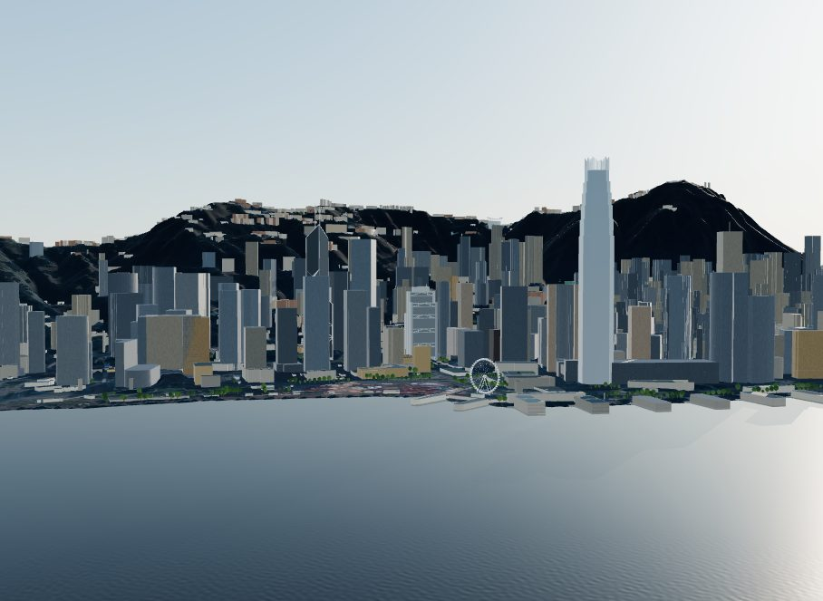
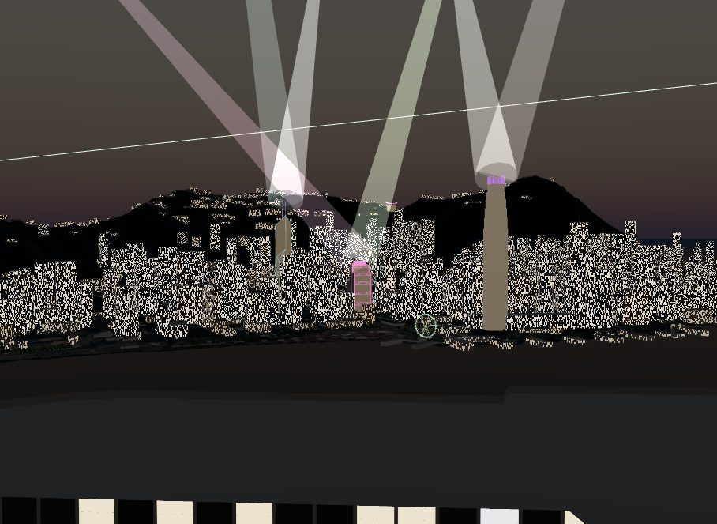
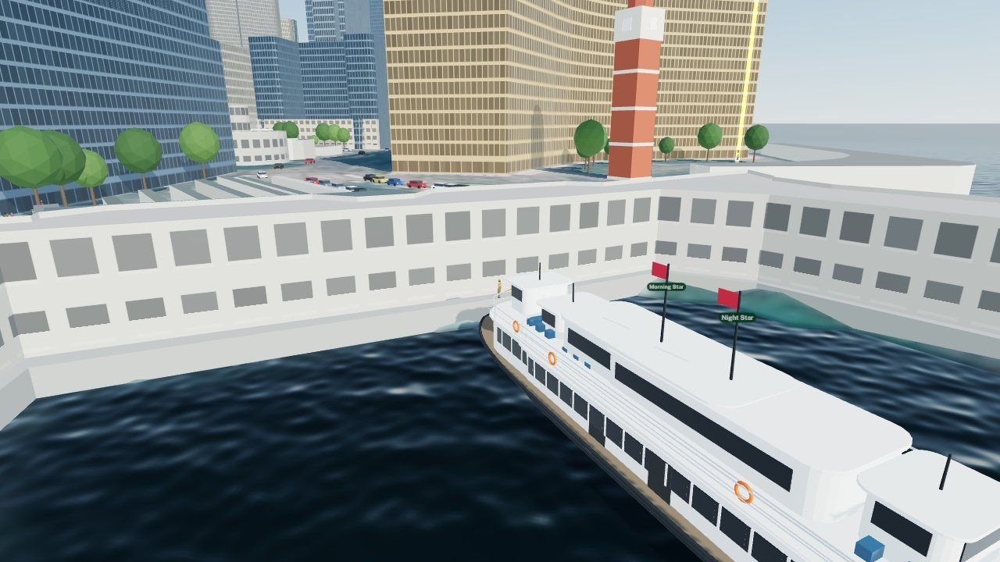
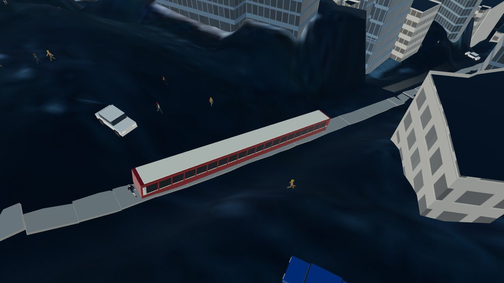

# Hong Kong

> Victoria Harbour from Sheung Wan to Causeway Bay, Tsim Sha Tsui and the Peak:
> 4.0 × 4.8 km, 7,513 buildings and 1,407 mapped trees on the government's
> 2020 LiDAR terrain. Nearly every height is measured: 86% of the footprint area
> by the Lands Department's survey, 12% by the LiDAR. Every number here is
> reproduced by the scripts in `analysis/` with `--city hong-kong`, and their
> outputs are in `cities/hong-kong/analysis/`.

| From the Peak | The Bank of China Tower and Central |
|---|---|
|  |  |
| **Central from Tsim Sha Tsui** | **A Symphony of Lights, 8 pm** |
|  |  |
| **The Star Ferry at Tsim Sha Tsui** | **The Peak Tram** |
|  |  |

Open it from the globe, or at `web/index.html#hong-kong`. The game is at
`#play-hong-kong`.

## 1. What is different

Hong Kong's heights are measured rather than mapped, as the Japanese cities'
are (Project PLATEAU). Sydney and Melbourne lean on OpenStreetMap floor counts
and estimates; here the government publishes the top level of every building
block. It is also the first city where an independent LiDAR scan of the whole
territory checks every roof. Six things are new to the pipeline:

1. **Surveyed heights** (`survey`, `pipeline/fetch_survey.py`,
   `pipeline/survey.py`). The Lands Department's *Building* dataset draws each
   building as blocks (a podium, the towers on it), each with a surveyed top
   and base level in mPD and a storey count. The fetcher reads them from the
   CSDI portal's ArcGIS feature service. The build cuts each Overture footprint
   along the blocks, tallest first, so a tower is not buried under its podium.
   Each block goes to the footprint it fits best (intersection over union):
   OpenStreetMap often maps a podium round its towers, and without that rule the
   towers' blocks were cut into the podium as well. 511 blocks no Overture
   footprint covers are added as buildings of their own.
2. **LiDAR heights** (`surface_check`). The Civil Engineering and Development
   Department's 2020 airborne LiDAR covers Hong Kong at 0.5 m, as a terrain
   model and a surface model. A footprint the survey covers less than half of
   is measured from the surface model: the median inside the outline drawn
   1 m in. A surveyed piece the laser saw far lower (its 90th percentile more
   than 15 m and a quarter below), on a block surveyed before the flight, takes
   the LiDAR height too: its block outline takes in a lower building
   (Queensway Government Offices' low block carried its high block's 209 m).
   116 pieces were lowered this way. Blocks surveyed after the flight are newer
   than the laser and stand.
3. **Terrain from a tile index in a projected grid** (`terrain.type:
   "tile_index"`). The LiDAR comes as 62 zipped GeoTIFF tiles in the Hong Kong
   1980 Grid, listed in a GeoJSON index. The fetcher mosaics them at 1 m. The
   local frame's WGS84 coordinates are converted to the grid with pyproj's
   HK1980 transformation (`frame_crs: "EPSG:4326"`; the Australian cities take
   theirs as GDA2020).
4. **An independent check of every roof** (`analysis/lidar_heights.py`), and
   of what the open data alone would have given (section 3).
5. **No sun-access rule.** Hong Kong's planning standards protect a view
   instead: a building-free band below the ridgelines, seen from vantage points
   across the harbour. The model shows the sun on public places without a rule
   behind them, as it does for Melbourne's unlisted spaces.
6. **Rail, and a light show.** The game runs Hong Kong Tramways' double-deck
   trams on the tracks OpenStreetMap maps, and the Peak Tram on its line
   (`game.rail`, `web/game/rail.js`). After dark at 8 pm, searchlights, lasers
   and colour wash the landmarks for ten minutes (`light_show`, `web/lights.js`).

## 2. Data

| Layer | Source | Licence |
|---|---|---|
| Buildings, parts, land use, water, roads, rail, piers, addresses | Overture Maps 2026-10-21.0, mostly OpenStreetMap | ODbL (CDLA for Overture's own data) |
| Surveyed heights | Lands Department, *Building* (CSDI portal, `landsd_rcd_1637211194312_35158`): block outlines, top and base levels in mPD, storeys, survey dates | Hong Kong government open data, with attribution |
| Terrain | CEDD territory-wide airborne LiDAR, 2020 DTM, 0.5 m (CSDI, `cedd_rcd_1629267205233_87895`), flown 20 December 2019 to 2 February 2020 | Hong Kong government open data, with attribution |
| Roof check and LiDAR heights | The same survey's DSM, 0.5 m | as above |
| Terrain check | Lands Department, Geodetic Survey Control Station Database: levelling bench marks (CSDI, `landsd_rcd_1637226129981_91080`) | as above |
| Imagery | Lands Department Map API (GeoData Store), aerial photograph tiles, zoom 18 | © HKSAR Government; the API's terms ask for the Lands Department logo and a copyright notice on the map face |
| Published heights | Wikipedia, *List of tallest buildings in Hong Kong* (accessed 28 October 2026), with its coordinates | CC BY-SA 4.0 (facts) |
| Landmark dimensions | Wikipedia, BOCHK, SkyscraperPage, KPF, the Antiquities and Monuments Office, Farrells and others; OpenStreetMap building parts where nothing is published (section 6) | facts; ODbL |

The imagery is resampled into the repository's ground tiles, as Sydney's is.
The Map API's terms ask for the Lands Department's logo on the map face; the
viewer shows the notice in its Data tab but not the logo yet.

## 3. Heights

| Height source | Footprint area |
|---|---:|
| Surveyed top level (Lands Department) | 86.2% |
| LiDAR roof (2020) | 11.5% |
| Estimate from neighbours | 1.9% |
| OpenStreetMap floor count or height | 0.4% |

**Against the LiDAR.** On 5,808 surveyed buildings, the model's roof (its
largest solid's top) differs from the laser's median roof by 1.16 m at the
median, with no bias (+0.03 m); 61% agree within 2 m and the 90th percentile is
10.8 m. Rooftop plant and parapets account for most of that spread. For the
384 surveyed towers of 100 m and more, the median difference is 1.6 m.
203 footprints show bare ground in the 2020 LiDAR: buildings finished since
the flight.

**Against published heights.** 40 of the 44 towers of 180 m and more on
Wikipedia's list fall in the model and match a building; the median error is
5.0% (4.3% for the surveyed ones) and the model runs 11 m short at the median,
because the list counts crowns and spires and the survey a building's main
roof. 32 are within 10%. The list gives coordinates rather than addresses, so
`analysis/heights.py` now takes a point from `lon` and `lat` columns, and takes
the tallest building at the point (a tower over its podium). Two rows are
excluded with reasons: Cheung Kong Center's name sits on a low building beside
the unnamed tower, and 39 Conduit Road's coordinate falls on its neighbours.
The Arch matches the Elements podium, which the survey's block assignment gave
part of Union Square: a 30% miss that is a matching problem, not a height one.

**What the open data alone would give.** On buildings the survey covers,
OpenStreetMap's 177 height tags are good: 5.0% median error, 67% within 10%.
Its 2,616 floor counts are not: times the default storey heights (3.0 m plus
2.8 m for homes, 3.9 m otherwise) they miss by 17.8% at the median, and 440 are
more than 40% short. Many count the floors of a tower above its podium, or
were mapped before a building was finished. A city with only OpenStreetMap
would need its storey heights calibrated, and its podiums mapped as parts.

**Roofs.** Anything of five floors or 20 m and more is ruled flat
(`pipeline/typology.py`), which covers the towers. Below that, 261 solids have
a mapped roof shape; the rest are drawn from the roof shapes mapped across the
SAR (7,844 buildings inside its land boundary, region `hong_kong`). Low flats
and semis are almost all flat, village houses gabled, and small structures
flat, curved or lean-to. 842 solids get pitched roofs. Scored against the 62
mapped roofs in the scene, the rules get flat or pitched right 76% of the time,
against 73% with the default priors (`analysis/roof_model.json`).

## 4. Terrain

The 2020 LiDAR terrain agrees with 101 levelling bench marks on open ground to
−0.22 m at the median (0.61 m absolute, 73% within 1 m, the 90th percentile
1.9 m). Bench marks are staples and rods in kerbs, walls and steps, so some of
that is their height above the ground. The traverse stations in the same
database mostly carry no levelled height (0 mPD), and are not used.

AWS Terrarium is a surface model here as everywhere: under buildings it stands
31 m above the LiDAR terrain at the median, on open ground −1.0 m. Read as a
radar check of the building mass (`radar_check.py`), the 2000 SRTM surface
tracks the model's block-mean heights with r = 0.76 and a slope of 1.14 at
200 m blocks, given the radar's age and smoothing.

The water is drawn at 0 mPD, about the lowest tide; mean sea level is about
1.3 mPD. Victoria Harbour is OpenStreetMap's coastline polygon, and the bottom
is modelled from the distance to each kind of shore, as for Sydney.

## 5. Sun on public places

No Hong Kong rule protects the sun on a public place, so none is tested; the
viewer shows the share of each place in sun, and the tower test reports
judgements, not passes and fails. The bank towers decide Statue Square's
winter: 10 am to 2 pm on the 21st, it is 21% in sun in December and 95% in
June (`sun_access.json`). Chater Garden is 31% and 91%, Tamar Park 29% and 73%.
Open ground on the waterfront and the Peak stays above 90% all year. The
numerical error budget is under 2.8 percentage points for every place.

## 6. Landmarks

Built in `cities/hong-kong/city.py` from published dimensions, on anchors
measured from their footprints. The solids they replace stay in the surface
model, so their shadows are the measured ones.

- **Bank of China Tower.** A 52 m square split along its diagonals into four
  triangular shafts; roof 315 m, two masts to 367.4 m (Wikipedia; BOCHK). The
  shafts stop lowest on the harbour side, then west, east and south, each top
  sloping up to the centre; the heights (about 110, 160, 210 and 315 m at the
  ridge) are OpenStreetMap's building parts, which agree with the published
  floor groupings. Silver-white cross bracing over 52 m modules on dark glass.
  The faces are turned 15.8° from north, as measured on the footprint.
- **HSBC Main Building.** 178.8 m; three 16.2 m bays of 29, 36 and 44 storeys
  (south, north, middle); eight masts in two rows of four at the east and west
  ends; coat-hanger trusses two storeys deep at five levels; the banking hall
  lifted over a 10 m plaza. The truss levels are inferred from OpenStreetMap.
- **Two IFC.** 412 m to the crown's fins; 57 m across at the base and 39 m at
  the main roof (SkyscraperPage). The setback levels are not published: the
  plan steps in over the top 120 m here.
- **ICC.** 484 m with its parapets; re-entrant corners that widen with height
  and a base that curves out (KPF; Architectural Record).
- **Central Plaza.** Roof 309 m, mast to 373.9 m, a triangle with cut corners
  and a three-sided glass pyramid; gold glass, and the Lightime clock's bars.
- **Observation Wheel** (60 m, 42 gondolas), the **Clock Tower** (44 m and its
  7 m lightning rod, red brick and granite; Antiquities and Monuments Office)
  and the **Peak Tower**'s crescent roof (396 to 428 m above the datum).

## 7. The game

*Hong Kong on Foot* starts at Central's Pier 7. The quests cross the harbour on
the Star Ferry, read heights with the survey lens at the Clock Tower, fly from
the Convention Centre heliport to Tamar Park, find the winter sun in Statue
Square, ride the Peak Tram and end at the lookout at 8 pm. The trams run on both
tracks along the north shore, keeping left, and stop for anyone on the rails;
the Peak Tram's two cars share one cable and pass at its loop. Its line, 1,265 m
rising 360 m as OpenStreetMap maps it on the LiDAR terrain, matches the
published 1,277 m and 358 m; the ride takes five minutes at 6 m/s, as the real
one does.

## 8. Open questions

- **A Symphony of Lights** was announced in February 2026 for retirement in
  the second half of the year, and was still running in September. If it has
  ended, the show here is a record of it.
- **The ridgeline guideline** is the rule Hong Kong does have: a 20% to 30%
  building-free band below the ridgelines, seen from vantage points such as
  the Tsim Sha Tsui waterfront. It is a view test, not a sun test, and is not
  implemented.
- **The 2020 LiDAR** predates the newest towers; where the survey is newer the
  survey stands, but 203 footprints have no roof in it to check.
- **The imagery's logo requirement** (section 2) needs the Lands Department's
  logo on the map face before the city is shown publicly.
- The tram's car size (8.9 × 2.0 × 4.5 m) comes from fan databases and a 1967
  report; the Peak Tram car's width is a guess; which Star Ferry runs which
  route is not modelled.
