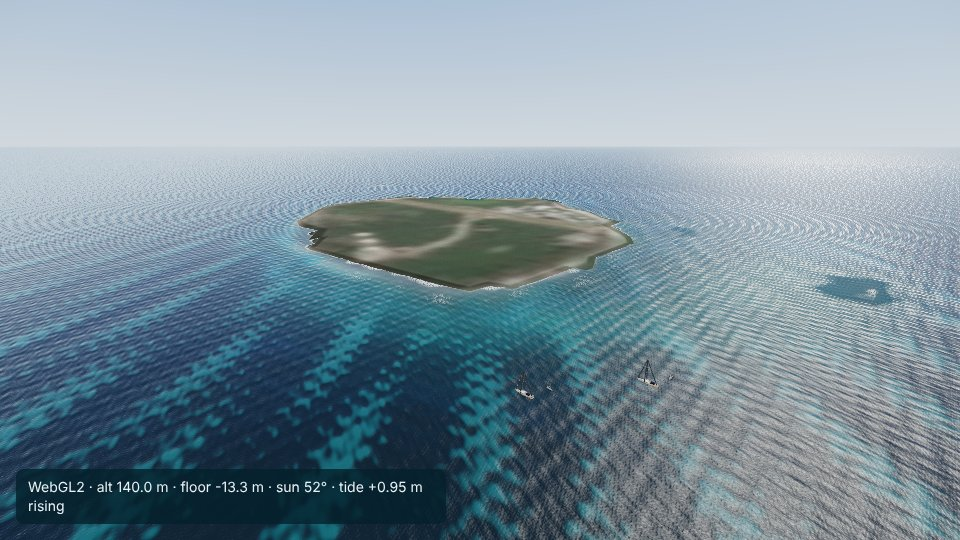
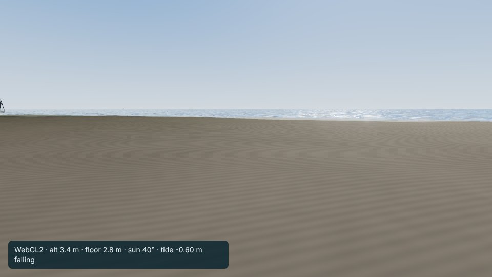

# Lady Elliot Island

Viewer: `web/reef/index.html?city=lady-elliot-island`. Config: `cities/lady-elliot-island/city.json`. Checks:
`cities/lady-elliot-island/analysis/` (`optics.json`, `poi_check.json`).

## Area

12 x 12 km (bbox 152.655-152.775 E, 24.06-24.17 S; origin 152.715 E, 24.115 S) centred on the island: its platform reef,
about 1.3 km across, and the shelf around it, mostly 30-55 m deep (5th to 95th percentile 28-56 m). No other reef lies in
the box; Lady Musgrave Island, the nearest, is 40 km north-west.

## Data

- Terrain: AusSeabed GBR 30 m, grid D (150-156 E, 23-29 S), cached in `data/raw/_gbr/D.tif`. Range -100.1 to +9.2 m;
  no no-data. The +9.2 m is the canopy: the island is rebuilt from its OpenStreetMap outline (`build_marine.py` cays():
  beach from 0 m at the waterline to the highest astronomical tide, 1.41 m above MSL from MSQ's tidal planes, at the
  vegetation line, interior 3.0 m, an assumption, no survey height found). 504 cells, 400 of them inland.
- Imagery: 14 Sentinel-2 scenes, all MGRS tile 56KMU, 10 Oct 2025 to 20 Sep 2026 (`optics.json` lists them). No seam.
- Tide: MSQ predictions for Waddy Point (K'gari), 114 km south-south-east on the open-ocean coast, 2025 and 2026,
  fitted to 3.2 cm RMS (largest error 10 cm); range -1.07 to +1.24 m about MSL. MSQ lists Lady Elliot Island as a secondary
  place of Bundaberg (Burnett Heads, 80 km south-south-west, at a river mouth): high water 24 and low water 33 minutes
  earlier, 0.74 of its range. Waddy Point runs about 25 minutes ahead of Burnett Heads, as Lady Elliot does, and its tide
  is closer in size (spring high and low water +0.63 / -0.62 m against Lady Elliot's +0.87 / -0.86 m and Burnett Heads'
  +1.16 / -1.17 m), so it was chosen; heights at the island are about a third larger than Waddy Point's.

## Optics

| | Lady Elliot Island | Whitsundays |
|---|---|---|
| Rinf blue / green / red | 0.0259 / 0.0121 / 0.0065 | 0.0264 / 0.0156 / 0.0013 |
| Kd blue / green, fit | -0.010 / 0.015 /m | 0.054 / 0.080 /m |
| Kd blue / green, used | 0.015 / 0.062 /m (pure water) | 0.054 / 0.080 /m |
| sand brightness spread 1-15 m, raw to inverted | blue 51 to 45%, green 100 to 55% | blue 103 to 43%, green 136 to 29% |

- The site's own Kd fit fails: the brightest floor does not darken with depth (blue stays 0.02-0.035 above Rinf from 2 to
  21 m), because the shallow reef flat is darker than the pale sand apron below it and there are few shallow pixels
  (under 1,000 per metre of depth). `build_marine.py` now holds blue and green at the absorption of pure water (Pope & Fry
  1997: 0.0150 /m at 490 nm, 0.0619 /m at 560 nm), as red always was. That is the clearest water physically possible;
  the real water is somewhat less clear, so the floor seen from above is a little too bright at depth. Borrowing Heron
  Island's Kd was tried first and made the depth check worse (spread 124%).
- Rinf: green the lowest of the five sites (0.0121), clear oceanic water; red again high (residual glint or offset).
- Habitat (scaled by 1.029): shallow floor seagrass and algae 44%, sand 26%, rubble 16%, reef 15%.

## Places

| POI | source | check on the built terrain |
|---|---|---|
| Lady Elliot Island (way 15703996) | OSM | 3.0 m |
| Western beach (relation 13651843, unnamed) | OSM | 0.8 m, beach |
| Lady Elliot Island airstrip (aerodrome way 582781803, runway way 33686280) | OSM | 3.0 m |
| Old Lady Elliot Lighthouse (way 437359875) | OSM (Nominatim) | 2.3 m, west shore |
| Lady Elliot Island reef (relation 6492561, unnamed) | OSM | 0.2 m deep (reef flat, dries at low tide) |
| West side, off the reef edge | nominal | 8.9 m |
| Gate toward Bundaberg | nominal | 27 m |

Spawn: on the upper sand of the western beach below the old lighthouse, 1.6 m (above the highest tide), facing the sea.
Start: 140 m up south-west of the island looking north-east across the cay and the airstrip.

## Harbour layout (checked with `window.__boats`)

Two yachts with tenders off the west side, one public mooring on the reef edge, a yacht and a dive boat between the gate
and the anchorage (both routes connect). No aircraft: the island is served by land planes on its airstrip, and the viewer
has only a seaplane and a helicopter.

## Known problems

- Kd (above); habitat inferred, not surveyed. No dive sites are mapped.
- The island's interior height is an assumption.
- A view from the beach shows the island as a wide sand plain: the 30 m terrain and the shore patch carry no vegetation
  until `life.js` adds trees.
