# Lake Pukaki: an alpine lake and Aoraki / Mount Cook from open data

> Lake Pukaki and Aoraki / Mount Cook, 38 × 84 km of the Mackenzie District in Canterbury, rebuilt from LINZ's LiDAR
> terrain and aerial photos, a summer satellite mosaic, mapped places, and the real sun, moon and stars. Open it from
> the globe (**Mackenzie**), or `web/reef/index.html?city=lake-pukaki`. Paths are relative to the repository root.

| The view up the lake from Peter's Lookout (a long lens, late afternoon) | On the phone |
|---|---|
| 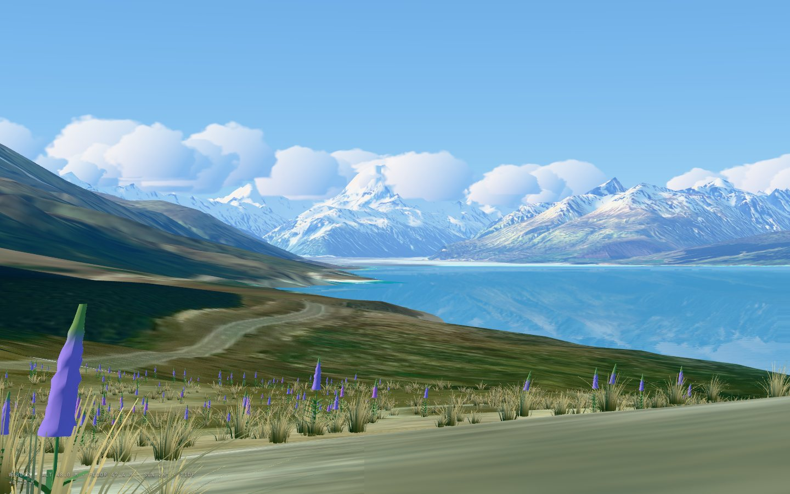 | 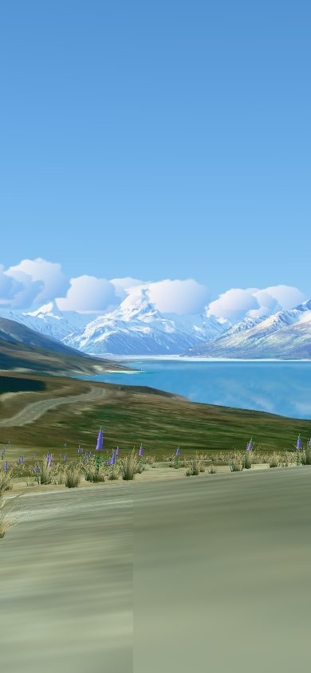 |
| **From 2 km up over the south end** | **In the tussock by the lookout** |
| 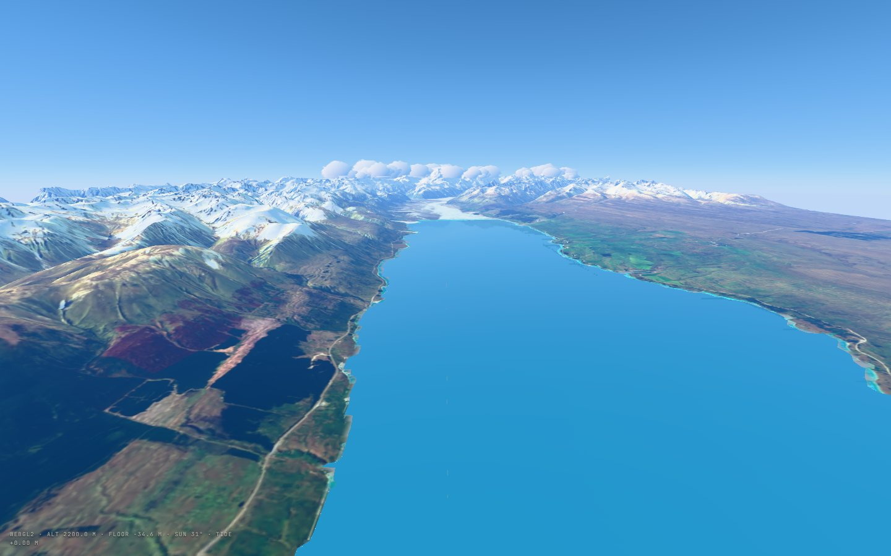 | 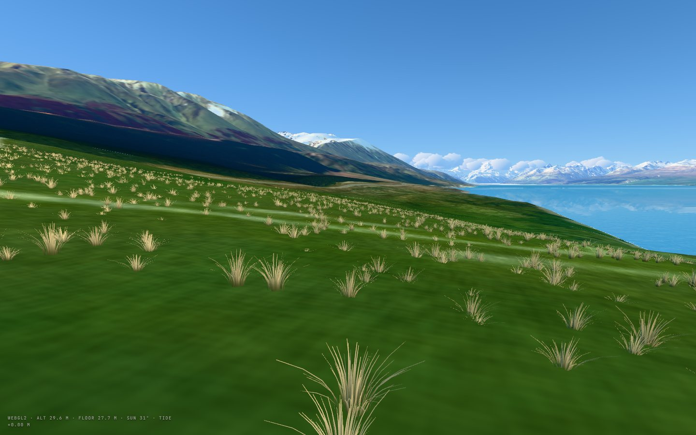 |
| **Dusk on the south shore** | **The dark-sky reserve's night** |
| 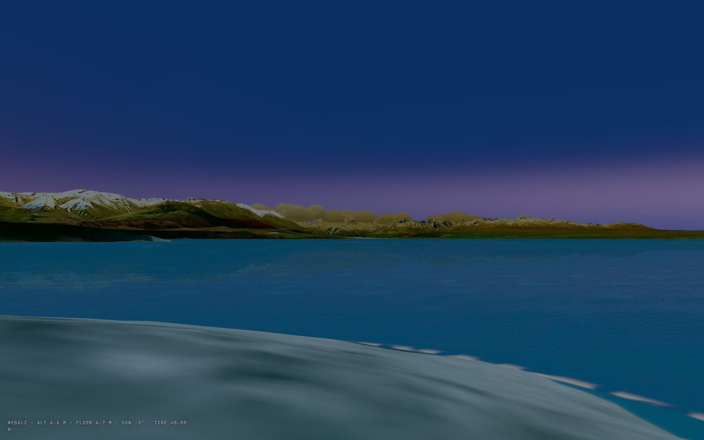 | 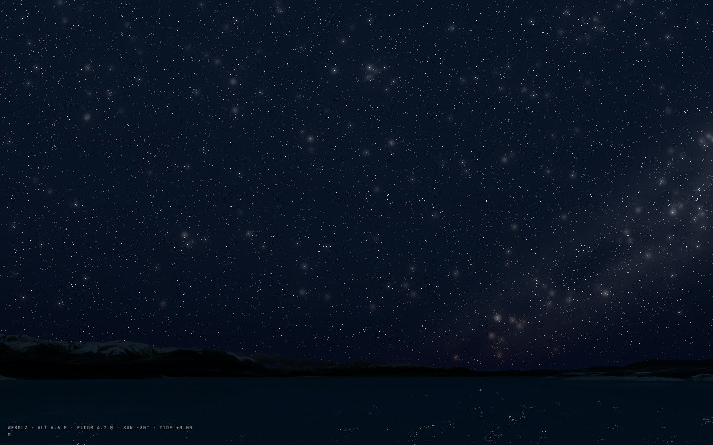 |

## 1. Which area, and why

The lake and the mountain it is famous for belong together, so the frame runs from the south shore up the lake and
the Tasman Valley to Aoraki and the Main Divide. NZTM2000 E 1352000–1390000 and N 5098000–5182000 is turned into the
site's own frame: a transverse Mercator on its centre (170.1506°E, 43.8576°S; `pipeline/cityctx.py`), x −19.2 to 19.2
km and y −42.24 to 42.24 km. That is Mackenzie District, Canterbury, from the Pukaki Dam and the visitor centre on the
south shore to the névé of the Tasman Glacier, with the West Coast's side of the Divide at the western edge.

Lake Tekapo, 25 km east across the basin, is a separate map in the same **Mackenzie** group. It is built in its own
session on this site's pipeline and viewer. Folding it into this frame would double the data for a separate view.

## 2. What is in it

| Layer | Source (licence) | In the model |
|---|---|---|
| Terrain | Toitū Te Whenua LINZ, *New Zealand LiDAR 1m DEM*: the national composite of every capture, here Canterbury – Mackenzie 2015 in the south and 2020 captures in the north (CC BY 4.0), read from its Cloud-Optimized GeoTIFF overviews at 16 m. Where it has gaps on land: *New Zealand Contour-Interpolated 8m DEM* (Geographx, CC BY 4.0) | `terrain.bin.gz`: 1280 × 2816 cells at 30 m, in 0.125 m steps above the lake's surface (section 3) |
| Ground colour | LINZ, *New Zealand 10m Satellite Imagery (2025–2026)*: a colour-balanced summer Sentinel-2 mosaic (CC BY 4.0) | `ground_0..2.webp` at 10 m, in strips a phone can hold |
| Aerial detail | LINZ, *Mackenzie 0.3m Rural Aerial Photos (2021)* and *Canterbury 0.3m Rural Aerial Photos (2015–2016)* (CC BY 4.0) | `detail_*.webp` at 0.75–0.9 m round Peter's Lookout, the south shore, Mount Cook Village and the Hooker Valley, loaded as the camera comes near (section 4) |
| Lakes, glaciers, scree, scrub, woods, roads, tracks, buildings, places | OpenStreetMap contributors (ODbL), read through Overture Maps 2026-10-21.0 | 29 lakes in `lakes.png`; land cover in `cover.png` (with the imagery); `roads.json`; `structures.json`; 51 POIs in `cities/lake-pukaki/city.json` |
| The lake's water | Sentinel-2 L2A over open water (Earth Search), the mosaic's own lake colour, and the published Secchi depth | `scene.json` optics (section 5) |
| Sun, moon, stars | NOAA solar position (`web/sun.js`); the moon from its age; the sky's rotation from sidereal time; the Milky Way on the J2000 galactic plane | the light, the sky, the night (section 6) |

Build:

```bash
python pipeline/fetch_linz.py --city lake-pukaki
python pipeline/fetch_overture.py --city lake-pukaki --only water segment building land land_use infrastructure
python pipeline/build_alpine.py --city lake-pukaki
python pipeline/alpine_detail.py --city lake-pukaki
python pipeline/far_land.py --city lake-pukaki
python pipeline/alpine_snow.py --city lake-pukaki
python pipeline/marine_meta.py --city lake-pukaki
```

`alpine_snow.py` maps the season's snow from the latest clear Sentinel-2 passes. For this build that is 22 and
24 October 2026, two relative orbits, because one swath covers only part of the frame. Snow is NDSI > 0.4 with B08 >
0.11, cloud is excluded by the scene classification layer, and the result is `snow.png` at 20 m. The summer mosaic
alone shows the end of summer's snowline. The viewer lays the spring snow over it from June to November, at half
strength in December, and drops it from January to March.

`far_land.py` adds the land past the frame. For an alpine site that is a ring 100 km either side of the centre:
Copernicus GLO-30 relief at 195 m, and WorldCover's classes coloured from the site's own imagery. `web/reef/farland.js`
lowers it by the lake's height, so it meets the frame's edge. Landmark models are placed from city.json
`landmarks` ({id, glb, lonlat, ground_m, walk?: "deck"}; `web/reef/alpine/landmarks.js`). Lupin drifts the land cover
cannot tell come from `flora.lupins` ({lonlat, r_m, density}). `tools/site_shots.js` renders a site's `shots` on a
desktop and a phone.

The last command refreshes the POIs, spawn and helicopter after a `city.json` edit, with no raw data needed.

## 3. Terrain and lakes

The LiDAR has no returns over water. Near the shores it is flattened to the water's surface; further out it is
blank. Each OpenStreetMap lake outline (and the LiDAR gaps inside it) is a lake. Its surface is the median of the
flattened LiDAR inside it:

| Lake | Surface (m NZVD2016) | Area in the model | Bed |
|---|---|---|---|
| Lake Pūkaki | 525.8 | 172.7 km² (Wikipedia gives 178.7 km² over the whole operating range) | to 70 m, the depth Lakes380 publishes |
| Tasman Lake | 704.0 | 8.1 km² | synthesised |
| Hooker Lake | 866.5 | 1.8 km² | synthesised |
| Mueller Lake | 753.0 | 1.0 km² | synthesised |

The whole grid is shifted so that Pukaki's surface is 0. The reef viewer's water code then works as it is: swimming,
the water column, boats and the helicopter's height. Only the main lake is that water. Everywhere else the bed the
water code sees is held above it, so the land below the lake's level stays dry: the Pukaki flats past the dam and the
West Coast's valleys, down to 70 m above the sea. The other lakes have their own flat surfaces (`web/reef/alpine/lakes.js`).

No open survey of the lake beds exists. Each bed is synthesised: depth grows from the shore with the distance to it,
steep at the sides and flat in the middle, to the lake's maximum depth. In glacial-flour water you see a metre or two
down at most, so only the shallow shelf shows.

The grid is stored as the residual of the plane through each cell's left, upper and upper-left neighbours, with all
the low bytes and then all the high bytes, gzipped: 3.4 MB where the plain grid is 5.9 MB
(`build_alpine.py encode_heights`, `web/reef/alpine/data.js decodeHeights`).

## 4. Land cover and the ground up close

`cover.png` holds one class per 20 m (`build_alpine.py COVER`): lake, river, snow and ice, debris-covered ice, rock and
cliff, scree and moraine, riverbed gravel, tussock, alpine herbfield, scrub, forest, pasture, wetland, road, built, shore.
White water in a gorge (the Hooker under its lower bridge) is bright and grey, so the colour rule took it for snow, a
flat white band along the river; a snow pixel with no more than three others in its 5 × 5 window beside a river or
riverbed pixel is now river (`build_alpine.py river_snow`: 4,031 pixels here, 2,436 at Tekapo, applied to the built
covers in place).
The classes come from the imagery's colour (lightness, saturation, green), the slope and the height, with
OpenStreetMap's mapped glaciers, scree and shingle, scrub and heath, and woods on top, and a 3 × 3 majority filter.
They steer the detail only: the colour is always the imagery's.

The ground's detail is layered by distance:
- **Beyond a few km:** the 10 m colour.
- **Within 1.5 km of the four aerial patches:** the 0.75 m photos, colour-matched to the mosaic below 40 m (a low-pass
  transfer), so a 2021 summer photo sits in the 2025–26 mosaic without a seam.
- **Within about 1 km:** grain and relief by class: hummocks in tussock, stones in scree, strata in rock, glints in snow.
- **Within 240 m:** a 2 m patch on a bicubic read of the grid plus that relief. Its CPU twin (`terrain.heightAt`) is
  the surface the player and the people stand on.
- **Within 40 m:** a turf of short grass on the grassy classes (and on "built" ground where the imagery is green):
  tufts of 15 blades 9–28 cm tall, five or six a square metre near the eye (fewer on a phone) and thinning outward. The blades are a
  living spring green, each its own shade, one in twelve dry straw, leaning a third of the way toward the colour of the
  10 m mosaic under the tuft and darker at the foot: from the side a blade shows its own green, not the litter and soil
  the satellite mixes in from above. The shader shrinks them to nothing before 40 m, so the turf has no edge as the
  camera moves.
- **Within 100–220 m:** plants and stones, placed by tile (`web/reef/alpine/flora.js`):
  - tussock clumps of 64 blades near and 18 further out, swaying in rolling gusts and lit through from behind: a
    forward lobe toward the sun and a diffuse share every thin blade passes through to its shaded face, so a backlit
    clump glows straw-gold against a low sun, as in photographs, rather than the near black of its sky-lit side (issue
    #232; the leaves of the lupins and shrubs take the same);
  - matagouri on scrub: a metre-high tangle of crooked grey twigs with spines, greener at the tips;
  - stones on scree, moraine and gravel, few inside a lupin stand.
- **Russell lupins, to 340 m:** in drifts (below).

Every placement draws from one integer hash per tile. Until November 2026 it returned values from −0.5 to 0.5 rather
than 0 to 1 (a signed XOR), so half of every draw passed every test: tussock stood at nearly every spot, stones were
smaller than meant, no matagouri was ever placed, and every lupin came out purple or violet. It is unsigned now, and
the thresholds were set again for about the density the tussock and stones had.

Lupins flower from September to February (NZPCN), from November to February on the Mackenzie's riverflats (DOC's
braided river field guide), and are at their best from mid-November to the end of December. The share in flower
follows the clock's month. Their colours run blue to purple in wild stands, with pinks, white and a little yellow;
no count of the shares is published, so the mix is a judgement from photographs.

They grow in drifts, as on the shore in photographs: on the shore and the riverbed gravel, on the road verges, and on
the grass, tussock and scrub slopes above a shore, a lake or a riverbed (full within 30 m of the water, thinning out to
90 m), wherever a low-frequency noise (stands tens of metres across, ragged at the edges) says a stand is. The site's
`flora.lupins` patches are stands on top of that, and the only ones on "built" ground (the grounds of the Church of the
Good Shepherd). In a full stand they stand 1.4 plants a square metre, touching. Each stand is mostly one colour, with a
second and a few odd plants of any colour. A plant is a clump: nine spikes of 0.5–1.1 m, the tallest in the middle,
nearly as thick as their foot for most of their length and tapering to buds, florets raised in whorls, speckled paler
(the banner petals) and opening from the foot up, over a mound of palmate leaves (fans of 11 leaflets on their stalks).
Four forms by distance, from one set of spots so that a plant stays put as it changes form: within 4.5 m (high and medium tiers) every flower modelled, pea flowers in whorls of six every 1.8 cm, each a short keel under a broad banner petal, packed round a thin stem, over leaflets folded along their midribs (refilled every metre the eye moves, and swapped with the coarser forms in the shader by the live distance, so a plant never waits for a refill to change); whole plants within 12 m,
plainer ones (five cone spikes, six leaves) to 55 m, and beyond, out to 340 m, patches of nine spikes over small leaf
domes, 1.4 m across, one instance each, so the drifts on a shore a few hundred metres below a lookout still read as a
band of colour. The far ring is filled a few milliseconds a frame and swapped in when done. A phone gets fewer and
nearer.

## 5. The lake's colour

Glacial flour makes the water bright and opaque. The values used:
- **Attenuation** `K` = 5.0, 3.6 and 3.9 per metre for red, green and blue. The green value is Kd = 1.7 / Secchi
  depth (Poole and Atkins), on the published means of 0.5 m (Irwin 1978) and 0.41 m (James and Graynoth 2002). Those two
  figures were read in search excerpts only; the papers' pages refused the fetch. Red and blue are in the ratios QAA
  gives. QAA alone gives 0.16 per metre on the lake's Sentinel-2 colour, and misses most of the flour's scattering.
- **Colour of deep water** `Rinf` = 0.03, 0.27 and 0.49. The mosaic's own lake colour, linearised (0.001, 0.111,
  0.249), is raised to match photographs taken at the lake: the satellite looks straight down, and from the shore the
  milky water is brighter against the tussock than the mosaic has it.

The numbers are in `cities/lake-pukaki/analysis/optics.json`. The lake reflects the mountains (a planar reflection,
`?mirror=0` turns it off). The wind breaks the image into a blur of sky, and a rough lake reflects less at a grazing
view than a flat one, so the turquoise holds.

## 6. Air, light and sky

`web/reef/alpine/atmos.js` is one model for the sky dome, the sky the lakes reflect, and the haze between the eye and
the land, so a ridge 70 km away fades into the sky behind it:
- **The model:** single scattering in an atmosphere of air molecules (Rayleigh: 5.802, 13.558, 33.1 × 10⁻⁶ m⁻¹, scale
  height 8 km) and aerosol (Mie: 2.2 × 10⁻⁶ m⁻¹, scale height 1.2 km, g = 0.78; set low for the Mackenzie's clear, dry
  air). It runs over a curved Earth, with an ozone layer.
- **The column of air** along a ray is the Chapman function, by Schüler's approximation, continued below the horizon
  through the ray's lowest point.
- **Multiple scattering** is one isotropic term.
- **No look-up tables:** it is the same single pass on WebGPU and WebGL2.
- **The constants are the standard ones** (Bruneton and Neyret 2008, Hillaire 2020). The implementation is this
  project's own; no code was taken.

The **photographic response** is a deliberate departure from the physics. Three display primaries sampling Rayleigh's
spectrum give a clear sky too much green, and a camera shows it bluer and brighter than its true share of the
light. So the sky and the haze share one gain and tint (`PHOTO` in atmos.js). The look was set against photographs of
the lake: the classic long-lens view from Peter's Lookout, with tawny tussock, the road, turquoise water, Aoraki
filling the frame and cumulus building on the Divide.

**Twilight** takes over once the sun is low:
- a warm glow over the sun's point on the horizon;
- a deep blue zenith;
- opposite the sun, the pink anti-twilight arch over the Earth's shadow;
- brightness from the reef viewer's measured skylight curve (`main.js skyLight`), so dusk joins the day and the night.

**Night** is the Aoraki Mackenzie International Dark Sky Reserve (Bortle 2):
- the Milky Way laid on the J2000 galactic plane, brighter and wider toward the bulge in Sagittarius, with dust lanes;
- the Magellanic Clouds at their real positions (circumpolar, due south);
- the stars of the Yale Bright Star Catalogue (section 12);
- the sky turned by sidereal time for the clock.

**The light on the land** (`web/reef/alpine/light.js`):
- the sun's colour through the air to the eye's height;
- the sky's irradiance from the same model;
- a golden bounce off the tussock;
- the mountains' shadows from a pass that marches every cell's ray toward the sun over the height grid, with the
  Earth's curve and the sun's disc. It runs again only when the sun has moved;
- the cars, the landmark models and the people take the scene's sun light, not that pass, so in a valley's shadow at
  golden hour they stood sunlit (issue #232). The same march runs on the CPU at the viewer (`light.js` `visAt`, again
  when the eye has moved 4 m or the sun 0.02°), and the sun light is scaled by it, eased over about a second: down in
  the shadow they stand in it with the slope round them. One value for the view: a sunlit landmark seen from inside a
  shadow is drawn shaded, which a shadow map per object would put right;
- by day the sky's light on the ground is taken at 0.72 of the model's. At full strength it gave about 40% of the light
  on open ground with the sun 40° up, where a clear sky gives 15 to 25%, and its blue lifted every shadow into a grey
  haze;
- a daylight white balance, as a landscape photographer sets one: the overall cast of sun and sky together is taken out
  of the land (a warm sun and a blue sky left the tussock sage). It fades out toward the golden hour, whose warmth stays.

| The scene's sun light in a hill's shadow at 19:50, before | After |
|---|---|
| 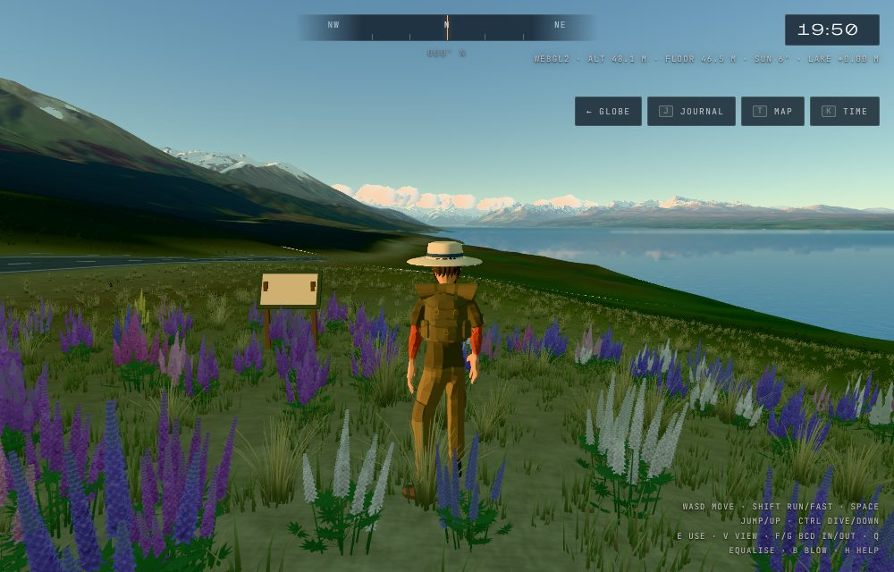 | 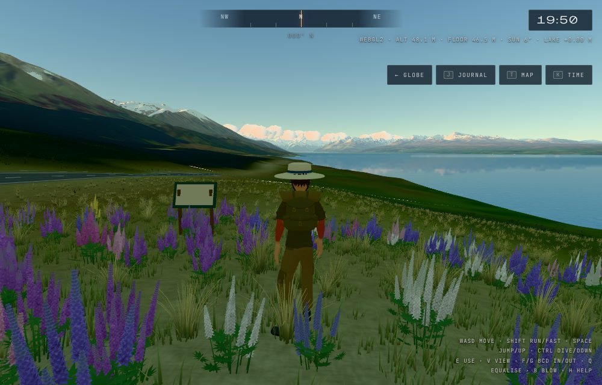 |
| **Facing a low sun at the visitor centre, before** | **After: the verge's tussock and lupins lit through** |
| 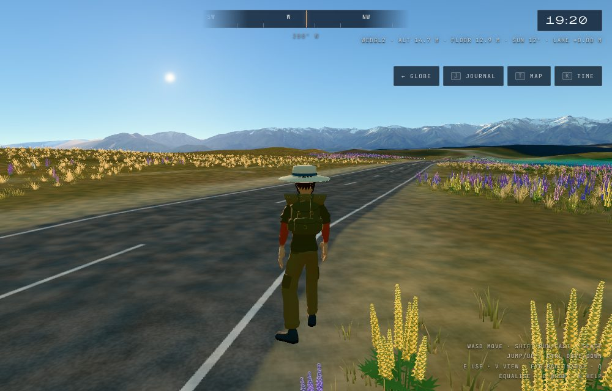 | 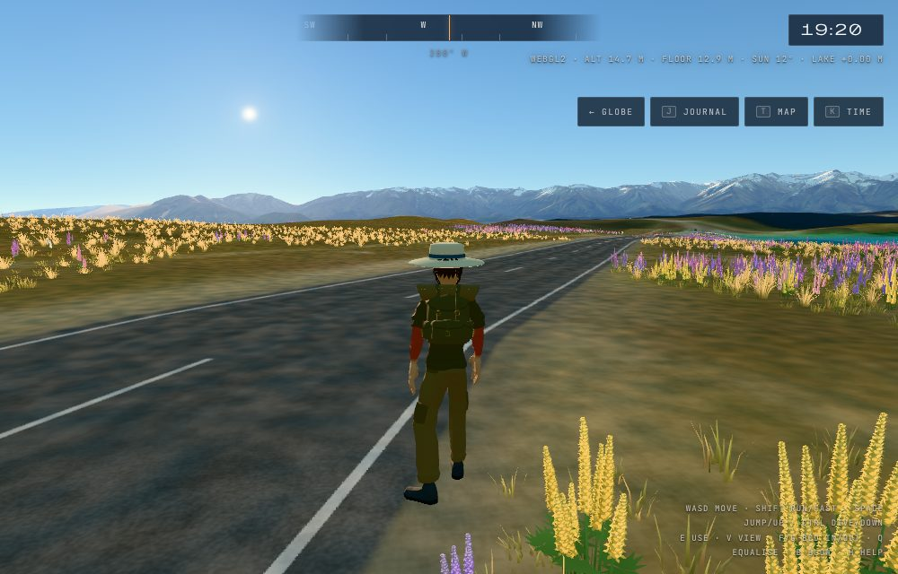 |

**The ground's colour** (`web/reef/alpine/terrain.js`):
- the imagery is printed for a screen, so pale ground comes out near a linear 0.45 where dry tussock and gravel reflect
  0.25 to 0.3. An albedo knee (`ALB_KNEE`) eases brightness down and keeps the hue; snow is set on its own;
- ground that is green already is deepened toward a spring green (a vibrance, `GREEN_VIBRANCE`: grey-green gains most,
  a bright lawn little); straw tussock, gravel and rock keep their colour;
- seen low along the ground, grass hides the soil and shows its blades: richer and a little darker than the
  straight-down photograph (none of this for red-brown ground, which turned magenta under it);
- the looks by cover class (grain, blades, glints) blend over the four nearest 20 m cover pixels, so a class edge is a
  fade, not a square; close up, three fine octaves and blade streaks (each fading as it shrinks under a pixel) replace
  the 3 m blotches that read as stains.

**Standing on it.** The player, the people, the plants and the seated landmarks stand on `terrain.heightAt`, which reads
the height texture's half floats (steps of 0.125 m at 200 m above the lake, 0.25 m at 300 m) and interpolates the
detail patch's own 2 m triangles, so nothing sinks into or floats over the surface as drawn.

**Clouds** (`web/reef/alpine/clouds.js`, `?clouds=0..1`) are soft-edged cumulus puffs over the high peaks, with flat
bases at about 2,350 m: the cloud a westerly builds on the Divide on a fine day. They are sheets facing the camera, not
volumes.

**A nor'west arch** (`?weather=nwarch`, both Mackenzie sites): Canterbury's sign of a nor'wester. A deck of high
cloud 6 km up over the basin, streaked along the wind as lenticular cloud is, ends in the west in a long straight edge
parallel to the Main Divide (city.json `clouds.nwarch`: a point on it 12 km south-east of the Divide at Aoraki and its
bearing, 37 degrees, a judgement from photographs), with the clear foehn gap under it over the Alps. Its underside
takes the sky's light by day and, while the sun is still above the deck's own horizon round sunset, the orange and
red the arch is known for. It is a shaded sheet, not a volume, and takes no haze (it is above most of the air).

**Tone and exposure:**
- tone mapping is the title screen's curve family (Khronos PBR Neutral), not ACES, which turns the sky and the lake grey-teal;
- exposure is 1.7 (it was 1.9, which left the pale shores and the glitter path white) and opens up as the light goes,
  as a photographer's does, until the eye's own adaptation takes over at dusk;
- the sun's glitter on the lake is drawn as an eye sees it, not as the slope distribution's smooth average (a white
  smear): a fifth of its light stays smooth and the rest goes into twinkling points on a grid sized to the pixel's
  footprint along each axis, with the mean kept (`web/reef/ocean.js`, shared with the reef sea; the cities' water does
  the same with `oeGlitter`). What feeds the bloom is held to 5 in the lights' units (`web/reef/post.js`), so a point
  glows round itself instead of veiling the shore;
- the depth buffer is logarithmic, so a far shore never flickers into its lake. Three.js r186 cannot resolve a
  reversed float depth buffer from a multisampled pass on WebGL2.

## 7. The game

`web/reef/game/lake-pukaki.js`; every line is computed from the model or cites a page that was read (docs/GAME_REEF.md).
The people are Microsoft Rocketbox avatars (MIT, the same files as the cities' NPCs; `web/reef/people.js` builds one
when a person's look names it). You walk in hiking clothes; an alpine site has no stinger season and no sea temperature.

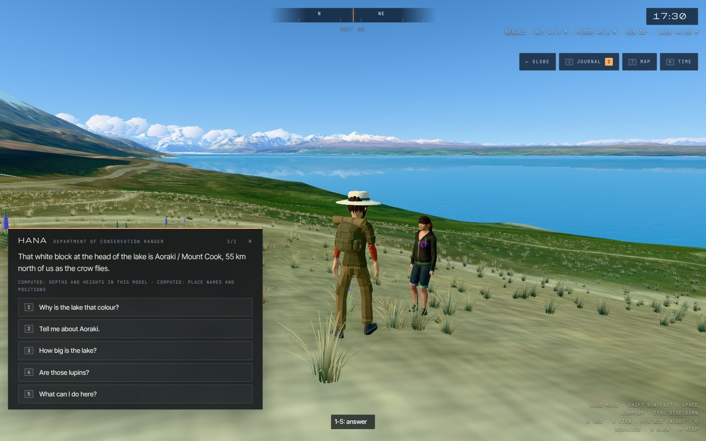


| Who | Where | What |
|---|---|---|
| Hana, Department of Conservation ranger | Peter's Lookout, by the spawn | the lake's colour, size, levels and hydro storage, the drowned island on the five-pound note; Aoraki's height and summits, how far it is over the model, its height in the model; the lupins in their season |
| Tom, stargazing guide | the south shore by the visitor centre | the dark-sky reserve; tonight's sunset and moonrise; how high the Milky Way's centre stands now, from the sky the viewer draws; can wait for dark with you |
| Mia, helicopter pilot | the pad at Glentanner | the Tasman Glacier; a flight round Aoraki |
| Eli, a walker | White Horse Hill | the Hooker Valley Track |
| Signs | Peter's Lookout; the Alpine Memorial | the board's height, the peaks in sight over the terrain with their heights; the memorial's inscription |

Quests:
- **The view up the lake:** read the board, then line Aoraki up over the water.
- **Lupins on the shore:** walk down from the lookout to the water.
- **Aoraki from the air:** take the helicopter, come within 2 km of the summit above 3,000 m, land and step out.
- **The Hooker Valley:** the Alpine Memorial, the bridges, the lake.
- **A dark night:** be on the south shore after nautical dusk.

No character speaks as or for Ngāi Tahu. Aoraki's place in their tradition is left to sources this build did not read in full.

Sources read on 2026-11-05:
- Wikipedia: *Lake Pukaki*, *Aoraki / Mount Cook*, *Tasman Glacier*, *Hooker Valley Track*, *Aoraki Mackenzie International Dark Sky Reserve*.
- Lakes380's Lake Pukaki datasheet.
- NZPCN's *Lupinus polyphyllus*.

## 8. Checked, and not

- **Checked:** `?gametest=1` on this site (32 checks, including the lint of every line and source) and on the
  Whitsundays (66, unchanged).
- **Checked:** stills on a desktop (1440 × 900) and a phone (390 × 844) at day, dusk and night, in software WebGL2 (Mesa).
- **Not checked:** a real GPU, WebGPU, Safari or iOS. The planar reflection renders the scene twice; on a slow device
  turn it off with `?mirror=0` and the plants with `?flora=0`.
- **Open:** volumetric clouds (issue #204).

## 9. Picture tiers

The reef and alpine viewer takes the same picture tier as the globe and the cities (`web/quality.js`: the device's
own, measured, or the visitor's choice in About; `?quality=high|medium|low` for one visit) and reads it in its own
terms (`web/reef/tier.js`):

| Tier | Who gets it | Plants | Lake mirror | Post | Pixels |
|---|---|---|---|---|---|
| high | desktop GPUs | all, to full radius; turf to 40 m | half resolution, near and mid lupins in it | bloom, 4x MSAA | up to 2x |
| medium | tablets, weaker laptops | 70% within 84% of the radii; a thinner turf | a third, no plants | bloom | within the tier's budget |
| low | phones, software renderers | 40% within 63% of the radii, simpler forms (lupins of 7 spikes and 9 leaves, tussock of 40 blades, matagouri of 28 twigs); no turf | off | no bloom | within the tier's budget |

On every tier each plant set is split into a disc round the eye and eight sectors beyond it, each with its own
bounds, so the renderer leaves out what is behind the camera (until November 2026 every set was drawn as one ring all
the way round). The mirror leaves out what is too small to read in a wind-blurred reflection: the turf, tussock, stones,
matagouri and far lupin patches always. The matagouri beyond 40 m is a bush of 14 twigs, and the lupins' spikes have no
end caps. The underwater light shafts are skipped by a branch when the eye is above the water.

Measured with `tools/reef_cost.js` at Tekapo's lupin shore (the low tier has no close-up form) (`shots` "lupins", 6 November, 14:30), WebGL2 on Mesa
llvmpipe, triangles a frame over every pass and the median frame time:

| | Before | high | medium | low |
|---|---|---|---|---|
| Desktop 1440 x 900 | 6.57 M, 2105 ms | 2.46 M, 1689 ms | 1.53 M, 963 ms | 0.73 M, 605 ms |
| Phone 390 x 844 (3x screen) | 3.00 M, 1359 ms | 1.88 M, 1099 ms | 1.16 M, 572 ms | 0.64 M, 341 ms |
| Desktop, with the close-up lupins (section 4) | | 2.90 M, 1567 ms | 1.79 M, 987 ms | 0.73 M, 678 ms |
| Phone, with the close-up lupins | | 2.33 M, 1131 ms | 1.42 M, 622 ms | 0.64 M, 351 ms |

A software renderer is limited by its pixels more than by its triangles, so the frame times say less than the
triangles about a real GPU. A phone picks the low tier for itself. On the reef sites, whose life is light already
(Hardy Reef: 0.4 M triangles at the surface), the tier sets the pixels, MSAA and bloom only.

What was looked at: Unreal Engine's scalability groups for foliage (`foliage.DensityScale`, `grass.DensityScale`,
`foliage.LODDistanceScale`) and its hierarchical instanced foliage, culled by cluster; Unity's terrain detail density
and distance. The approach is theirs (density and distance scaled per tier, instances culled in clusters); no code was
taken.

## 10. The highways and their traffic

**The road surface** (`web/reef/alpine/roadfield.js`, painted in `terrain.js`). Round the eye, a 640 m field at
1.25 m holds the signed distance across the nearest sealed road's centreline, the phase along it, and the road's
kind and half-width. Because the distance is signed, it changes linearly across a road, so a bilinear read is exact
and a 10 cm line stays sharp on 1.25 m texels, as signed distance fields keep glyphs sharp (Green 2007). A read whose
gradient is far steeper than a metre per metre (where one road's field meets another's, or the "no road" value) is
no road. The ground is painted within about 240 m, past which the photographs carry the roads:
- **State highways** (OpenStreetMap primary: SH80, Mount Cook Road; SH8): two 3.4 m lanes; a 100 mm white edge line at
  each lane's outer edge; a broken white centre line of 3 m stripes and 7 m gaps (the NZTA Traffic Control Devices
  Manual, part 5, table 2-6); sealed shoulders to 3.9 m and a gravel shoulder beyond.
- **Secondary and tertiary roads:** 3.2 m lanes and the centre line only.
- **Residential streets, unclassified roads and tracks** are left to the photographs: the township's 0.3 m photographs
  show its streets, and most of the Mackenzie's back roads are gravel.
- **The seal** is chipseal: pale greywacke chips in bitumen, with a third of the photograph's own colour kept so it sits
  in the aerial patches without a step, and the wheel paths a little darker.
- **Flat ground:** the relief (section 4) is laid flat on the seal and eased back over 2 m past its edge, on the GPU and
  in `heightAt` alike, so the player, the cars and the drawn road agree. No plant grows on the seal.

**Traffic** (`web/reef/alpine/traffic.js`, `?traffic=0` leaves it out, `?traffic=<n>` scales it). The shared Blender
cars (`web/assets/vehicles/cars.glb`: SUVs, hatchbacks, sedans, vans for the campervans, and coaches) drive the highway
centrelines:
- **Keeping left**, 1.7 m left of the centreline.
- **Speed:** 100 km/h on the open road, 50 km/h within 150 m of a building, slowed for bends (2.5 m/s² sideways) and
  for the car ahead (a two-second gap). At a line's end a car carries on along the same road.
- **Wheels and detail:** the wheels are split off the body as `web/game/cars.js` splits them, so they turn. Three
  levels of detail.
- **After dark:** lamps lit, and a pool of headlamp light on the road ahead (added light, since a light per car would
  recompile every material as cars come and go). A soft contact shadow under each car.
- **Why not cars.js:** the cities' cars and traffic patch WebGL materials, which the reef viewer's WebGPU renderer
  cannot take, so this module drives the same models with their own glTF materials.
- **How many:** from Waka Kotahi's count on SH80 (its State Highway Traffic Monitoring Sites layer, site 08000001,
  "Lake Pukaki – Nth of SH8 Junction", at -44.1828, 170.1153): an AADT of 1,756 vehicles in 2024 (1,439 in 2023), 7%
  of them heavy. With three quarters of a day's traffic between 8 and 19 h, a fifth in the shoulder hours and the
  rest at night (a rural highway's day, a judgement: the site's hourly counts were not read), at about 90 km/h that is
  0.67 cars a kilometre each way by day, 0.39 in the shoulder hours and 0.10 at night (`traffic.js` `PER_KM`). It
  was a car a kilometre by day before, a judgement. There is no count site further up SH80, so the valley takes the
  same figure; the coaches' share (6%) is close to the count's heavy share. The colours (white and silver commonest)
  are a judgement from photographs.

The reef gametest checks that the cars keep left and stand on the drawn ground.

| SH80 below Peter's Lookout | After dark |
|---|---|
| 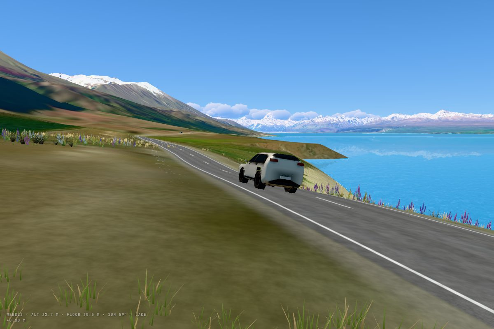 | 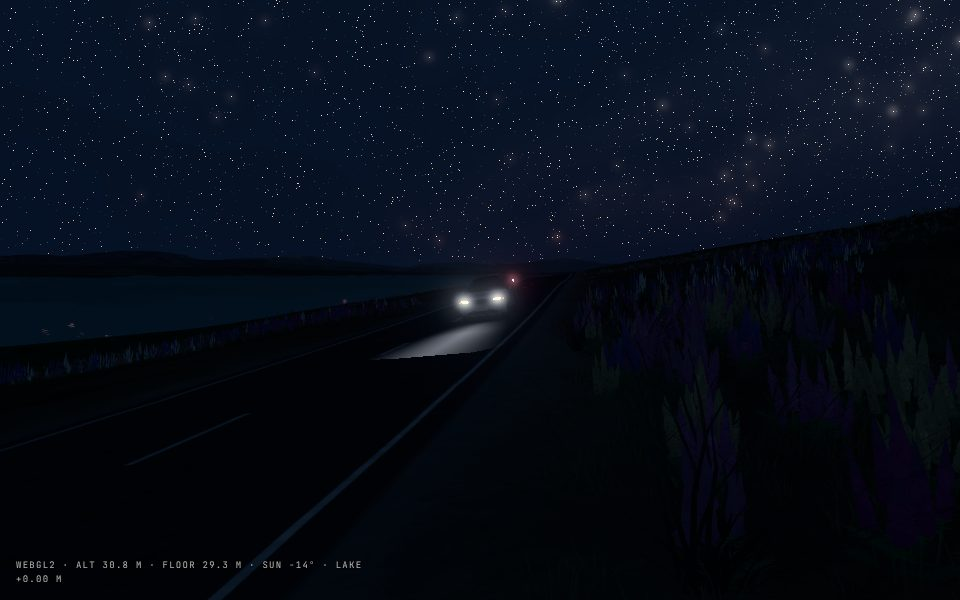 |

## 11. Landmark models

Measured by `pipeline/pukaki_landmarks.py` (`cities/lake-pukaki/analysis/landmarks.json`: OpenStreetMap footprints and
bridge ways via Overture Maps 2026-10-21.0, heights from LINZ's 1 m LiDAR DSM less DEM) and built by
`blender/build_pukaki.py` into `web/data/lake-pukaki/models/pukaki-*.glb` (meshopt-compressed). They are placed by
city.json `landmarks`, as at Tekapo.

| Landmark | Measured | Model |
|---|---|---|
| The Hermitage Hotel | OSM footprint 144 x 102 m (6,700 m²), 29.8 m to the top over 763 m ground; 6,800 square metres of LiDAR height over the hotel and its attached wings | blocks of whole storeys (3.2 m) cut from the LiDAR, each on its own ground (it falls 13 m across the site), up to eight storeys at the Aoraki Wing; walls in 3 m bays of windows, parapets and flat roofs. 9,900 triangles |
| Lake Pukaki Visitor Centre | footprint 10.3 x 7.6 m, 5.2 m to the top, 3.9 m median | a mono-pitch roof rising to the lake over a glazed lake side, cedar boards on the others (the form a judgement) |
| Mt Cook Alpine Salmon shop | footprint 14.7 x 6.7 m, 5.8 m to the ridge | a gable of corrugated iron over weatherboards, the shop windows to the car park (the form a judgement) |
| The tahr statue (Game and Forest Foundation, unveiled 2014) | no mapped position: the LiDAR's object 2.8 m tall on the knoll inside the viewing loop 21 m west of the visitor centre (a judgement) | a life-size bronze Himalayan tahr bull (0.95 m at the shoulder) with a bull's long ruff, on a greywacke boulder, facing up the lake |
| Lower Hooker, Hooker Bluff and Upper Hooker swing bridges | spans along the OSM ways: 71.0, 101.5 and 78.7 m; decks along the DSM (a sag fitted); banks and river from the DEM | a 1.2 m deck hung from two main cables at handrail height on portal frames, hangers every 1.5 m, wire mesh sides, backstays to anchor blocks; walkable (`deck` in city.json) |

The Hooker Bluff bridge was rebuilt in 2025-26: DOC gives the new one as 189 m long and 1.2 m wide, opened on 28 July
2026; DC Structures Studio describe a central swing span with 5 m steel masts at its east and west ends on concrete pads
on the moraine, and gradients to 8%. OpenStreetMap's way, and so the model, has 101.5 m of bridge. Looked at again in
November 2026: the way (16301097) still has its 2018 two-node geometry, about 112 m end to end; its last edit (changeset
186749568, 1 August 2026, "path finally reopened") changed its tags only. A 189 m bridge does not fit it, so its ends or
its line moved; redrawing it needs the new alignment mapped, or LINZ photographs flown since July 2026.
The bronze is less metallic than real bronze, because the viewer has no environment map and a full metal renders
near black without one.

| The tahr statue by the visitor centre | The Hermitage in Blender |
|---|---|
| 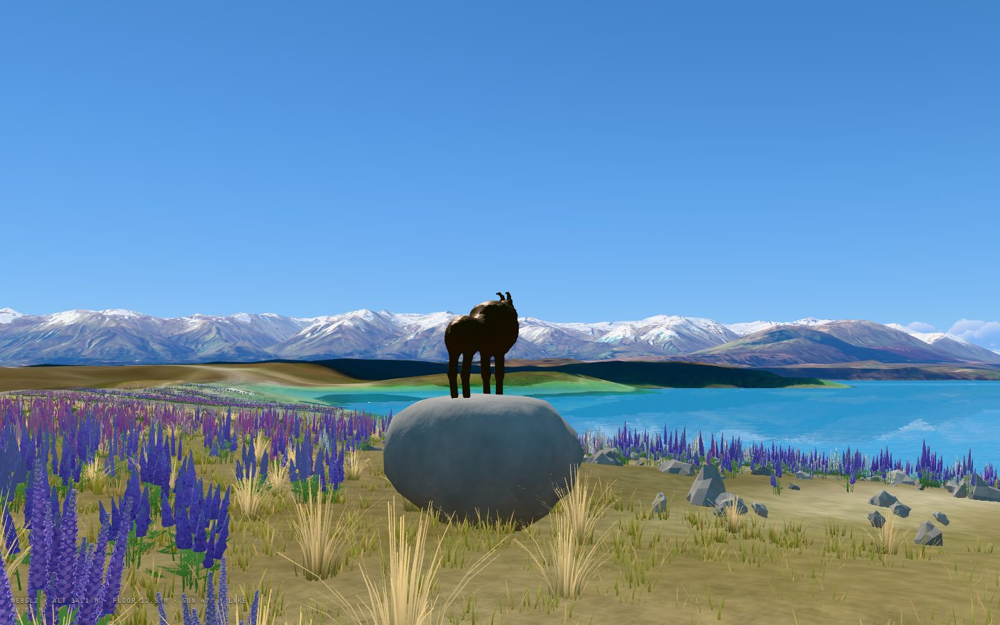 | 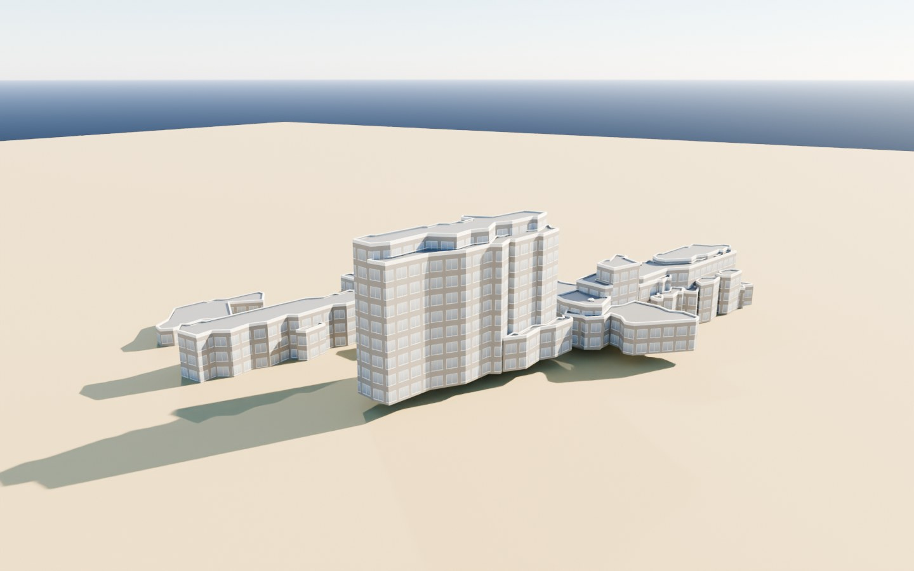 |

Sources read on 2026-11-06: Scoop, "Duchess of Bedford to dedicate tahr statue" (2014); Wikipedia, *Lake Pukaki* (the
statue on its boulder by the visitor centre); DOC, the Hooker Valley Track and its new second bridge (2026); DC
Structures Studio, Hooker Valley pedestrian bridge 2.

## 12. The stars

`web/reef/alpine/stars.js` draws the **Yale Bright Star Catalogue, 5th revised edition** (D. Hoffleit and W. H. Warren
Jr., Yale University Observatory, 1991): 9,096 stars to about magnitude 6.5, the naked eye's limit under the reserve's
sky, with their J2000 positions, V magnitudes and B-V colours. `pipeline/stars.py` reads the catalogue's file from the
Smithsonian Astrophysical Observatory's Telescope Data Center (tdc-www.harvard.edu/catalogs/bsc5.html; the same data
as CDS / NASA ADC catalogue V/50) into `web/data/sky/bsc5.bin` (91 kB). **Licence:** the catalogue is distributed by
the astronomical data centres free of charge for any use, with acknowledgement; this is the acknowledgement.

- **Position:** each star is turned by the same matrix as the Milky Way and the Magellanic Clouds (atmos.js
  `equatorialMatrix`: sidereal time for the clock, the site's latitude and longitude), so the Southern Cross, the
  Pointers, Orion and the Clouds stand where they are on the date and at the hour. Precession since J2000 (a third of a
  degree) is left out.
- **Look:** a sprite a few pixels across for each star, larger for the bright ones, as a photograph spreads them;
  brightness from the magnitude with the range eased to a photograph's; colour from B-V (Ballesteros 2012 to a
  temperature, then a blackbody's colour, at 60% of its saturation, as the eye sees star colours).
- **Through the air:** dimmed by the airmass (Kasten and Young 1989) at 0.2 magnitudes an airmass, twinkling more
  toward the horizon, and hidden behind the land (depth-tested at 140 km). The lake's mirror shows them.
- **Under the stars:** the Milky Way's band, its bulge and dust lanes, and the Clouds stay a model on their real
  positions, with a smooth grain of unresolved stars along the band.

Checked in stills: a November night shows the Clouds high in the south and the Pointers low beside the band; a June
midnight puts the galactic core overhead.

| The southern sky from Peter's Lookout, 7 November 01:30 | A nor'west arch at sunset (`?weather=nwarch`) |
|---|---|
| 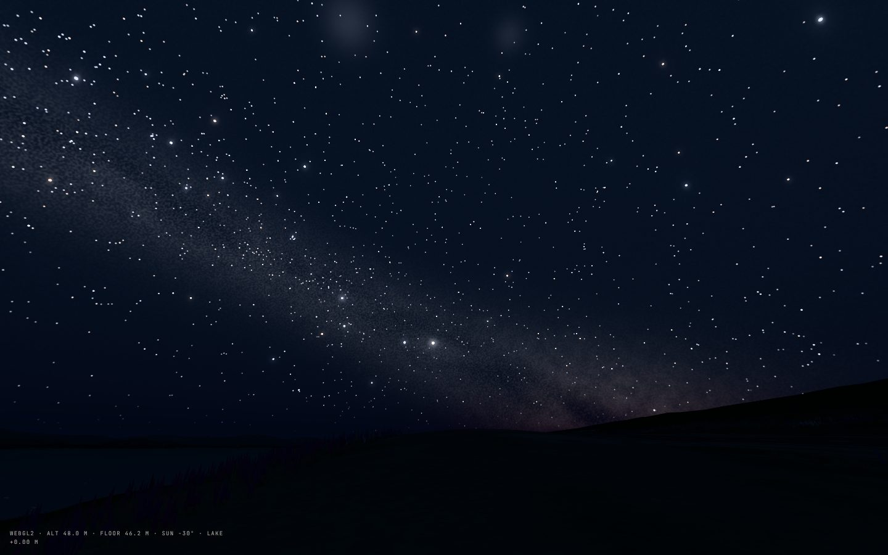 | 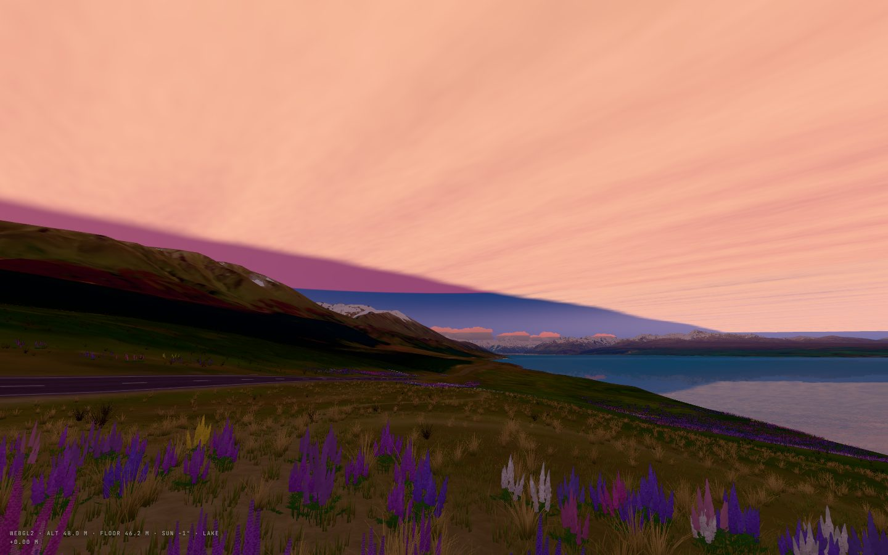 |

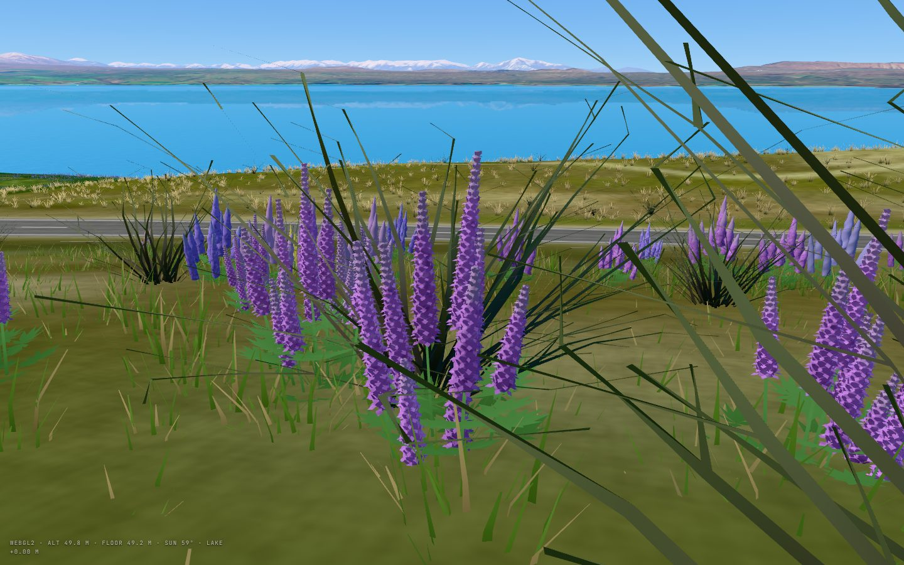
