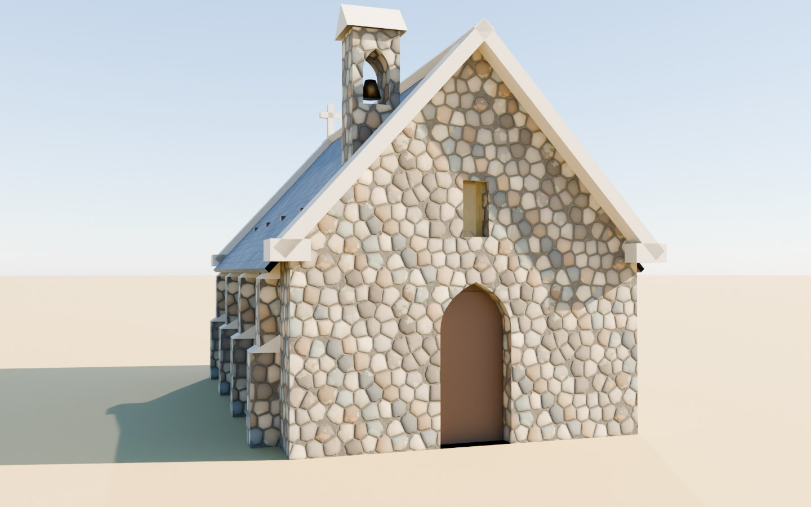
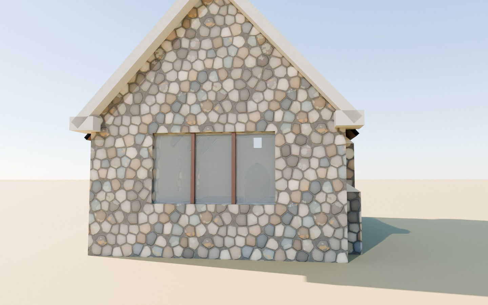
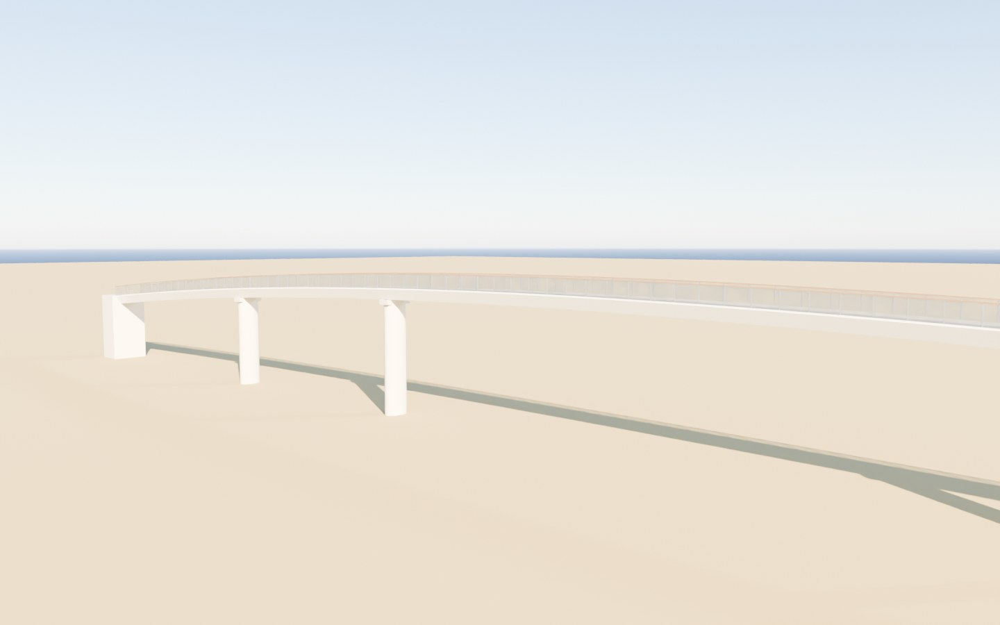

# Lake Tekapo / Takapō

Viewer: `web/reef/index.html?city=lake-tekapo` (the reef viewer's alpine kind, shared with Lake Pukaki in the
Mackenzie group). Config: `cities/lake-tekapo/city.json`. Landmark measurements:
`cities/lake-tekapo/analysis/landmarks.json`. Game: `web/reef/game/lake-tekapo.js`.

| The church (model) | Its altar end and window |
|---|---|
|  |  |
| **The sheepdog statue on its cairn** | **The footbridge over the Tekapo River** |
|  |  |

These are Blender previews of the models on a flat plane. The stills from the viewer (desktop 1440x900 and phone 390x844,
day, dusk and night, from every viewpoint in `shots`) are added once the shared alpine viewer and
`pipeline/build_alpine.py` are merged.

## Area

36 x 52 km at a 30 m grid: local transverse Mercator on the township (origin 170.477 E, 44.004 S), `extent_m`
[-10000, 26000, -11000, 41000]. In NZTM2000 the corners are E 1388072 N 5113286 (south-west), E 1424058 N 5114389,
E 1422471 N 5166364 and E 1386485 N 5165269 (north-west). It takes in the whole lake (its head at 170.5555 E, 43.7799 S),
the township and the Church of the Good Shepherd, Mt John and its observatory, Lakes Alexandrina and McGregor, the
Tekapo canal and Lake George Scott, Cowans Hill, the Godley delta and the braided flats above it, and the Two Thumb Range
from Mount Edward north past Beuzenberg Peak. Its west edge meets the Lake Pukaki frame (east edge E 1390000) in a strip
2-3.5 km wide over the canal and the Mary Range.

## Data

All LINZ data is CC BY 4.0 (Toitū Te Whenua Land Information New Zealand), read from the public S3 buckets with no key.

- **Terrain**: New Zealand LiDAR 1 m DEM, national composite, sheets BX16-18, BY16-18 and BZ16-18 (24 x 36 km each).
  Checked 2026-11-05: every sheet opens as a COG with overviews; read decimated, BY16 and BZ16 have 5-7% no-data (the
  lake surfaces), the others none. The composite's sources: BX from the West Coast 2020-2022 capture, BY and BZ mostly
  from Mackenzie 2015 with Canterbury 2016-2019. The newer Canterbury - Mackenzie 2026 capture (19 April - 2 May 2026,
  59 tiles) covers the frame south of latitude 43.739 S. The contour-interpolated 8 m DEM covers all nine sheets as a
  fallback. Spot heights from the 1 m DEM: Mt John 1030.1 m (Wikipedia 1,031 m; the observatory article 1,029 m), the
  church's ground 714.8 m, Beuzenberg Peak 2068 m (OSM 2070 m), Cowans Hill 781.3 m (OSM 783 m).
- **The lake's surface**: 707.7 m in the hydro-flattened DEM (sheet BY17, 2015). Wikipedia gives about 710 m, and the
  Tekapo River article a summer maximum of 709.8 m; the lake is regulated, so its level moves by metres through the year.
- **Imagery**: New Zealand 10 m Satellite Imagery 2025-2026 (31 Aug 2025 - 29 Apr 2026) over the frame; Mackenzie
  0.3 m Rural Aerial Photos (13 Jan - 18 Mar 2021); Mackenzie 0.075 m Urban Aerial Photos 2025-2026 (13 Nov 2025 -
  11 Feb 2026) and 2023 over the township.
- **Places, roads, water, buildings**: Overture Maps 2026-10-21.0 (OpenStreetMap ODbL within). The lake polygon
  (Lake Tekapo / Takapō) measures 96.5 km2 on the spheroid against Wikipedia's 83 km2: the OSM outline includes the
  Godley delta's wet flats.
- **Wikipedia**: the action API, with a User-Agent naming the project and its URL; fetched 2026-11-05.

### Real and synthesised

| What | How |
|---|---|
| Ground, hills, mountains | measured: LINZ 1 m LiDAR, resampled |
| Lake bed | **synthesised**: no open bathymetric survey of Lake Tekapo was found; the depth under the flattened surface is made from the distance to the shore and the slope of the land around it (`lake.bathymetry` in city.json) |
| Lake level | the 2015 capture's surface; not the live level |
| The church, the statue, the footbridge, the observatory | modelled from measured footprints and heights (below); details from Heritage New Zealand's list entry and photographs |
| The sheepdog's pose and the way it faces | nominal: standing, head up, facing north-north-east |
| The footbridge's piers | three, read from their shadows in the 0.075 m aerial photographs |
| The sky | the sun from `web/sun.js`, the stars from their coordinates (game), the moon's age as the viewer draws it |

## The first view

The owner asked for each map to open on its most beautiful photograph, recreated 1:1. The picture everyone takes here is
the Church of the Good Shepherd with the lake behind it. Photographers' guides (Pixeo, Locationscout) put the classic
frames on the ground just south of the church and along the lakeshore, with lupins in the foreground in November and
December and the Milky Way above the church on moonless nights. The spawn reproduces that frame from the real
geometry (WGS84 geodesics, LiDAR heights):

- **Where**: 32 m south-south-west of the church (bearing 195 degrees from it), at 170.482358 E, 44.003702 S, local
  (430, 33). The ground there is bare (DSM minus DEM 0.0 m), 712.5 m, 2.3 m below the church's ground, so the camera
  looks slightly up at the building.
- **Which way**: heading 15 degrees, along the church's own axis (16.5 degrees, the OpenStreetMap footprint), the way
  its altar window looks. Behind the south gable and the belfry: the lake, the head of the lake (13.3 degrees,
  25.5 km), Mistake Peak (2.8 degrees, 24.3 km) and the Southern Alps beyond the Godley (Mt D'Archiac about 8 degrees,
  60 km, outside the frame: it needs the far-terrain ring asked of the shared viewer). The Two Thumb Range fills the
  right (Beuzenberg Peak 27 degrees, 35.7 km).
- **What is not in it**: Aoraki. From the church it bears 328.7 degrees, 53 km away, 3.0 degrees above the horizontal
  after the Earth's curve; Mt John, 2.4 km away at 324.4 degrees, stands 7.4 degrees up and hides it. The famous view of
  Aoraki is Pukaki's.
- **Arrival**: the camera comes down from (418, -20), 38 m up, behind the player, onto that frame.

`shots` in city.json lists the stills taken from it and from the other hero viewpoints: the postcard, the same frame at
night (the church against the reserve's sky), the lupins on the shore east of the footbridge, Mt John's summit over the
lake, and the whole lake from the south.

### What was learned from games and photographers

- *The Legend of Zelda: Breath of the Wild* (Nintendo, 2017) opens by walking the player out to a cliff edge from which
  the landmarks of the whole world are in sight at once; open-world design writing calls this the vista. Here the first
  frame holds the church, the lake to its head and the range, and every place a quest leads to is either in it or a
  turn of the head away (Mt John to the left, the footbridge and the statue behind).
- Driving and flying games that recreate real places (Forza Horizon's photo mode, Microsoft Flight Simulator) treat
  landmark viewpoints as destinations; the `shots` list does the same for the stills and the films.
- Nothing is copied from any game's look; the frame is the place's own.

Sources: [Pixeo, Church of the Good Shepherd](https://pixeoapp.com/photography-guides/oceania/new-zealand/church-of-the-good-shepherd-lake-tekapo),
[Locationscout, Church of Good Shepherd](https://locationscout.net/new-zealand/487-church-of-good-shepherd-lake-tekapo),
[TV Tropes, Video Game Vista](https://TVTropes.org/pmwiki/pmwiki.php/Main/VideoGameVista),
[GMTK, How Nintendo Solved Zelda's Open World Problem](https://gmtk.substack.com/p/how-nintendo-solved-zeldas-open-world).

## Landmarks

Measured by `pipeline/tekapo_landmarks.py`, built by `blender/build_tekapo.py` into `web/assets/landmarks/tekapo-*.glb`
(meshopt-compressed). Each model is in its own anchor's frame, orientation baked in, y = 0 at `ground_m`.

| Landmark | Measured | Source | Model |
|---|---|---|---|
| Church of the Good Shepherd (1935) | footprint 10.1 x 6.4 m, long axis 16.5 degrees; ridge 6.1 m above the ground, median roof 4.7 m (eaves about 3 m) | OSM footprint; LINZ 1 m DSM - DEM (sheet BY17) | boulder-faced walls 0.5 m thick with lichen, four stepped buttresses a side, three lancets a side, a pointed-arch door in the south gable, the 2.7 x 1.55 m plate-glass altar window with two timber mullions in the north gable, concrete gable copings, a slate roof (1957), a belfry with its bell on the roofline west of the door, the concrete cross on the north gable; inside, cream plaster, rimu trusses, pews, the altar. 2,300 triangles |
| Sheepdog statue (cast in London from a plaster sent in 1966) | 3.1 m to the top above the ground; a round paved bay about 6 m across | DSM - DEM; the 0.075 m aerial photographs | a bronze collie about 0.55 m at the withers on a tapering cairn of stone |
| Footbridge (2015) | 131.9 m along the OSM way, deck 123 m, about 3 m wide; deck 8.2-10.8 m above the river (DSM along the way, less the balustrade); piers about 27.5, 50 and 100 m from the west end | OSM; DSM; aerial photographs | white steel box girder, composite decking, mesh balustrade with a timber handrail, elliptical concrete piers |
| Mt John Observatory | 20 summit buildings: footprints and DSM heights; the domes' crowns at the DSM's highest point in each telescope building (MOA 9.8 m, One Metre 9.1 m, Astrograph 6.4 m, Boller & Chivens 5.8 m, Optical Craftsmen 4.8 m, the round domes 1.9-4.8 m) | OSM via Overture; DSM - DEM | painted blockwork with parapets, aluminium domes with their shutters |

Heritage New Zealand's list entry (no. 311, fetched 2026-11-05) gives the materials and parts (poured concrete faced
with local boulders left with their lichen, buttresses, the belfry to the left of the main entrance, the cross on the
north gable, the plate-glass window above the altar, the natural surroundings of matagouri, tussock and rock) but no
dimensions; the dimensions are the survey's.

## The game

`web/reef/game/lake-tekapo.js`, in the format of [GAME_REEF.md](../GAME_REEF.md) "For developers".

| Who | Where | What |
|---|---|---|
| Kate, Department of Conservation ranger | by the spawn below the church | the church (Heritage NZ, Wikipedia), the lake's colour, size and names, its height in the model, the water temperature by month, the lupins (season, history, the harm to braided rivers), the matagouri, the sunrise and when the sun clears the hills (computed over the terrain), where to go |
| Ian, runholder | by the sheepdog statue | the statue, Haig and the casting; Te Manahuna and the first runs; the sun and the frosts |
| Mei, Dark Sky Project guide | by the Astro Café on Mt John | the telescopes and MOA's planet; the reserve; the sky now: sun, moon, the Southern Cross, the Magellanic Clouds, the Milky Way's centre, placed from their coordinates and the clock |
| Signs | the church, the footbridge, the summit | the list entry and the carvings; the bridge and the outlet's control gates; the summit's height in the model and what is in sight over the terrain |

Quests: **the church at sunrise** (be there within half an hour of sunrise and look up the lake; Kate can skip you to
it); **the summit of Mt John**; **lupins on the shore** (only in November and December); **a night under the reserve**
(on Mt John after astronomical dusk, look up for 20 s, then face the Southern Cross where the model puts it).

NPC looks name Rocketbox avatars (`look.character`) as AGENTS.md asks; the reef viewer's people currently build
Quaternius templates, so the alpine viewer's support for them is with the shared viewer.

Facts and their pages are listed in the file's `SOURCES`; nothing is said that a page does not say or the model does not
compute. Ngāi Tahu tradition appears only as Wikipedia gives it, and no character speaks for mana whenua.

## Not checked

A real GPU, WebGPU, Safari and iOS. The viewer stills, until the shared alpine viewer and pipeline are merged.
