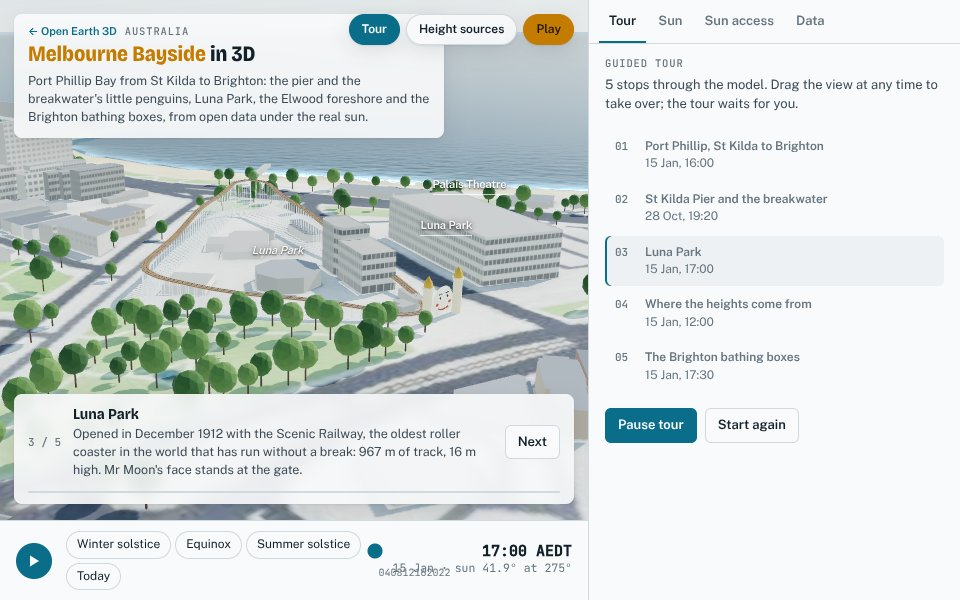
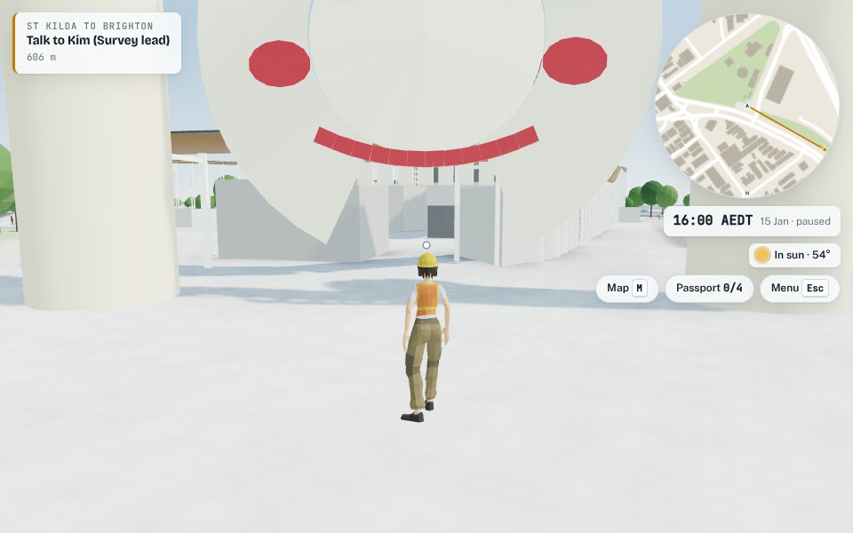

# Melbourne Bayside

> Port Phillip's shore from St Kilda to Brighton: 3.2 × 7.7 km, 9,335
> buildings and 4,524 trees on Geoscience Australia's 5 m LiDAR terrain. Every
> number here is reproduced by the scripts in `analysis/` with
> `--city melbourne-bayside`, and their outputs are in
> `cities/melbourne-bayside/analysis/`.

| The viewer's tour at Luna Park | The Brighton bathing boxes, a summer afternoon |
|---|---|
|  |  |
| **Mr Moon and the Scenic Railway** | **From the viewing platform at night: penguins on the breakwater** |
|  |  |
| **The pier's approach over the sand, a boardwalk at deck height** | **In through Mr Moon's mouth, under the railway's span** |
|  |  |

Open it from the globe, or at `web/index.html#melbourne-bayside`. The game is at
`#play-melbourne-bayside`.

## 1. What is different from the city centre

The bayside uses Melbourne's pipeline: synthetic ground, since there is no open
aerial imagery, and the same WCS terrain. Five things are new:

1. **The breakwater is not in the terrain.** The bare-earth LiDAR DEM flattens
   the St Kilda breakwater to the water, and the water polygon then covers it.
   A new `terrain.raise` block raises mapped outlines of a class to a crest:
   - the breakwater rises to 2.5 m;
   - it slopes up over 6 m from its edge.

   The crest height is a chosen value, not a measurement. The water polygon is
   cut back from the raised outline (`pipeline/shore.py`, `without_raised`), so
   the rocks stay dry.
2. **Beaches are land, not land use.** Overture maps the beaches in its `land`
   theme, so a protected place can now come from it (`source: "land"`).
3. **The DEM has unmarked no-data values.** At the edge of its coverage over
   the bay, the service passes through no-data values that are not flagged as
   voids: some are not finite and some are far too high. Non-finite values and
   anything above `fill_above_m` (60 m here) are now treated as voids and filled
   from their neighbours.
4. **Almost nothing has a surveyed height.** Only 8 buildings carry an
   OpenStreetMap `height` tag. This is a suburb of houses, so the floor count
   and Microsoft's ML heights carry most of the model (section 3).
5. **The pier is mapped only over the water.** St Kilda Pier's walkway is
   mapped as a path that runs on over the sand to the promenade. Under it, the
   bare-earth DEM shows the sand, up to 2 m below the deck, so nobody could
   step up onto the pier.

   A boardwalk can now be given as a line in the local frame
   (`game.boardwalks[].line`). The pier's approach follows the mapped path
   onto the promenade, at deck height and as wide as the pier.

## 2. Data

| Layer | Source | Licence |
|---|---|---|
| Buildings, parts, land, land use, water, roads, piers | Overture Maps 2026-10-21.0, mostly OpenStreetMap; heights partly Microsoft ML Buildings | ODbL |
| Terrain | Geoscience Australia DEM_LiDAR_5m_2025, WCS 1.0.0 | CC BY 4.0 |
| Terrain check | Vicmap Elevation METRO spot heights | CC BY 4.0 |
| Climate (benches) | Bureau of Meteorology, Melbourne (Olympic Park) 086338, mean maximum since 2013 | © Commonwealth of Australia |
| Bathing boxes | Heritage Victoria assessment (2017, VHR H2369); Brighton Bathing Box Association | quoted facts |
| Luna Park | Luna Park Melbourne (opening, Scenic Railway length and height) | quoted facts |
| Penguins | Parks Victoria; Earthcare St Kilda; Phillip Island Nature Parks | quoted facts |

## 3. How good is it?

### Terrain

`analysis/dem_check.py` compares the DEM with the 12 Vicmap spot heights on
open ground inside the model:
- the median difference is −0.18 m;
- the median absolute difference is 0.21 m;
- all 12 agree within 1 m, and the largest miss is 0.67 m.

The global Terrarium tiles would have been 6.3 m too high at the median on land
(`data_quality.py`). Those tiles are a surface model, so houses and trees lift
them. At Dendy Street Beach they read 3.5 m, against the DEM's 0.0 m.

### Heights

| Height source | Buildings |
|---|---:|
| Microsoft ML height, bias removed, blended with neighbours | 5,619 |
| Estimated from neighbours and building type | 2,492 |
| OpenStreetMap floor count | 1,120 |
| Parametric (the bathing boxes) | 96 |
| Surveyed (`height` tag) | 8 |

Each estimator is cross-validated on the 1,128 buildings whose heights are
known (`height_model.json`):

| Estimator | Typical error | 90th percentile | Bias |
|---|---:|---:|---:|
| Building-type defaults | ×1.21 | ×1.69 | +14% |
| Nearby known heights | ×1.00 | ×1.52 | 0% |
| Raw Microsoft ML height | ×1.52 | ×2.11 | −33% |
| ML with bias removed, blended with neighbours | ×1.17 | ×1.53 | +1% |
| Floor count × storey height vs surveyed height (7 buildings) | ×1.05 | | −2% |

The nearby-heights estimator has a typical error of ×1.00 because so many
neighbouring houses share a floor count. The raw ML heights run low here, as in
Sydney, but less so: a third too low against Sydney's 43%. Among the 272
buildings that also have a floor count, the ML height is a median 0.54× the
floor-count height.

`analysis/radar_check.py` finds little to compare. The SRTM radar surface
correlates with the model's block heights at r = 0.10 to 0.27, depending on the
block size. In a suburb of one- and two-storey houses the signal is mostly
trees and noise. That test is useful for towers, and this model has almost
none (2 buildings of 15 floors or more).

### Landmarks

- **The Brighton bathing boxes.** OpenStreetMap maps all 96 on Dendy Street
  Beach as `beach_hut` footprints, with no heights.
  `cities/melbourne-bayside/city.py` makes each one a parametric box on its own
  footprint:
  - timber walls 2.0 m high on a 0.25 m plinth;
  - a corrugated-iron gable roof at 35°, the Brighton Bathing Box
    Association's standard;
  - the front facing the lower ground, which is the water.

  Each owner paints their own box, and has done since the mid-1970s. The
  schemes drawn here are illustrative, not each box's own. Each box's solid
  stays in the surface model at its ridge height, so the boxes' shade counts in
  the analyses.
- **Luna Park.** The Scenic Railway opened with the park in December 1912. It
  has 967 m of track and stands 16 m tall. Here it is one loop of the mapped
  park edge, set 6 m in, climbing to 16 m on the far side, on timber trestles.
  That loop passes just behind the gate, so it crosses the way in on a clear
  span, 4.5 m above the gate's ground. That height is chosen, not mapped.

  Mr Moon, the face at the gate, was rebuilt in fibreglass in 1999. No
  dimensions are published, so the face is scaled to make its open mouth a
  3.2 m doorway. It stands between two towers at the entrance OpenStreetMap
  maps.

  Both are drawn meshes only. They are not in the surface model, so they cast
  no shade in the analyses.
- **St Kilda Pier.** The pier was rebuilt and reopened in December 2024. It is
  mapped, and the game walks it on its deck height, like Sydney's wharves. Two
  boardwalks (`game.boardwalks`) are drawn as timber decks at the same height:
  - the approach over the sand (section 1);
  - the viewing platform beyond the kiosk, which is mapped as a line with no
    deck under it.

### Numerical error

`analysis/error_budget.js` re-runs the sun with finer samples, a 1 m surface
model and finer time steps. The largest error is 3.2 points, at Luna Park, and
then 2.4 points at Dendy Street Beach.

In both places almost all of the error comes from the surface model's 2 m
cells. Thin shapes do not sample well at that size: Luna Park's narrow rides
and buildings, and the gaps between the boxes, each about 3 m wide. Everywhere
else the error is within 0.4 points.

## 4. Sun on the foreshore

No planning rule here protects sun on a named place, so the model applies no
tests. `sun_access.js` reports a 10 am–2 pm window on the 21st of each month.

| Place | Sun, 10 am–2 pm | Note |
|---|---|---|
| St Kilda, Elwood, Sandown Street and Middle Brighton beaches | 100% all year | Nothing tall stands on the foreshore |
| Dendy Street Beach | 88% in June, 98% in December | The shade is the bathing boxes' own |
| Luna Park | 68% in June, 87% in December | The buildings in and around the park |
| Lower Esplanade Reserve | 87% in June, 100% from September to March | Shaded only when the winter sun is low |
| St Kilda Botanic Gardens, Elwood Park | 97–99% | Tree heights are not mapped, so the trees cast no shade in this analysis |

`uncertainty.js` has no protected places to test here, so it reports none.

## 5. The game: Bayside on Foot

You start on the promenade at the foot of St Kilda Pier, at the city's live
clock. There are four people and four stamps:
- **Kim (survey lead):** sends you out along the pier to the kiosk.
- **Tash (Earthcare St Kilda volunteer):** explains the colony.
  - About 1,400 little penguins live in the breakwater, which was built for
    the sailing at the 1956 Olympics.
  - When Earthcare first counted them, in 1986, there were 57.
  - She gives this evening's sunset and when the birds come ashore. One choice
    sets the clock to ten minutes before sunset.
  - Watch from the viewing platform, with no flash.
- **Luca (Luna Park):** tells the Scenic Railway's story. You walk in through
  Mr Moon's mouth.
- **Grace (bathing box owner):** tells the boxes' history. You walk the row,
  from the first box to the last.

### The penguins (`web/game/penguins.js`)

The colony's place comes from the data. `pipeline/game_data.py` builds it in
three parts:
- **Burrows:** points on the mapped breakwater's raised rocks.
- **Landing places:** points every 3 m along the rocks' edge, keeping only those
  with water 6, 20 and 40 m out to sea.
- **The viewing line:** the line of the mapped platform.

The game shows 160 birds. Through the day all but a few are at sea; 5% stay
ashore, as nesting and moulting birds do.

From sunset the timeline runs:
1. Small rafts of neighbours gather offshore, each off the landing place
   nearest their burrows. About half the birds land within 20 m of home.
2. Between 20 minutes and two hours after sunset, each raft swims in.
3. The birds climb out at the rocks' edge and waddle to their burrows at
   0.35 m/s.
4. Through the night, the birds near you call.
5. Between 30 and 90 minutes before sunrise, each bird leaves for the sea.

The arrival and leaving times are chosen values; their sources are cited in
`city.json`. When the clock runs, even at 120×, the birds swim and walk. When
it jumps (skipped ahead, or set by the player), every bird is placed where it
would be by then.

In a headless run on 28 October, with the clock at the game's default 30×:

| Minutes after sunset | Birds in rafts | Birds ashore |
|---|---:|---:|
| 15 | 42 | 0 |
| 45 | 53 | 42 |
| 75 | 36 | 95 |
| 120 | 0 | 160 |

At sunset+120, 100 of the 160 are already in their burrows. The breakwater
rocks are a no-go area. The player is stopped at their edge and
asked to stay on the pier and the platform, and the crowd's footways that
cross them are dropped.

### Getting around

- **Fast travel:** six points on the shore become fast-travel stops once you
  have visited them (`game.travel`).
- **Helicopter:** there is no helipad on the bayside foreshore. The one on the
  Elwood soccer pitch is invented, so that you can fly the coast.
- **Ferries:** no ferry runs along this shore, so there are none in the
  game.
- **Benches:** they use the bayside's own climate. On a cold day sitters choose
  the sun, and on a hot one the shade.

## 6. Limitations

- **Ground:** drawn, not photographed, as in the city centre.
- **Heights:** only 8 surveyed heights. ML heights carry 60% of the
  buildings, with a typical error of ×1.17.
- **Breakwater:** its 2.5 m crest is chosen. The burrows sit on the model's
  rocks, and the real nest boxes and crevices are not mapped.
- **Bathing boxes:** the paint schemes are illustrative.
- **Scenic Railway:** the track follows the park's edge, not its real course.
- **Trees:** no heights are mapped, so trees cast no shade in the analyses.
- **Trams:** Route 96 to the city is mentioned in the game, but not modelled.
- **The pier's crowd:** none. The pipeline drops footways over water unless
  they are flagged as bridges, so the passers-by keep to the shore. You and the
  penguins have the pier to yourselves.
