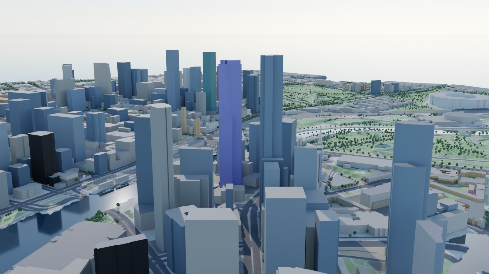
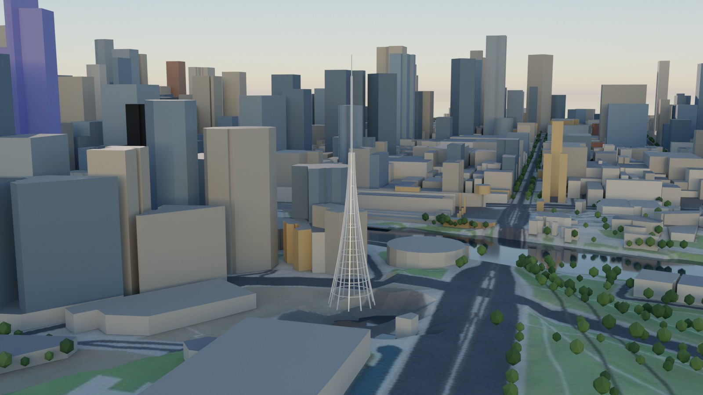

# Melbourne

> Central Melbourne, from Docklands to the Shrine of Remembrance: 4.8 × 3.9 km,
> 13,050 buildings and 11,335 trees on Geoscience Australia's 5 m LiDAR
> terrain. Every number here is reproduced by the scripts in `analysis/` with
> `--city melbourne`, and their outputs are in `cities/melbourne/analysis/`.

| The model, Federation Square at midwinter noon | Cycles render from the Blender script |
|---|---|
|  |  |
| **Southbank's towers** | **The Arts Centre spire, late afternoon in midwinter** |
|  |  |

Open it from the globe, or at `web/index.html#melbourne`. The game is at
`#play-melbourne`.

## 1. What is different from Sydney

Melbourne was the first city added after Sydney, and the point of adding it was
to find what the pipeline had assumed without saying so. Four things:

1. **There is no open aerial imagery.** The Vicmap aerial basemap is licensed
   and paid for, Esri's imagery cannot be redistributed, and the City of
   Melbourne's open 10 cm orthophoto is one 45 GB file. So the ground is
   drawn from the open map data instead (`imagery.type: "synth"`):
   - parks, gardens and pitches;
   - plazas and pedestrian malls;
   - water;
   - roads with their kerbs, footways, cycleways and tram tracks;
   - footprints with contact shading.

   It reads as a map more than a photo, but nothing in it is borrowed.
2. **The terrain comes from an OGC WCS, in GDA94.** Geoscience Australia's
   `DEM_LiDAR_5m_2025` is served only through WCS 1.0.0, in geographic
   coordinates on the GDA94 datum, which is now about 1.5 m off GDA2020 and
   WGS84. The fetcher (`terrain.type: "wcs"`) requests it in GDA94. The build
   converts the local frame's coordinates with the official GDA94-to-GDA2020
   transformation before sampling. The source has 573 void pixels, including a
   pit down to −80 m near the Arts Centre. They are filled from their
   neighbours.
3. **The rules name single days.** Melbourne protects public spaces on 22
   April, 22 June and 22 September, not over seasons. Periods can now be a
   single day or a list of days (`"04-22,09-22"`). The tower test samples the
   rule's own dates (`protection.test_dates`), and the analyses fall back to a
   rule's named days when no 21st falls inside its period.
4. **The river is a protected place.** "The Yarra River corridor" is not a
   land-use polygon. It is built from every Yarra water polygon, widened by
   15 m (`source: "water"`, `buffer_m`).

## 2. Data

| Layer | Source | Licence |
|---|---|---|
| Buildings, parts, land use, water, roads, piers, addresses | Overture Maps 2026-10-21.0, mostly OpenStreetMap | ODbL (CDLA for Overture's own data) |
| Terrain | Geoscience Australia DEM_LiDAR_5m_2025, WCS 1.0.0 | CC BY 4.0 |
| Terrain check | Vicmap Elevation METRO spot heights (ArcGIS feature layer) | CC BY 4.0 |
| Published heights | Wikipedia, List of tallest buildings in Melbourne, revision 1382111188 (26 Oct 2026) | CC BY-SA 4.0 (facts) |
| Planning rules | Melbourne Planning Scheme via the Victorian government's planning API (version VC314, 28 Oct 2026) | Crown copyright, quoted |
| Spire height | Wikipedia, Arts Centre Melbourne | CC BY-SA 4.0 (facts) |

## 3. How good is it?

### Terrain

`analysis/dem_check.py` compares the DEM with 238 surveyed Vicmap spot heights
on open ground. The median difference is −0.10 m and the median absolute
difference 0.26 m. 84% agree within 1 m, and the 90th percentile is 1.36 m.
The two largest misses, 11 m and 6 m, are both at Federation Square, which is
built on a deck over the railway yards. The LiDAR ground there is the deck,
while those spot heights sit at track level. For sun on the square, the deck
is the right surface.

The global Terrarium tiles would have been 8–11 m too high at the median, the
same surface-model problem Sydney had (`data_quality.py`).

### Heights

OpenStreetMap is much better mapped here than in Sydney: 23% of the building
footprint area has a surveyed `height` tag, against 4% in Sydney.
`analysis/heights.py` matched 21 of 42 published towers by street address:
- **Overall:** the median error is 0.2%.
- **Surveyed heights:** the 16 towers with a surveyed height are within 0.1%
  at the median.
- **Everything else:** the open data misses badly where it has only a floor
  count or nothing at all.

The gross misses are fixed in the build:

| Tower | Open data | Model | How |
|---|---|---|---|
| Rialto Towers | 20 m (the podium) | 251 m | published height, name match |
| Aspire | 33 m (estimate) | 211 m | published height, name match |
| Melbourne Grand | 13 m (estimate) | 198 m | published height, name match |
| Meriton Suites King Street | 12 m (3 levels: OSM still maps the old building) | 188 m | cited lookup |
| Abode318 | 13 m (estimate) | 187 m | cited lookup |
| Melbourne Quarter Tower | 191 m (floor count) | 155 m | cited lookup |

Eight rows are excluded from the score, each with its reason in
`reference_heights.csv`. Their address points land on a shared podium or a
neighbouring building (West Side Place's four towers share one address).
Thirteen addresses are not in Overture's address points at all.

### Landmarks

- **The Arts Centre spire** is mapped twice in OpenStreetMap: as a 7 m square
  block from 15 m to 162 m, and as a solid 452 m² block from 15 m to 50 m with a
  162 m mast. `cities/melbourne/city.py` replaces both with one parametric
  lattice on the first one's anchor:
  - twelve ribs flaring from a 14 m base into a mast;
  - rings every 8 m;
  - the published height of 162 m.

  The shape is an approximation, and it is floodlit at night.
- **St Paul's Cathedral** is mapped at 96 m, which matches the 95 m central
  spire.
- **Flinders Street Station** has no name on any footprint in Overture, so its
  label is placed at the station's published coordinates. OpenStreetMap maps
  its outline, 310 m long, at 20 m. The mapped parts are:
  - a dome from 20 m to 30 m;
  - the Elizabeth Street clock tower at 35 m;
  - two 24 m blocks.

  By the OpenStreetMap convention the parts replace the outline. That dropped
  the station's long body from the model and left the dome standing on
  nothing. `cities/melbourne/city.py` now restores the body: the outline minus
  the ground-standing parts, at the outline's 20 m.

  On top of the body it adds:
  - the dome drawn as a copper dome on a drum;
  - clock faces near the top of the tower;
  - the row of clocks over the main entrance;
  - the 1910 colour scheme that the 2018–2020 repaint restored: cream,
    terracotta and dark green.

  The hex values are approximate conversions of the published Munsell
  references, and the heights of the terracotta bands are chosen.

  Restoring the body adds one solid. It also changes one estimate: the
  station's roof part `w271939466` drops from an estimated 19 m to 15.7 m.

  In the error budget, Birrarung Marr's production figure moves from 91.48% to
  91.69%, and Batman Park's by 0.02 points. The other eighteen protected places
  and the sun-access results are unchanged.

### The river

The Yarra uses the same water as Sydney Harbour (`web/water.js`), with its own
settings in `city.json`:
- **Waves:** a light 4 m/s northerly across a river 100–150 m wide gives
  short-fetch ripples, with a significant height of 5 cm. The wind is a chosen
  typical value, not a measurement.
- **Colour:** the river is turbid with suspended clay, so it is brown-green
  with 0.6 m of clarity, and its bottom never shows.
- **Shores:** 98% of the river's edge in the model is built, so the foam is
  mostly a faint lap against the walls. Rock lines the other 2%. Overture's 19
  sand polygons here are sports fields away from the river.

## 4. Sun on the protected spaces

The rules are DDO10's tables, read from the live scheme. Table 1 is a hard
rule: a permit must not be granted for buildings and works that would cast
any additional shadow. The model tests it. Table 2 asks only that shadow
"will not unreasonably prejudice the amenity" of the space. That is a judgement, so those
spaces show sun but are not tested.

| Space (Table 1) | Window | Sun on the rule's day (`sun_access.js`) |
|---|---|---|
| Federation Square | 11 am–3 pm, 22 April to 22 September | 34% on 21 June, 59% on 21 September |
| City Square | 11 am–3 pm, 22 April to 22 September | 37% on 21 June |
| Bourke Street Mall | noon–2 pm, 22 April and 22 September | 21% in April, 29% in September |
| Boyd Community Park | noon–2 pm, 22 April and 22 September | 38% in April, 48% in September |
| Yarra River corridor | 11 am–2 pm, 22 June | 79% |

Two spaces in Table 1 are not in the open data as named places: the State
Library forecourt and the Shrine of Remembrance's northern forecourt. They are
listed in `protection.source_note`.

Every DDO10 window falls between 22 April and 22 September, outside daylight
saving, so the clock-or-standard-time question that moves Sydney's Macquarie
Place by 44 points does not arise. The only ambiguous windows are the 22 March
ones for Fitzroy Gardens and the Royal Botanic Gardens, which were not checked
against the scheme text. The two readings differ there by 0.1 points
(`time_basis.js`).

### How sure are these numbers?

`analysis/uncertainty.js` re-runs the sun 40 times. Each run redraws every
building's height from the error measured for its height source.

| Space | Sun (model) | 90% range | Where its shade comes from |
|---|---|---|---|
| Federation Square, 21 June | 34% | 24–35% | 60% from estimated heights, mostly the square's own buildings: the Ian Potter Centre and the Alfred Deakin Building have no height in the open data |
| City Square, 21 June | 37% | 19–37% | Half from one surveyed building, 41% from the new metro entrance, whose height is an estimate |
| Bourke Street Mall, April | 21% | 14–26% | Three-quarters from surveyed heights (Myer, David Jones, the GPO) |
| Boyd Community Park, April | 37% | 28–38% | All from surveyed heights |
| Yarra River corridor, 22 June | 79% | 71–78% | Two-thirds from surveyed heights |

The fix list ranks the heights worth checking next, by how far they could move
an answer:
1. **The metro entrance in City Square:** an estimated 29 m that the error model
   allows anywhere from 12 to 123 m. That could swing the square's sun by 14
   points.
2. **An unnamed building on the Bourke Street Mall:** a floor-count height.
3. **The Alfred Deakin Building on Federation Square.**

A height for each, with a citation, goes in `verified_heights.csv`.

## 5. The game: Melbourne on Foot

Six people and six stamps, all on the same model:
- **Federation Square:** start here and meet Mia, the survey lead.
- **City Square:** Hannah, a planner, explains DDO10. You then find a sunny
  spot on Federation Square at lunchtime on 22 June.
- **The river:** Arjun takes you downriver from Federation Wharf to Crown
  Landing.
- **The air:** Sophie flies you from the Yarra helipad past the Arts Centre
  spire to Birrarung Marr.
- **The survey lens:** Jun sends you to find three height sources.

The river shuttle is invented: there is no regular ferry through the city. It
is smaller than a harbour ferry (22 m), in a navy and gold livery that is
invented too. It stops at Crown Landing, because Victoria Harbour meets the Yarra just west of
the model. The test script `melflow.js` plays all of it headless; see
[GAME.md](../GAME.md).

## 6. Limitations

- **Ground:** drawn, not photographed. With no photo to sample, a roof's colour
  leans from a neutral grey towards its material's palette (COLORBOND steel,
  terracotta, slate). 4,530 solids get pitched roofs under Sydney's rules.
  Against the 51 roofs mapped in OSM those rules get flat or pitched right only
  51% of the time: they make the CBD's large old pitched buildings flat
  ([BUILDINGS.md](../BUILDINGS.md)).
- **Estimates:** 43% of the footprint area still has an estimated height, mostly
  low-rise. The uncertainty analysis (`uncertainty.js`) ranks the buildings
  worth checking next.
- **Trams:** the tram network is in the data (it is drawn on the ground), but
  the game has no trams yet.
- **Docklands:** the model ends at Docklands, so Victoria Harbour's link to the
  Yarra and the Bolte Bridge are outside it.
