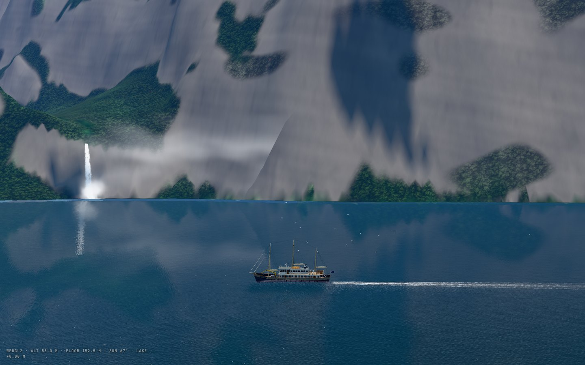
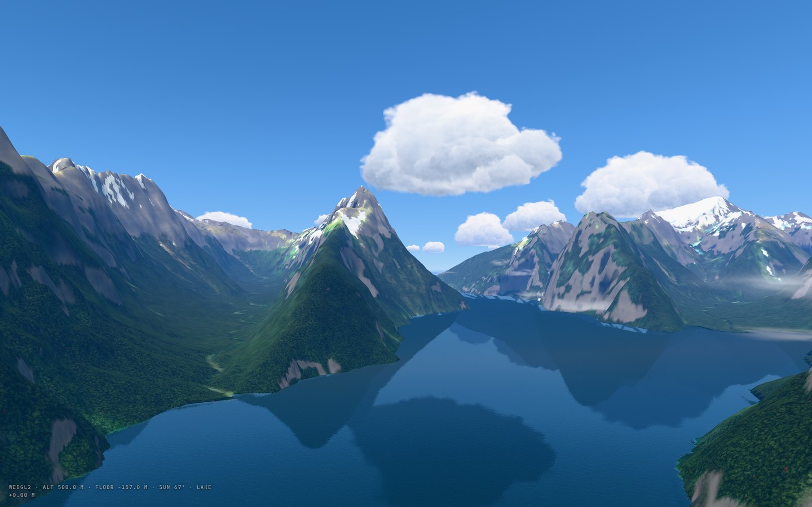
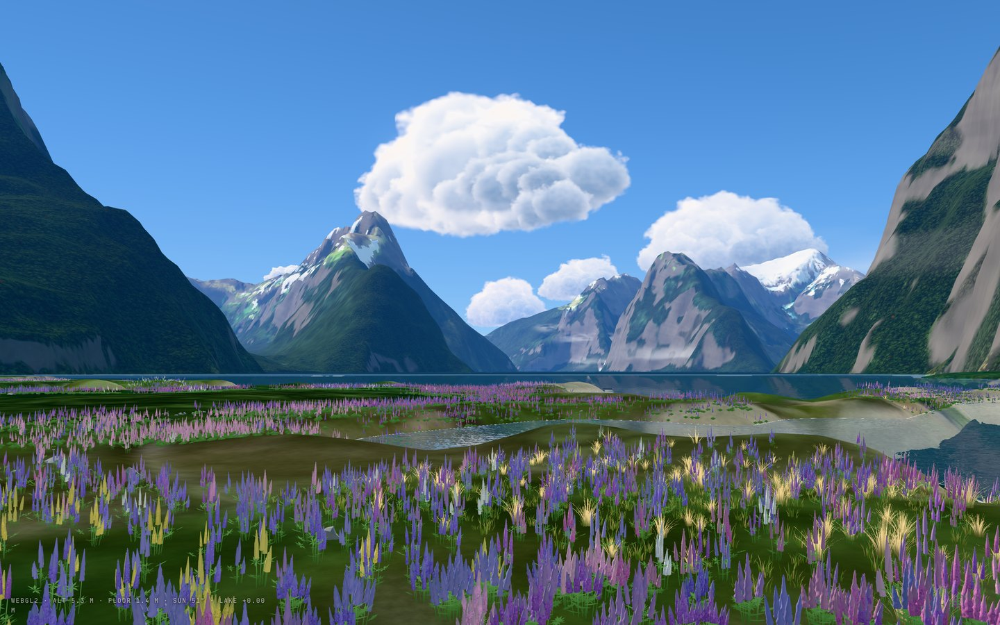
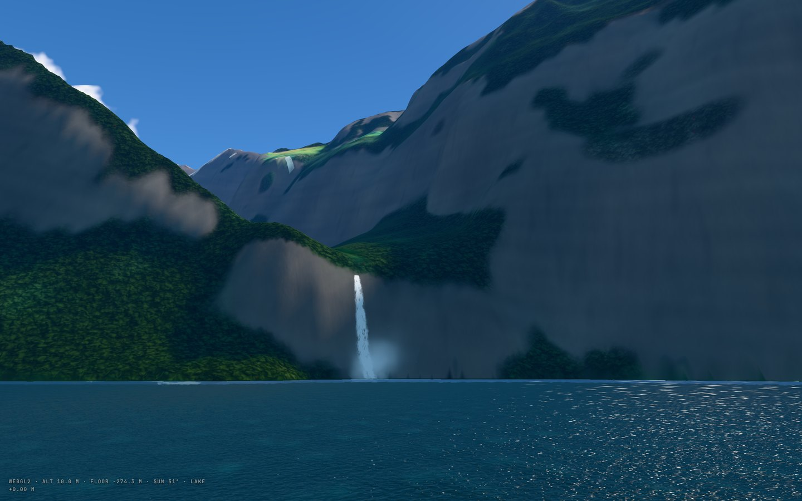
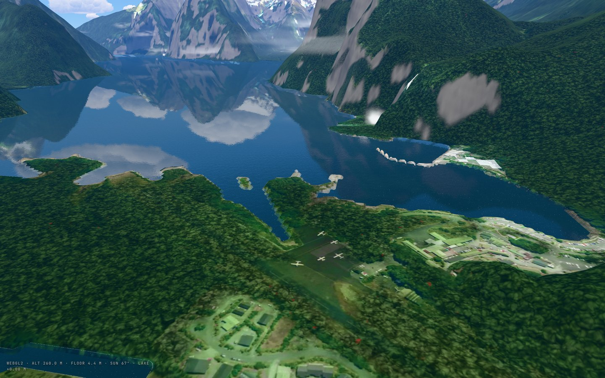
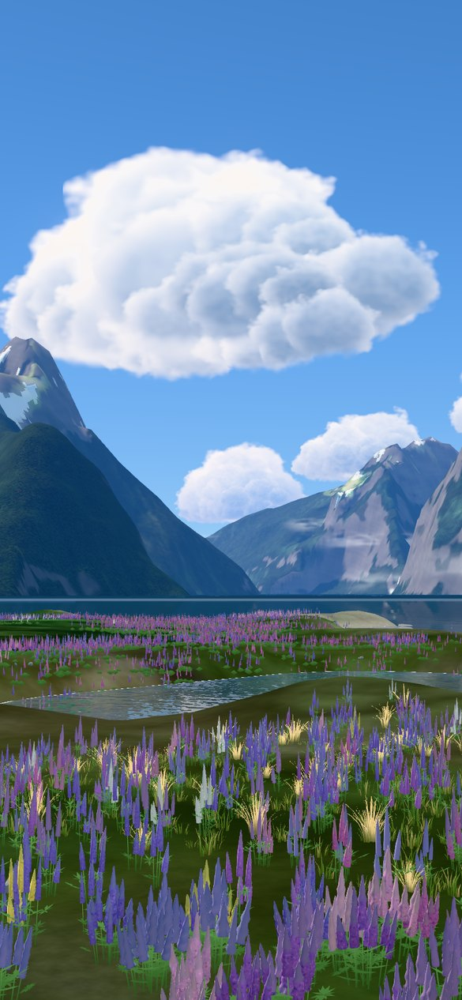

# Milford Sound / Piopiotahi: a fiord, its falls and a ship, from open data

> Milford Sound / Piopiotahi in Fiordland National Park, 20 × 20 km from the Tasman Sea to the Cleddau: Mitre Peak
> straight out of the water, rainforest on walls a kilometre high, Stirling and Lady Bowen Falls, fair-weather
> cumulus, gulls, lupins on the river flats, and a 40 m ship sailing the day cruise's line. Open it from the globe
> (**Milford Sound**), or `web/reef/index.html?city=milford-sound`. Paths are relative to the repository root.

| The ship under Mitre Peak | From 500 m over the head of the fiord |
|---|---|
|  |  |
| **The foreshore in lupin season** | **Stirling Falls from the water** |
|  |  |
| **The village, the airstrip and Lady Bowen Falls** | **On the phone** |
|  |  |

## 1. Which water, and why

The brief was a real ship in a real seascape under towering walls, on a fine day: blue sky, white cloud, birds and
flowers. Milford Sound is the place on Earth that picture describes. Mitre Peak rises 1,683 m from the sea in about
2 km, the walls are clad in rainforest to the bush line, two falls of 150 m and more run all year, and New Zealand
publishes the terrain and the imagery openly. It is also next door to the project's other alpine sites, so it runs on
the same viewer (`web/reef/`, site kind `alpine`) and the same pipeline, each extended here for a fiord.

The frame is a transverse Mercator on Stirling Falls (167.87°E, 44.61°S): x −12.16 to 8.32 km, y −10.88 to 9.6 km.
It holds the whole fiord (16 km from Freshwater Basin to Saint Anne Point), 4 km of the Tasman Sea off its mouth,
Mount Pembroke and its glacier to the north, and the village, the airstrip and the Cleddau's flats at the head.

## 2. What is in it

| Layer | Source (licence) | In the model |
|---|---|---|
| Terrain | Toitū Te Whenua LINZ, *New Zealand LiDAR 1m DEM* where a capture reaches (the head of the fiord and the road; a quarter of sheet CB08), and the *New Zealand Contour-Interpolated 8m DEM* (Geographx) over the rest of Fiordland (both CC BY 4.0) | `terrain.bin.gz`: 2048 × 2048 cells at 10 m, 0.125 m steps above mean sea level |
| Ground colour | LINZ, *New Zealand 10m Satellite Imagery (2025–2026)* (Sentinel-2, CC BY 4.0), with its own shade taken out (section 3) | `ground_0.webp` at 10 m |
| Aerial detail | LINZ, *Southland 0.25m Rural Aerial Photos (2023)* (CC BY 4.0) | `detail_foreshore.webp` at 0.75 m over the village, the airstrip and the foreshore |
| Coast, lakes, falls, peaks, woods, roads, buildings | OpenStreetMap contributors (ODbL) through Overture Maps 2026-10-21.0 | `lakes.png`, `cover.png`, `roads.json`, `structures.json`, 35 POIs |
| The land past the frame | Copernicus GLO-30 and ESA WorldCover (`pipeline/far_land.py`) | `far.png`, `far.jpg` |
| Sun, moon, stars | as the other alpine sites (`web/sun.js`, `web/reef/alpine/atmos.js`, `stars.js`) | the light, the sky, the night |

Build:

```bash
python pipeline/fetch_linz.py --city milford-sound
python pipeline/fetch_overture.py --city milford-sound --only water segment building land land_use infrastructure
python pipeline/build_alpine.py --city milford-sound
python pipeline/alpine_detail.py --city milford-sound
python pipeline/far_land.py --city milford-sound
python pipeline/marine_meta.py --city milford-sound      # after any city.json edit: POIs, route, falls, birds, clouds
python blender/build_ship.py                              # the ship (needs pip install bpy==5.2.3)
```

## 3. What the pipeline learned for a fiord (`pipeline/build_alpine.py`)

- **The main water can be the sea** (`lakes[].sea`). A lake is a gap in the LiDAR. Here the LiDAR reaches a quarter of
  the frame, so its gaps say nothing; the sea is where neither DEM has a height, joined to the cells OpenStreetMap's
  sea holds that lie within a metre of sea level, grown from a seed point. The coast is the DEMs', not the mapped
  line's, so no cliff loses its foot. `fetch_linz.py` now skips a sheet the LiDAR composite does not hold.
- **The bed is a glacial trough.** No open bathymetry of the fiord was found. The bed deepens from the walls to the
  published 291 m over 700 m (about half the fiord's width) and stays there out to sea. The real fiord shoals to a
  sill near its mouth; the model does not, and nothing drawn depends on it (the water hides the bed a few metres down).
- **The photograph's shade is taken out** (`imagery.deshadow`). Under walls this high the summer mosaic is in blue
  shade for good, 8% of the land. The viewer lights the land itself, so shade printed in the colour is a second shadow
  that never moves. A shaded pixel (blue over green, dark) takes the sunlit colour of what stands there: bush below
  the 950 m bush line (the median of the frame's own sunlit bush), scrub above it, rock where it is steeper than 60°
  or high. The photograph's own light and dark stay as texture.
- **Bush holds on anything under 60°.** The Mackenzie rule (rock above 42°) would bare half of Fiordland.

## 4. What the viewer learned

- **The walls** (`web/reef/alpine/terrain.js`, `scene.biome: "fiordland"`). A photograph from above has almost no
  pixels on a wall that stands near the vertical. Bush is drawn as a canopy of domed crowns about 9 m across, in the
  wall's own space so a crown is round on a cliff, each lit on its sunward side with dark gaps between, breaking into
  boughs near the eye; southern rātā flowers crimson through the canopy below 700 m from December to February. Where
  the wall passes 47 to 69° the bush gives way in patches to rock: beds dipping across the face, flutes worn down it,
  dark seeps, joints, moss, and bush again on the ledges.
- **The sky** (`alpine/clouds.js`, `clouds.field`). Fair-weather cumulus at one condensation level over 68 km, each
  cloud a heap of soft puffs with a flat base, shaded as one body (white on its sunward side and top, blue-grey
  beneath, a bright rim against the sun), drifting on the westerly and coming round again. One mesh, one draw call,
  sorted back to front a few times a second. The lake's mirror shows them in the fiord.
- **The falls** (`alpine/fiord.js`, `falls`). Each fall is traced down the model's own wall from its mapped lip by
  steepest descent: Stirling Falls comes out 134 m in the model against the published 151 m, Lady Bowen Falls ends
  on its fan as the real one does. The water is a ribbon of streaks that run faster as they fall; spray drifts off
  the foot and foam spreads on the sea.
- **The rainbow** is not placed. Spray scatters light back at 40.5 to 42.4° from the point opposite the sun, so a
  bow stands in the plume only when the sun is behind the eye and lower than 42°, and moves as the eye moves: on a
  January day, in the morning from the water south-west of Stirling Falls.
- **The gulls**: red-billed and black-backed gulls wheel behind the ship and over the fall's foot, a few beats then
  a glide, banked into their circles.
- **What you hear** is synthesised in the page, with no recordings: the fall's roar by distance, a gull's cry from
  the nearest bird, a bellbird's notes by day near the bush. `?mute=1` turns it off.
- **Lupins** stand on the foreshore and the Cleddau's flats (`flora.lupins`), in flower from November to January
  as on the other sites. They are a weed here, and the ranger says so.

## 5. The ship

`blender/build_ship.py` builds her; `web/reef/boats/ship.js` loads her as a vessel of kind `ship`
(`harbour.traffic`). She is the *Piopiotahi*, a ship that does not exist: a 40 m steel motor vessel in the style of
the scow-rigged vessels that work the fiord, with three masts, a derrick forward and a two-deck house. She sails
the day cruise's line at about 9 knots: out along the south wall under Mitre Peak and past Copper Point and Dale
Point to the Tasman Sea, back under the north wall to Stirling Falls, Harrison Cove and Lady Bowen Falls. The route
is planned over the model's own depths (`boats/nav.js`). She rides the same wave field the sea is drawn from, leaves
a wake in it, turns her radar, flies her ensign, and shows her lights at dusk.

The site opens aboard her (`spawn.aboard`): <kbd>V</kbd> changes the view (off the quarter, wide off the beam, at
the foredeck rail, from above), dragging looks round, <kbd>F</kbd> puts you ashore on the foreshore walk.

## 6. What is not real, and what was not checked

- The ship is true to type, not a survey of a real vessel; no photograph was compared.
- The bed of the fiord is synthesised, and the tide is not modelled: the sea stands at mean sea level.
- The water's colour is set by eye (`optics`), where the lakes' is measured.
- North of latitude 44.63°S the terrain is the 8 m contour DEM: overhangs and the last few degrees of the steepest
  faces are not in it, and the canopy and the rock are procedural, not photographs.
- The buildings of the village are the aerial photograph on the ground, not models.
- Everything was drawn on software WebGL2 in a headless browser. A real GPU, WebGPU, Safari and iOS were not
  tried, and the sound was not listened to.
