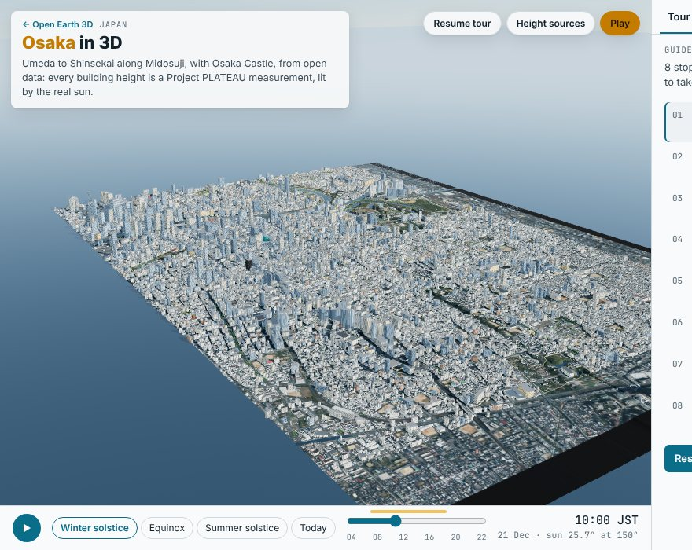
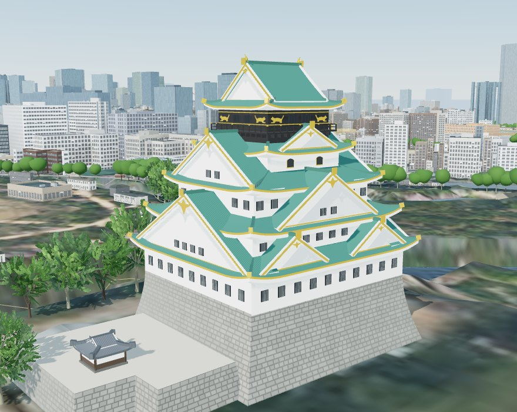
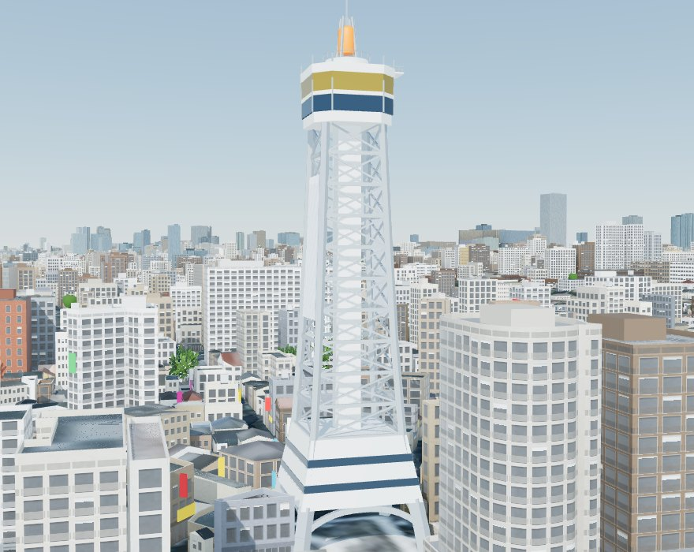
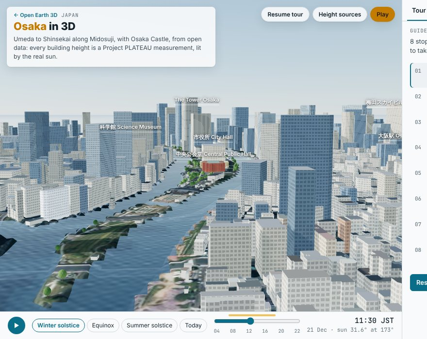
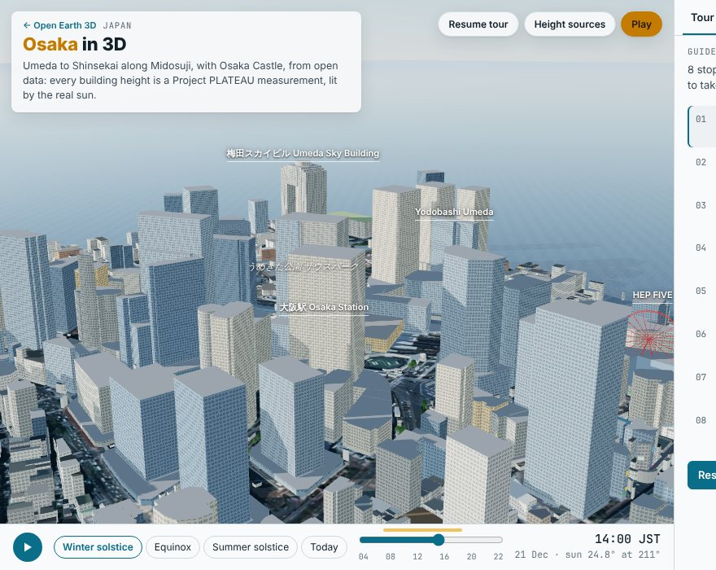
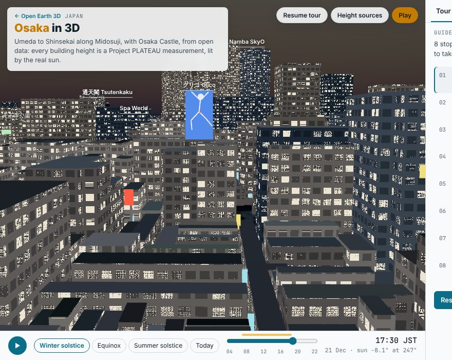
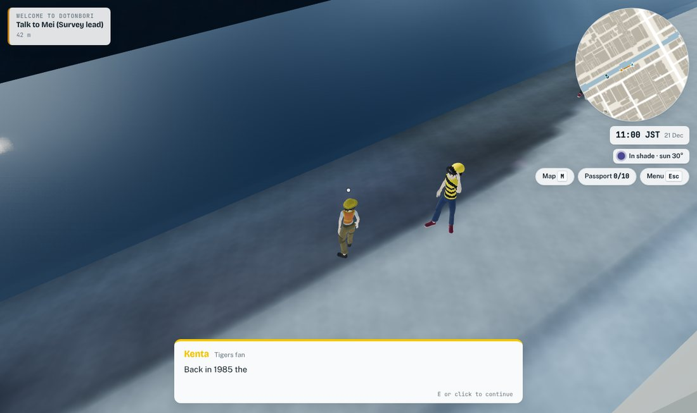

# Osaka: a city whose heights were measured, not guessed

Osaka is the second city built from the same config-and-checks recipe as
[Sydney](sydney.md), and the first where almost every building height is a
survey measurement. Project PLATEAU, the Japanese government's open 3D city
model, publishes a surveyed height for nearly every building in central Osaka.
So the question that took most of the Sydney study (where do heights come
from, and how wrong are the guessed ones?) mostly goes away. What is left is
more interesting: where the survey is out of date, where the other open data is
not independent of it, and what a city looks like when the model has
neighbourhoods, boats and people that belong to it.

| Osaka in the browser | Osaka Castle keep | Tsutenkaku |
|---|---|---|
|  |  |  |
| **Nakanoshima, between the rivers** | **Umeda and the HEP FIVE wheel** | **Dotonbori at dusk, with shop signs** |
|  |  |  |

## 1. The short answer

- **Scope.** 4.5 × 6.4 km along Midosuji, from Umeda in the north to
  Shinsekai in the south, with Osaka Castle to the east: 73,280 buildings.
  68,431 are Overture footprints and 4,849 are PLATEAU buildings Overture
  lacks (mostly houses and sheds).
- **Heights.** 89.2% of the footprint area has a PLATEAU measured height, and
  another 1.2% a PLATEAU block height. 4.6% has an OpenStreetMap floor count,
  2.0% an OSM height taller than the survey (a building newer than the survey),
  and 3.0% is estimated from neighbours. Eighteen published tower heights are
  matched to within a median of 1.8% (17 of 18 within 10%).
- **Terrain.** GSI's 5 m airborne-laser DEM is bare earth. AWS's global
  Terrarium tiles read a median of 6.7 m too high over Osaka's land, because
  they are a surface model. A second, older GSI DEM (10 m) agrees with the
  5 m one to a median of 0.7 m.
- **Landmarks.** The Osaka Castle keep, Tsutenkaku, the HEP FIVE wheel, the
  Glico runner and the Kani Doraku crab are built from published dimensions,
  with 1,400 shop-sign sites on street facades in the Dotonbori, Shinsekai and
  Umeda neon districts.
- **Sun.** A winter-solstice study of eight parks, from 8:00 to 16:00. Utsubo
  Park gets 49% of its area in direct sun, Umekita South Park 16% and Osaka
  Castle Park 75%. The window is borrowed from Japan's shadow rule, which
  does not apply to these parks; see section 7.
- **Game.** *Osaka on Foot*: ten stamps, twelve people who talk like Osakans,
  two river routes (the Tombori River Cruise and the Aqua Liner) and a
  helicopter. See section 8.

## 2. What was built

| Part | How |
|---|---|
| Footprints | Overture Maps, release 2026-10-21.0 (OpenStreetMap, ODbL) |
| Heights | Project PLATEAU, Osaka City 2020 CityGML (survey year 2017), read by `pipeline/fetch_plateau.py` (the `citygml` backend, `pipeline/plateau_citygml.py`) |
| Terrain | GSI DEM5A, 5 m airborne laser, bare earth; the 10 m DEM fills gaps |
| Imagery | GSI seamless aerial photographs, zoom 17 |
| Landmarks | `cities/osaka/city.py`, from published figures |
| Analyses | The same scripts as Sydney, plus a GSI-tile terrain check |

No code outside `cities/osaka/` is specific to Osaka. What Osaka needed from
the shared code is described in [ADDING_A_CITY.md](../ADDING_A_CITY.md):
a GSI terrain source, a PLATEAU height source, a name-based reference table and
per-city game flavour.

### 2.1 PLATEAU without the national download

The national CityGML archive for Osaka is 1.3 GB. A city only needs a few of
its 3,900 mesh files: 48 here. `pipeline/rangezip.py` reads a
zip over HTTP range requests, so `plateau_citygml.py` fetches the central
directory, picks the 3rd-mesh files whose bounds meet the bbox, and parses
each building's footprint, `measuredHeight`, storey count and LOD1 block with
regular expressions (a 50 MB XML file in about 7 s). It runs in about a
minute. (Osaka's 2020 release has no building 3D Tiles to read instead.)

## 3. Heights

### 3.1 The ladder in Osaka

| Source | Footprint area | Meaning |
|---|---:|---|
| `plateau` | 89.2% | The height Project PLATEAU measured from the air |
| `plateau_lod1` | 1.2% | PLATEAU's block height for a building with no survey record |
| `floors` | 4.6% | OSM floor count × a storey height calibrated on PLATEAU |
| `mapped` | 2.0% | An OSM height more than 30% (plus 6 m) taller than the survey |
| `estimate` | 3.0% | The weighted median of known heights within 60 m |
| `parametric` | 0.1% | Landmarks built from published figures |

### 3.2 OpenStreetMap is not an independent check here

For 40,057 buildings with both an OSM `height` tag and a PLATEAU match, the
two heights are identical: the median ratio is 1.000, and so is the 90th
percentile. Osaka's OSM heights were evidently imported from PLATEAU. That is
good for the map and bad for anyone who wants to check PLATEAU against OSM.

### 3.3 Where the survey is old

PLATEAU's building survey is from 2017. A tower built after that stands on a
site that was empty or low then, and PLATEAU's footprint there carries the old
height. 196 buildings have an OSM height more than 30% (plus 6 m) taller than
the survey; they keep the OSM height. Without that rule, JP Tower Osaka
(188 m, 2024) would be drawn at 137 m, Yodobashi Umeda Tower (150 m, 2019) at
65 m and Osaka Umeda Twin Towers South (190 m, 2022) at 35 m. The rule is a
heuristic. It cannot catch a new building that is slightly taller than what it
replaced.

A second case runs the other way: a tower that OSM maps in parts, each with a
floor count, can come out well short of the survey. The Umeda Sky Building was
156 m from its parts against 173 m published; the survey says 176.8 m, and the
parts of the tower now scale up to it.

### 3.4 Checked against published heights

Eighteen towers over 150 m, named as they are on the map, against Wikipedia's
list of Osaka's tallest buildings (`cities/osaka/reference_heights.csv`).

| Height source | n | Median absolute error |
|---|---:|---:|
| `mapped` (OSM) | 3 | 0.0% |
| `floors` | 8 | 1.0% |
| `plateau` | 7 | 4.8% |

The `plateau` rows are the independent ones, and every one of them reads taller
than the published figure, by 0.2% to 11.3% (OAP Tower +11.3%, Nakanoshima Dai
Building +9.6%, OBP Castle Tower +6.3%). That fits a survey
that measures the top of the roof structure against an architectural height
that stops lower, but we have not checked the roofs one by one. The `mapped` and `floors` rows are
almost circular, since mappers took them from the same published lists.
Median over all 18: 1.8%; the worst is OAP Tower at +11.3%.

### 3.5 Storey height

OSM floor counts need a storey height. Instead of Sydney's defaults, it is
calibrated on PLATEAU: 118,782 non-residential and 11,163 residential
buildings with both a storey count and a measured height have a median of
3.4 m and 3.6 m a floor, with no constant term.

### 3.6 The estimated buildings

4,056 buildings (3.0% of the area, mostly small ones) have no measurement.
Their heights come from neighbours within 60 m, with a leave-one-out error of a
factor of 1.33 at the median and 2.6 at the 90th percentile. The Monte Carlo
sigmas the sun study uses are 0.165 for `floors` and 0.43 for `estimate`,
and 0.03 for a measured height.

## 4. Terrain

| Source | Over land in the model area |
|---|---|
| GSI DEM5A (used) | bare earth, 5 m |
| AWS Terrarium, zoom 15 | median 6.7 m above DEM5A, 90th percentile 15.6 m |
| GSI 10 m DEM | median absolute difference 0.72 m, 90th percentile 2.3 m (810 open-ground points); 61.5% within 1 m |

Terrarium is a surface model here, as it was in Sydney. The 10 m check is
older and coarser than DEM5A, not independent of it in method (both are GSI
products), so it shows consistency and not independence.

The radar check of [Sydney §9.3](sydney.md#93-the-rejected-radar-surface-checks-the-building-mass)
holds in Osaka as well. The surface excess of the SRTM-derived Terrarium over
the bare-earth DEM tracks the building mass of the model: r = 0.62, 0.68 and
0.77 at 100, 150 and 200 m blocks, with a slope of 0.33 to 0.44.

## 5. Landmarks

Everything below is parametric: built in `cities/osaka/city.py` from published
dimensions, with anchors measured from the data, and approximate in the details
that no source gives. The numbers marked * are measured from the data
or chosen by us.

| Landmark | Figures used | Source |
|---|---|---|
| Osaka Castle keep | stone base 13.3 m, tower 39.4 m above it, total 52.7 m, 54.8 m with the golden shachi; five roofs outside, eight floors inside; ground 31.7 m T.P.*; tier plans* | Osaka Prefecture fact sheet, Bunshun, PLATEAU record 大阪城天守閣 (54.6 m) |
| Tsutenkaku | 103 m (108 m with the lightning rod); gold observatory at 87.5 m, open deck at 94.5 m; the lattice and neon are schematic* | Osaka City leaflet and tourist sources |
| HEP FIVE wheel | 75 m diameter, 106 m top, lowest point at the seventh floor (about 31 m); the building drawn at 47 m*, because PLATEAU's 107 m is the wheel | published dimensions |
| Glico sign | a panel with a simplified runner, on the building nearest the published coordinates* | Wikipedia coordinates |
| Kani Doraku crab | about 8 m across*, on the Dotonbori facade | indicative |
| Shop signs | 1,400 facades with a street in front of them, in three districts*; blades, banners and boards in six colours, lit at night | indicative, random |

The Central Public Hall is coloured as red brick and the City Hall as
granite, from their names; they are not otherwise modelled.

## 6. Neon

The viewer lights "floodlit" meshes after dark. For Osaka, materials can carry
their own emissive colour and glow, and a city can add a night ambient light
(`night_ambient`) so the streets are not pitch black. Shop signs, the Glico
runner, the crab and the top of Tsutenkaku use them.

## 7. Winter sun on the parks

Japan's shadow rule (日影規制, Building Standards Act art. 56-2) limits the hours
of winter-solstice shade, between 8:00 and 16:00, that a building may cast on
neighbouring land. As we read it, it applies in the zones a local authority
lists and not in commercial zones, which is most of this model. Osaka's parks
have no such rule. So the "protected" window in this city is a study rule, and
the viewer says so. The window and the choice of parks are this project's;
the reading of the Act should be checked against its text.

Share of each park in direct sun, averaged over 8:00 to 16:00 on 21 December
(JST has no daylight saving, so clock and standard time agree):

| Park | Share in sun |
|---|---:|
| 西の丸庭園 Nishinomaru Garden | 88% |
| 桜之宮公園 Sakuranomiya Park | 77% |
| 大阪城公園 Osaka Castle Park | 75% |
| 難波宮跡公園 Naniwa Palace Ruins Park | 70% |
| 扇町公園 Ogimachi Park | 69% |
| 天王寺公園 Tennoji Park | 65% |
| 靱公園 Utsubo Park | 49% |
| うめきた公園 サウスパーク Umekita South Park | 16% |

Umekita South Park, between the new Umeda towers, is the place where a
new tower would matter most. The ranked fix list of
`analysis/uncertainty.js` (the buildings whose heights move a result most)
leads with an unnamed building and the Gate Tower beside that park.

## 8. Osaka on Foot

The game is Sydney's engine with Osaka's cast. The twelve people carry a
Kansai accent in English: *maido* (welcome), *ookini* (thank you), *honma?*
(really?), *nandeyanen* (what, why?), *mokarimakka?* (making money?).

| NPC | Role | Local flavour |
|---|---|---|
| Mei | Survey lead | Ebisu-bashi, Dotonbori's origin in 1612 |
| Daisuke | Takoyaki master | headband, apron, a tray of takoyaki |
| Kuidaore Taro | Dotonbori mascot | red-and-white stripes, clown hat, drum |
| Kenta | Tigers fan | yellow-and-black stripes, the cap, the 1985 Colonel Sanders legend |
| Officer Sato | Koban police | police cap; stand on the right on escalators |
| Fumi | Kuromon Market | leopard-print top, visor, umbrella, *ame-chan* candy |
| Taisho Kenji | Kushikatsu chef | *nidozuke kinshi*: no double-dipping |
| Yoshi & Taka | Manzai comedians | the double act, *nandeyanen!* |
| Tanaka | Salaryman | pinstripe, mask, ID lanyard; the Umeda underground "dungeon" |
| Captain Nishida | Aqua Liner | the City of Water |
| Ichiro | Castle guide | ashigaru hat and flag; the keep's figures |
| Ryo | Helicopter pilot | Naniwa Palace ruins |


The ten stamps:

1. **Ebisu-bashi.** Meet Mei and hear how much of the roof area is measured.
2. **Takoyaki.** Ride the Tombori River Cruise from Taizaemon-bashi to Nipponbashi.
3. **Kuromon Market.** Use the survey lens on a PLATEAU-measured and an estimated building.
4. **Tsutenkaku.** Kushikatsu in Shinsekai, under the tower.
5. **Namba Grand Kagetsu.** The manzai act argues about 103 m and 108 m.
6. **Midosuji.** Stand in direct sun in Utsubo Park on the winter solstice.
7. **Aqua Liner.** Ride from Hachikenyahama to Osaka-jo Port.
8. **Osaka Castle.** The keep's figures; walk to Naniwa-no-miya Park.
9. **Umeda by air.** Fly the helicopter to Umekita Park.
10. **Surveyor.** Back at Ebisu-bashi.

How the people look is data in `cities/osaka/city.json` and code in
`web/game/people.js`: a procedural leopard and tiger print on a top, pinstripe,
the Kuidaore stripes, and accessories attached to bones (visor, headband,
ashigaru hat, mask, lanyard, tray, umbrella, flag, drum). The crowd uses a
Japanese palette and weights, and a few percent of it wear a pattern, a mask
or an umbrella. A playwright script plays all ten quests through the game's
test hook.

| Dotonbori, midday | Fumi at Kuromon Market | A Tigers fan |
|---|---|---|
|  |  |  |

## 9. Limitations

- **The survey is from 2017.** Buildings since then are the 196 OSM heights
  that outrank the survey, plus whatever the survey and OSM both miss. The
  Umekita area, which was a rail yard in 2017, is the clearest case.
- **PLATEAU here is LOD1.** Buildings are blocks with flat roofs and no
  interiors. Only the landmarks have a shape.
- **A PLATEAU height is the top of the roof structure.** Published heights
  stop lower, which is why `plateau` towers read taller than the published
  figure.
- **The landmarks are approximate.** The tier plans of the keep, the lattice
  of Tsutenkaku, the Glico runner and the Kani Doraku crab are indicative,
  and the shop signs are random facades on streets, not the real signs.
- **The castle hill is smooth.** A 5 m DEM does not resolve the stone walls
  (up to 30 m); they read as steep slopes.
- **Ground level is the photo.** At street level the aerial image is blurred and
  carries its own shadows. At night the ground is dark apart from the signs.
- **The boats are not real.** The two river routes follow the landings
  mapped in OpenStreetMap; the timetable, the speed (9 m/s) and the vessel
  names are invented. The Tombori River Cruise is split into two short routes
  so that a boat at a landing always goes the way the quest wants.
- **No Blender render** of Osaka has been made.

## 10. Reproducing it

```bash
env -u AWS_ACCESS_KEY_ID -u AWS_SECRET_ACCESS_KEY -u AWS_SESSION_TOKEN \
  python pipeline/fetch_overture.py --city osaka
python pipeline/fetch_tiles.py --city osaka
python pipeline/fetch_plateau.py --city osaka
python pipeline/build_scene.py --city osaka
python pipeline/landmarks.py --city osaka
python analysis/heights.py --city osaka
python pipeline/build_scene.py --city osaka        # applies reference corrections
python analysis/data_quality.py --city osaka
python analysis/dem_check.py --city osaka
python analysis/radar_check.py --city osaka
node analysis/sun_access.js --city osaka
node analysis/uncertainty.js --city osaka 40
python pipeline/game_data.py --city osaka
```

The whole pipeline takes about 20 minutes, 12 of them for the 40 uncertainty
draws. The shipped data is 29 MB, of which `buildings.json` is 11 MB (3.3 MB
gzipped) and `game.json` 6.4 MB (1.7 MB gzipped).

## Sources

- Project PLATEAU, Osaka City 3D city model 2020 (MLIT; CityGML v2):
  [G-spatial Information Center](https://www.geospatial.jp/ckan/dataset/plateau-27100-osaka-shi-2020).
- Geospatial Information Authority of Japan: DEM5A, DEM10B and seamless
  aerial photographs ([tile service](https://maps.gsi.go.jp/development/ichiran.html)).
- Overture Maps Foundation, release 2026-10-21.0 (OpenStreetMap contributors, ODbL).
- Osaka Castle keep: [Osaka Prefecture fact sheet](https://www.pref.osaka.lg.jp/documents/140847/shousai_oskajyo.pdf);
  [Bunshun](https://bunshun.jp/articles/-/52).
- Tsutenkaku: [Osaka City planning leaflet](https://www.city.osaka.lg.jp/toshiseibi/cmsfiles/contents/0000266/266754/TSUTENKAKU.pdf)
  and [osaka-info.jp](https://osaka-info.jp/spot/tsutenkaku/).
- Tower heights: [Wikipedia, List of tallest buildings in Osaka](https://en.wikipedia.org/wiki/List_of_tallest_buildings_in_Osaka).
- Characters: Quaternius, Ultimate Modular Men and Women (CC0).
