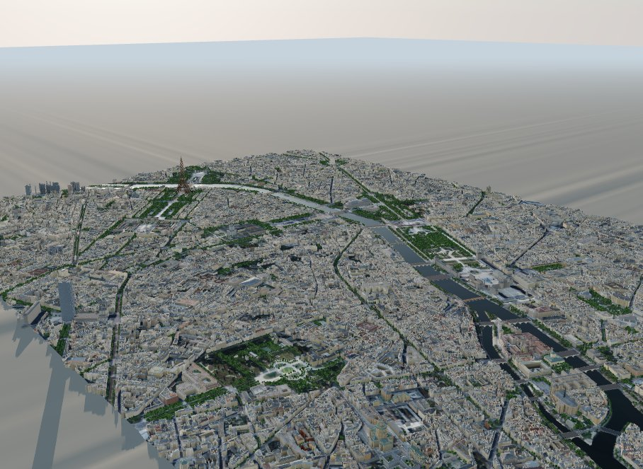
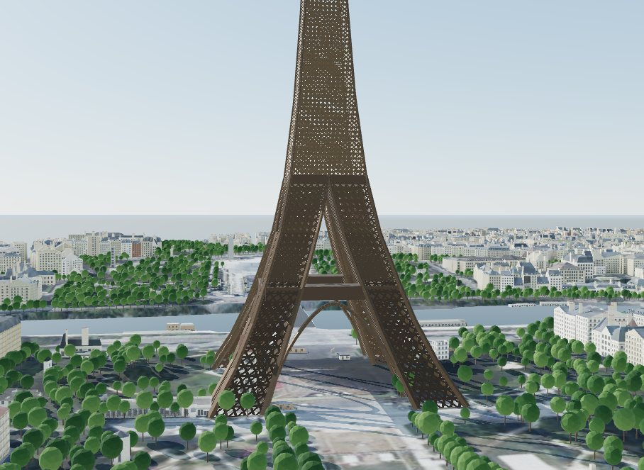
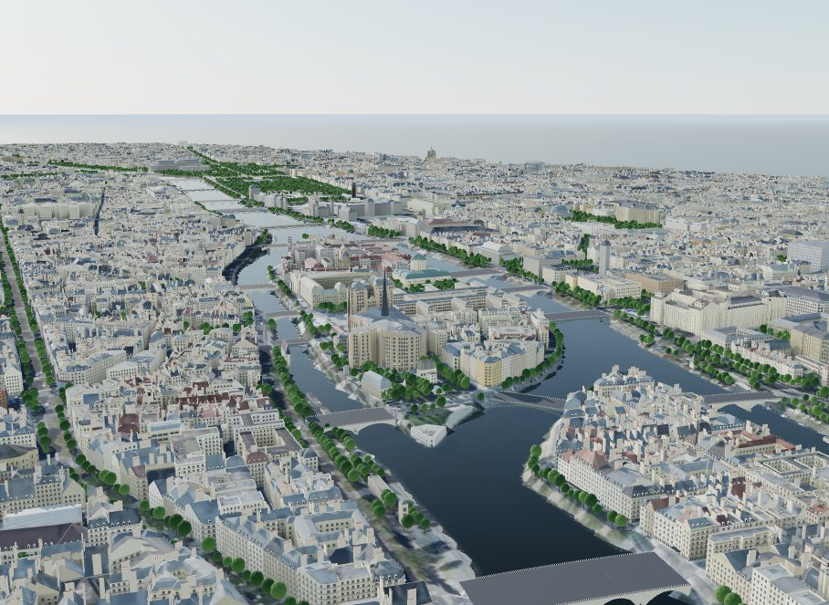
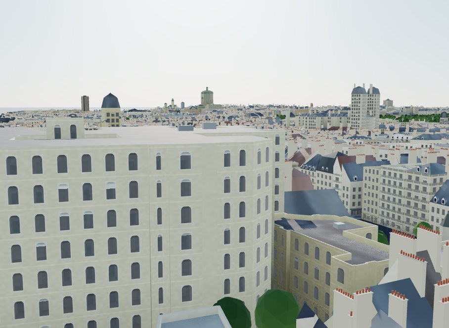
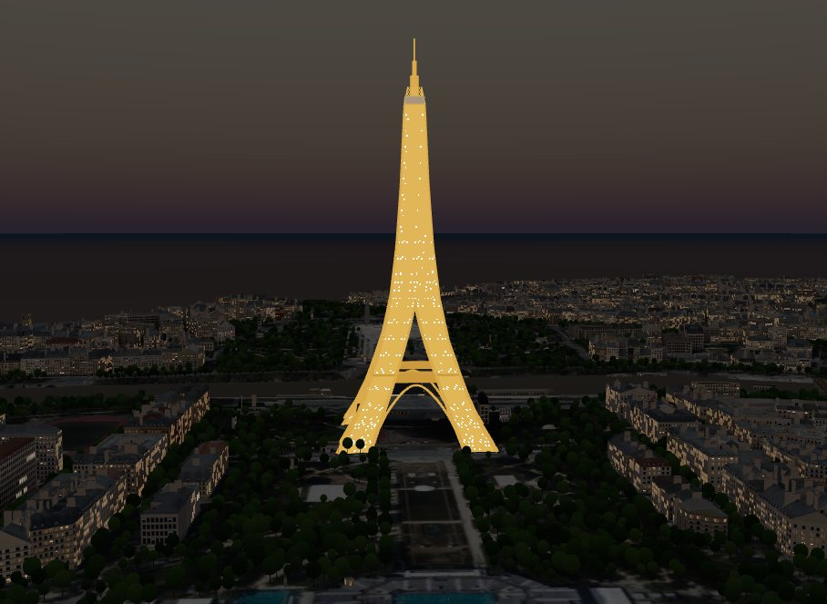
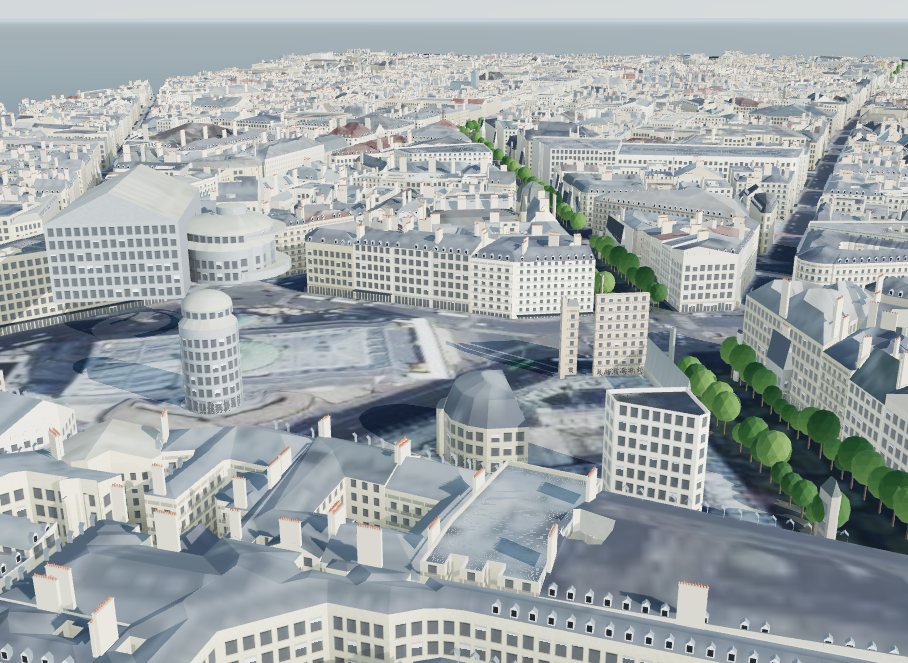
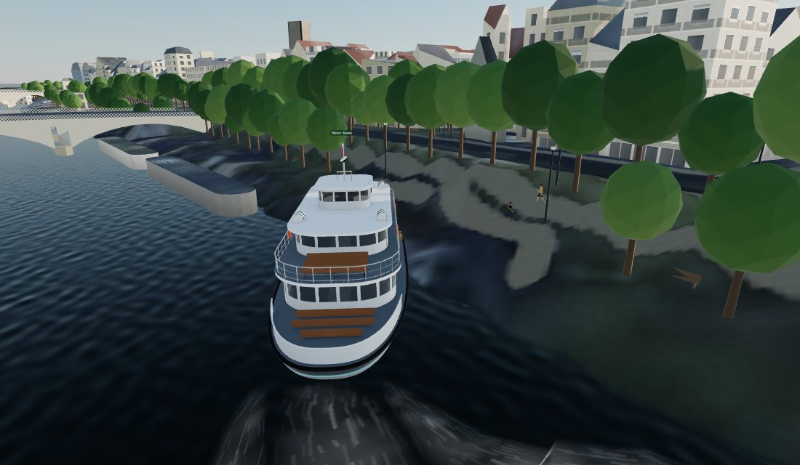
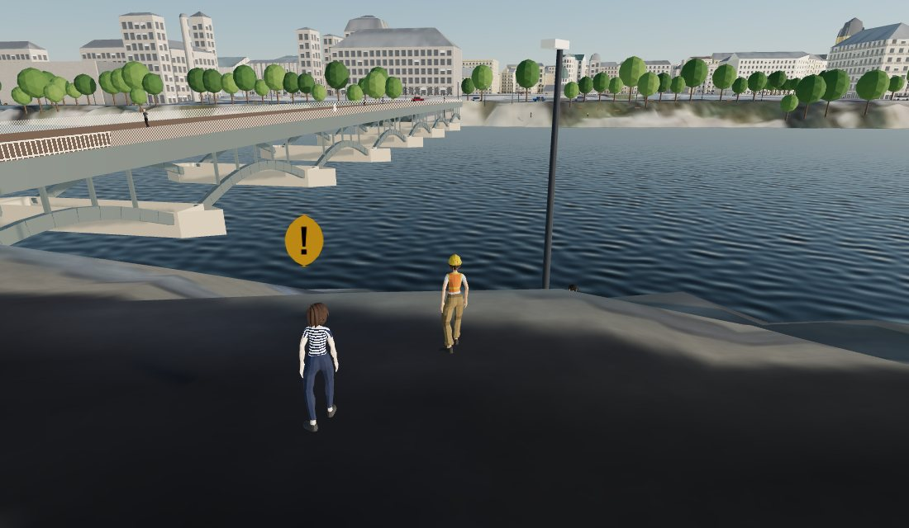

# Paris: every roof measured

Central Paris from the Eiffel Tower to the Île Saint-Louis, and from the Arc de
Triomphe to the Tour Montparnasse: 5.6 × 4.0 km of the densest city in this
project. It is the first city here where the open data is a laser survey of every
roof. IGN, France's mapping agency, flew its LiDAR HD over Paris on 2 and 3 March
2023 and publishes the result under the Licence Ouverte. The model takes each
building's height from that survey, cuts monuments and courtyards from it, and reads
each roof's shape from the laser's profile over the surveyed eaves.



| The Eiffel Tower | The Île de la Cité | Zinc mansards on the Left Bank |
|---|---|---|
|  |  |  |
| **The tower sparkling, 23:01** | **Dormers and chimney stacks near the Opéra** | **Paris on Foot: the Batobus at Notre-Dame** |
|  |  |  |

## The short answer

- **Heights are measured, not guessed.** 99.4% of the footprint area takes its
  height from IGN's LiDAR HD. Three published towers in the area agree with the
  laser to 2.6% at the median (Tour Montparnasse: 211.0 m against 210 m).
- **Open data is weaker than it looks.** Against the laser, OpenStreetMap floor
  counts times a storey height are within 11% at the median (16,781 buildings).
  OpenStreetMap height tags, rare here (210 buildings), are 27% low at the median,
  and Microsoft's ML heights are 25% low.
- **Haussmann's rule is in the data.** The 1859 decree let a building on a wide
  street rise 20 m to its cornice. The 10,199 residential buildings of five floors
  or more that BD TOPO dates 1850 to 1914 have a median surveyed eaves height of
  20.1 m.
- **Roofs are read from the laser.** 20,002 pitched roofs were profiled;
  50.2% are mansards or gambrels, and the median pitched roof rises
  4.8 m over its eaves. On the 485 roofs mappers tagged, the profile gets
  flat or pitched right 69% of the time, where the rules alone get 34%.
- **The terrain** agrees with IGN's earlier RGE ALTI model to 0.12 m at the median
  (633 open-ground points, 94.5% within 1 m).

## 1. Data

| What | Source | Licence |
|---|---|---|
| Footprints | OpenStreetMap via Overture Maps (release 2026-10-21.0); IGN BD TOPO where Overture has none | ODbL; Licence Ouverte 2.0 |
| Heights | IGN LiDAR HD normalised surface model (MNH), 0.5 m, flown 2-3 March 2023 | Licence Ouverte 2.0 |
| Eaves, floors, dates, use, materials | IGN BD TOPO `batiment` (WFS on the Géoplateforme); materials from the Fichiers fonciers | Licence Ouverte 2.0 |
| Terrain | IGN LiDAR HD bare earth (MNT), resampled to 2 m | Licence Ouverte 2.0 |
| Terrain check | IGN RGE ALTI 1 m, an earlier, independent bare-earth model | Licence Ouverte 2.0 |
| Aerial photographs | IGN BD ORTHO, zoom 17 (0.8 m) | Licence Ouverte 2.0 |
| Bridges, Batobus stops, places | OpenStreetMap via Overture | ODbL |

Everything comes from IGN's Géoplateforme (`data.geopf.fr`), with no key:
`pipeline/fetch_ign.py` pages through the BD TOPO WFS (36,871 buildings in the
bounding box) and reads the LiDAR rasters from the WMS-R as float32 BIL in tiles of
2,500 pixels. The LiDAR's flight dates come from IGN's own metadata layer
(`IGNF_LIDAR-HD_METADONNEE:metadata`, mission 22LHDKE).

### The scene's zero is the Seine

The viewer draws water at 0 m. Sydney and Melbourne sit on the sea; Paris sits
26.9 m above it. So the scene's datum is the Seine's level on the day of the LiDAR
flight, measured from the data itself: the LiDAR terrain is hydro-flattened over the
river, and its median over the 985,000 one-metre cells of the Seine (islands cut
out) is 26.9 m NGF-IGN69; 87% of the cells lie within 0.5 m of it.
`datum_offset_m` in `city.json` subtracts it from the terrain, so every height in
the scene is a height above the river. The elevation checks add it back.

### The islands

Overture's polygon for the Seine has no holes: the Île de la Cité and the Île
Saint-Louis are inside it. They are mapped separately as islets, so the pipeline now
cuts every mapped island and islet out of a city's water.

## 2. Heights

### The ladder in Paris

`pipeline/measured.py` puts BD TOPO and LiDAR HD behind the same interface as
PLATEAU in Japan, so `build_scene.py` treats them the same way:

1. **LiDAR top** (`lidar`). The 95th percentile of the normalised surface model
   inside the footprint, inset 0.6 m so walls, cornices and street trees stay out.
   Chimneys and lift overruns cover less than 5% of a roof, so they do not set the
   top. Every mapped building part is measured on its own.
2. **Levels.** A footprint of 250 m² or more whose heights spread over 6 m is
   checked for levels: bands of height with a 3 m gap holding almost no returns.
   Each level becomes a piece with its own top (a cathedral's towers over its nave,
   a block's taller wing). A level at ground height is an open courtyard, and it is
   cut out.
3. **Surveyed eaves** (`bdtopo`). Where the LiDAR is blank or far below the eaves
   (IGN blanks a few sensitive sites, the Élysée among them), BD TOPO's eaves height
   plus the median measured roof, 2.8 m.
4. Below that, the usual ladder (OpenStreetMap heights and floor counts, then
   estimates), which here covers 0.1% of the area.

An OpenStreetMap height far above the laser is not kept as a newer building, as
it is in Japan. The LiDAR is from 2023 and BD TOPO carries what was built since,
so such a height is a spire or a chimney counted as the building's top (the
Sainte-Chapelle is tagged 75 m, its spire; the laser sees its roof at 41 m).

| Open data against the LiDAR top | Buildings | Within 10% | Median factor | Median ratio |
|---|---|---|---|---|
| OpenStreetMap floor count × storey height | 16,781 | 46% | 1.11 | 1.01 |
| BD TOPO floor count × storey height | 6,734 | 45% | 1.11 | 1.04 |
| BD TOPO eaves height | 24,292 | 29% | 1.18 | 0.87 |
| OpenStreetMap height tag | 210 | 19% | 1.38 | 0.73 |
| Microsoft ML height | 577 | 13% | 1.38 | 0.76 |

From `cities/paris/analysis/lidar_check.json`. The median factor is
exp(median |log ratio|): 1.11 means half the buildings are within 11%. The eaves
are about 13% under the top, which is the roof. OpenStreetMap height tags are
few, and they are low: many measure to the gutter, or describe one part.

### Checked against published heights

| Tower | Published | LiDAR | Error |
|---|---|---|---|
| Tour Montparnasse | 210 m | 211.0 m | +0.5% |
| Tour Panorama (Front de Seine) | 100 m | 94.4 m | −5.6% |
| Tour Zamansky (Jussieu) | 90 m | 87.7 m | −2.6% |

Paris has had a height limit since 1977, so these three are the only buildings in
the area on Wikipedia's list. The Tour Panorama's 100 m includes its rooftop
structures; the 95th percentile of its roof does not.

## 3. Roofs

`IGNHeights.roof` reads each roof from the LiDAR over the surveyed eaves.
`IGNHeights.roof_at` hands it to `build_scene.py` as a measured roof, the same path
as the roofs measured from Project PLATEAU's LOD2 models in Kyoto. A roof shape
mapped in OpenStreetMap still comes first. The profile takes the median height in
bands of distance from the walls:
- **flat:** the roof's core is less than 1 m above the eaves, whatever plant stands
  on it;
- **mansard:** the roof gains 55% or more of its height within 2.6 m of the
  facade, a steep brisis under a low terrasson;
- **hipped:** the roof rises steadily to its ridge.

Where more than a third of the outline runs along another building, the ends are
gables, as on a Paris street, where roofs slope to the street and the courtyard
between party walls. That makes the mansard a gambrel and the hipped roof a gabled
one, with the ridge along the street. The roof's height is the LiDAR top less the
eaves, and the Fichiers fonciers give its material (zinc, slate or tile) for half
of the buildings.

| Measured roofs | Buildings |
|---|---|
| Gambrel (mansard with gables on party walls) | 7,693 |
| Gabled (343 with the ridge across) | 7,117 |
| Flat | 6,519 |
| Hipped | 2,846 |
| Mansard | 2,346 |
| **All buildings with a measured roof** | **26,521** |

(The main roof of each building. Counted per solid, half of the 20,002 pitched
roofs are mansards or gambrels.)

**The check.** On the 485 roofs that mappers tagged with a shape, the LiDAR profile
gets flat or pitched right 69% of the time, and the family (flat; mansard or
gambrel; other pitched) 45%. The rule-based priors, which make every building of
five floors flat, get flat or pitched right 34% of the time on the same kind of
sample. Mapped roof tags are noisy (a Paris mansard between party walls is tagged
gambrel, mansard or flat by different mappers), so these are floors, not
estimates.

**What a Paris roof carries.** On mansards, gambrels and attics of 2.6 m or more:
a zinc dormer in every 2.9 m bay along the street, standing proud of the steep
slope, and a rendered chimney stack with terracotta pots on each long party wall.
The roofs are standing-seam zinc where the land tax files or the region's mix say
so, and they sit flush behind the cornice, with no eaves past the wall.

**Facades.** The Paris region in `pipeline/typology.py` gives a stone block of four
to eight floors on a street the Haussmann facade: limestone ashlar with its
courses, a rusticated base under a shop and its entresol, French windows with stone
surrounds, a wrought-iron balcony along the whole front on the second and top
floors and a railing across each window on the others, and a cornice.

**Trees.** The 34,957 trees mapped in OpenStreetMap are drawn with the shared tree
models, as plane trees (60%) and elms (40%) (`trees.mix` in `city.json`). Species are
not mapped, so the mix is a guess: the plane is Paris's commonest street tree, and the
horse chestnuts and limes of the gardens are drawn as elms, the nearest of the shared
broadleaf species.

## 4. Terrain

The terrain is IGN's LiDAR HD bare earth (MNT), resampled to 2 m, from the same
flight. Against IGN's RGE ALTI 1 m, an earlier bare-earth model, at 633 open-ground
points every 120 m: median difference 0.10 m, median absolute difference 0.12 m,
90th percentile 0.46 m, 94.5% within 1 m (`analysis/dem_check.py`). The largest
differences are where the ground changed between the two surveys.

AWS Terrarium, the global fallback, is 7.3 m above the bare earth on open ground
and 11.4 m above it under buildings here (`data_quality.json`): it is a surface
model, and would float every building.

## 5. Landmarks

`cities/paris/city.py`:
- **The Eiffel Tower.** 330 m to the tip of the antenna, on a base 124.9 m square.
  Four legs, each a tapering box girder, join at the second floor (115.7 m). The
  floors are at 57.6, 115.7 and 276.1 m, and the decorative arches stand between the
  legs. The iron is a lattice cut out of each face in the shader (`web/world.js`,
  `lattice`), with a strut and two diagonals in every bay, finer towards the top. It
  is painted in three browns, darker at the base, as the tower is. After dark it is
  lit gold, and for five minutes at the start of every hour it sparkles. The curve of
  the corner edges between the published floors, the legs' 25 m width and the arches'
  rise are approximations from photographs. The OSM block for the tower (330 m over
  the whole base) is dropped, and the open lattice is left out of the sun analyses.
- **27 Seine bridges**, each on its mapped outline:
  - a deck from quay to quay at the measured height of the two banks;
  - parapets;
  - masonry arches and piers with cutwaters, or open steel ribs on the steel bridges;
  - the four pylons of the Pont Alexandre III, with their gilded groups.

  Span counts are published for 12 of them, and the others take spans of about
  30 m. The decks are walkable surfaces in the game, and the helicopter can fly
  under them.
- **Notre-Dame's spire**, 96 m, rebuilt to Viollet-le-Duc's design. The LiDAR of
  March 2023 saw only scaffolding where it stands.
- **The Arc de Triomphe** with its great arch and side arches, and **the Louvre
  Pyramid** in glass on a steel net. Their solids stay in the sun analyses.

## 6. Paris on Foot

Paris on Foot sends a surveyor out from the Pont des Arts:
- **The river.** Bernard, a bouquiniste on the Quai de Conti, teaches you to read a
  roof with the survey lens. The lens now shows each roof's shape and material, and
  whether it was measured. Then the Batobus from Saint-Germain-des-Prés to
  Notre-Dame, where Léa, a carpenter on the cathedral's new roof, tells its story.
- **The Left Bank.** Simone, a retired senator, plays chess in the Luxembourg. Find
  her a chair in direct sun at noon on 21 December, when the sun is 18 degrees up.
  Then Karim, a waiter in Saint-Germain, sends you to Nadia's bakery on the Rue du
  Bac.
- **The tower.** Henri paints the Eiffel Tower. Fly the helicopter under its first
  floor, then follow the river to the Louvre and land in the Tuileries.

The survey is written in lines (`game.lines`). After Camille's prologue the river,
the Left Bank and the tower open side by side, and her finale waits for all three.

The Batobus runs on two lines through the seven Batobus landings mapped in
OpenStreetMap, in the shared river-shuttle model. The crowd wears Paris colours,
and a few people wear a marinière or a beret. Trig stations stand on the
Trocadéro, the Pont Alexandre III, the Pont des Arts, the Square du Vert-Galant
and the Place du Panthéon.

The helicopter used to fly under the first span it found within 250 m. On the
Seine that is the wrong bridge, so it now takes the nearest one, and a quest step
can name the span it wants.

**Tested.** A Playwright script plays the whole survey headlessly through
`window.__game` and earns all seven stamps:
- the Batobus from Saint-Germain-des-Prés arrives at Notre-Dame;
- a sunlit spot in the Luxembourg completes the sun step at noon on 21 December;
- the helicopter's crossing under the Eiffel Tower's first floor fires;
- it lands in the Tuileries.

The survey lens, turned round on the Quai de Conti, finds a LiDAR-measured
building by itself.



## 7. Limitations

- **One time slice, two dates.** The heights are the LiDAR of March 2023; the
  footprints are OpenStreetMap as of October 2026. A building finished since the
  flight falls back to BD TOPO's eaves, or, where BD TOPO has not caught up, to the
  ladder.
- **The 95th percentile is a roof, not a spire.** Domes and spires reach above it.
  The Panthéon's and the Invalides' domes are as tall as their LiDAR levels, but
  their lanterns are not.
- **Roof shapes are classified, not modelled.** A real Paris roof breaks over
  courtyards, steps down at party walls and carries terraces. The model draws one
  roof per solid, of one of five shapes, at the measured height.
- **The Eiffel Tower and the bridges are parametric.** Their published dimensions
  are exact; the curves and the members between them are drawn, not surveyed.
- **No sun rule.** Paris protects its skyline, not its parks' sun, so the places
  are measured for information and nothing is tested against a rule.
- **Size.** 29,000 buildings make the densest scene here: about 21 MB of buildings,
  5.5 million vertices, and 6 seconds to build the mesh on a CPU.

## 8. Reproducing it

```bash
env -u AWS_ACCESS_KEY_ID -u AWS_SECRET_ACCESS_KEY -u AWS_SESSION_TOKEN \
  python pipeline/fetch_overture.py --city paris
python pipeline/fetch_ign.py --city paris        # BD TOPO buildings and LiDAR HD (about 600 MB)
python pipeline/fetch_tiles.py --city paris      # BD ORTHO, LiDAR terrain, Terrarium
python pipeline/build_scene.py --city paris      # about 8 minutes
python pipeline/landmarks.py --city paris
python analysis/heights.py --city paris
python analysis/lidar_check.py --city paris
python analysis/dem_check.py --city paris
python analysis/data_quality.py --city paris
python analysis/radar_check.py --city paris
node analysis/sun_access.js --city paris
node analysis/error_budget.js --city paris
node analysis/time_basis.js --city paris
node analysis/uncertainty.js --city paris 40
python pipeline/game_data.py --city paris
```
