# Queenstown (Tāhuna)

> Queenstown on Lake Wakatipu, from Fernhill to Frankton Arm and the Kelvin Peninsula:
> 6.2 × 4.8 km and 4,071 buildings. 97.6% of the footprint area has its roof measured by
> LINZ's 2021 LiDAR. The buildings stand on LINZ's 1 m bare-earth terrain under its 2026
> aerial photos. The Remarkables, Cecil and Walter Peaks and Ben Lomond rise past the frame,
> from LINZ's national 8 m DEM under its 10 m satellite mosaic. The scene's 0 m is the
> lake's surface (309.2 m above the sea). Every number here comes from the scripts in
> `analysis/` with `--city queenstown`, and their outputs are in `cities/queenstown/analysis/`.

| Blue hour from Bob's Peak | The same view from above, as in the reference photograph |
|---|---|
| 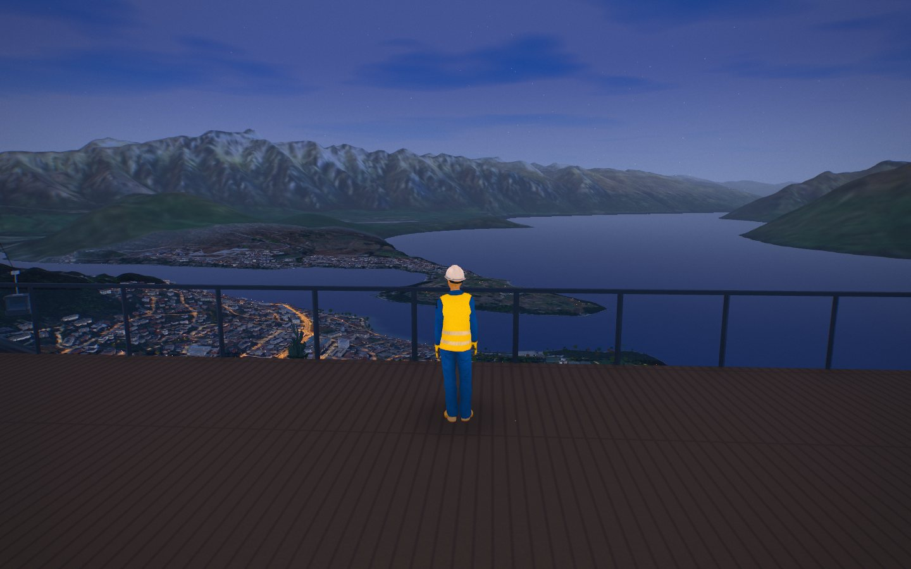 | 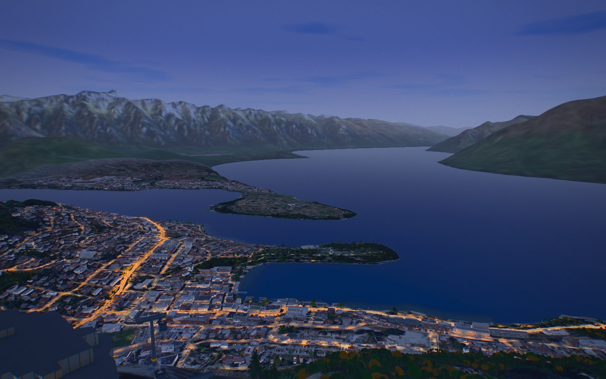 |
| **Day from Bob's Peak** | **The bay from the Fernhill side** |
| 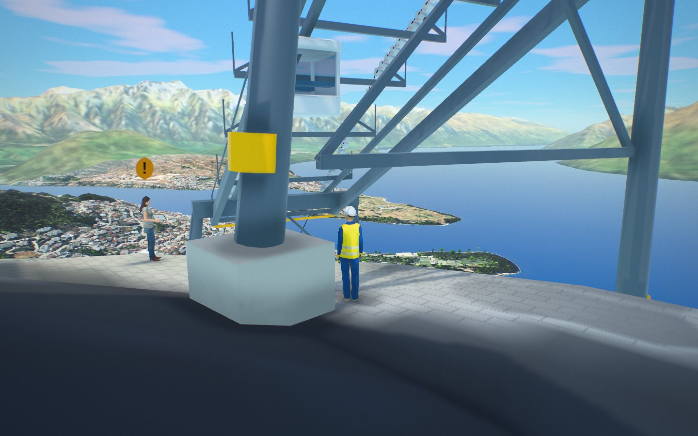 | 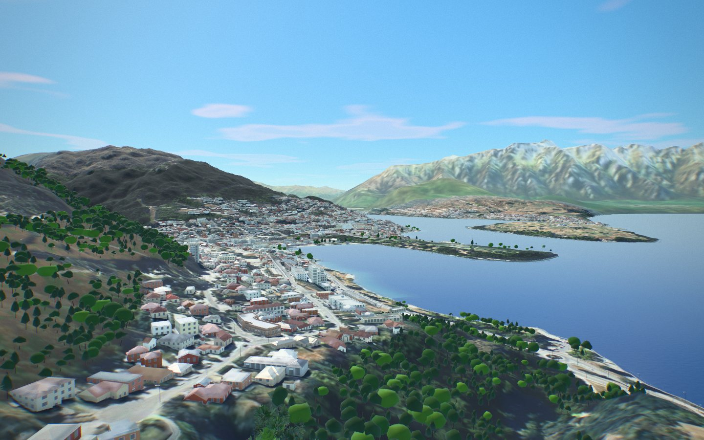 |
| **The TSS Earnslaw at Steamer Wharf** | **Night from Bob's Peak** |
| 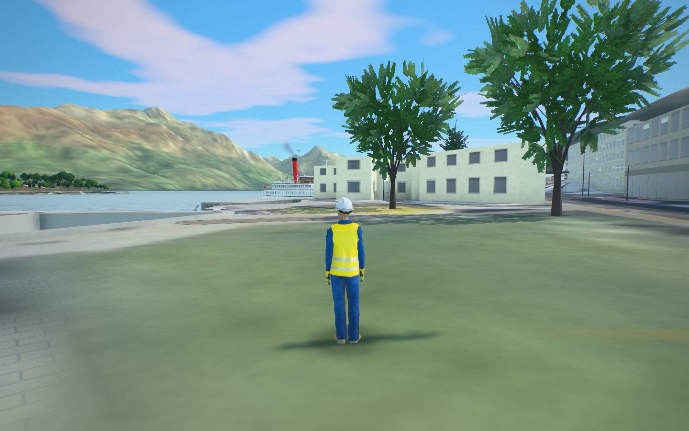 | 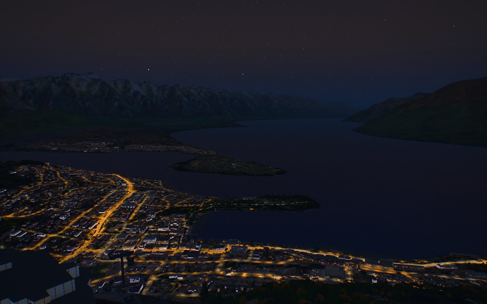 |
| **The Skyline Gondola and its towers** | **The Earnslaw (Blender)** |
| 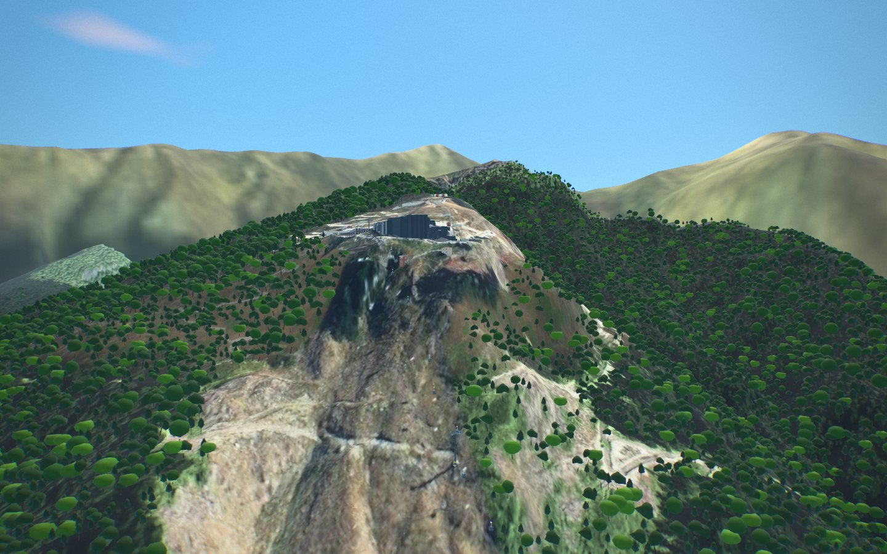 | 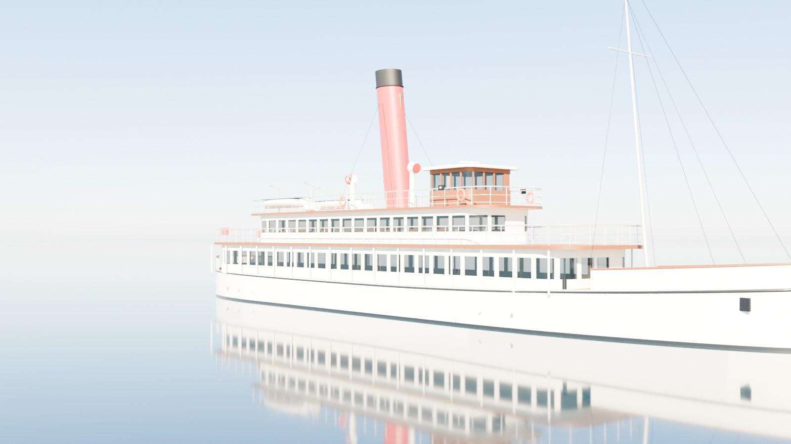 |

Phone (390 × 844), from the game's start on the Skyline deck: day, dusk, night.

| Day | Dusk | Night |
|---|---|---|
| 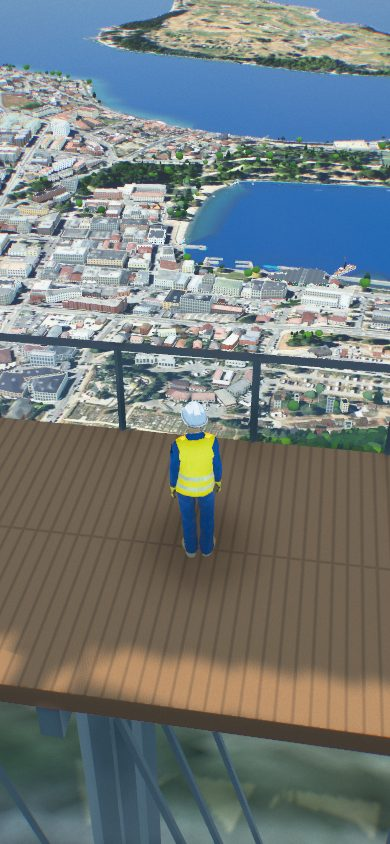 | 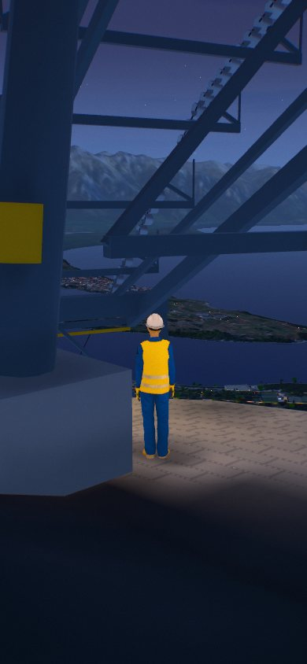 | 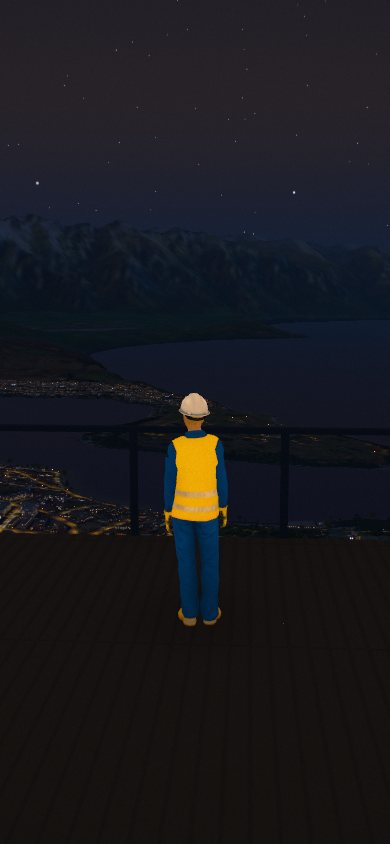 |

Open it from the globe, or at `web/index.html#queenstown`. The game is at `#play-queenstown`.

## 1. The reference

The owner set the bar with two photographs: the blue-hour view from Bob's Peak, with the town lit
amber under the snow on the Remarkables, and a clear day over Queenstown Bay from the Fernhill
side. The first is the place the town is best known for. It is where the game starts, and it is
the model viewer's opening shot. The second is the tour's second stop. Matched to them:

- **The start** is on the Skyline restaurant's viewing deck on Bob's Peak, facing south-east over
  the town, the bay, the Gardens peninsula and the Kelvin Peninsula to the Remarkables. The deck is a landmark (`cities/queenstown/city.py`, `DECK`):
  timber boards on a steel frame with a glass balustrade. The game walks it as a strip. Its place and level are measured. LINZ's 2026 aerial
  photographs show the crowd at its balustrade along the restaurant's south-east face. The 2021
  LiDAR surface model shows a strip 3–4 m deep and about 26 m long at 474.6 m, 17 m over the luge
  track and 4.8 m under the restaurant's roof. The model draws it 26 × 3.6 m. Skyline opened an
  extension in March 2026 that takes the deck from 68 to 430 m² (Otago Daily Times, 20 March 2026;
  the Queenstown Times gives 460 m²). The photographs were flown before it opened, and neither its
  plans nor newer imagery are published, so the larger deck is not drawn.
- **The way onto the deck.** The real deck is reached through the restaurant. The extension's five
  levels run from a lift level at the bottom to the deck on top (Otago Daily Times), and its builder
  describes a glass elevator on a structural steel frame (Naylor Love's project page). No source
  says where the lift stands: in November 2026 the opening coverage (ODT, Scoop, NZ Herald), the
  builder's page and Commons' April 2026 photographs from the luge were checked again, and none
  shows it. So the game still draws it where the deck's south-west end meets the luge track, 15 m
  below (`cities/queenstown/city.py`, `LIFT`).
- **The glass lift** (issue 265) is drawn as a panoramic machine-room-less traction lift, laid out
  from KONE's MonoSpace 700 planning guide and its Scenic brochure:
  - **The car** is 1,000 kg, 1.45 × 1.6 m and 2.35 m high. It is glazed on its long sides, with a
    stainless handrail 70 mm off the glass, a stone floor, a lit ceiling and a car operating panel.
    It has doors at both ends (through-car): the luge track's faces south-west, the deck's north-east.
  - **The shaft** is glazed in panes between slim graphite mullions and transoms, on 150 mm corner
    columns.
  - **Each landing door** has a stainless surround, a floor indicator and a call panel.
  - **The machinery**: the car rides T-rails in a sling with guide shoes. The counterweight runs on
    its own rails on the back wall against the hill, so the view side stays clear (the side
    counterweight scenic lifts use). The gearless machine and its sheave sit in the head under a
    louvred cap, and the pit stands on a concrete plinth on the luge track.
  - **The deck's balustrade** runs from each corner to the shaft's corner column and stops there.
  - **Riding it**: <kbd>E</kbd> at either door rides it in its car (`web/game/game.js`
    `rideLiftCar`). The car comes to you, the landing and car doors slide open, you step in and turn
    to the glass, and the car runs at 1 m/s, shortened to at most 8 s. The counterweight passes it
    the other way and the ropes pay out from the head, while the camera holds outside the glass.
  - Stills (llvmpipe, desktop tier, 1440 × 900; phone 390 × 844):

    | The lift from the deck | Riding it | Its foot on the luge track | The deck's LED strip at night | Phone, dusk |
    |---|---|---|---|---|
    | 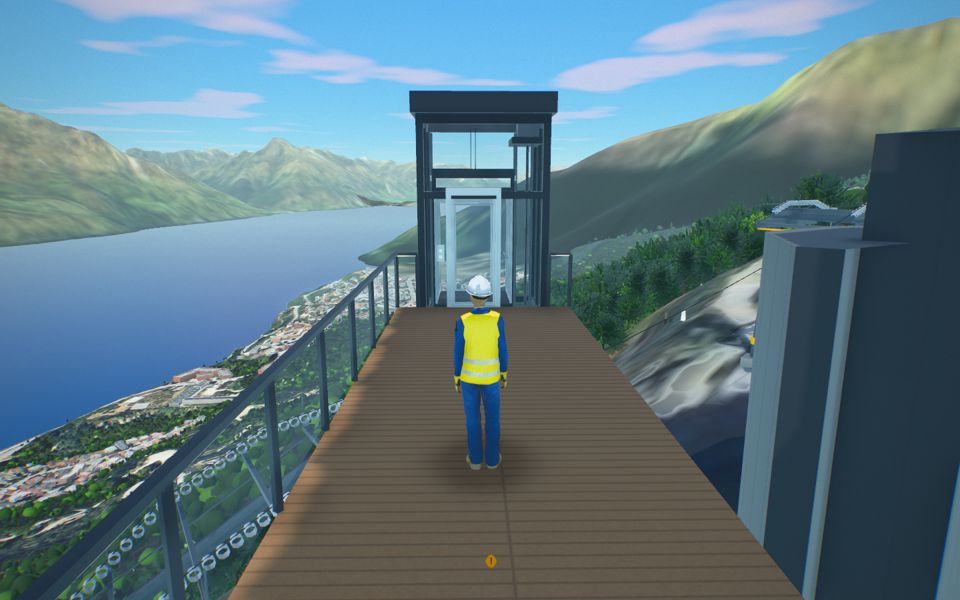 | 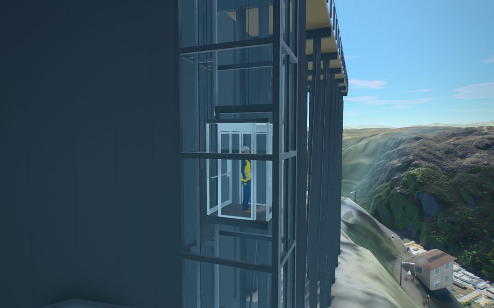 | 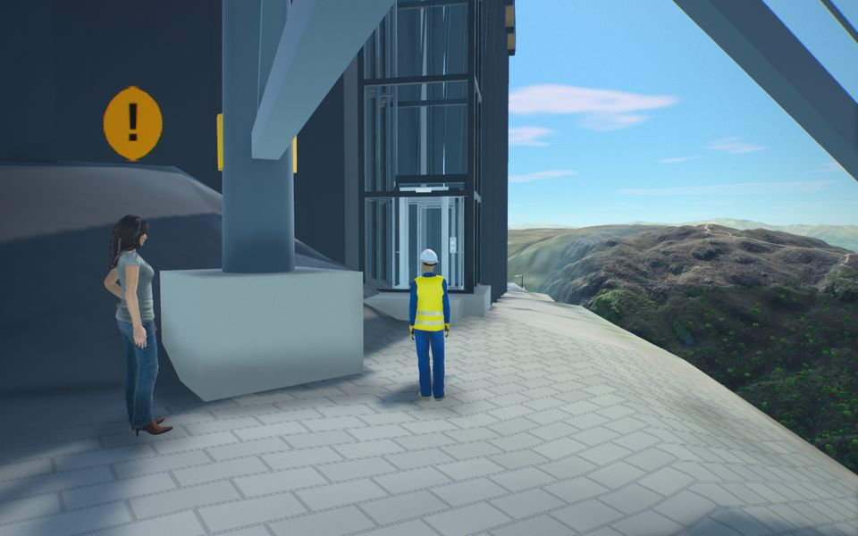 | 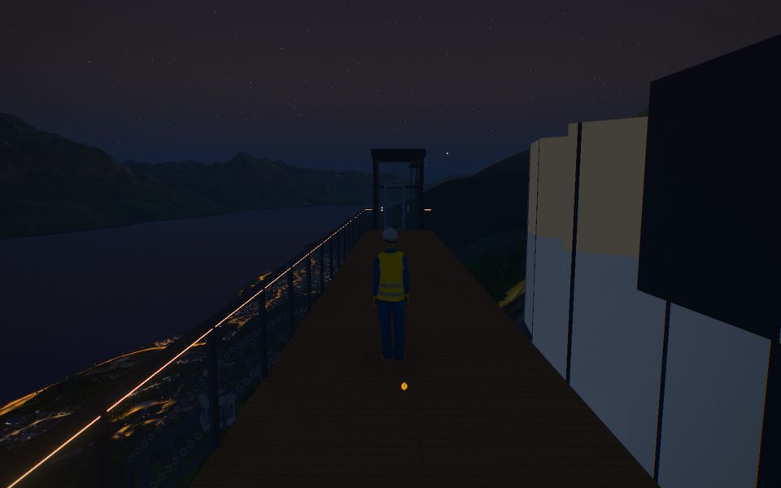 | 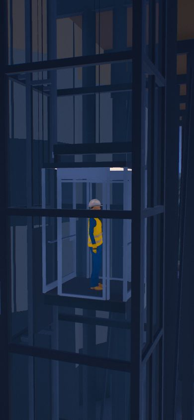 |
  - The game starts on the deck (`game.start.z`), and Aroha waits at the lift's foot, on the open
    luge track, where the welcome's gold line leads. No road reaches the deck's level, so a taxi
    meets you at the lift's foot: `tools/game_check.js` measures the start's kerb from there when
    the start stands at a lift's top.
- **The lake** is a saturated blue with turquoise over the shallows (`water.colour`,
  `shallow_colour`, `scatter`).
- **The air** is clear: `far.clarity` 2.2 stretches every haze distance (the fog and the far
  land's air), so the Remarkables 10 to 15 km away stand out as they do in the photographs. This
  is a chosen value. Any city can set it in far.json, through `far` in its city.json.
- **The light**: the city keys its own grade (`game.look.grade`): a brighter, more saturated blue
  hour, a vivid day and warm amber street lamps (`night.street`).

Games looked at for the arrival, for their design only: Microsoft Flight Simulator's photogrammetry
approach into Queenstown sets the town in its mountains. The vista points of open-world games such
as Assassin's Creed and Ghost of Tsushima start the player where the whole map can be read.
Nothing was taken from either but that idea.

| The deck, day | Dusk | Night |
|---|---|---|
| 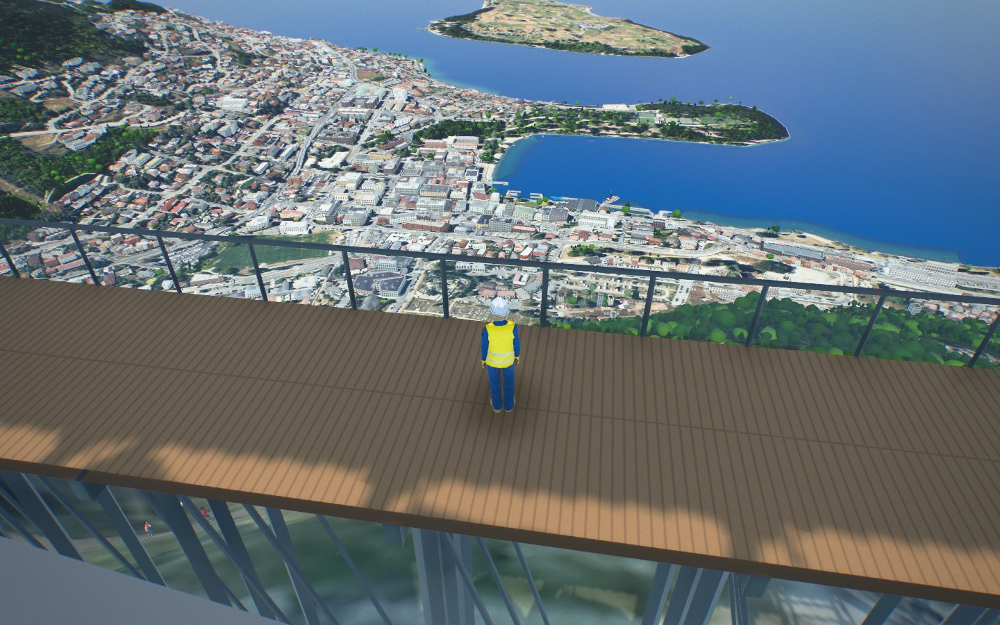 | 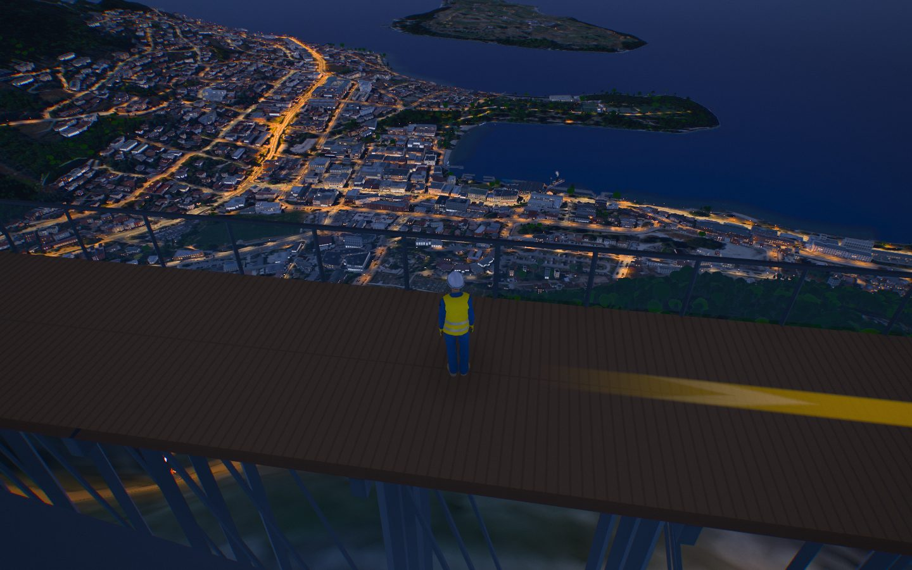 | 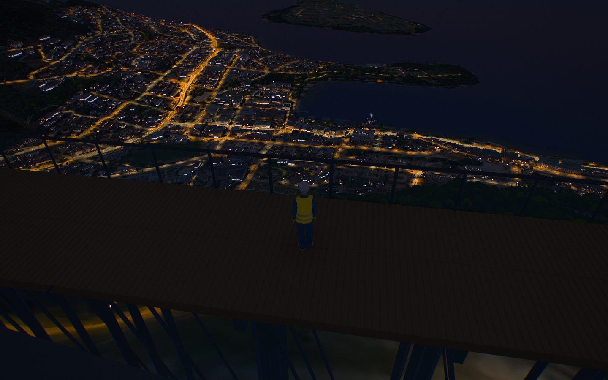 |
| **The glass lift from the luge track, day** | **Dusk** | **Night** |
| 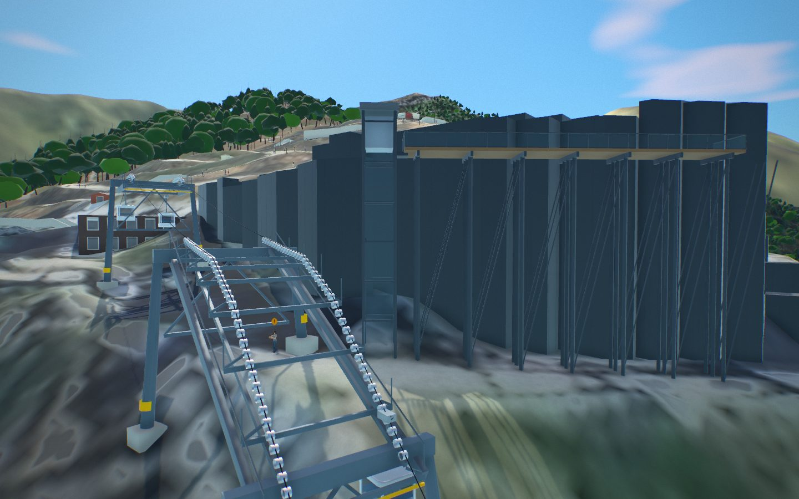 | 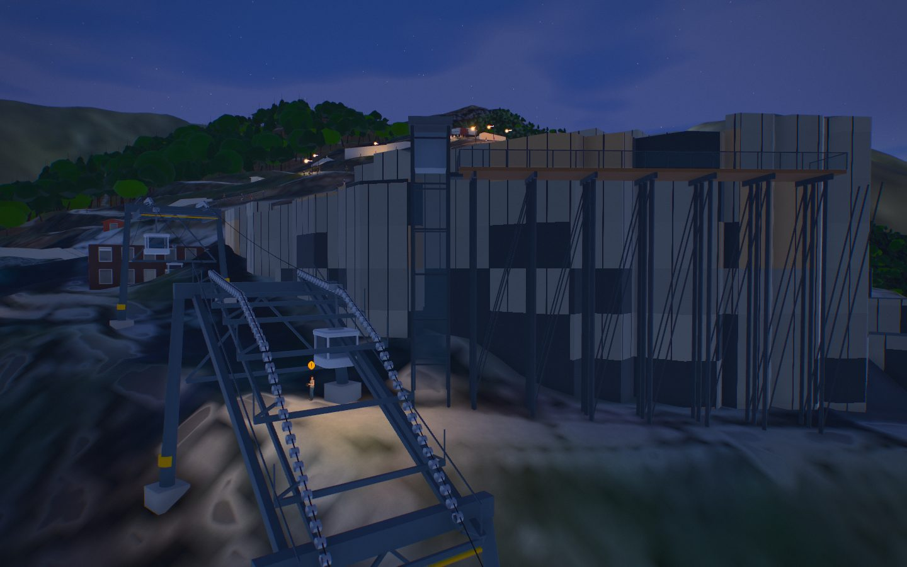 | 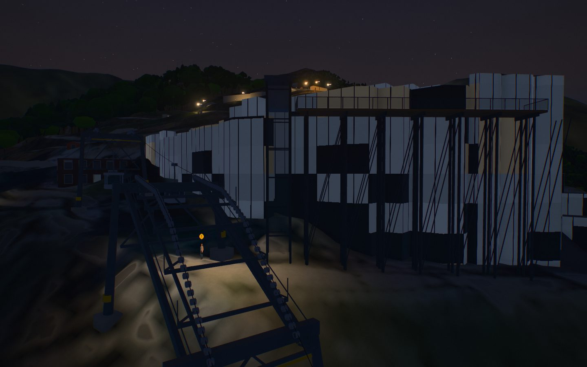 |

## 2. The data

| What | Source | Licence |
|---|---|---|
| Terrain | LINZ, Otago - Queenstown LiDAR 1m DEM (2021), flown 12–13 March 2021 for LINZ, Landpro and QLDC; COGs in NZTM2000 on `nz-elevation` (AWS) | CC BY 4.0 |
| Roofs | LINZ, Otago - Queenstown LiDAR 1m DSM (2021): the median of the surface model inside each footprint, over the lowest ground under it | CC BY 4.0 |
| Ground | LINZ, Queenstown 0.1m Urban Aerial Photos (2026), February–March 2026, read at 0.42 m from the COGs' overviews; the 2021 urban photos fill the rest | CC BY 4.0 |
| Footprints, roads, water, places | Overture Maps 2026-10-21.0 (OpenStreetMap and others) | ODbL and others, as Overture lists them |
| The gondola | OpenStreetMap `aerialway=gondola` with its stations (via Overture); the towers from LINZ's 2026 urban aerial photos (their plinths and shadows) | ODbL; CC BY 4.0 |
| Heritage landmarks | Heritage New Zealand Pouhere Taonga, New Zealand Heritage List entries 7439, 2341 and 2336 (read for facts, not copied); photographs on Wikimedia Commons (listed in section 3); the 2021 LiDAR for their outlines and heights | © HNZPT; CC BY-SA 3.0 / CC BY 2.0 / CC BY-SA 2.0; CC BY 4.0 |
| The land past the frame | LINZ, New Zealand Contour-Interpolated 8m DEM (read at 32 m); LINZ, New Zealand 10m Satellite Imagery (2025–2026); ESA WorldCover 2021; NASA Black Marble | CC BY 4.0; CC BY 4.0; CC BY 4.0; public domain |
| Climate | NIWA, Queenstown Airport, 1991–2020 normals (via Wikipedia's climate table) | — |
| Walter Peak (past the frame) | LINZ New Zealand Contour-Interpolated 8m DEM (no LiDAR covers it); LINZ Otago 0.15m Rural Aerial Photos (2025–2026), RGBNIR, 16-bit, read at 0.5 m; Overture Maps 2026-10-21.0: Lake Wakatipu, the wharf, the ferry terminal and the buildings | CC BY 4.0; CC BY 4.0; ODbL |
| The deck's access, the Earnslaw's run | Otago Daily Times (20 March 2026), Queenstown Times (5 June 2026), Naylor Love's project page; RealNZ's TSS Earnslaw and Walter Peak pages and insider guide | read for facts |

### New in the pipeline

- **LINZ COGs** (`terrain`, `surface_check` and `imagery` of type `stac_cog`, `pipeline/fetch_tiles.py`).
  The fetcher lists a STAC collection's items that meet the bbox and reads each over HTTP range
  requests, at the resolution asked. A decimated read takes the overviews, so 0.1 m photos come
  in at 0.42 m without downloading the full resolution. A boundless read would bypass the
  overviews, so the window is clipped instead. The imagery is cut into Web Mercator tiles, which
  the build reads as it reads an XYZ service. Nodata over the lake is set just under the lake's
  surface (`water_m`).
- **An inland lake as the scene's 0 m** (`datum_offset_m` 309.2). This is the median DEM height
  along the survey's water edge on the day the LiDAR was flown. The far land takes the offset too,
  so the lake past the frame is the water plane.
- **The far land, finer and measured** (`far` in city.json: `nh`, `nc`, `half_m`, `mesh`,
  `relief`, `colour`, `clarity`). A 1024 height grid over 72 km (70 m cells), a 640-line mesh, the
  national bare-earth DEM in place of the global surface model, and the satellite mosaic's colour
  in place of the land-cover palette. The mesh's size is read from far.json (`web/farland.js`).
- **Terraces from the LiDAR** (`cities/queenstown/gondola.py massing()`). The Skyline complex
  steps down the side of Bob's Peak. Drawn as one block it would stand 21 m tall over the lowest
  ground under it. Instead, its roof levels are read from the surface model in 3 m cells,
  quantised to 1.5 m and joined into 19 terraces, each standing on the ground under it
  (`massing.json`).

## 3. The landmarks

| **Eichardt's, day** | **Eichardt's, night** | **St Peter's at dusk, the lych-gate on the left** |
|---|---|---|
| 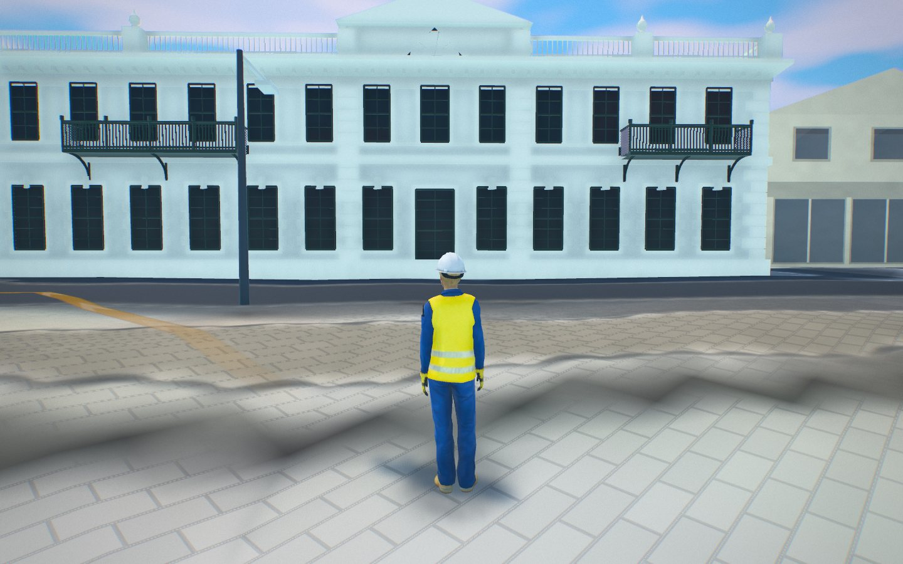 | 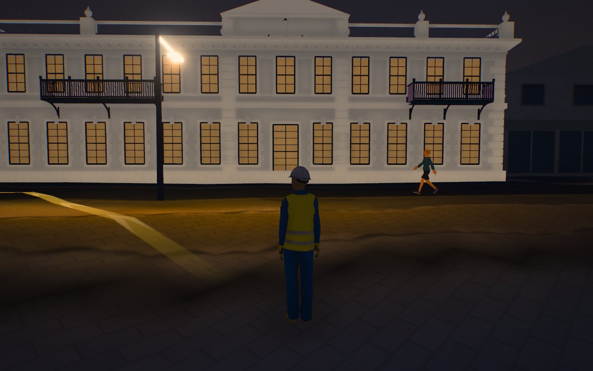 | 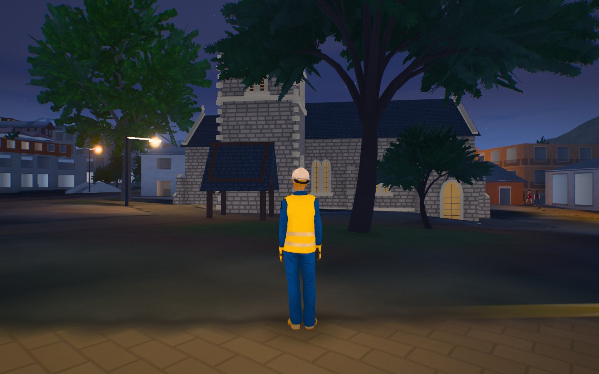 |
| **Williams Cottage** | **Steamer Wharf at dusk** | **From the Skyline deck** |
| 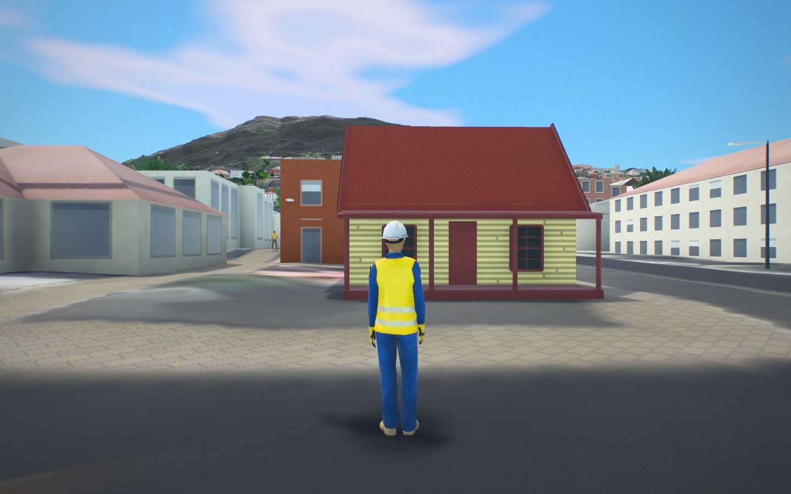 | 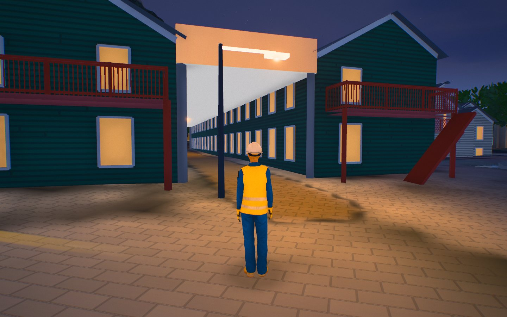 | 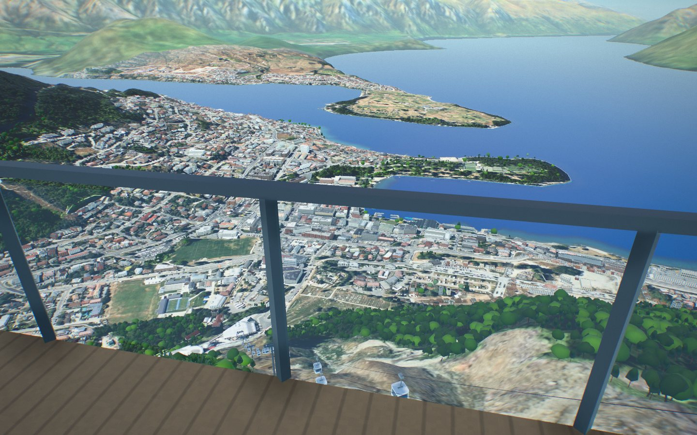 |
| **The gondola from the lake, night** | **Phone: Eichardt's, St Peter's, Steamer Wharf** | |
| 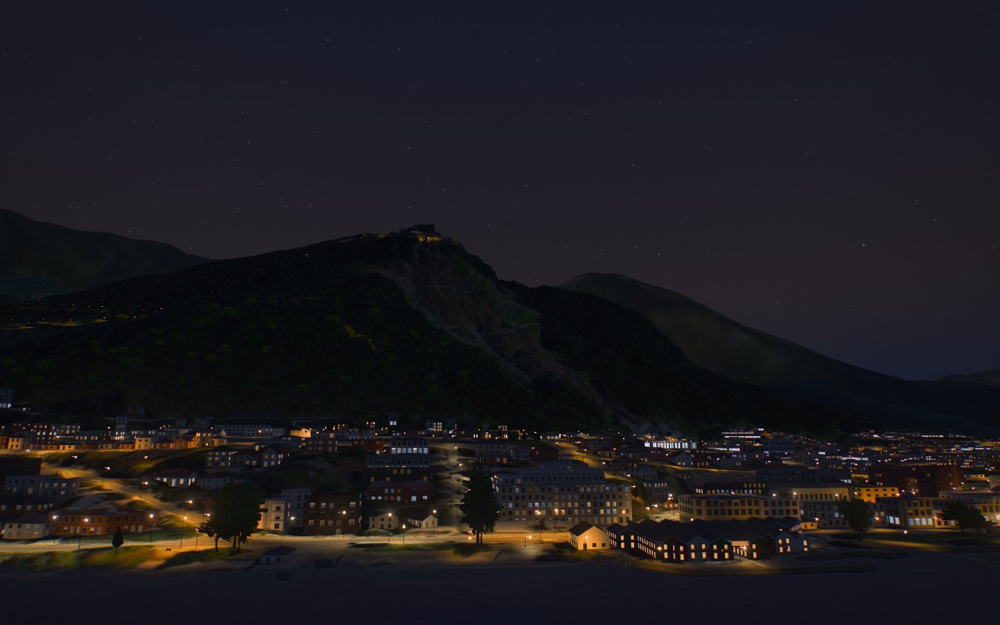 | 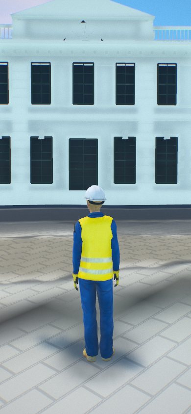 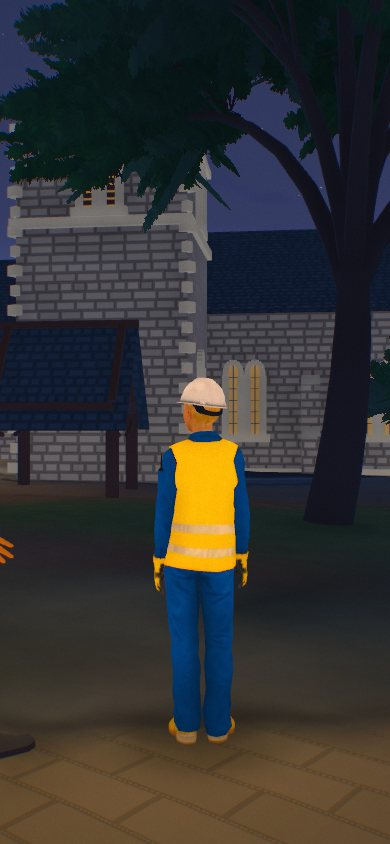 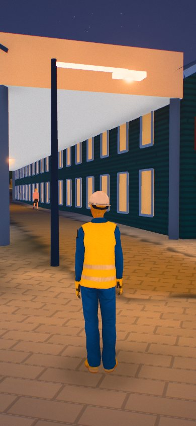 | |

The towers in LINZ's 2026 aerial photograph (CC BY 4.0), along the line (s, metres) and across it
(d): on the left, the big portal over the luge, its legs' shadows falling across the line; on the
right, the mast at 381.5 m, its white plinth at the foot of the shadow and its head displaced
downhill.

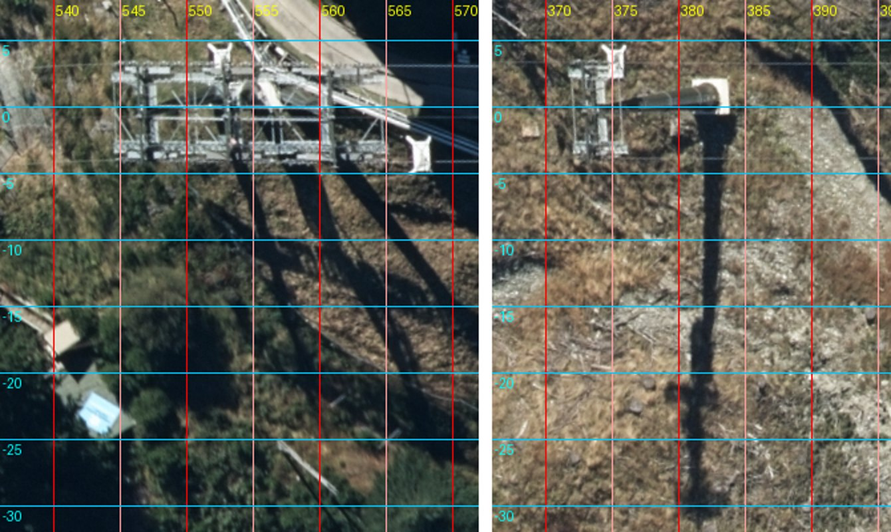

- **The Skyline Gondola.** Doppelmayr's 10-MGD D-Line opened on 29 June 2023: 35 ten-seat CWA
  Omega V cabins, 5 m/s, 760 m inclined and 438 m up (Doppelmayr's release, June 2023;
  lift-world.info). The line and its stations are OpenStreetMap's, measured by `gondola.py` into
  `gondola.json`. In plan the line runs 620 m from the Brecon Street station, 36 m above the lake,
  to the top station 430 m higher.
  - *The towers.* The 2021 LiDAR was flown before the line was built (2021–2023). Along it the
    laser caught the old line and the forest the new corridor was cut through, so it measures
    none of the new towers. The towers come from LINZ's 0.1 m urban aerial photographs of February
    and March 2026 (`gondola.py --photo`, `PHOTO_TOWERS`). Each tower's foot is a white concrete
    plinth on the line, where its shadow starts. Its head shows several metres downhill of the
    foot, because of the photograph's relief displacement. Its height is the length of its
    shadow: the head's shadow lies across the line from the foot, along the sun's azimuth. The sun
    is calibrated on coaches in the same photograph, in the Brecon Street car park: 3.65 m tall,
    3.05 m of shadow towards 212°. That gives 0.84 m of shadow per metre of height, the sun 50°
    up. Each shadow is followed down or up the slope on the 1 m DEM.
  - *What the photographs show.* There are six tower sites along the line, read to about half a
    metre along it. Three are tubular masts with a crossarm, at 97, 230 and 381.5 m along the line,
    16, 18 and 28.5 m high. Three are portals: a lattice frame on legs either side of the tracks,
    carrying long sheave trains where the line breaks over a crest. The first stands over the rock
    by the bottom station (32 m along, about 15 m high, an 11 m head). The second, the largest,
    stands over the luge (554 m, about 11 m over its foot, a 19 m head on two pairs of legs). The
    third stands under the top station (598 m, about 15 m high, an 8.5 m head).
  - *Ten or six.* Doppelmayr give 10 towers (lift-world.info and remontees-mecaniques.net repeat it, with
    the stations at 345 and 783 m, the drive at the top and the tensioning at the bottom). OpenStreetMap
    maps 6, at the same six sites. The photographs, at 0.1 m, show no other tower along the line; a tower
    10–30 m tall would cast a shadow 8–25 m long. No line profile or data sheet that breaks the count down
    is published, and none was found (November 2026). The big portal over the luge is one lattice head,
    21 m along the line, on two pairs of legs, its two white plinths either side of the line 12 m apart:
    one structure, so it is not split. The likeliest reading is that Doppelmayr count each portal's leg
    pairs or sheave trains, or the stations' own entry supports, as towers. The model draws the six
    structures the photographs show.
  - *The cable.* It sags 2.5% of each span. At 3.8 m, the lowest the cabins pass over the ground is
    just below the big portal, where the line comes over the luge.
  - *The cabins.* Omega V shells in light silver-grey with dark glazing bands (a 2023 photograph
    of the terminals, Thermosash). Their roofs are white in the 2026 aerial photographs.
  - In the game the cabins (`web/game/rail.js`, kind `gondola`) go up one side and down the other,
    slowing round each station's bullwheel, and you can ride one between the stations.
- **Eichardt's Private Hotel** (Heritage NZ List 7439; `heritage.py`). This is F. W. Burwell's
  Victorian Free Classical hotel of 1871–86, on the corner of Marine Parade and Ballarat Street.
  HNZ's listing gives its features: a symmetrical facade, a classical cornice with brackets,
  string courses at both floors, Gibbs surrounds on the ground floor, quoins and architraves, and
  a parapet concealing the roof.
  - *Size.* The model stands on the LiDAR's roof edges: 31 × 22 m, the parapet at 8.3–9.2 m, the
    pediment over the lake front's middle bay at 11.2 m.
  - *What the photographs add* (2010 and later, Wikimedia Commons): white plaster with rusticated
    quoins, thirteen bays to the lake, dark green sashes, cast-iron balconies on curved brackets,
    a balustrade with urns, and the pediment's shell between Baroque scrolls.
  - *What changed.* HNZ describe the 1929 alterations: a stepped Art Deco parapet in place of
    Burwell's balustrade, and a Moorish horseshoe arch over the Ballarat Street door, repeated on
    the balcony door above. The restoration after the November 1999 flood (reopened December
    2001) brought the balustrade back, as every photograph since shows, so the model has the
    balustrade and not the stepped parapet. It keeps the Moorish arch on both Ballarat Street
    doors. HNZ's text (List 7439) comes from a 1998 report, before the restoration, and QLDC protects
    the facade (District Plan, protected feature 136). No photograph or text found from after 2001
    shows whether the arch survived; Wikimedia Commons could not be searched from here (November 2026).
  - After dark, floodlights at its foot light the plaster.
- **St Peter's Anglican Church** (List 2341; `heritage.py`). Built in 1932 to J. McDowall Smith's
  design: "modelled on the traditional lines of the English parish church", its walls faced with
  greywacke from the lake edge (the parish's history).
  - *Plan and heights.* OpenStreetMap maps only a 13 m² square, which is the tower. The plan and
    the heights come from the LiDAR: a nave of 12 × 8.8 m with its ridge at 8.5 m, a narrower
    chancel to the east-north-east with its ridge at 7.7 m, the square tower on the north side,
    its battlements at 9.4 m, a west porch and a vestry.
  - *From a photograph* (John Harwood, 2007, CC BY 2.0): the rubble walls with pale freestone
    dressings, the steep slate roofs, paired lancets with leaded lights between buttresses, the
    tower's louvred belfry lancets, and the octagonal slate spire with its cross. The spire's tip
    is drawn at 17 m; the LiDAR caught 15.2 m below the point. A 1 m surface model rarely returns the
    tip of a slender spire, and no height is published, so the drawn height stands.
  - *The lych-gate* is in memory of Thomas Hicks (the parish). QLDC protects it (District Plan,
    protected feature 39) on the church's lot at the corner of Camp and Church Streets: the lot's
    address, not the gate's own place. It is drawn in oak under a slate gable, on the path beside the
    tower, where the LiDAR shows a 4–5 m roof over the path, 23 m from Camp Street.
- **Williams Cottage** (List 2336; `heritage.py`). 1864, with a lean-to of 1866, and "believed to
  be the earliest remaining cottage in Queenstown".
  - *From HNZ's conservation-plan text:* painted weatherboards, a very high gabled roof of
    corrugated iron, a stone chimney between the main roof and the lean-to, a verandah to the
    front, four-paned windows under it and six- and twelve-paned sashes elsewhere, and a later
    rear room with another massive stone chimney.
  - *From the LiDAR:* the ridge at 5.9 m and the eaves at 2.7 m.
  - *The stone store room.* HNZ: "a small stone store room is situated to the side". The mapped
    footprint stands out 3 m from the lean-to's north-east wall, about 2.6 m wide, and the model draws
    it there: schist rubble under an iron skillion falling away from the cottage, a plank door in its
    end wall.
  - *From a photograph* (Schwede66, Wikimedia Commons, CC BY-SA 3.0): cream boards, oxblood
    joinery, a red roof, schist chimneys with brick tops, and the rear chimney's tall black flue.
- **Steamer Wharf** (`heritage.py`). The waterfront pavilions by the Earnslaw's berth, by Wyatt +
  Gray.
  - *Form.* Two-storey weatherboard pavilions with their gables to the lake, in green, oxblood and
    cream with white trim, grey iron roofs, and orange-red balconies and stairs (Tim J Keegan,
    2011, CC BY-SA 2.0). The model splits OpenStreetMap's two blocks into pavilions about 7 m
    wide, eaves at 5.6 m and ridges at 7.7 m (the LiDAR's).
- **The TSS Earnslaw** (`blender/build_vehicles.py`, `ferry_steamer.glb`), 51.2 × 7.3 m with
  2.1 m draught (Wikipedia, citing the NZ National Maritime Museum). The model has a plumb stem,
  a white hull with a red boot-topping and portholes, glazed main and upper saloons, an open
  promenade, a varnished kauri wheelhouse forward on the boat deck, and the raked red funnel with
  a black top. Wikipedia and RealNZ say red since the 1984 refit. The black top is not in a
  source and is drawn from photographs. She also has cowl ventilators, a whistle, the mast and
  stays, two lifeboats in davits, liferafts, lifebuoys, an anchor and capstan, and the ensign
  aft. She is shared, like the other ferries. In the game (`ferry_style.model: "steamer"`) she is
  single-ended: she lies alongside as she came in, swings round slowly once under way, sails bow
  first, and puffs coal smoke from her funnel.

The heritage landmarks are drawn in place of their mapped blocks, which stay in the surface model
for the shadows and the analyses (landmarks.json `hidden`).

## 3b. The Earnslaw to Walter Peak

| The Earnslaw on her way, past the frame | At Walter Peak |
|---|---|
| 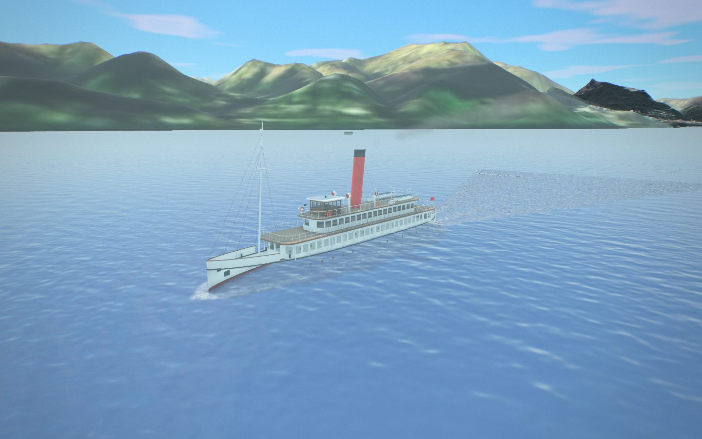 | 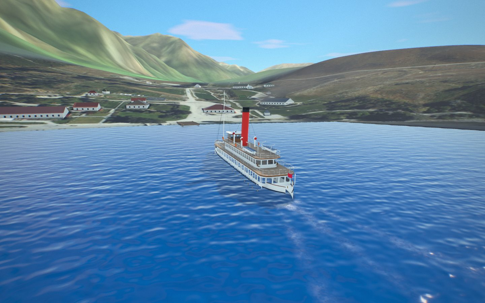 |
| **Walter Peak at dusk** | **The Colonel's Homestead, on foot** |
| 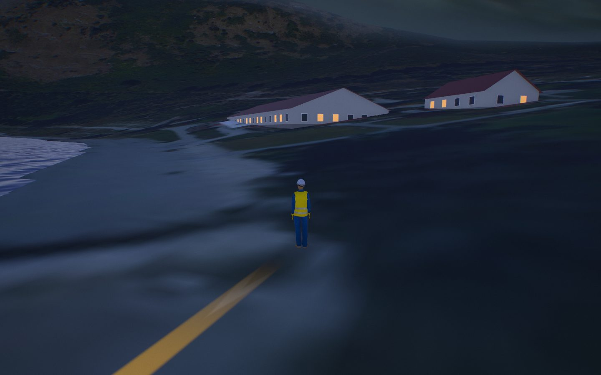 | 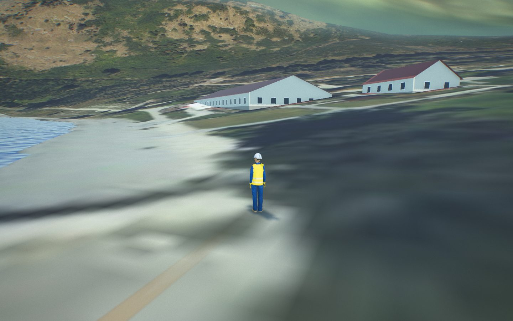 |

The Earnslaw's real run is to the Walter Peak wharf in Beach Bay, in front of the Colonel's Homestead,
about 45 minutes each way (RealNZ). The wharf is 13 km from the town, well past the map's frame
(`pipeline/outposts.py`, `web/outposts.js`, shared by any city):

- **The route.** The leg is routed over Overture's Lake Wakatipu on a 10 m grid from the frame to the
  far wharf (inside the frame over the game's own water), keeping 30 m off the shore out on the lake:
  12.5 km, straight down the open lake past Cecil Peak, as OpenStreetMap's "TSS Earnslaw Cruise" line runs.
- **The crossing.** At her 13-knot service speed she takes about half an hour, where the real cruise takes
  45 minutes: the game keeps her rated speed rather than slowing her to the timetable. <kbd>F</kbd> skips
  the crossing in about 40 s, and the wait for her at a wharf passes in about a minute at most.
- **Walter Peak.** A tile 1.07 × 0.89 km on a 2 m grid: LINZ's 8 m national DEM (no LiDAR covers it),
  smoothed a little on land to take out its contour terraces, under LINZ's 2025–26 0.15 m rural aerial
  photographs read at 0.5 m. The lake's bottom shelves to 6 m, as the far land's lake does, so the water
  matches at the tile's edge. The far land is cut round the tile with grid lines on its box, and the tile's
  outer 70 m blends to the far land's own surface, so there is no seam.
- **The wharf** is Overture's pier at the ferry terminal, a timber deck on piles 1.3 m over the lake that the
  game walks as a strip. Her berth is alongside its outer half.
- **The buildings** are Overture's 18 footprints round the homestead: weatherboard walls with window bands
  and a pitched roof, gabled on a long building and hipped on a squarer one, each on its footprint's
  oriented rectangle. The roofs' colours are the photograph's; the walls' colour and the heights are judged
  (the homestead's eaves at 3.2 m and ridge at 7 m), as no survey covers them.
- **The walk.** Callum's lake quest sails there, walks up to the Colonel's Homestead and sails back.

| The crossing at dusk | At night | Walter Peak at night |
|---|---|---|
| 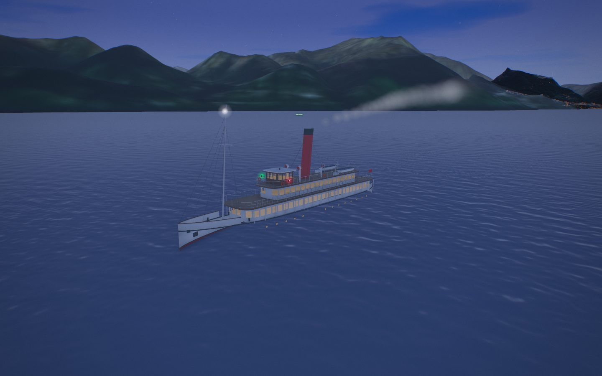 | 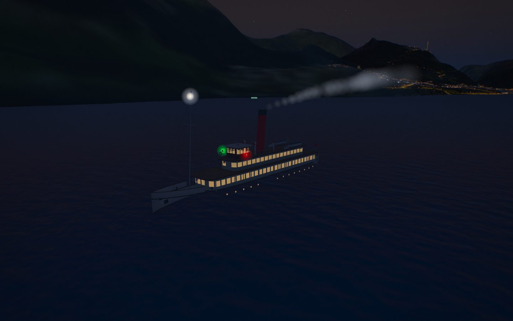 | 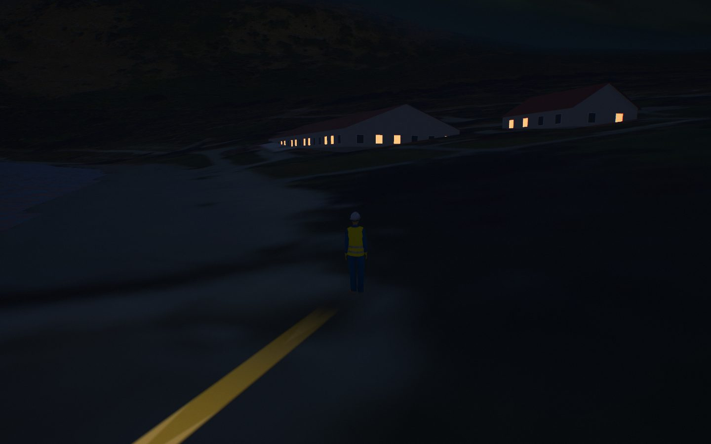 |

Phone (390 × 844): the crossing and Walter Peak, day, dusk and night.

| | Day | Dusk | Night |
|---|---|---|---|
| The crossing | 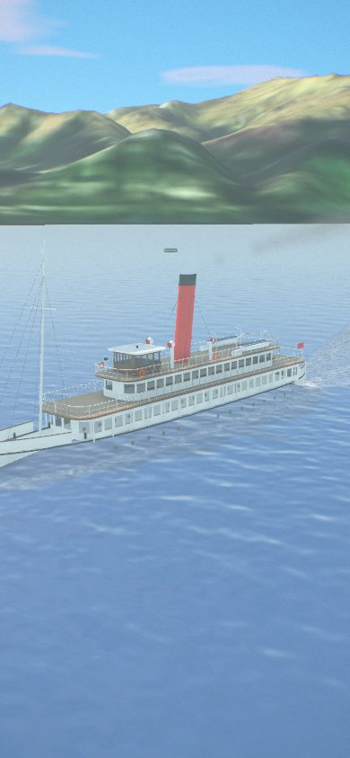 | 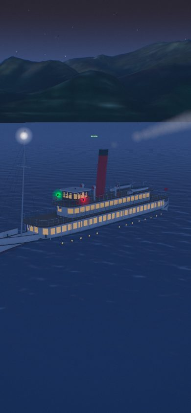 | 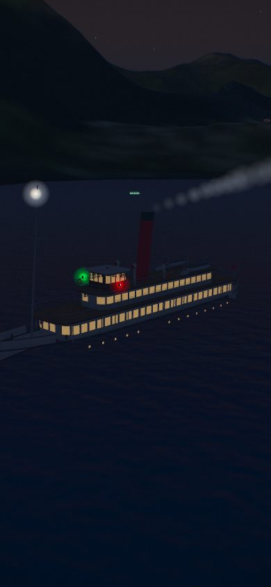 |
| Walter Peak | 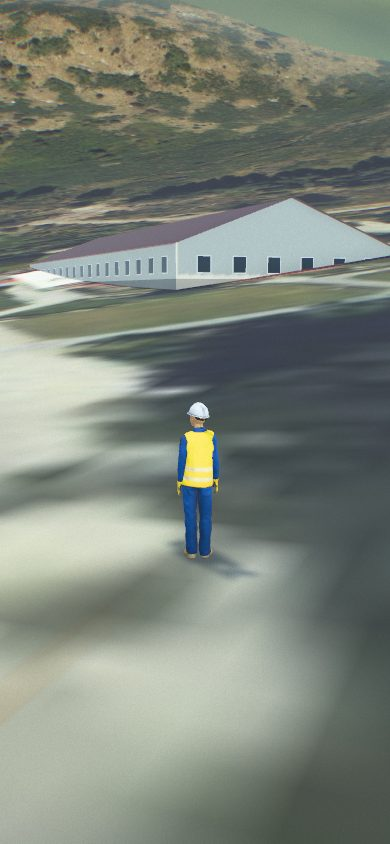 | 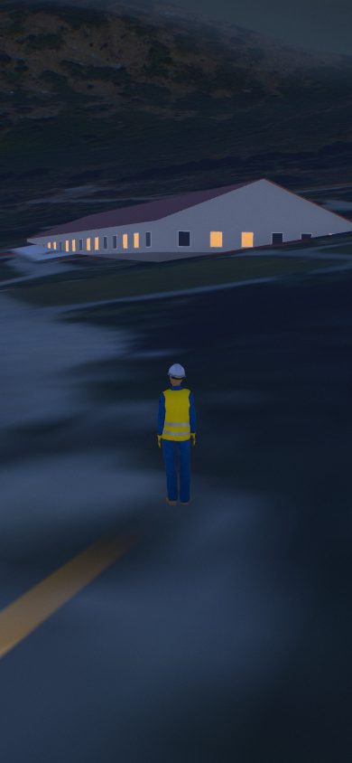 | 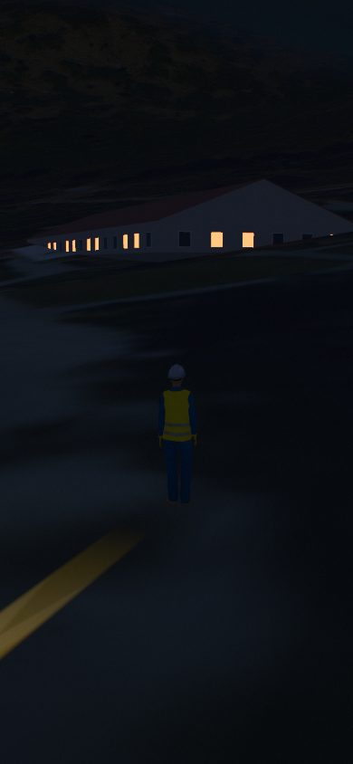 |

## 4. Queenstown on Foot

You start on the Skyline deck on Bob's Peak. Aroha waits at the foot of the glass lift on the luge track below, and there are three walks, in any order:

- **The hill.** Hemi, further along the hillside, keeps you there until the Remarkables turn pink
  ("Wait here till dusk" sets the time). Then you ride the gondola down to Mei at Brecon Street,
  and back up.
- **The lake.** Callum, at Steamer Wharf, puts you on the Earnslaw to Walter Peak, past the map's
  edge; you walk up to the Colonel's Homestead and sail back. Then you walk Marine Parade past Eichardt's to Williams Cottage
  and out to the point of the Gardens.
- **The air.** Sophie flies from the Recreation Ground.

Your car waits at Brecon Street by the gondola's bottom station (`start.car`). Skyline Road, the
service road up Bob's Peak, is mapped as a track, and so is the unnamed track that carries it down
to Lomond Crescent. The game drives both (`drive_named`, `drive_tracks`), so a taxi can come up to
the top. The real road is private.

The Earnslaw sails her real run, to Walter Peak (section 3b), and `ferry_note` says how its time
differs. The lines
are sourced: Tāhuna, "shallow bay"; Rākaihautū and the lake; the seiche (26.7 min, about 200 mm,
told as the giant's breathing); William Rees's woolshed, which became Eichardt's; the Earnslaw
built in Dunedin, carried in pieces by rail to Kingston and launched there in 1912, burning about
1.5 t of coal a return trip (RealNZ).

## 5. The woods' cost

The canopy model plants 152,829 trees, most of them in the woods on Bob's Peak and Ben Lomond's
lower slopes. That is about ten times any other city. `tools/woods_probe.js` measured them on
llvmpipe at 1440 × 900, standing at four spots:

| Spot | High | Medium, before | Medium, now | Low |
|---|---|---|---|---|
| By the top station (-1046, 450) | 4.12 M | 4.12 M | 2.48 M | 0.77 M |
| Halfway up the line (-700, 380) | 2.53 M | 2.53 M | 1.75 M | 0.58 M |
| Brecon Street (-460, 290) | 1.32 M | 1.32 M | — | 0.34 M |
| Eichardt's (-100, -200) | 0.28 M | 0.28 M | — | 0.07 M |

The figures are the tree triangles drawn in a frame. The trees add 44 to 70 draw calls (692
against 648 by the top station on high). On llvmpipe they took a frame from about 3.0 to 5.0 s
there on high. llvmpipe's frame times jump about between runs, so the triangles are the figure to
compare.

Most of the triangles are the woods' far ring: about 32,000 far crowns, each with its trunk, past
200 m. The medium tier drew exactly what the high tier drew. Now the tier sets the share of a
wood's far crowns it draws (`OEQuality.city().woods`, `web/trees.js` `farKeep`): all of them on
high, half on medium. Low already keeps a third of the woods' trees and draws them nearer. The
photograph's canopy under the woods (`woodsFloor`) carries the hillside where the crowns thin. The
change applies to every city's woods; Queenstown's are where it counts.

## 6. Checks

- Heights: 3,831 of 4,117 solids are measured by the LiDAR, and 240 are estimated from their
  neighbours. These are mostly buildings that went up after the March 2021 flight: 119 footprints
  have no roof in the surface model (`analysis/lidar_heights.json`).
- `tools/game_check.js queenstown`: walk, talk, the helicopter, the Earnslaw, the car, a taxi and
  a ride, the junctions, rain, and a lost WebGL context; the glass lift up and down; the kerb for a taxi
  from the lift's foot; the crossing to Walter Peak (skipped in 56 s), ashore on its wharf, and the walk
  to the Colonel's Homestead; the lake quest's walk there has ground to stand on.
- Stills of each landmark at street level, of the gondola from the lake and from the deck, of the deck
  and its lift, of the Earnslaw on her way and at Walter Peak, and of Walter Peak on foot: desktop
  1440 × 900 and phone 390 × 844, day, dusk and night, on llvmpipe at the desktop tier.
- Not checked: a real GPU, WebGPU, Safari or iOS.

## 7. Limitations and follow-ups

- **The deck.** The 430 m² deck Skyline opened in March 2026 is still not drawn. Its plans are not
  published, the aerial photographs predate it, and no photograph found (Commons to April 2026, the
  opening coverage) shows its outline. The press gives its area (430 m², or 460 m² in the Queenstown
  Times) but not its shape. Skyline says it reaches its full size only when the old complex is
  rebuilt, around 2028–29. The glass lift's place is judged; the restaurant's interior, through
  which the real deck is reached, is not modelled.
- **The gondola's towers.** Doppelmayr give 10 (lift-world's data sheet too: 760 m inclined, 438 m
  of rise, 35 cabins at 5 m/s). The photographs show six structures, and those are what is drawn.
  The ODT's report of the build says three towers were flown in by helicopter and seven set by crane
  and digger, but no published profile or data sheet places them or gives their heights, and
  counting the portals' leg pairs as towers gives seven, not 10.
- **The heritage landmarks.**
  - Eichardt's Moorish arch is drawn although no photograph since 2001 shows it.
  - St Peter's lych-gate stands where the LiDAR shows a roof over the path; QLDC's listing gives
    only the lot. The spire's tip at 17 m is the drawn height, not a measured one.
  - Neither church nor cottage has its interior.
- **Walter Peak.** No LiDAR covers it, so its ground is the 8 m national DEM, and its buildings'
  heights, walls and forms are judged; the gardens' trees are only in the photograph. The crossing
  runs at the Earnslaw's service speed (about 30 minutes) rather than the timetable's 45.
