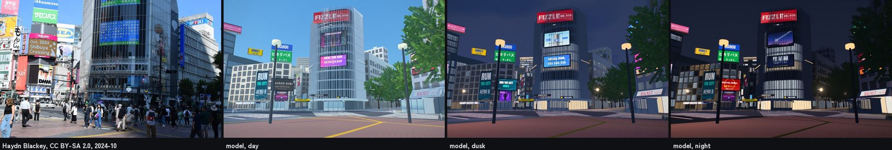
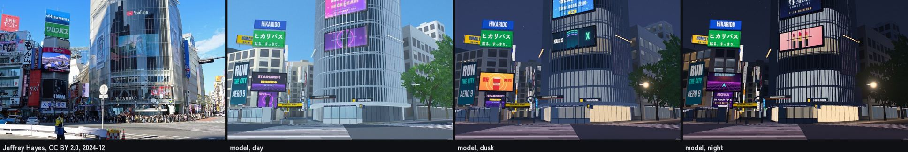
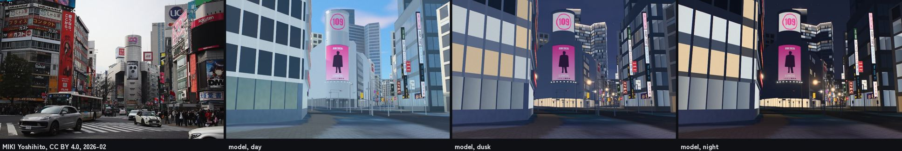
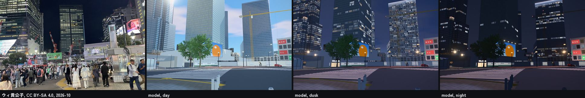
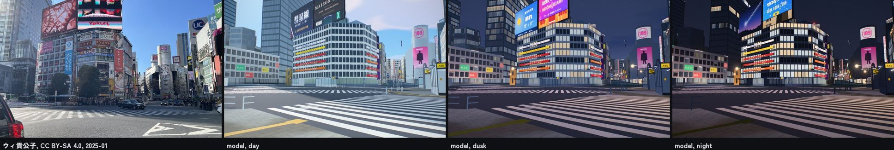

# Shibuya: SHIBUYA SKY, the scramble and a game's Tokyo

A map of Tokyo ([Tokyo as maps](tokyo-maps.md)): Sangenjaya to Shibuya, Harajuku, Yoyogi Park and Meiji
Jingu. It is the real city first: Overture's footprints at the heights Project PLATEAU surveyed, on
GSI's laser-scanned bare earth, under the real sun. On top of that sit the places a game made famous,
ten years on: Shibuya's scramble, Center Gai and Sangenjaya's backstreets are the streets *Persona 5*
(2016) redrew as its Tokyo. This note records how those places were built, from what, and what is not
known. Every number comes from the scripts in `pipeline/` and `analysis/` run with `--city shibuya`;
outputs are in `cities/shibuya/analysis/`.

Until November 2026 the map ran on north to Shinjuku and Yotsuya; that half is now the
[Shinjuku map](shinjuku.md), with Suga Shrine's stairs, Kabukicho and the east exit. The two share one
frame, and the landmarks of both are built by `cities/shibuya/city.py`. The overview below was taken
before the split.


| SHIBUYA SKY: SKY EDGE at sunset | Riding up from 46F |
|---|---|
|  |  |
| **The roof: GEO COMPASS, the escalator's well, the hammocks** | **CROSSING LIGHT** |
|  |  |
| **The scramble** | **Center Gai's arch at dusk** |
|  |  |
| **Sangenjaya after dark** | **Walking into Shibuya: the station sign, Hachiko and Aoi** |
|  |  |

## 1. The short answer

- **Scope.** 4.45 × 4.0 km (`extent_m` −2700 to 1750 east, −3100 to 900 north of 139.6965 E,
  35.6685 N), from Sangenjaya in the south-west to Harajuku and Meiji Jingu in the north: 47,787
  buildings in 49,880 solids. 881 of them are PLATEAU buildings that Overture does not have.
- **Heights.** 87.4% of the footprint area stands at a PLATEAU surveyed height, 2.6% at an
  OpenStreetMap height, 1.0% at a floor count and 9.0% at an estimate from the neighbours.
- **Terrain.** GSI's 5 m airborne-laser DEM. Against GSI's elevation service at 518 points it agrees
  to a median of −0.01 m, and 97.7% within a metre. AWS's global Terrarium tiles read 6.0 m too high
  at the median, because they are a surface model.
- **SHIBUYA SKY.** The open roof of Shibuya Scramble Square, 229 m up: deck, glass
  fence, SKY EDGE, GEO COMPASS, CLOUD HAMMOCK, the escalator from 46F and the 18
  searchlights. In the game you take the lift up and ride the escalator out.
  Section 5.
- **A game's Tokyo, as it is.** The scramble's crossings and Hachiko, the Center
  Gai arch, the big screens and SHIBUYA109, Sangenjaya's lanes, and shop signs and
  utility poles in the neighbourhoods. Section 6.
- **Game.** *Tokyo Pilgrimage: Shibuya*: a welcome at Hachiko, then two walks in any
  order. Section 7.

## 2. Sources

| Layer | Source | Licence |
|---|---|---|
| Building heights, massing | Project PLATEAU Tokyo 23 wards LOD2 (MLIT), read as the vector tiles published by indigo-lab | CC BY 4.0 (PLATEAU), MIT (tiles) |
| Footprints, names, roads, steps, water, parks | Overture Maps, release 2026-10-21.0 (OpenStreetMap) | ODbL |
| Terrain | GSI DEM5A, 5 m airborne laser survey, bare earth (10 m DEM where 5A has no data) | GSI terms of use |
| Aerial photos | GSI seamless photos, zoom 17 | GSI terms of use |
| Street detail round the scramble: entrances, crossings, kerbs, tactile paving, the police box, the JR tracks | OpenStreetMap API, fetched 2026-11-03 (`pipeline/osm_detail.py`, `cities/shibuya/scramble_osm.json`) | ODbL |
| Crosswalk widths and positions | GSI seamless aerial photos, zoom 18 (`tools/aerial_local.py`) | GSI terms of use |
| Reference photographs (compared against, not used as textures) | Wikimedia Commons, 2019-26, listed in section 6b | CC BY 2.0 / 4.0, CC BY-SA 2.0 / 4.0, CC0 |
| Lettering on ema, plaques and signs | Google Fonts (Yomogi, Zen Kurenaido, Klee One, Yuji Syuku, Shippori Mincho, DotGothic16, RocknRoll One, Ma Shan Zheng, ZCOOL KuaiLe, Long Cang, LXGW WenKai TC, Nanum Pen Script, Caveat, Kalam) | SIL Open Font License |

## 3. Heights and terrain

PLATEAU covers the whole area; `pipeline/build_scene.py` cuts each Overture
footprint along PLATEAU's roof faces, as in [Tokyo](tokyo.md#3-how-plateau-is-used).

- **PLATEAU against OpenStreetMap.** Where both have a height, OpenStreetMap's is a median factor
  of 1.07 from PLATEAU's (90th percentile 1.30) over 3,970 buildings (`height_model.json`). The
  largest misses are a tag on the wrong part and buildings OpenStreetMap maps as a single height
  where PLATEAU has the tower.
- **The estimate.** 9.0% of the footprint area, mostly small buildings PLATEAU's
  tiles miss. The neighbour estimator's cross-validated median error factor is
  1.18 (90th percentile 1.72).
- **Terrain.** `analysis/dem_check.py` samples GSI's elevation service, which
  serves the 1 m laser DEM where it was flown and DEM5 elsewhere, at 518 points:
  median difference −0.01 m, 90th percentile 0.31 m, 97.7% within 1 m. That is the
  same agency's survey, so it checks the reading of the tiles more than the
  survey.

## 4. SHIBUYA SKY

The open deck on the roof of Shibuya Scramble Square (opened 1 November 2019):
about 2,500 m² at 229 m. Visitors ride the lifts of SKY GATE from 14F to 45F at
360 m a minute, and climb from the 46F gallery to the roof on an escalator walled
in glass.

- **The deck** is put at PLATEAU's lower roof tier (227.1 m above the ground) and
  GEO COMPASS reaches its top tier. Scramble Square's solids each stand on their
  own ground, a few centimetres apart; their heights are set so that every top is
  at one level, the one the deck is drawn at, so feet, boards and the escalator
  meet. PLATEAU has a 190 m² band along the west and north edges 9 m lower; it is
  under the edge of the deck here and is raised to it.
- **On the roof:** the deck boards, the glass fence on steel posts (lowest at SKY
  EDGE, the corner over the scramble), light lines in the floor fanning out to
  that corner, GEO COMPASS (a raised square with a compass on its floor and steps
  up each side), CLOUD HAMMOCK's nets, and the 18 searchlights of CROSSING LIGHT,
  which the light show turns on after dark.
- **The escalator** rises 5.5 m at 30° from a landing on 46F, in a well cut into
  the roof, with glass balustrades and black handrails. In the game it is a
  walkable surface that moves at 0.5 m/s: stand on it and it carries you up.
- **Estimates.** The plan of the roof furniture is drawn from photographs and the
  GSI aerial photo, whose view of the tower leans. The escalator's rise, angle and
  speed and the fence heights are estimates.

## 5. A game's Tokyo, as it is

*Persona 5* drew its Tokyo from these streets and renamed some of them: Sangenjaya
became Yongen-Jaya, and Center Gai became Central Street. The model keeps the real
names and the real geometry, and leaves out what belongs to the game: no
characters, logos, invented shops or interface. What is built:

- **The scramble.** Its street, buildings and signs are built at street level in
  section 6b. Hachiko sits on his pedestal (the statue since 1948), with its plaque.
- **Center Gai's gate** and **SHIBUYA109** are in section 6b, the big screens in section 6.
- **Sangenjaya**, the triangle between Setagaya-dori and Route 246: the front of a
  snack bar the game's café is drawn on (New Marina), the bathhouse Chiyo-no-yu
  with its noren, the coin laundry and vending machines beside it, the meat shop on
  the corner, and utility poles with their wires down the lanes. The Carrot Tower
  stands over it in its own colour.
- **Shinjuku's** arch, screens and clock are in the [Shinjuku map](shinjuku.md).
- **Signs.** Shop signs on street fronts in Center Gai, Udagawacho, Dogenzaka and Sangenjaya. They are
  indicative, not the real shops' signs. A blade sign's two faces each stand on the side they
  face, so both read the right way round (`tools/sign_check.py` checks every city's), and blades
  from the facing walls of a narrow lane do not cross.

- **The crossing after dark** is section 6.

Two things are left out on purpose: the Godzilla head on the Toho building and
Okamoto Taro's mural *Myth of Tomorrow* in the station passage are artworks the
model does not reproduce. The green Aoi-gaeru train car that stood by Hachiko until
2020 has gone to Odate and is not shown.

## 6. The crossing after dark, as it stands in 2026


| The scramble from the air at 20:15 | CROSSING LIGHT over SHIBUYA SKY, 20:31 |
|---|---|
|  |  |
| **Hachiko Square, the hoarding round the Toyoko site behind it** | |
|  | |

The scramble is lit by its screens. Each one stands on its own building at its published size,
and plays a programme drawn for this model. The brands, music, films and games are invented, and
the ward's notices are generic. The screens play from 9:00 to midnight, as the operators run
them, and are dark after that.

| Screen | Where | Size (w × h) | Source |
|---|---|---|---|
| Q'S EYE, and its banner screen | NW, built into QFRONT's glass over the diagonal | 12.96 × 7.289 m, banner 12.96 × 5.33 m | Tokyu OOH media sheet (spec of 15 Aug 2025) |
| Rakuten Vision (formerly Mighty Vision, DHC Channel) | W corner, Taiseido building at Center Gai's mouth | 10.24 × 5.76 m | Mainichi Kokoku sheet, 2024 |
| Shibuya Ekimae Vision, and its banner screen | SW, roof of the Shibuya Ekimae building | 21.6 × 12.144 m over 21.6 × 4.176 m | Tokyu OOH; traffic news, 2018 |
| Shibuhachi Hit Vision | SW, roof of the Oto building, south of it | 24.32 × 17.28 m | HIT |
| Starts Vision SHIBUYA (formerly Glico Vision) | NE, top of the Sanzenri building beside MAGNET | 6.356 × 3.456 m | Shibuya Television |
| 109 Forum Vision, and its banner screen | NE, MAGNET by SHIBUYA109 | 8.64 × 4.8 m | media sheet |
| Shibuya Scramble Square Vision | SE, lower floors of the east tower, behind its glass | 552.6 m² in a 25.24 × 40.05 m box; 13.79 × 20.24 m on the east face | Tokyu OOH; Panasonic |
| Shibuya Nishiguchi Sky Vision (May 2026) | W, roof of the Shibuya Mitsubishi building | 15.2 × 11.4 m | Shibuya Television |
| Synchro7 | E, seven faces on three buildings at Miyamasuzaka-shita | not published: estimated | HIT |

- **Together.** The five screens in the standard synchronised slot (Q'S EYE, the Ekimae vision,
  Rakuten, Starts and 109 Forum) play the same clip together. The real slot is 15 seconds, four
  times an hour; the model runs it for 18 seconds every two and a half minutes, so a visit
  catches it. Synchro7's seven faces always play as one.
- **Lit signs.** These are lit from outside:
  - QFRONT's Q'S WALL prints, on both glass side walls (the real lamps: 11 and 8).
  - The Ekimae building's 25 × 4 m vertical board.
  - The Nishimura building's 7.6 × 14.6 m banner.
  - MAGNET's 18.25 × 3.71 m banner and a wall ad.

  These are lit boxes:
  - MAGNET's name over its corner, in words and not its logo.
  - SHIBUYA TSUTAYA's name on QFRONT (placement estimated).
  - SHIBU HACHI BOX, the ward's tourist information on Hachiko Square since October 2020.

  The trades' stacked signs (袖看板) and lit prints on the fronts round the crossing are
  indicative.
- **Light on the street.** Each screen throws a pool of light on the street in front of it, in
  the mean colour of its programme. No street-lamp pole stands in the scramble.
- **The old Tokyu Toyoko site.** The West and South buildings behind Hachiko closed in 2020 and
  have been pulled down. The South building was gone by January 2026. The second phase of Shibuya
  Scramble Square has been building on the site since May 2025, due in fiscal 2031. PLATEAU's
  survey still has the twelve solids standing, and OpenStreetMap has removed them. They are left
  out here (`landmarks.json` `demolished`), and the site is a construction site: a hoarding with
  the developer's notice, floodlights and a tower crane. The crane's place and height are
  illustrative.
- **Hachiko Square.** Hachiko has faced east, towards the station, since May 1989, when his
  pedestal was lowered so people could touch him. Metal benches ring him. The station's Hachiko
  gate moved to the Miyamasuzaka side on 26 January 2025, and the *Hachiko Family* tile relief
  was taken down from February 2025, so neither is drawn.
- **SHIBUYA SKY's CROSSING LIGHT.** Its 18 searchlights put on a show from 19:00, on the hour and
  the half hour, to 22:00 (`light_show` `every`, `until`). Each show's length and the beams'
  movement are illustrative.
- **Closed and gone.** Seibu Shibuya's A and B buildings closed at the end of September 2026; no
  screen or lit sign is drawn on them. QFRONT's crown (a transparent LED band since 2020, still
  there in the 2024-25 photographs) carries an invented soda's advert in its place.

What could not be checked: how high up its wall most screens sit, and which way the roof
screens face (both estimated from photographs); the outline of Scramble Square's irregular
screen, which is stepped here; the trees and night lighting of Hachiko Square; the colours of
the Center Gai arch; and where Scramble Square's colour lighting is on the tower.

## 6b. The scramble at street level

Someone who knows Shibuya should recognise every facade from the pavement. `cities/shibuya/scramble.py`
builds the scramble's street and the buildings round it that the generic city cannot draw as they
are, checked against photographs from the same viewpoints (the comparison stills are in
`docs/images/shibuya/compare/`).

**What is built, and from what**

| Part | How it is built | Measured from | Estimated |
|---|---|---|---|
| Crosswalks | Five: one diagonal from Hachiko to QFRONT (the scramble has only one), and four round it; 45 cm bars with 45 cm gaps, along the traffic | Positions and widths on GSI's aerial photo: the diagonal 9.4 m wide, the two on the station side 9.0 and 9.2 m, Dogenzaka's 7.8 m, Center Gai's 7.2 m. The national standard (道路標示): 45 cm bars, gaps 45-90 cm since 2024 | The bars' phase along each walk |
| The junction's floor | Asphalt over the carriageways between the crosswalks, so no lane line runs through the scramble | The game's road bands and the crosswalks | Its edge at the kerbs, about 0.5 m |
| Stop lines and diamonds | A 45 cm stop line 2 m before each crosswalk on the lanes coming in (all of a one-way street), and the warning diamonds (横断歩道あり) 30 and 50 m back, one per lane | OSM's one-way tags | Lane widths 3.1 m. No 止まれ: the junction has signals, and the photographs show none |
| Underground entrances | A5a, A5b, A6a, A6b, A7a, A7b and the unnumbered ones: a stair going down between tiled walls under a flat roof on a steel frame, aluminium to waist height and glass above, handrails, tactile blocks at the head, a lit sign with the exit's code. The ground is not drawn over the well | OSM: the entrance node, its little building, and the footway that goes underground from it (which way the stair goes down) | Treads 30 cm, risers 16.5 cm, the roof's depth |
| Shibuchika's pavilion (exit 8) | The square pavilion on Hachiko Square with its charcoal fascia and name | OSM's 13.8 × 13.4 m outline | Its height (OSM 3.8 m) |
| Tactile paving | Yellow 30 cm guide blocks along every footway OSM tags `tactile_paving=yes`, warning blocks where they meet a kerb or a door | OSM | |
| Guard rails | White guard pipes (0.8 m, posts every 2 m) on the kerbs between crosswalks; short stainless bollards on QFRONT's forecourt | Photographs 2024-25 | Their exact runs |
| The Ginza line | Its concrete viaduct on piers clear of the roads, two tracks with their third rail and no wires | OSM's line (bridge=viaduct, layer 2) | Rails 12 m over the street, the deck 9 m wide |
| The JR lines | The Yamanote Line's two tracks and the freight line's two: the steel plate-girder bridge over the road (stiffeners, flanges, its clearance sign), north of it a concrete viaduct on three rows of columns with the Hachiko-exit bicycle lot under it (city bicycles, instanced), rails on sleepers, the overhead line on portal masts | OSM's track lines, bridge and the bicycle lot under the tracks | Rails 7.4 m over the road, the girder 2 m deep, masts every 46 m, the 4.5 m clearance |
| QFRONT | A double skin curved round its corners: glass on silver fins every 0.9 m in front of the floors (lit after dark), the glass crown with a roof advert, Q FRONT under it, the canopy with SHIBUYA TSUTAYA and STARBUCKS COFFEE. Q'S EYE (12.96 × 7.289 m) and its banner screen are moved up to where the photographs put them, 30.8 and 20.4 m over the street | PLATEAU 52.2 m to the crown; R.I.A. design, 1999, 8 floors | Fins, storeys, the gap between the skins |
| SHIBUYA109 | The aluminium block and the cylinder at its point, the printed advert on its front and the pink 109 in a ring on its silver top | PLATEAU: 33.6 m roof, the cylinder 49.7 m; OSM's footprint rounds the point on a 13.7 m circle (PLATEAU's generalised model, 11.5 m); drawn 13 m across | The advert's size; the panels' joints |
| MAGNET | Its glazed corner under a sloping silver fascia with its name in red serif letters | Photographs 2025 | The fascia's height and slope |
| Center Gai's gate | Two grey posts bending over like shepherd's crooks, disc lamps at their tips, センター街 on the posts and the basketball banner between them | Photographs 2024-25 (no dimensions are published) | 5.5 m posts, the street's 9 m |
| The koban | 渋谷警察署渋谷駅前交番 at OSM's node on Hachiko Square's north edge: two storeys of pale tile, KOBAN and its name over the door, the red lamp | OSM | Its size, 6.4 × 4.6 × 6.6 m |
| The station's Hachiko side | OSM maps the whole station as one 15 to 29 m building, which the generic styles drew as a yellow stone palace. It is drawn as the works site it is: pale panel walls, hoardings with the works notice at its foot, a scaffold over the square carrying an advert | OSM's outline and heights; photographs 2024-25 | The scaffold's size |
| The west side's billboards | Box billboards stacked on steel towers over the roofs (the Taiseido block's tower is in PLATEAU's LOD2, 5.5 × 5.6 m to 39.4 m) and the Oto building's floor-by-floor sign bands; the Taiseido bookshop's fascia | PLATEAU, photographs | All the brands are invented |

**Side by side.** Each still stands the camera where the photographer stood and is cropped to the
photo's lens (`tools/compare/shibuya.json`, `tools/compare_sheet.py`); the photo first, then the model at
13:00, 15 minutes after sunset and 20:30 on 3 November.

| | |
|---|---|
| Hachiko Square toward QFRONT |  |
| QFRONT from the Hachiko corner |  |
| SHIBUYA109 from the scramble |  |
| The station side |  |
| Across the junction from MAGNET |  |

**Cost.** The Shibuya map's data grew from 34.0 MB to 36.1 MB (landmarks.json 1.61 to 3.07 MB, and
scramble.jpg, 0.3 MB). On the low tier under a software renderer (llvmpipe, `TIER=low tools/city_shot.js`)
the map loads in 23.4 s and draws the view from Hachiko Square in 311 ms a frame by day and 368 ms at
night; on a GPU the cost is a few more draw calls (one per material, about 40). A real GPU was not
measured.

**What was not built, and why.** The Ginza line's viaduct is drawn from Mark City across the street and
the Toyoko site to the JR station (it carries on inside the station's outline). Seibu's A and B buildings closed on
30 September 2026 and carry no sign here. The traffic signals and the crowd belong to the game
(`web/game/junctions.js`). Real brands, logos and the real adverts are not drawn: every advert is
invented in the kind the real one is, and the buildings' own names are set in open fonts.

**PLATEAU.** Shibuya's newest model (2025, spec v5,
[geospatial.jp](https://www.geospatial.jp/ckan/dataset/plateau-13113-shibuya-ku-2025)) has no LOD3
building anywhere in the ward: LOD2, textured, is the finest. Its LOD3 roads cover the scramble, and
its LOD3 street furniture stops about 130 m east of it. So the scramble's buildings are modelled
here from photographs on PLATEAU's heights and OSM's outlines, and its markings from the aerial
photo. Licence: PLATEAU's site policy (公共データ利用規約 1.0, compatible with CC BY 4.0), 「出典：国土交通省
PLATEAU」.

**How games and demos built it, and what this model does instead.**

| Work | What it gets right | What it changes | Here |
|---|---|---|---|
| *Ghostwire: Tokyo* (Tango Gameworks, 2022) | Hand-built with no existing assets; the depth of the street wall, alleys, dense signs, wet night reflections ([Automaton](https://automaton-media.com/en/news/20230823-20986/), [Game Informer](https://gameinformer.com/feature/2022/12/30/exploring-shibuya-with-tango-gameworks)) | Gave up an exact copy early, blends Tokyo, frozen at August 2020 | The measured street, as it stands in November 2026 |
| *The World Ends with You* (2007) and *NEO* (2021) | The scramble and Hachiko keep their names; every place scouted ([RPG Site](https://www.rpgsite.net/interview/12116-neo-the-world-ends-with-you-interview-discussing-creation-and-localization-with-the-team-behind-the-revived-cult-classic)) | Compressed, distorted perspective, 109 renamed 104 | True scale; the sign density comes from where the signs are |
| *Persona 5* (2016) | Center Gai and the station as hubs; the screens as a story device | Compressed hub maps, brands replaced | The screens play invented programmes at their published sizes |
| *Jet Set Radio* (2000, 2002) | The spirit: colour, graffiti, music | Caricatures | |
| バーチャル渋谷 (cluster, 2020) | The station front for events; real advertisers on virtual screens ([MoguLive](https://www.moguravr.com/?p=134953)) | Built in a month; no sign of PLATEAU | |
| Nimikko's *Shibuya* for Unreal | 1:1 scale, 750+ signs with fictional brands, 2-3k triangles an asset ([forum](https://forums.unrealengine.com/t/nimikko-shibuya-game-ready-environment/2578085)) | Its own layout | The same discipline: fictional brands, cheap assets, many of them |

The common lesson, taken here: Shibuya is recognised by its screens and its stacked rooftop billboards
over a street wall only 25-45 m high, with Scramble Square towering behind, and at night the light
comes from the screens and signs while the buildings stay dark glass.

**Reference photographs** (Wikimedia Commons; used to compare, not as textures):
[Hachiko plaza toward QFRONT, 2024-10](https://commons.wikimedia.org/wiki/File:2024_%E9%96%8B%E6%A5%AD60_(54037871340).jpg) (Haydn Blackey, CC BY-SA 2.0);
[QFRONT, 2024-12](https://commons.wikimedia.org/wiki/File:Shibuya_(54222657891).jpg) (Jeffrey Hayes, CC BY 2.0);
[the west side, 2025-08](https://commons.wikimedia.org/wiki/File:2025_Shibuya_Crossing.jpg) (Kakidai, CC BY-SA 4.0);
[QFRONT and the gate from the crosswalk, 2025-02](https://commons.wikimedia.org/wiki/File:Shibuya,_Tokyo,_Japan_Feb_21_2025_(54345489916).jpg) (GoToVan, CC BY 2.0);
[109 from the scramble, 2026-02](https://commons.wikimedia.org/wiki/File:Shibuya._(55097345367).jpg) (MIKI Yoshihito, CC BY 4.0);
[the empty junction, 2025-01](https://commons.wikimedia.org/wiki/File:%E6%B8%8B%E8%B0%B7%E3%82%B9%E3%82%AF%E3%83%A9%E3%83%B3%E3%83%96%E3%83%AB%E4%BA%A4%E5%B7%AE%E7%82%B9_2025%E5%B9%B41%E6%9C%8822%E6%97%A5%E3%81%AE%E6%B8%8B%E8%B0%B7_202501221341_IMG_2568.jpg) (ウィ貴公子, CC BY-SA 4.0);
[the station side at night, 2026-10](https://commons.wikimedia.org/wiki/File:%E6%B8%8B%E8%B0%B7%E3%82%B9%E3%82%AF%E3%83%A9%E3%83%B3%E3%83%96%E3%83%AB%E4%BA%A4%E5%B7%AE%E7%82%B9_2026%E5%B9%B410%E6%9C%8819%E6%97%A5%E3%81%AE%E6%B8%8B%E8%B0%B7_202610192208_IMG_3376.jpg) (ウィ貴公子, CC BY-SA 4.0);
[the station's Hachiko exit, 2024-07](https://commons.wikimedia.org/wiki/File:Shibuya_station_Hachiko_exit_streetscape_IMG_3287.jpg) (Bject, CC BY 4.0);
[Hachiko, 2025-11](https://commons.wikimedia.org/wiki/File:The_Hachiko_statue_at_Shibuya,_Tokyo,_Japan.jpg) (Joli Rumi, CC BY-SA 4.0).
Facts: [ja.wikipedia: QFRONT](https://ja.wikipedia.org/wiki/QFRONT), [SHIBUYA109](https://ja.wikipedia.org/wiki/SHIBUYA109),
[渋谷スクランブル交差点](https://ja.wikipedia.org/wiki/%E6%B8%8B%E8%B0%B7%E3%82%B9%E3%82%AF%E3%83%A9%E3%83%B3%E3%83%96%E3%83%AB%E4%BA%A4%E5%B7%AE%E7%82%B9),
[渋谷センター街](https://ja.wikipedia.org/wiki/%E6%B8%8B%E8%B0%B7%E3%82%BB%E3%83%B3%E3%82%BF%E3%83%BC%E8%A1%97),
[the single diagonal](https://trafficnews.jp/post/122022/2), [crosswalk bars since 2024](https://jafmate.jp/car/traffic_topics_20240830_1195692.html),
[Udagawa's koban](https://architecture-tokyo.com/2017/03/04/1985-udagawacho-police-box-edward-suzuki/).

```bash
python pipeline/osm_detail.py --city shibuya        # the OSM detail round the scramble (city.json osm_detail)
python3 tools/aerial_local.py shibuya 362 -998 32    # the aerial photo in the local frame, to measure markings
python3 tools/scramble_plan.py shibuya 365 -1005 110 # a plan of the footprints, roads and crossings
```

## 7. Tokyo Pilgrimage: Shibuya

The game is a walk, not a survey. Aoi, a pilgrimage guide at Hachiko, welcomes you;
then two lines run side by side, and a report back waits for both. The Your Name, Shinjuku and
Aoyama walks went with the [Shinjuku map](shinjuku.md#5-tokyo-pilgrimage-shinjuku), and Aoi
sends you there at the end.

| Line | Who | What you do |
|---|---|---|
| Shibuya | Shun at Center Gai, Yuna at the SKY GATE door, Taro at SKY EDGE | Walk onto the scramble, read the arch, take the lift, ride the escalator onto the roof, stand at SKY EDGE |
| Sangenjaya | Haru, a Sangenjaya local; Mr Tanaka, a regular at the bathhouse | Find the snack bar's front, walk the triangle after dark |

The people are original characters. None stands for a real shop's staff.

What the game took from *Persona 5*, and what it does instead:
- **Neighbourhoods with names.** Walking into one puts its name up as Tokyo's
  platforms sign theirs (駅名標): the name, its reading, the line's colour band
  and the stations either side. Four areas: Shibuya, Sangenjaya, Harajuku and
  Omote-sando.
- **Things to look at.** <kbd>E</kbd> at a spot reads it: Hachiko, Center Gai's
  arch, the bathhouse, a vending machine (a can of cold green tea, 150 yen),
  GEO COMPASS, a hammock.
- **Overheard talk.** Students at Hachiko, visitors at the scramble,
  visitors on the roof: their conversation comes up in bubbles as you pass.
- **No calendar, no ranks, no combat.** The clock is the real sun, and the numbers
  people tell you come from the model.

The crowd uses the `tokyo` style. The helicopter's registration is JA26SB; taxis
come in Tokyo's dark navy, yellow, white and green, and buses in white with a red
band. The helipad in Yoyogi Park is a game device; there is no heliport there. The game starts the helicopter on the roof of SHIBUYA SKY, on the GEO COMPASS deck, a lift ride from the start at Hachiko; that pad is a game device too.

## 8. Sun

Tokyo protects no park's sunlight (see [Tokyo](tokyo.md#5-sun-and-the-rules)). The
places carry this project's lunch-hour window, noon to 13:00, as a thought
experiment. Miyashita Park is a roof garden on a mall; its sun is read at the
ground here, so treat it with care.

`analysis/sun_access.js` gives the mean share of each place in direct sun over the
window, December and June:

| Place | December | June | Where the shade comes from |
|---|---:|---:|---|
| Yoyogi Park | 94% | 99% | a 91 m building, the NHK Hall, Park Court Shibuya The Tower |
| Jingu-dori Park | 78% | 100% | one 32 m building beside it |
| Miyashita Park | 81% | 88% | the hotel tower and the mall it stands on, read at the ground |

Shinjuku Gyoen and Suga Park are in the [Shinjuku map](shinjuku.md#6-sun).

## 9. Limits

- The aerial photos are not true orthophotos, and the towers lean in them.
- SHIBUYA SKY's furniture and the district pieces are built from published
  figures and photographs, not surveys.
- 9.0% of the footprint area has an estimated height. Look for the green tint under
  **Height sources**.
- Shop signs and shop fronts are indicative; the screens' programmes are invented.
- The searchlights' times and movement are illustrative.

## 10. Reproducing it

```bash
env -u AWS_ACCESS_KEY_ID -u AWS_SECRET_ACCESS_KEY -u AWS_SESSION_TOKEN \
  python pipeline/fetch_overture.py --city shibuya
python pipeline/fetch_tiles.py --city shibuya
python pipeline/fetch_plateau.py --city shibuya
python pipeline/build_scene.py --city shibuya
python pipeline/osm_detail.py --city shibuya      # OSM's street detail round the scramble (cities/shibuya/scramble_osm.json)
python pipeline/landmarks.py --city shibuya       # also draws atlas.jpg and scramble.jpg (fonts are fetched to data/raw/fonts)
python pipeline/game_data.py --city shibuya
python pipeline/night_lights.py --city shibuya    # after game_data.py: it reads game.json
python analysis/data_quality.py --city shibuya
python analysis/dem_check.py --city shibuya
node analysis/sun_access.js --city shibuya
python blender/build_scene.py --city shibuya
```

## Sources

- SHIBUYA SKY: [SHIBUYA SKY](https://www.shibuya-scramble-square.com/sky/about/?page=1),
  [Wikipedia (ja)](https://ja.wikipedia.org/wiki/SHIBUYA_SKY).
- The crossing's screens and signs: [Wikipedia (ja), 渋谷スクランブル交差点](https://ja.wikipedia.org/wiki/%E6%B8%8B%E8%B0%B7%E3%82%B9%E3%82%AF%E3%83%A9%E3%83%B3%E3%83%96%E3%83%AB%E4%BA%A4%E5%B7%AE%E7%82%B9),
  the media sheets at [ooh-cmedia.com](https://www.ooh-cmedia.com/media/shibuya-synchronized-broadcast/)
  ([Q'S EYE](https://www.ooh-cmedia.com/media/qs-eye/), [Ekimae Vision](https://www.ooh-cmedia.com/media/shibuya-station-front-vision/),
  [Starts Vision](https://www.ooh-cmedia.com/media/starts-vision-shibuya/), [109 Forum Vision](https://www.ooh-cmedia.com/media/shibuya-109forum-vision/),
  [Scramble Square Vision](https://www.ooh-cmedia.com/media/shibuya-scramble-square-vision/), [Q'S WALL](https://www.ooh-cmedia.com/media/shibuya-qs-wall/),
  [Ekimae long board](https://www.ooh-cmedia.com/media/shibuya-ekimae-bldg-long-board/), [Nishimura building](https://www.ooh-cmedia.com/media/shibuya-nishimura-bld/),
  [MAGNET wall jack](https://www.ooh-cmedia.com/media/shibuya-magnet-by-shibuya109-wall-jack/)),
  [HIT: Shibuhachi Hit Vision](https://www.hit-ad.co.jp/digital-billboards/shibuyaled.html) and [Synchro7](https://www.hit-ad.co.jp/digital-billboards/synchro7_shibuya.html),
  [Shibuya Television: west exit Sky Vision](https://www.sib.tv/news/10408/), [Panasonic](https://www2.panasonic.biz/jp/solution/outside/works/ShibuyaSSVision.html),
  [traffic news, 2018](https://trafficnews.jp/post/82440), [AdverTimes](https://www.advertimes.com/?p=494293).
- The Toyoko site and Phase II: [traffic news](https://trafficnews.jp/post/548718), [traffic news](https://trafficnews.jp/post/653174);
  Seibu Shibuya's closing: [Fashionsnap](https://www.fashionsnap.com/article/2026-03-25/seibu-shibuya-close/).
- Hachiko Square: [Wikipedia (ja), 忠犬ハチ公](https://ja.wikipedia.org/wiki/%E5%BF%A0%E7%8A%AC%E3%83%8F%E3%83%81%E5%85%AC),
  [san-tatsu](https://san-tatsu.jp/collects/381997/), [SHIBU HACHI BOX](https://travel.watch.impress.co.jp/docs/news/1276219.html),
  [the Hachiko gate's move](https://tabiris.com/?p=54640), [the relief](https://www.tokyoartbeat.com/articles/-/hachiko-family-news-202501).
- CROSSING LIGHT: [enjoytokyo](https://www.enjoytokyo.jp/article/202710/), [nippon.com](https://www.nippon.com/en/articles/-/17056),
  [Impress Watch](https://www.watch.impress.co.jp/docs/news/1214693.html).
- *Persona 5*'s Tokyo and the real places: [Kotaku](https://kotaku.com/persona-5s-in-game-locations-compared-to-the-real-world-1787125885),
  [TheGamer](https://www.thegamer.com/persona-5-locations-visit-real-world-counterparts/),
  [Megami Tensei Wiki: Yongen-Jaya](https://megatenwiki.com/wiki/Yongen-Jaya),
  [rinblog: Sangenjaya](https://rinblog.org/en/p5r-seichi-sangenjaya-en/).
