# Shibuya: SHIBUYA SKY, the scramble and a game's Tokyo

A map of Tokyo ([Tokyo as maps](tokyo-maps.md)): Sangenjaya to Shibuya, Harajuku, Yoyogi Park and Meiji
Jingu. It is the real city first: Overture's footprints at the heights Project PLATEAU surveyed, on
GSI's laser-scanned bare earth, under the real sun. On top of that sit the places a game made famous,
ten years on: Shibuya's scramble, Center Gai and Sangenjaya's backstreets are the streets *Persona 5*
(2016) redrew as its Tokyo. This note records how those places were built, from what, and what is not
known. Every number comes from the scripts in `pipeline/` and `analysis/` run with `--city shibuya`;
outputs are in `cities/shibuya/analysis/`.

Until November 2026 the map ran on north to Shinjuku and Yotsuya; that half is now the
[Shinjuku map](shinjuku.md), with Suga Shrine's stairs, Kabukicho and the east exit. The two share one
frame, and the landmarks of both are built by `cities/shibuya/city.py`. The overview below was taken
before the split.


| SHIBUYA SKY: SKY EDGE at sunset | Riding down the west edge at the blue hour |
|---|---|
|  |  |
| **The roof: GEO COMPASS, the escalator's well, the hammocks** | **CROSSING LIGHT** |
|  |  |
| **The scramble** | **Center Gai's arch at dusk** |
|  |  |
| **Sangenjaya after dark** | **Walking into Shibuya: the station sign, Hachiko and Aoi** |
|  |  |

## 1. The short answer

- **Scope.** 4.45 × 4.0 km (`extent_m` −2700 to 1750 east, −3100 to 900 north of 139.6965 E,
  35.6685 N), from Sangenjaya in the south-west to Harajuku and Meiji Jingu in the north: 47,787
  buildings in 49,880 solids. 881 of them are PLATEAU buildings that Overture does not have.
- **Heights.** 87.4% of the footprint area stands at a PLATEAU surveyed height, 2.6% at an
  OpenStreetMap height, 1.0% at a floor count and 9.0% at an estimate from the neighbours.
- **Terrain.** GSI's 5 m airborne-laser DEM. Against GSI's elevation service at 518 points it agrees
  to a median of −0.01 m, and 97.7% within a metre. AWS's global Terrarium tiles read 6.0 m too high
  at the median, because they are a surface model.
- **SHIBUYA SKY.** The open roof of Shibuya Scramble Square, 229 m up: deck, glass
  fence, SKY EDGE, GEO COMPASS, CLOUD HAMMOCK, the 18 searchlights, and the two
  escalators in glass channels down the west and north edges, up from 46F's doors
  and down again facing Shinjuku. In the game you take the lift up and ride them.
  Section 4.
- **A game's Tokyo, as it is.** The scramble's crossings and Hachiko, the Center
  Gai arch, the big screens and SHIBUYA109, Sangenjaya's lanes, and shop signs and
  utility poles in the neighbourhoods. Section 6.
- **Game.** *Tokyo Pilgrimage: Shibuya*: a welcome at Hachiko, then two walks in any
  order. Section 7.

## 2. Sources

| Layer | Source | Licence |
|---|---|---|
| Building heights, massing | Project PLATEAU Tokyo 23 wards LOD2 (MLIT), read as the vector tiles published by indigo-lab | CC BY 4.0 (PLATEAU), MIT (tiles) |
| Footprints, names, roads, steps, water, parks | Overture Maps, release 2026-10-21.0 (OpenStreetMap) | ODbL |
| Terrain | GSI DEM5A, 5 m airborne laser survey, bare earth (10 m DEM where 5A has no data) | GSI terms of use |
| Aerial photos | GSI seamless photos, zoom 17 | GSI terms of use |
| Street detail round the scramble: entrances, crossings, kerbs, tactile paving, the police box, the JR tracks | OpenStreetMap API, fetched 2026-11-03 (`pipeline/osm_detail.py`, `cities/shibuya/scramble_osm.json`) | ODbL |
| Crosswalk widths and positions | GSI seamless aerial photos, zoom 18 (`tools/aerial_local.py`) | GSI terms of use |
| Reference photographs (compared against, not used as textures) | Wikimedia Commons, 2019-26, listed in section 6b | CC BY 2.0 / 4.0, CC BY-SA 2.0 / 4.0, CC0 |
| Lettering on ema, plaques and signs | Google Fonts (Yomogi, Zen Kurenaido, Klee One, Yuji Syuku, Shippori Mincho, DotGothic16, RocknRoll One, Ma Shan Zheng, ZCOOL KuaiLe, Long Cang, LXGW WenKai TC, Nanum Pen Script, Caveat, Kalam) | SIL Open Font License |

## 3. Heights and terrain

PLATEAU covers the whole area; `pipeline/build_scene.py` cuts each Overture
footprint along PLATEAU's roof faces, as in [Tokyo](tokyo.md#3-how-plateau-is-used).

- **PLATEAU against OpenStreetMap.** Where both have a height, OpenStreetMap's is a median factor
  of 1.07 from PLATEAU's (90th percentile 1.30) over 3,970 buildings (`height_model.json`). The
  largest misses are a tag on the wrong part and buildings OpenStreetMap maps as a single height
  where PLATEAU has the tower.
- **The estimate.** 9.0% of the footprint area, mostly small buildings PLATEAU's
  tiles miss. The neighbour estimator's cross-validated median error factor is
  1.18 (90th percentile 1.72).
- **Terrain.** `analysis/dem_check.py` samples GSI's elevation service, which
  serves the 1 m laser DEM where it was flown and DEM5 elsewhere, at 518 points:
  median difference −0.01 m, 90th percentile 0.31 m, 97.7% within 1 m. That is the
  same agency's survey, so it checks the reading of the tiles more than the
  survey.
- **The rivers** (#277). The Meguro River runs open from Ikejiri-Ohashi, where it leaves its culvert,
  down through Nakameguro; the Shibuya River from south of the station to Tengenji. Both are concrete
  channels drawn at their own level (`water.inland`, [Inland water](../ARCHITECTURE.md)): the Meguro
  9 m between its walls at the head and 13 m at Nakameguro, its water 4.5 m under the street, from
  about 10.5 m above Tokyo Bay at Ikejiri-Ohashi to 2.7 m at the map's south edge (the bank from the
  5 m survey either side, smoothed). 30 streets cross the two without a bridge model; the ground stays
  over them as decks. The widths are read from the railings and the depth from photographs, not measured
  or surveyed at each bridge.

## 4. SHIBUYA SKY

The open deck on the roof of Shibuya Scramble Square (opened 1 November 2019):
about 2,500 m² at 229 m. Visitors ride the lifts of SKY GATE from 14F to 45F at
360 m a minute and come out of the 46F gallery through glass doors at the foot of
the roof's west and north edges, into a channel walled in glass and open to the sky, where an escalator and a broad stair climb beside the glass to the deck.

| The way down at the blue hour | The way down at night |
|---|---|
|  | 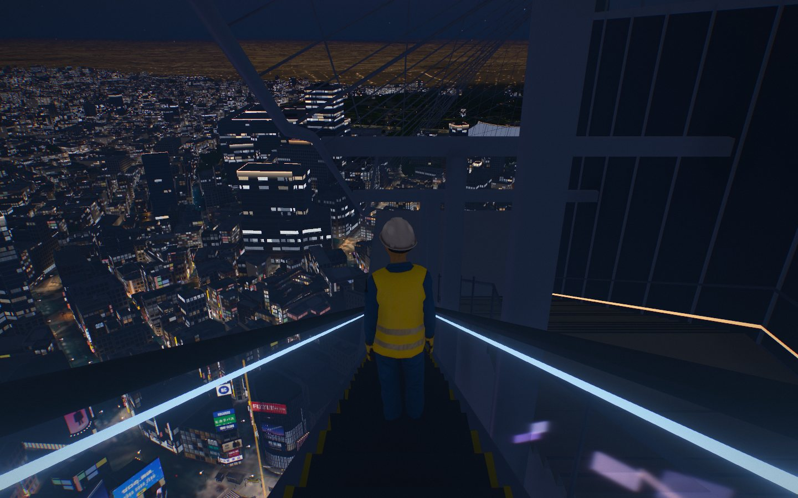 |
| **Out of 46F's doors, at night** | **The two channels from the air** |
| 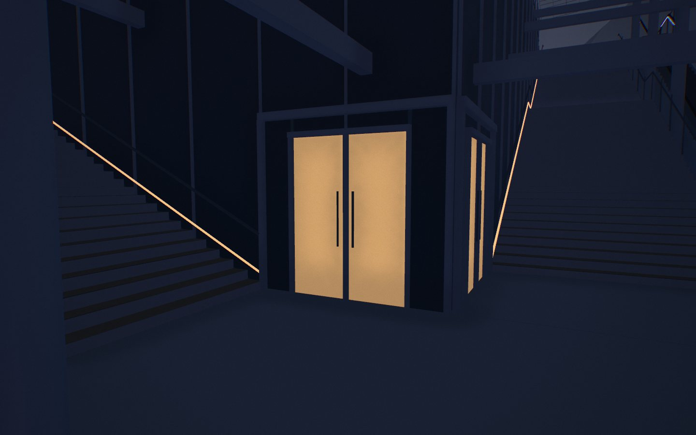 | 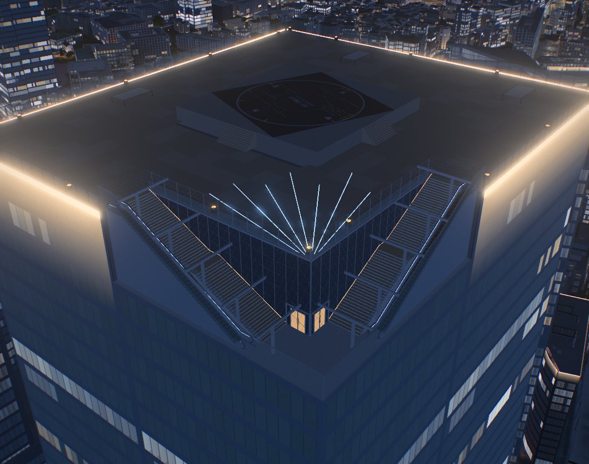 |

- **The channels.** Photographs put them down the west and north edges, the band
  PLATEAU surveyed 9 m below the deck (190 m² of its roof model). The north channel
  carries the escalator up (signed SKY STAGE, ROOFTOP at its foot), the west one
  the escalator down: riding down you face Shinjuku's towers and Yoyogi's woods,
  with the scramble 229 m below on your left, the roof's most photographed view,
  above all at sunset and in the blue hour. The two meet in the corner at their
  feet, where 46F's doors open onto white stone.
- **Across a channel, 6.4 m:** the outer glass, which steps up 3 m over the flights
  from the corner to the deck; the escalator (1 m steps edged in yellow, glass
  balustrades with black handrails, a light under each handrail); white columns
  carrying white beams over the channel every 4.5 m; the stair (timber treads on
  white risers, two legs of 30 risers of 0.15 m on 0.30 m goings with a landing,
  glass on the escalator's side, a handrail and a foot light on the wall); and the
  deck's flank, clad in dark glass on white mullions. The real channel has a safety
  net of fine wire over it; it is left out, because at a game's distance it reads as
  clutter and its hair-thin shadows shimmer.
- **The doors** are a pair of sliding glass leaves, 0.9 m each and 2.4 m high, in
  white frames with fixed glass either side and a transom to 2.7 m, lit from the
  gallery after dark: one in each channel's flank at its foot.
- **The deck** is put at PLATEAU's lower roof tier (227.1 m above the ground) and
  GEO COMPASS reaches its top tier. Scramble Square's solids each stand on their
  own ground, a few centimetres apart; their heights are set so that every top is
  at one level, the one the deck is drawn at, so feet, boards and the flights meet.
- **On the roof:** the deck boards (pale timber-look, from the photographs), the
  glass fence on steel posts, GEO COMPASS (a raised square with a compass on its
  floor and steps up each side), CLOUD HAMMOCK's nets, the 18 searchlights of
  CROSSING LIGHT, which the light show turns on after dark, and SKY EDGE: the
  deck's corner over the channels' feet, where the glass on the rim is lowest
  (1.1 m); its floor is plain, with no lines of light set in it.
- **In the game** the lift lands you in front of the north door, facing the
  escalator up. The escalators move at 0.5 m/s and carry whoever stands on them,
  up the north edge and down the west; you walk onto one from the floor before its
  comb and it sets you down on the floor past the far end. The stairs are walked.
  CROSSING LIGHT's searchlights stand clear of the 6 m before each flight's head. The spot "The
  escalator down to SKY EDGE" is at the head of the way down.
- **Built.** `cities/shibuya/city.py` (`sky_flights`, `sky_channels`, `sky_doors`)
  draws the channels and cuts them into the roof when the scene is built;
  `cities/shibuya/sky_refit.py` cut them into the built roof of November 2026
  (keeping every solid's index) without the raw downloads.
- **Estimates.** The plan is drawn from photographs (listed below) and PLATEAU's
  band, not from drawings: the channels' width, the rise (PLATEAU's 9 m), the
  flights' lengths, the doors' sizes and the lights are estimates. Which edge
  carries which escalator follows the photographs' views (the Docomo tower and
  Yoyogi's woods past the escalator up; Shinjuku ahead and the scramble on the left
  riding down).
- **Reference photographs** (Wikimedia Commons; used to compare, not as textures):
  [the foot of the escalator up, 2019-11](https://commons.wikimedia.org/wiki/File:Shibuya_Scramble_Square_-_SHIBUYA_SKY_3.jpg)
  and [towards the National Stadium, 2019-11](https://commons.wikimedia.org/wiki/File:Shibuya_Scramble_Square_-_SHIBUYA_SKY_4.jpg) (Kakidai, CC BY-SA 4.0);
  [riding down, 2023-05](https://commons.wikimedia.org/wiki/File:Shibuya_Scramble_Square_SHIBUYA_SKY_(53131621676).jpg),
  [riding up, 2023](https://commons.wikimedia.org/wiki/File:Shibuya_Scramble_Square_SHIBUYA_SKY_(53002088261).jpg),
  [the head of the stair, 2023](https://commons.wikimedia.org/wiki/File:Shibuya_Scramble_Square_SHIBUYA_SKY_(53137572352).jpg),
  [the channel from the deck, 2023-08](https://commons.wikimedia.org/wiki/File:Shibuya_Scramble_Square_SHIBUYA_SKY_(53331156129).jpg),
  [the net and the outer glass, 2023](https://commons.wikimedia.org/wiki/File:Shibuya_Scramble_Square_SHIBUYA_SKY_(53085799886).jpg)
  (Dick Thomas Johnson, CC BY 2.0). Visitors' notes on the photo spot (the
  handrail's diagonal, the sky and the city at dusk while some blue remains):
  [Lemon8](https://www.lemon8-app.com/onumarui/6954390644936983046?region=us),
  [Kaori Blog](https://www.kaoriblog.com/20230712shibuyasky/).

## 5. A game's Tokyo, as it is

*Persona 5* drew its Tokyo from these streets and renamed some of them: Sangenjaya
became Yongen-Jaya, and Center Gai became Central Street. The model keeps the real
names and the real geometry, and leaves out what belongs to the game: no
characters, logos, invented shops or interface. What is built:

- **The scramble.** Its street, buildings and signs are built at street level in
  section 6b. Hachiko, sculpted, sits on his pedestal (the statue since 1948), with its plate.
- **Center Gai's gate** and **SHIBUYA109** are in section 6b, the big screens in section 6.
- **Sangenjaya**, the triangle between Setagaya-dori and Route 246: the front of a
  snack bar the game's café is drawn on (New Marina), the bathhouse Chiyo-no-yu
  with its noren, the coin laundry and vending machines beside it, the meat shop on
  the corner, and utility poles with their wires down the lanes. The Carrot Tower
  stands over it in its own colour.
- **Shinjuku's** arch, screens and clock are in the [Shinjuku map](shinjuku.md).
- **Signs.** Shop signs on street fronts in Center Gai, Udagawacho, Dogenzaka and Sangenjaya. They are
  indicative, not the real shops' signs. A blade sign's two faces each stand on the side they
  face, so both read the right way round (`tools/sign_check.py` checks every city's), and blades
  from the facing walls of a narrow lane do not cross.

- **The crossing after dark** is section 6.

### 5b. Sangenjaya, planned as a pilgrimage

People come to Sangenjaya's triangle for one thing: to stand where *Persona 5* (Atlus, 2016) set
Yongen-Jaya. So the district is planned from the pilgrim's walk, not from the map: each stop is a real
place as it stands, offered from the angle the game framed it, with what has changed since said plainly.
The game is the reason and the framing; none of its art, names, logos or characters is drawn.

Surveyed from pilgrims' photographs of 2016 to 2025 and the owner's own of the front (sources below).
Coordinates are the Geospatial Information Authority's for the lot's address, or OpenStreetMap's.

| Stop | In the game | The real place | As it stands | Built |
|---|---|---|---|---|
| 1 | The street the hero arrives on, the yakisoba shop | Pukuichi ぷくいち, Hiroshima Fuchu-yaki, 2-11-14 (35.64233, 139.66934) | Trading, 17:00 to 24:00, closed Mondays; an ochre awning over two bays | **Yes**: the shutters, the awning and its name, the corner sign, the stair; a spot and a label. Placed on the model's three-storey building facing the lane, 15 m from the address point (no map service gave the shop itself) |
| 2 | The café's lane and its front | The snack bar New Marina スナック ニューマリーナ, 2-14-21 (35.64279, 139.66936, OSM): a red dome awning with a scalloped edge and the name in white, over a steel shutter; brick tile, the door in white-painted brick; red clay pavers | Trading in the evening | **Yes** (`cities/shibuya/sancha.py`) |
| 2 | The shop beside it, "Good-Bye Good-Bye" | Good-day Good-day SINCE 1986, the same house's left bay: a pale dome awning in a dark frame, green lettering | Shutter down in every photograph | **Yes** |
| 2 | Where the café itself stands | The lot to the right: a walled garden until 2019; since 2024 the takoyaki stand Takoharu たこはる, a dark plank fence chalked NANIWANO AJI, a round sign, a red lantern | Evenings | **Yes** |
| 2 | (not in the game) | RAIN ON THE ROOF, the café upstairs next door, 2-14-22: where pilgrims go for coffee and curry | Open | Its sign |
| 3 | The bathhouse and the laundromat | Chiyo-no-yu 千代の湯, 2-12-7 (35.64274, 139.66954), across the lane: a hand-painted board over a slot in a corrugated fence, a passage to the door, the coin laundry on its right, the chimney behind | Closed to bathers since 2021; the passage boarded up by 2024, the board and chimney still there | **Yes**, as it stands: the fence, the boarded alley, the board, the chimney (its height an estimate) |
| - | (on the way; pilgrims of 2016 lunched there) | The Thai restaurant Siam Talart, 2-14-19 (Overture), on the lane north of the bathhouse | Trading | **Yes**: its lit board with its name and タイ料理, a canopy, a menu stand (colours indicative: no photograph of the front was found) |
| 4 | The corner where the old couple talk | A pale blue-grey house with an outside stair at the bend of the lane north of Chiyo-no-yu, past the Thai restaurant Siam Talart (2-14-19, Overture) | There | **Yes**: the lap siding on the model's two-storey house at the bend (2889) and the small block at its corner (2897), barred sashes, a steel stair of fourteen risers with a white rail to a door on the first floor, pots under it; a spot, a framed photo and a label. Placed from the building data and Overture's places; the house itself is in no map service |
| 5 | The fork with the bar signs, the short cut to the station | The fork past it, where a narrower lane goes off east to the bars (もつ焼き 勝利, 鶏籠, Jackie, Bar Had A Good Day: Overture, 2026-10); further on, a covered stretch under a house, towards Setagaya-dori and the station | There | **Yes**: four lit stand signs with the bars' names at the lane's mouth (their colours indicative) and an arrow board; the covered stretch on the model's lane between two houses (2891, 2884), 8 m long and 1.5 to 2.3 m wide, cream tile walls, quarry tile floor, two tubes. Which stretch is covered is read from pilgrims' accounts of a tunnel-like passage about one *ken* wide; no source names its building |
| 6 | The supermarket | Niku no Hanamasa 肉のハナマサ, 2-14-6 (35.64291, 139.66899): a yellow sign wall two storeys high, navy brush lettering, over a glass front | Trading, 24 hours | **Yes**: the wall at its size across the whole front, the lettering, the lit glass, its blade |
| 6 | The batting cages | Sangenjaya Batting Center 三軒茶屋バッティングセンター (2-14-6, Overture), on Hanamasa's roof, by a steel stair in the slot to its left (the game puts it on the right) | Shut by 2024; the stair shuttered, the net frame still on the roof | **Yes**: the lowered shutter, the yellow board, scissor flights up the slot, posts, rails and netting over the roof (7 m, an estimate) |
| 6 | The cinema | Sangenjaya Cinema 三軒茶屋シネマ, a second-run house from 1955 in Hanamasa's building; its blade at the corner beside the supermarket's | Closed in July 2014; the blade still hangs, faded (2024) | **Yes**: the blade, faded and unlit |
| - | The clinic, the hero's guardian's house, the second-hand shop | No real place is known for any of them | - | Left out |

The usual walk is about an hour, all within five minutes of the station: Pukuichi, the café's lane,
the bathhouse's board opposite, the stair corner, the fork and the passage, Hanamasa and the stair to
the cages. It is best after dark, when the signs are lit; by day the shutters are down.

What the game adds to the real front is light and framing, and that is what is taken from it: the lane
seen from the Good-day corner with both awnings receding, the same lane from the stand looking back,
and a warm lamp over the door after dark (`sancha.glows`). The district's link (`#play-shibuya@t-sancha`)
arrives at that corner, looking down the lane.

**The game layer.** Each stop is a spot with its own passport stamp (`spots[].stamp`, given the first time you
look at it) and a frame (`spots[].frame`): after its lines the camera opens on the angle the place is known by, from
where a pilgrim stands to take it, ready to save the photograph. Arriving by the district link tracks the walk's own
line and points at Haru, who stands at the arrival, rather than at the map's first quest at Hachiko 3.4 km away
(`trackNear` in `web/game/game.js`; the line no longer waits for the welcome at Hachiko).

**After dark** New Marina's name on the awning is lit from within and a strip lamp under the rim washes the shutter;
the door lamp's pool is brighter and wider, as in evening photographs. The bars' stand signs light from five, the
passage's tubes all night, and Hanamasa's glass front all night.

What the game says changes with the places: Chiyo-no-yu's spot, its chatter and Mr Tanaka's quest say the
bath has closed and point to its board; its vending machines, which stood in the boarded alley, are no
longer a spot.

Two things are left out on purpose: the Godzilla head on the Toho building and
Okamoto Taro's mural *Myth of Tomorrow* in the station passage are artworks the
model does not reproduce. The green Aoi-gaeru train car that stood by Hachiko until
2020 has gone to Odate and is not shown.

## 6. The crossing after dark, as it stands in 2026


| The scramble from the air at 20:15 | CROSSING LIGHT over SHIBUYA SKY, 20:31 |
|---|---|
|  |  |
| **Hachiko Square (taken with the works' hoarding, since removed)** | |
|  | |

The scramble is lit by its screens. Each one stands on its own building at its published size,
and plays a programme drawn for this model. The brands, music, films and games are invented, and
the ward's notices are generic. The screens play from 9:00 to midnight, as the operators run
them, and are dark after that.

| Screen | Where | Size (w × h) | Source |
|---|---|---|---|
| Q'S EYE, and its banner screen | NW, built into QFRONT's glass over the diagonal | 12.96 × 7.289 m, banner 12.96 × 5.33 m | Tokyu OOH media sheet (spec of 15 Aug 2025) |
| Rakuten Vision (formerly Mighty Vision, DHC Channel) | W corner, Taiseido building at Center Gai's mouth | 10.24 × 5.76 m | Mainichi Kokoku sheet, 2024 |
| Shibuya Ekimae Vision, and its banner screen | SW, roof of the Shibuya Ekimae building | 21.6 × 12.144 m over 21.6 × 4.176 m | Tokyu OOH; traffic news, 2018 |
| Shibuhachi Hit Vision | SW, roof of the Oto building, south of it | 24.32 × 17.28 m | HIT |
| Starts Vision SHIBUYA (formerly Glico Vision) | NE, top of the Sanzenri building beside MAGNET | 6.356 × 3.456 m | Shibuya Television |
| 109 Forum Vision, and its banner screen | NE, MAGNET by SHIBUYA109 | 8.64 × 4.8 m | media sheet |
| Shibuya Scramble Square Vision | SE, lower floors of the east tower, behind its glass | 552.6 m² in a 25.24 × 40.05 m box; 13.79 × 20.24 m on the east face | Tokyu OOH; Panasonic |
| Shibuya Nishiguchi Sky Vision (May 2026) | W, roof of the Shibuya Mitsubishi building | 15.2 × 11.4 m | Shibuya Television |
| Synchro7 | E, seven faces on three buildings at Miyamasuzaka-shita | not published: estimated | HIT |

- **Together.** The five screens in the standard synchronised slot (Q'S EYE, the Ekimae vision,
  Rakuten, Starts and 109 Forum) play the same clip together. The real slot is 15 seconds, four
  times an hour; the model runs it for 18 seconds every two and a half minutes, so a visit
  catches it. Synchro7's seven faces always play as one.
- **Lit signs.** These are lit from outside:
  - QFRONT's Q'S WALL prints, on both glass side walls (the real lamps: 11 and 8).
  - The Ekimae building's 25 × 4 m vertical board.
  - The Nishimura building's 7.6 × 14.6 m banner.
  - MAGNET's 18.25 × 3.71 m banner and a wall ad.

  These are lit boxes:
  - MAGNET's name over its corner, in words and not its logo.
  - SHIBUYA TSUTAYA's name on QFRONT (placement estimated).
  - SHIBU HACHI BOX, the ward's tourist information on Hachiko Square since October 2020.

  The trades' stacked signs (袖看板) and lit prints on the fronts round the crossing are
  indicative.
- **Light on the street.** Each screen throws a pool of light on the street in front of it, in
  the mean colour of its programme. No street-lamp pole stands in the scramble.
- **The old Tokyu Toyoko site.** The West and South buildings behind Hachiko closed in 2020 and
  have been pulled down (the South building by January 2026) for the second phase of Shibuya
  Scramble Square, building since May 2025 and due in fiscal 2031; the site is a hoarding, floodlights
  and a crane. **By the owner's choice the square is drawn as it stood before the works**: the twelve
  solids PLATEAU surveyed stand behind Hachiko, and there is no hoarding. This is the one place where
  the map is not as it stands in November 2026. `TOYOKO_WORKS` in `cities/shibuya/city.py` draws the
  site as it is (the buildings left out through `landmarks.json` `demolished`, the hoarding with the
  developer's notice, the floodlights and a tower crane, whose place and height are illustrative);
  then `python pipeline/landmarks.py --city shibuya` and `python pipeline/pack.py`.
- **Hachiko's light.** After dark a small warm light card stands 4 m up before him, aimed at him
  (`game.look.fill` with `aim`): the square's lamps are drawn as points and as pools on the paving,
  which leave a bronze black. It stands for their light and the shopfronts'; no luminaire is there.
- **Hachiko Square.** Hachiko's pedestal was lowered in May 1989 so people could touch him. He
  looks north-east, toward the station's Hachiko exit, with the bus street at his back: photographs
  from 2020, 2021 and July 2025 show him from behind looking toward QFRONT's side, in profile from the
  square's south, and from the front with the buses behind him. The station's Hachiko gate moved to the
  Miyamasuzaka side on 26 January 2025, and the *Hachiko Family* tile relief was taken down from
  February 2025, so neither is drawn. Hachiko and his corner of the square are described in section 6b.
- **SHIBUYA SKY's CROSSING LIGHT.** Its 18 searchlights put on a show from 19:00, on the hour and
  the half hour, to 22:00 (`light_show` `every`, `until`). Each show's length and the beams'
  movement are illustrative.
- **Closed and gone.** Seibu Shibuya's A and B buildings closed at the end of September 2026; no
  screen or lit sign is drawn on them. QFRONT's crown (a transparent LED band since 2020, still
  there in the 2024-25 photographs) carries an invented soda's advert in its place.

What could not be checked: how high up its wall most screens sit, and which way the roof
screens face (both estimated from photographs); the outline of Scramble Square's irregular
screen, which is stepped here; the trees and night lighting of Hachiko Square; the colours of
the Center Gai arch; and where Scramble Square's colour lighting is on the tower.

## 6b. The scramble at street level

Someone who knows Shibuya should recognise every facade from the pavement. `cities/shibuya/scramble.py`
builds the scramble's street and the buildings round it that the generic city cannot draw as they
are, checked against photographs from the same viewpoints (the comparison stills are in
`docs/images/shibuya/compare/`).

**What is built, and from what**

| Part | How it is built | Measured from | Estimated |
|---|---|---|---|
| Crosswalks | Five: one diagonal from Hachiko to QFRONT (the scramble has only one), and four round it; 45 cm bars with 45 cm gaps, along the traffic | Positions and widths on GSI's aerial photo: the diagonal 9.4 m wide, the two on the station side 9.0 and 9.2 m, Dogenzaka's 7.8 m, Center Gai's 7.2 m. The national standard (道路標示): 45 cm bars, gaps 45-90 cm since 2024 | The bars' phase along each walk |
| The junction's floor | Asphalt over the carriageways between the crosswalks, so no lane line runs through the scramble | The game's road bands and the crosswalks | Its edge at the kerbs, about 0.5 m |
| Stop lines and diamonds | A 45 cm stop line 2 m before each crosswalk on the lanes coming in (all of a one-way street), and the warning diamonds (横断歩道あり) 30 and 50 m back, one per lane | OSM's one-way tags | Lane widths 3.1 m. No 止まれ: the junction has signals, and the photographs show none |
| Underground entrances | A5a, A5b, A6a, A6b, A7a, A7b and the unnumbered ones: a stair going down between tiled walls under a flat roof on a steel frame, aluminium to waist height and glass above, handrails, tactile blocks at the head, a lit sign with the exit's code. The ground is not drawn over the well | OSM: the entrance node, its little building, and the footway that goes underground from it (which way the stair goes down) | Treads 30 cm, risers 16.5 cm, the roof's depth |
| Shibuchika's pavilion (exit 8) | The square pavilion on Hachiko Square with its charcoal fascia and name | OSM's 13.8 × 13.4 m outline | Its height (OSM 3.8 m) |
| Tactile paving | Yellow 30 cm guide blocks along every footway OSM tags `tactile_paving=yes`, warning blocks where they meet a kerb or a door | OSM | |
| Guard rails | White guard pipes (0.8 m, posts every 2 m) on the kerbs between crosswalks; short stainless bollards on QFRONT's forecourt | Photographs 2024-25 | Their exact runs |
| The Ginza line | Its concrete viaduct on piers clear of the roads, two tracks with their third rail and no wires | OSM's line (bridge=viaduct, layer 2) | Rails 12 m over the street, the deck 9 m wide |
| The JR lines | The Yamanote Line's two tracks and the freight line's two: the steel plate-girder bridge over the road (stiffeners, flanges, its clearance sign), north of it a concrete viaduct on three rows of columns with the Hachiko-exit bicycle lot under it (city bicycles, instanced), rails on sleepers, the overhead line on portal masts | OSM's track lines, bridge and the bicycle lot under the tracks | Rails 7.4 m over the road, the girder 2 m deep, masts every 46 m, the 4.5 m clearance |
| QFRONT | A double skin curved round its corners: glass on silver fins every 0.9 m in front of the floors (lit after dark), the glass crown with a roof advert, Q FRONT under it, the canopy with SHIBUYA TSUTAYA and STARBUCKS COFFEE. Q'S EYE (12.96 × 7.289 m) and its banner screen are moved up to where the photographs put them, 30.8 and 20.4 m over the street | PLATEAU 52.2 m to the crown; R.I.A. design, 1999, 8 floors | Fins, storeys, the gap between the skins |
| SHIBUYA109 | The aluminium block and the cylinder at its point, the printed advert on its front and the pink 109 in a ring on its silver top | PLATEAU: 33.6 m roof, the cylinder 49.7 m; OSM's footprint rounds the point on a 13.7 m circle (PLATEAU's generalised model, 11.5 m); drawn 13 m across | The advert's size; the panels' joints |
| MAGNET | Its glazed corner under a sloping silver fascia with its name in red serif letters | Photographs 2025 | The fascia's height and slope |
| Center Gai's gate | Two grey posts bending over like shepherd's crooks, disc lamps at their tips, センター街 on the posts and the basketball banner between them | Photographs 2024-25 (no dimensions are published) | 5.5 m posts, the street's 9 m |
| The koban | 渋谷警察署渋谷駅前交番 at OSM's node on Hachiko Square's north edge: two storeys of pale tile, KOBAN and its name over the door, the red lamp | OSM | Its size, 6.4 × 4.6 × 6.6 m |
| The station's Hachiko side | OSM maps the whole station as one 15 to 29 m building, which the generic styles drew as a yellow stone palace. It is drawn as the works site it is: pale panel walls, hoardings with the works notice at its foot, a scaffold over the square carrying an advert | OSM's outline and heights; photographs 2024-25 | The scaffold's size |
| The west side's billboards | Box billboards stacked on steel towers over the roofs (the Taiseido block's tower is in PLATEAU's LOD2, 5.5 × 5.6 m to 39.4 m) and the Oto building's floor-by-floor sign bands | PLATEAU, photographs | All the brands are invented |
| The bookshop on Center Gai's corner | The shop that has stood on the corner since 1912, on the block's chamfer facing the crossing and 3.4 m of its south side: white clapboard to the first floor, the shop window and door, a blue awning with the name in white, and the big white box sign, lit from inside, wrapping round the corner: the name in heavy blue characters inside a red outline of an open book (its spine at the corner), the romanised name in red, a blue edge at its foot. The name is invented, 大昇堂書店 (BOOKS TAISHODO), in the real one's pattern: five characters, □□堂書店, two on the side and three on the front, in the same colours. The block's corner screen and Rakuten Vision stand above the sign (7.4 m and 12.9 m) | OSM's outline (w136690966 is the whole block); photographs 2021 and 2024 | The awning (3.0-3.45 m) and the sign (3.6-6.9 m), scaled from the door |
| Hachiko | The bronze Akita sculpted as signed distance fields and meshed by surface nets (`pipeline/sculptkit.py`, `cities/shibuya/hachiko.py`), 27,600 triangles. Remodelled in November 2026 against photographs from the front, the side and behind, after the first version read as a cat: a heavy, broad head raised about 13 degrees and turned a little to his left, a short blunt muzzle with its bridge and nose, small thick ears set wide on the corners of the skull (the left one bent forward, as it was in life), a thick neck straight into a broad chest, the flat strap collar round it with its tab hanging at the front, long straight forelegs, thick thighs at his sides, the tail curled over his back, all on a rough bronze slab cast with him. The real forelegs and paws are rubbed bright by hands; here, by the owner's choice, the bronze is one even colour. On a speckled grey granite plinth (0.95 x 0.95 x 1.15 m) with its bronze plate, 忠犬ハチ公 set vertically, on a dark granite step clad in small tiles (1.55 m square, 0.38 m) | Photographs: the front (2025-07), the side and the square behind (2025-11), the crowd (2023); the first statue (1934) was 162 cm on a 180 cm pedestal | The sizes, scaled from the plinth: the dog 1.09 m from his paws to his ears, the forelegs' outer edges 0.44 m apart, the collar 0.57 m up |
| Hachiko's corner of the square | Round him, grey granite setts laid in arcs (6.6 m out, with two dark bands), carried on out across the planters' half of the square as the photographs show (the clay pavers start beyond); behind him a curved bed (2.4-4.4 m out, round his back) behind a 0.48 m granite wall people sit on, with two stainless rails along it and five lamps set in its face, and in the bed rocks, clumps of lilyturf and a Kasuga lantern, kept low on purpose: the real bed's garden pines and maple are left out so that nothing stands over Hachiko; on his left the memorial stone with its plate. Out on the square two round planters of upright granite strips (2.7 m across) ringed by stainless rails, each with a Somei-yoshino cherry. The lilyturf is the square's own (`cities/shibuya/hachiko_garden.py`: crossed cards cut out of a drawn atlas, `hachiko_garden.png`); the cherries are the shared trees', in flower from 24 March, turning in autumn and bare in winter (`trees.areas` in city.json). Four cherry-blossom inlays of pale stone in the setts | Photographs 2020-25 | All positions and sizes. The lilyturf's height |

**Side by side.** Each still stands the camera where the photographer stood and is cropped to the
photo's lens (`tools/compare/shibuya.json`, `tools/compare_sheet.py`); the photo first, then the model at
13:00, 15 minutes after sunset and 20:30 on 3 November.

| | |
|---|---|
| Hachiko Square toward QFRONT |  |
| QFRONT from the Hachiko corner |  |
| SHIBUYA109 from the scramble |  |
| The station side |  |
| Across the junction from MAGNET |  |

**Cost.** The Shibuya map's data grew from 34.0 MB to 36.1 MB (landmarks.json 1.61 to 3.07 MB, and
scramble.jpg, 0.3 MB). On the low tier under a software renderer (llvmpipe, `TIER=low tools/city_shot.js`)
the map loads in 23.4 s and draws the view from Hachiko Square in 311 ms a frame by day and 368 ms at
night; on a GPU the cost is a few more draw calls (one per material, about 40). A real GPU was not
measured.

**What was not built, and why.** The Ginza line's viaduct is drawn from Mark City across the street and
the Toyoko site to the JR station (it carries on inside the station's outline). Seibu's A and B buildings closed on
30 September 2026 and carry no sign here. The traffic signals and the crowd belong to the game
(`web/game/junctions.js`). Real brands, logos and the real adverts are not drawn: every advert is
invented in the kind the real one is, and the buildings' own names are set in open fonts.

**PLATEAU.** Shibuya's newest model (2025, spec v5,
[geospatial.jp](https://www.geospatial.jp/ckan/dataset/plateau-13113-shibuya-ku-2025)) has no LOD3
building anywhere in the ward: LOD2, textured, is the finest. Its LOD3 roads cover the scramble, and
its LOD3 street furniture stops about 130 m east of it. So the scramble's buildings are modelled
here from photographs on PLATEAU's heights and OSM's outlines, and its markings from the aerial
photo. Licence: PLATEAU's site policy (公共データ利用規約 1.0, compatible with CC BY 4.0), 「出典：国土交通省
PLATEAU」.

**How games and demos built it, and what this model does instead.**

| Work | What it gets right | What it changes | Here |
|---|---|---|---|
| *Ghostwire: Tokyo* (Tango Gameworks, 2022) | Hand-built with no existing assets; the depth of the street wall, alleys, dense signs, wet night reflections ([Automaton](https://automaton-media.com/en/news/20230823-20986/), [Game Informer](https://gameinformer.com/feature/2022/12/30/exploring-shibuya-with-tango-gameworks)) | Gave up an exact copy early, blends Tokyo, frozen at August 2020 | The measured street, as it stands in November 2026 |
| *The World Ends with You* (2007) and *NEO* (2021) | The scramble and Hachiko keep their names; every place scouted ([RPG Site](https://www.rpgsite.net/interview/12116-neo-the-world-ends-with-you-interview-discussing-creation-and-localization-with-the-team-behind-the-revived-cult-classic)) | Compressed, distorted perspective, 109 renamed 104 | True scale; the sign density comes from where the signs are |
| *Persona 5* (2016) | Center Gai and the station as hubs; the screens as a story device | Compressed hub maps, brands replaced | The screens play invented programmes at their published sizes |
| *Jet Set Radio* (2000, 2002) | The spirit: colour, graffiti, music | Caricatures | |
| バーチャル渋谷 (cluster, 2020) | The station front for events; real advertisers on virtual screens ([MoguLive](https://www.moguravr.com/?p=134953)) | Built in a month; no sign of PLATEAU | |
| Nimikko's *Shibuya* for Unreal | 1:1 scale, 750+ signs with fictional brands, 2-3k triangles an asset ([forum](https://forums.unrealengine.com/t/nimikko-shibuya-game-ready-environment/2578085)) | Its own layout | The same discipline: fictional brands, cheap assets, many of them |

The common lesson, taken here: Shibuya is recognised by its screens and its stacked rooftop billboards
over a street wall only 25-45 m high, with Scramble Square towering behind, and at night the light
comes from the screens and signs while the buildings stay dark glass.

**Reference photographs** (Wikimedia Commons; used to compare, not as textures):
[Hachiko plaza toward QFRONT, 2024-10](https://commons.wikimedia.org/wiki/File:2024_%E9%96%8B%E6%A5%AD60_(54037871340).jpg) (Haydn Blackey, CC BY-SA 2.0);
[QFRONT, 2024-12](https://commons.wikimedia.org/wiki/File:Shibuya_(54222657891).jpg) (Jeffrey Hayes, CC BY 2.0);
[the west side, 2025-08](https://commons.wikimedia.org/wiki/File:2025_Shibuya_Crossing.jpg) (Kakidai, CC BY-SA 4.0);
[QFRONT and the gate from the crosswalk, 2025-02](https://commons.wikimedia.org/wiki/File:Shibuya,_Tokyo,_Japan_Feb_21_2025_(54345489916).jpg) (GoToVan, CC BY 2.0);
[109 from the scramble, 2026-02](https://commons.wikimedia.org/wiki/File:Shibuya._(55097345367).jpg) (MIKI Yoshihito, CC BY 4.0);
[the empty junction, 2025-01](https://commons.wikimedia.org/wiki/File:%E6%B8%8B%E8%B0%B7%E3%82%B9%E3%82%AF%E3%83%A9%E3%83%B3%E3%83%96%E3%83%AB%E4%BA%A4%E5%B7%AE%E7%82%B9_2025%E5%B9%B41%E6%9C%8822%E6%97%A5%E3%81%AE%E6%B8%8B%E8%B0%B7_202501221341_IMG_2568.jpg) (ウィ貴公子, CC BY-SA 4.0);
[the station side at night, 2026-10](https://commons.wikimedia.org/wiki/File:%E6%B8%8B%E8%B0%B7%E3%82%B9%E3%82%AF%E3%83%A9%E3%83%B3%E3%83%96%E3%83%AB%E4%BA%A4%E5%B7%AE%E7%82%B9_2026%E5%B9%B410%E6%9C%8819%E6%97%A5%E3%81%AE%E6%B8%8B%E8%B0%B7_202610192208_IMG_3376.jpg) (ウィ貴公子, CC BY-SA 4.0);
[the station's Hachiko exit, 2024-07](https://commons.wikimedia.org/wiki/File:Shibuya_station_Hachiko_exit_streetscape_IMG_3287.jpg) (Bject, CC BY 4.0);
[Hachiko, 2025-11](https://commons.wikimedia.org/wiki/File:The_Hachiko_statue_at_Shibuya,_Tokyo,_Japan.jpg) (Joli Rumi, CC BY-SA 4.0);
Hachiko from the front and three-quarters, 2025-07 ([094](https://commons.wikimedia.org/wiki/File:Tokyo-Shibuya-and-Shinbashi---2025-07-13_094.jpg), [095](https://commons.wikimedia.org/wiki/File:Tokyo-Shibuya-and-Shinbashi---2025-07-13_095.jpg); RuinDig, CC BY 4.0);
[Hachiko Square, 2020-04](https://commons.wikimedia.org/wiki/File:Hachiko_square_2020-04-19.jpg) (Asanagi, CC0);
[Hachiko Square's planters, 2021-02](https://commons.wikimedia.org/wiki/File:Shibuya_Hachiko_2021-02-22.jpg) (しんぎんぐきゃっと, CC BY-SA 4.0);
[Hachiko in the crowd, 2023](https://commons.wikimedia.org/wiki/File:Hachiko_(53083712909).jpg) (Dick Thomas Johnson, CC BY 2.0);
[the bookshop's corner, 2021-03](https://commons.wikimedia.org/wiki/File:Tienda_Taiseido_en_Shibuya_(51045981721).jpg) (Antonio Tajuelo, CC BY 2.0).
Facts: [ja.wikipedia: QFRONT](https://ja.wikipedia.org/wiki/QFRONT), [SHIBUYA109](https://ja.wikipedia.org/wiki/SHIBUYA109),
[渋谷スクランブル交差点](https://ja.wikipedia.org/wiki/%E6%B8%8B%E8%B0%B7%E3%82%B9%E3%82%AF%E3%83%A9%E3%83%B3%E3%83%96%E3%83%AB%E4%BA%A4%E5%B7%AE%E7%82%B9),
[渋谷センター街](https://ja.wikipedia.org/wiki/%E6%B8%8B%E8%B0%B7%E3%82%BB%E3%83%B3%E3%82%BF%E3%83%BC%E8%A1%97),
[the single diagonal](https://trafficnews.jp/post/122022/2), [crosswalk bars since 2024](https://jafmate.jp/car/traffic_topics_20240830_1195692.html),
[Udagawa's koban](https://architecture-tokyo.com/2017/03/04/1985-udagawacho-police-box-edward-suzuki/).

```bash
python pipeline/osm_detail.py --city shibuya        # the OSM detail round the scramble (city.json osm_detail)
python3 tools/aerial_local.py shibuya 362 -998 32    # the aerial photo in the local frame, to measure markings
python3 tools/scramble_plan.py shibuya 365 -1005 110 # a plan of the footprints, roads and crossings
```

## 6c. The streets off the scramble (#118)

`cities/shibuya/streets.py`, built into the scramble's kit and atlas, dresses the first 150 m of the
five streets that leave the scramble: Center Gai, Dogenzaka, Bunkamura-dori, Jingu-dori up to MODI,
and Inokashira-dori between the two Seibu buildings. The generic city gives them their masses and
windows; what makes them read as Shibuya from the pavement is what hangs on the fronts.

| Part | How it is built | Measured from | Estimated |
|---|---|---|---|
| Every front onto the five streets | Found from the built city: each outline edge of 4.5 m or more within 15 m of a street's centreline and facing it. At its foot a shop window lit from inside and a lit fascia over it; on four fronts in five a vertical sign of tenants (縦看板), one panel a floor (3.2 m), standing out from the wall at one end and read up and down the street; on some, bands of tenants' signs floor over floor | OSM's street lines (scramble_osm.json), the built city's footprints and heights | The fascia's and signs' sizes, from photographs 2023-25; which front carries which is seeded per building |
| The camera and electronics store on Dogenzaka | A white fascia with the name in red, a blue band under it, three banners up its floors in red, blue and white | Photographs 2024-25 | Sizes. The name is invented (カメラのサクラ) |
| The drugstore and the shoe store on Center Gai | Yellow fascia with the name in dark blue and the big 薬; white on red with a navy band | Photographs 2024-25 | Sizes. Names invented (ドラッグ あおば, STEP MARKET) |
| MODI on Jingu-dori | MODI up a blade at its corner (the building's name, in an open font), the record and book store's fascia over the door | Photographs 2024 | Sizes. The store's name is invented (DISC & BOOKS) |
| SHIBUYA109's Bunkamura-dori face | SHIBUYA109 up a blade near the point, the front's printed advert again on a 9 × 13.5 m frame, shop windows at the foot | OSM's footprint | The print's size and place |
| Seibu A and B | Closed on 30 September 2026 (A and B; LOFT and MOVIDA stay open under their own names). Cream precast panels with small, deep windows over every face from 4.6 m up, dark now; the ground floor's glass dark behind it; the closing notice on a white board at the doors on Jingu-dori and Inokashira-dori; the enclosed glass bridge between the two over Inokashira-dori | Footprints and heights from PLATEAU and OSM; closing: [Sakigake, 25 March 2026](https://www.sakigake.jp/news/article/20260325CO0078/), [AdverTimes](https://www.advertimes.com/?p=559377), [FASHIONSNAP](https://www.fashionsnap.com/article/2026-03-25/seibu-shibuya-close/) | The panels' bay (2.7 m) and window size; the bridge at 9-13 m. Whether the SEIBU letters are off the buildings yet is not reported: none is drawn |
| Shibuhachi Hit Vision, bent | HIT's screen on the Oto building's roof (June 2014; 24.3 × 17.3 m, about 420 m² by HIT's release), its foot along the face over the station square and turning round the building's south-east corner on a 6 m radius (`screens.py`'s `path` and `round`) | Size: HIT ([value-press, 2014](https://www.value-press.com/pressrelease/128731)) | The bend's place and radius, from photographs |
| The Taiseido block | The pharmacy's and the monja restaurant's small vertical signs on its Dogenzaka face, and the tower's three billboards stacked 15 cm apart to the tower's top at 39.4 m | PLATEAU's tower | The signs' sizes. Names invented (八千代薬品, もんじゃ 月島) |

All the signs' words are in `cities/shibuya/streets.py` and drawn into `web/data/shibuya/scramble.jpg`;
no text is shared with another city. On foot at 13:00, 15 minutes after sunset and 20:30 on 3 November
(desktop, then phone; `tools/game_shot.js shibuya tools/compare/shibuya_streets.json`):

| | |
|---|---|
| Center Gai | 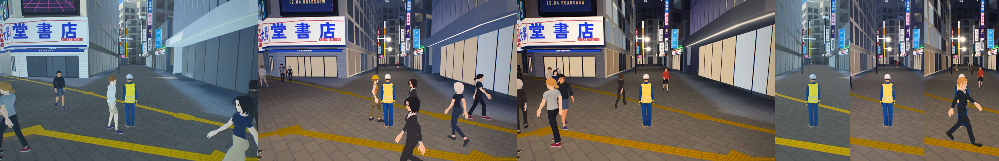 |
| Dogenzaka | 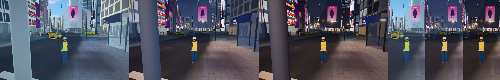 |
| Bunkamura-dori | 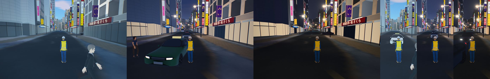 |
| Jingu-dori at Seibu A | 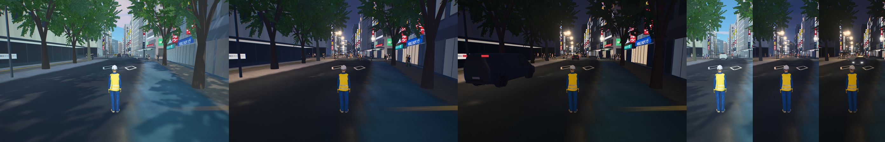 |
| Inokashira-dori and the Seibu bridge | 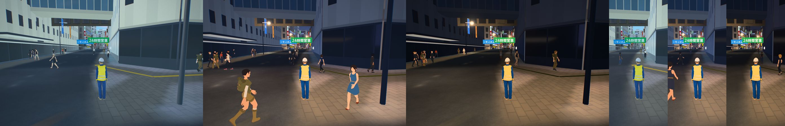 |
| Shibuhachi Hit Vision from the station square | 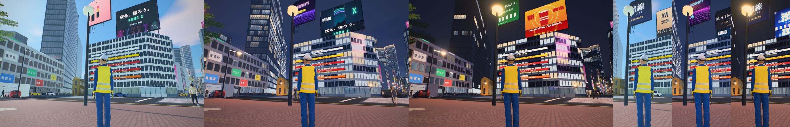 |
| Jingu-dori at MODI | 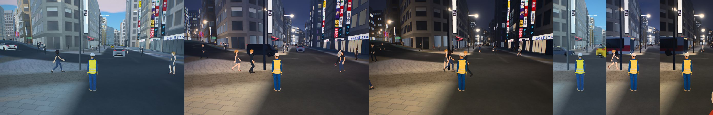 |
| The Taiseido block from the scramble | 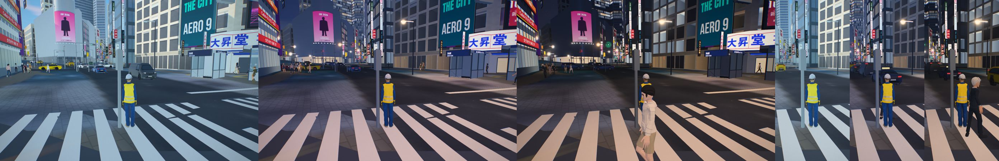 |

The shop glass round the scramble (`x_shop`, `st_shop`) is no longer a floodlit material: a floodlit
material glows all over after dark, and the shop windows read as flat cream slabs. Only their panes
light now. The cost: landmarks.json 3.92 to 4.10 MB, 93.5k to 96.6k triangles, scramble.jpg 0.71 to
about 1.3 MB (2048 × 4096).

**Not done.** The bird call of the walk signals is #133. A real GPU's frame time on the low tier is still
unmeasured (only llvmpipe, `tools/city_shot.js`).

## 7. Tokyo Pilgrimage: Shibuya

The game is a walk, not a survey. Aoi, a pilgrimage guide at Hachiko, welcomes you;
then two lines run side by side, and a report back waits for both. The Your Name, Shinjuku and
Aoyama walks went with the [Shinjuku map](shinjuku.md#5-tokyo-pilgrimage-shinjuku), and Aoi
sends you there at the end.

| Line | Who | What you do |
|---|---|---|
| Shibuya | Shun at Center Gai, Yuna at the SKY GATE door, Taro at SKY EDGE | Walk onto the scramble, read the arch, take the lift, ride the escalator onto the roof, stand at SKY EDGE |
| Sangenjaya | Haru, a Sangenjaya local; Mr Tanaka, a regular at the bathhouse | Find the snack bar's front, walk the triangle after dark |

The people are original characters. None stands for a real shop's staff.

What the game took from *Persona 5*, and what it does instead:
- **Neighbourhoods with names.** Walking into one puts its name up as Tokyo's
  platforms sign theirs (駅名標): the name, its reading, the line's colour band
  and the stations either side. Four areas: Shibuya, Sangenjaya, Harajuku and
  Omote-sando.
- **Things to look at.** <kbd>E</kbd> at a spot reads it: Hachiko, Center Gai's
  arch, the bathhouse, a vending machine (a can of cold green tea, 150 yen),
  GEO COMPASS, a hammock.
- **Overheard talk.** Students at Hachiko, visitors at the scramble,
  visitors on the roof: their conversation comes up in bubbles as you pass.
- **No calendar, no ranks, no combat.** The clock is the real sun, and the numbers
  people tell you come from the model.

The crowd uses the `tokyo` style. The helicopter's registration is JA26SB; taxis
come in Tokyo's dark navy, yellow, white and green, and buses in white with a red
band. The helipad in Yoyogi Park is a game device; there is no heliport there. The game starts the helicopter on the roof of SHIBUYA SKY, on the GEO COMPASS deck, a lift ride from the start at the scramble's Hachiko-side kerb; that pad is a game device too. The game opens with a crane down from QFRONT's screen to that kerb as the walk turns green, the crowd stepping out round you (docs/GAME.md, Arriving and getting started).

## 8. Sun

Tokyo protects no park's sunlight (see [Tokyo](tokyo.md#5-sun-and-the-rules)). The
places carry this project's lunch-hour window, noon to 13:00, as a thought
experiment. Miyashita Park is a roof garden on a mall; its sun is read at the
ground here, so treat it with care.

`analysis/sun_access.js` gives the mean share of each place in direct sun over the
window, December and June:

| Place | December | June | Where the shade comes from |
|---|---:|---:|---|
| Yoyogi Park | 94% | 99% | a 91 m building, the NHK Hall, Park Court Shibuya The Tower |
| Jingu-dori Park | 78% | 100% | one 32 m building beside it |
| Miyashita Park | 81% | 88% | the hotel tower and the mall it stands on, read at the ground |

Shinjuku Gyoen and Suga Park are in the [Shinjuku map](shinjuku.md#6-sun).

## 9. Limits

- The aerial photos are not true orthophotos, and the towers lean in them.
- SHIBUYA SKY's furniture and the district pieces are built from published
  figures and photographs, not surveys.
- 9.0% of the footprint area has an estimated height. Look for the green tint under
  **Height sources**.
- Shop signs and shop fronts are indicative; the screens' programmes are invented.
- The searchlights' times and movement are illustrative.

## 10. Reproducing it

```bash
env -u AWS_ACCESS_KEY_ID -u AWS_SECRET_ACCESS_KEY -u AWS_SESSION_TOKEN \
  python pipeline/fetch_overture.py --city shibuya
python pipeline/fetch_tiles.py --city shibuya
python pipeline/fetch_plateau.py --city shibuya
python pipeline/build_scene.py --city shibuya
python pipeline/osm_detail.py --city shibuya      # OSM's street detail round the scramble (cities/shibuya/scramble_osm.json)
python pipeline/landmarks.py --city shibuya       # also draws atlas.jpg and scramble.jpg (fonts are fetched to data/raw/fonts)
python pipeline/game_data.py --city shibuya
python pipeline/night_lights.py --city shibuya    # after game_data.py: it reads game.json
python analysis/data_quality.py --city shibuya
python analysis/dem_check.py --city shibuya
node analysis/sun_access.js --city shibuya
python blender/build_scene.py --city shibuya
```

## Sources

- SHIBUYA SKY: [SHIBUYA SKY](https://www.shibuya-scramble-square.com/sky/about/?page=1),
  [Wikipedia (ja)](https://ja.wikipedia.org/wiki/SHIBUYA_SKY).
- The crossing's screens and signs: [Wikipedia (ja), 渋谷スクランブル交差点](https://ja.wikipedia.org/wiki/%E6%B8%8B%E8%B0%B7%E3%82%B9%E3%82%AF%E3%83%A9%E3%83%B3%E3%83%96%E3%83%AB%E4%BA%A4%E5%B7%AE%E7%82%B9),
  the media sheets at [ooh-cmedia.com](https://www.ooh-cmedia.com/media/shibuya-synchronized-broadcast/)
  ([Q'S EYE](https://www.ooh-cmedia.com/media/qs-eye/), [Ekimae Vision](https://www.ooh-cmedia.com/media/shibuya-station-front-vision/),
  [Starts Vision](https://www.ooh-cmedia.com/media/starts-vision-shibuya/), [109 Forum Vision](https://www.ooh-cmedia.com/media/shibuya-109forum-vision/),
  [Scramble Square Vision](https://www.ooh-cmedia.com/media/shibuya-scramble-square-vision/), [Q'S WALL](https://www.ooh-cmedia.com/media/shibuya-qs-wall/),
  [Ekimae long board](https://www.ooh-cmedia.com/media/shibuya-ekimae-bldg-long-board/), [Nishimura building](https://www.ooh-cmedia.com/media/shibuya-nishimura-bld/),
  [MAGNET wall jack](https://www.ooh-cmedia.com/media/shibuya-magnet-by-shibuya109-wall-jack/)),
  [HIT: Shibuhachi Hit Vision](https://www.hit-ad.co.jp/digital-billboards/shibuyaled.html) and [Synchro7](https://www.hit-ad.co.jp/digital-billboards/synchro7_shibuya.html),
  [Shibuya Television: west exit Sky Vision](https://www.sib.tv/news/10408/), [Panasonic](https://www2.panasonic.biz/jp/solution/outside/works/ShibuyaSSVision.html),
  [traffic news, 2018](https://trafficnews.jp/post/82440), [AdverTimes](https://www.advertimes.com/?p=494293).
- The Toyoko site and Phase II: [traffic news](https://trafficnews.jp/post/548718), [traffic news](https://trafficnews.jp/post/653174);
  Seibu Shibuya's closing: [Fashionsnap](https://www.fashionsnap.com/article/2026-03-25/seibu-shibuya-close/).
- Hachiko Square: [Wikipedia (ja), 忠犬ハチ公](https://ja.wikipedia.org/wiki/%E5%BF%A0%E7%8A%AC%E3%83%8F%E3%83%81%E5%85%AC),
  [san-tatsu](https://san-tatsu.jp/collects/381997/), [SHIBU HACHI BOX](https://travel.watch.impress.co.jp/docs/news/1276219.html),
  [the Hachiko gate's move](https://tabiris.com/?p=54640), [the relief](https://www.tokyoartbeat.com/articles/-/hachiko-family-news-202501).
- CROSSING LIGHT: [enjoytokyo](https://www.enjoytokyo.jp/article/202710/), [nippon.com](https://www.nippon.com/en/articles/-/17056),
  [Impress Watch](https://www.watch.impress.co.jp/docs/news/1214693.html).
- *Persona 5*'s Tokyo and the real places: [Kotaku](https://kotaku.com/persona-5s-in-game-locations-compared-to-the-real-world-1787125885),
  [TheGamer](https://www.thegamer.com/persona-5-locations-visit-real-world-counterparts/),
  [Megami Tensei Wiki: Yongen-Jaya](https://megatenwiki.com/wiki/Yongen-Jaya),
  [rinblog: Sangenjaya](https://rinblog.org/en/p5r-seichi-sangenjaya-en/) (photographs of June 2025).
- Sangenjaya's stops, photographed beside the game's: [maruko30, part 1](https://maruko30.com/entry/persona5-jyunrei-01) and
  [part 2](https://maruko30.com/entry/persona5-jyunrei-02) (2024), [animecosplayjapan](https://animecosplayjapan.com/?p=3049) (addresses, 2024),
  [zukkazu](https://zukkazu.com/persona-5-holy-land-pilgrimage/) (2019), [Source Gaming](https://sourcegaming.info/2017/04/09/persona-5-yongenjaya-in-real-life) (2017),
  [linkle24](https://linkle24.hatenablog.com/entry/2016/11/06/223804) (2016), [tsunagu Japan](https://www.tsunagujapan.com/wow_02105-3b6a9908-9ab9-46d8-a44b-5b675883ccc7/).
  The places' positions and names: Overture Maps places, release 2026-10-21 (CDLA Permissive 2.0 and ODbL, as their sources).
  Sangenjaya Cinema and its blade: [pias-202](https://ameblo.jp/pias-202/entry-12849924892.html) (2024), [TV Tokyo, 2013](https://www.tv-tokyo.co.jp/adomachi/backnumber/20130511/89894.html);
  the triangle's tunnel-like passages: [kobaden-shoutengai](https://ameblo.jp/kobaden-shoutengai/entry-12851335584.html) (2024).
  Chiyo-no-yu: [Tokyo Sento Association](https://www.1010.or.jp/map/item/item-cnt-487), [komuken](https://komuken.com/sentou-tiyonoyu/).
  The photographs were read for facts (what stands where, colours, lettering); none is reproduced.
