# Shinjuku: the stairs of Your Name, Kabukicho and the east exit

A map of Tokyo ([Tokyo as maps](tokyo-maps.md)): Shinjuku from Tokyo Opera City and Nishi-Shinjuku's
towers to Yotsuya, and from Jingu Gaien and Aoyama-itchome in the south to Kabukicho in the north,
with Shinjuku Gyoen, 2-chome and Golden Gai between. It is the real city first: Overture's footprints
at the heights Project PLATEAU surveyed, on GSI's laser-scanned bare earth, under the real sun. On top
of that sit the places a film and a game made famous, ten years on: Suga Shrine's 男坂 in Yotsuya is the
staircase on the poster of *Your Name* (君の名は。, 2016), and Kabukicho and 2-chome are streets
*Persona 5* (2016) drew. Every number comes from the scripts in `pipeline/` and `analysis/` run with
`--city shinjuku`; outputs are in `cities/shinjuku/analysis/`.

Until November 2026 this was the north half of one map with Shibuya; it was split in two
([Tokyo as maps](tokyo-maps.md)). The two maps share one frame, so `cities/shibuya/city.py` builds
the landmarks of both (`cities/shinjuku/city.py` loads it with `CITY = "shinjuku"`), and the pictures
taken before the split are still in `docs/images/shibuya/`.

| The east exit plaza, where the game starts | The plaza after dark |
|---|---|
| 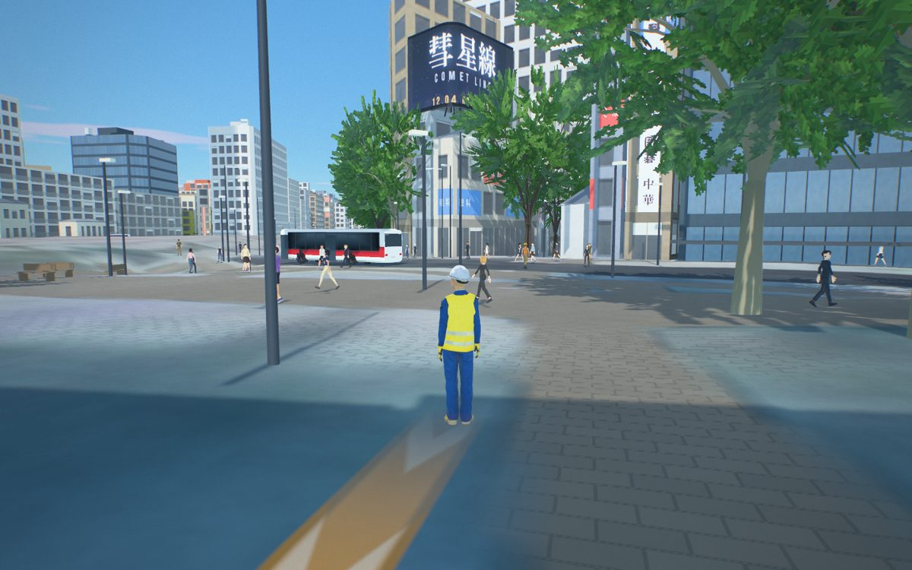 | 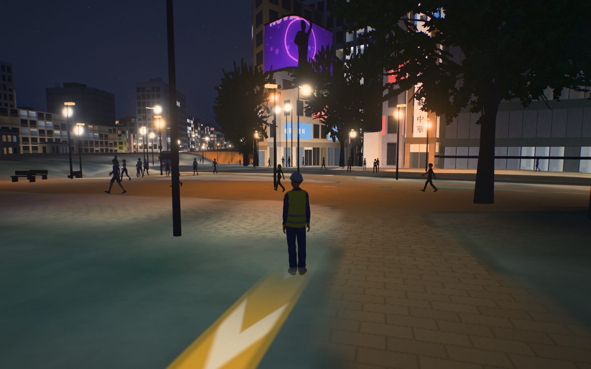 |
| **Ichibangai's arch at dusk** | **Shinjuku on the title's subway map** |
| 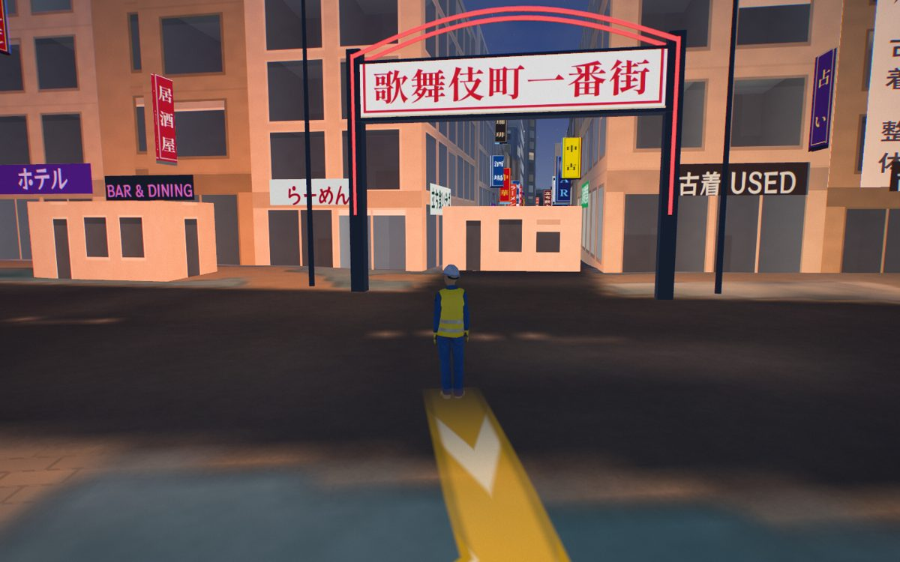 | 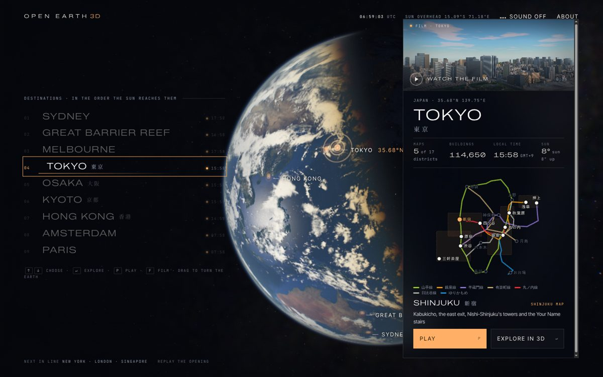 |

| The 男坂 at dusk, rendered in Cycles (`blender/build_scene.py`) | Kabukicho's arch at night, in Cycles |
|---|---|
| 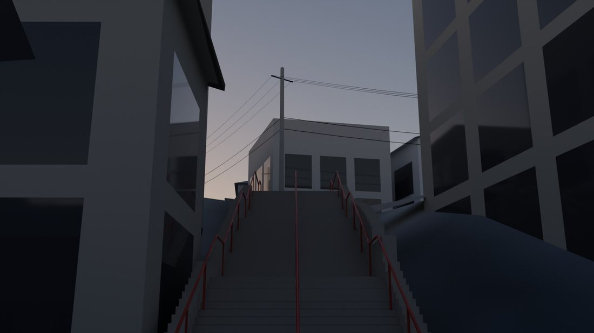 | 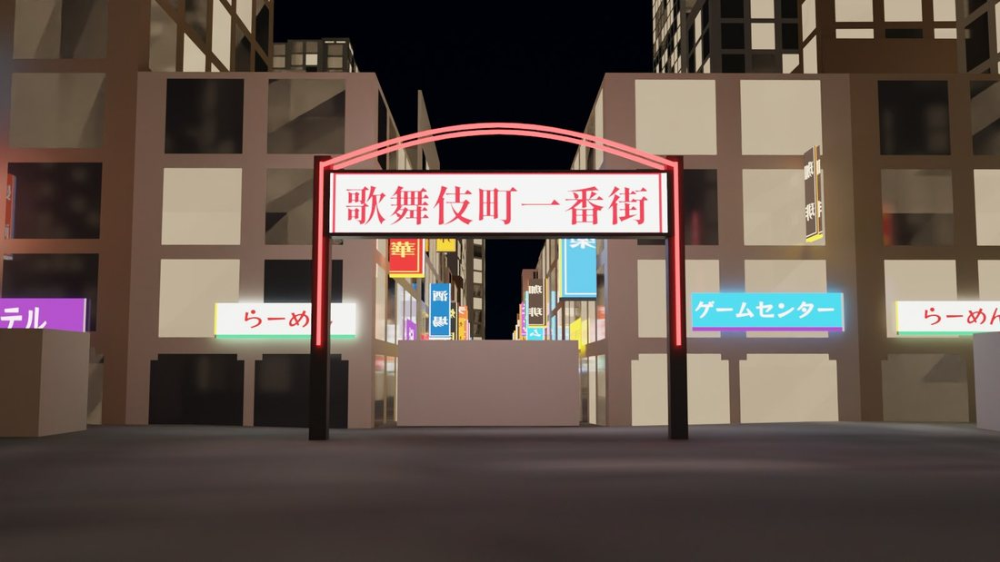 |
| **The 男坂 from the lane at its foot, late afternoon** | **Halfway up: red rails on both sides and down the middle** |
| 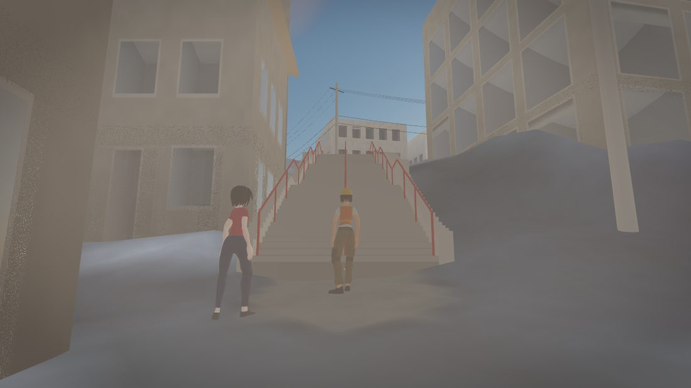 | 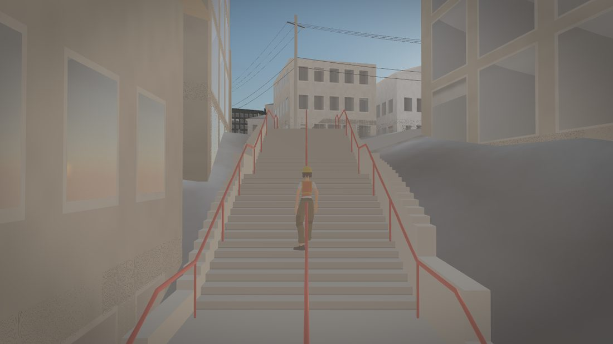 |
| **The approach: the great torii, the banners, Mr Sato** | **The hall** |
| 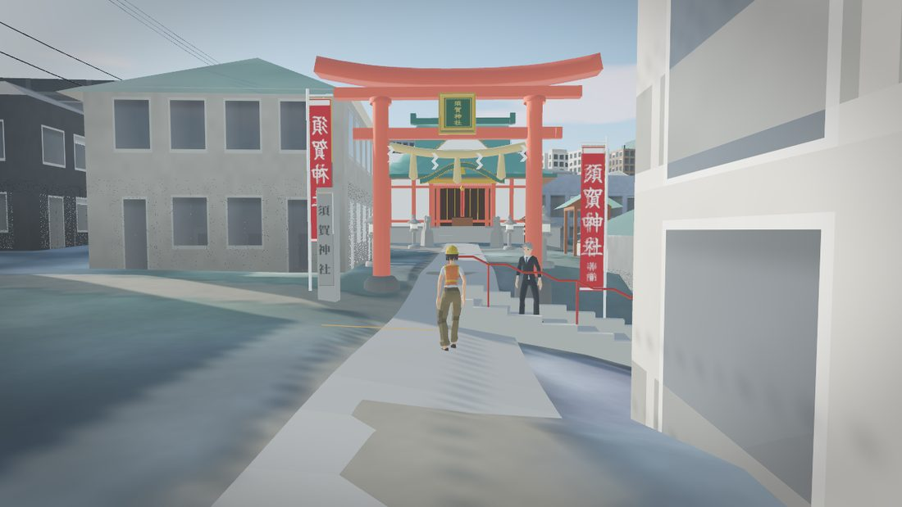 | 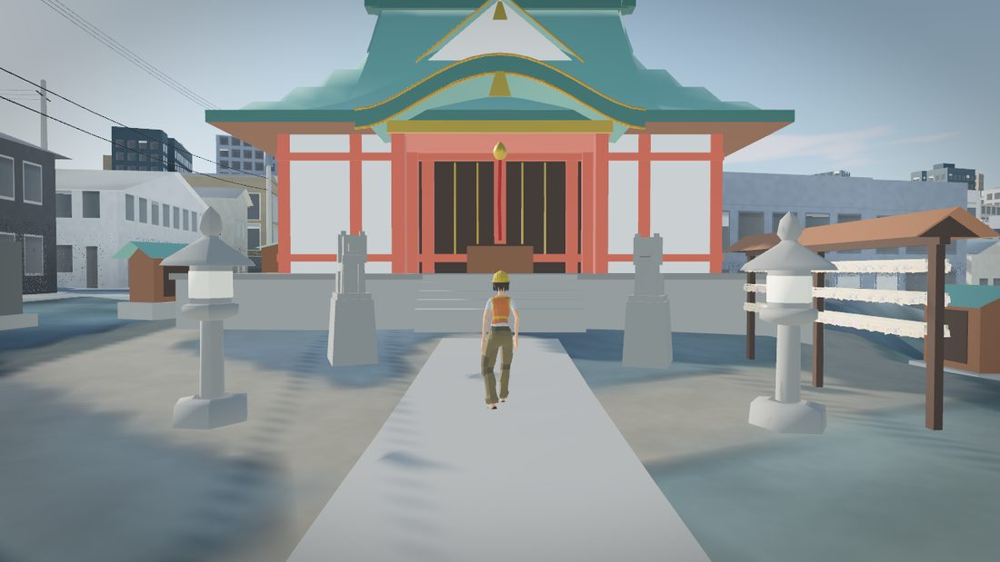 |
| **Reading an ema of 2026, under Yotsuya-sanchome's station sign** | **The precinct from the air** |
| 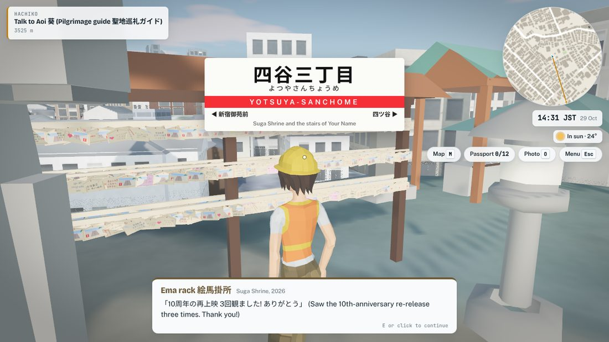 | 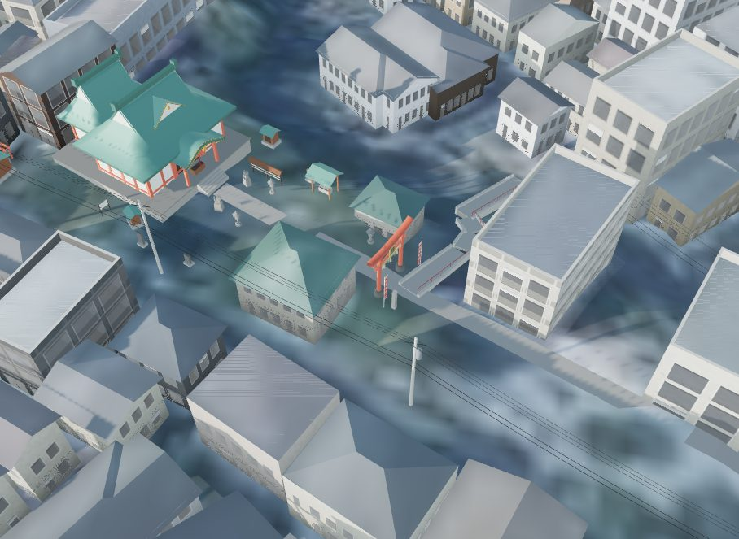 |
| **Kabukicho's arch** | **Overheard at the foot of the stairs** |
| 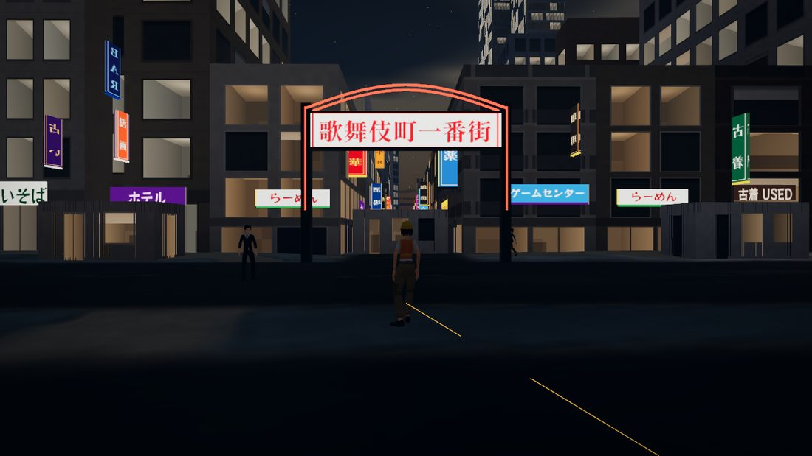 | 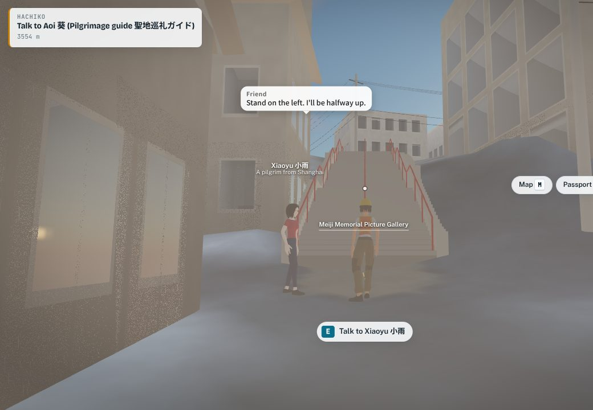 |

## 1. The short answer

- **Scope.** 4.5 × 3.07 km (`extent_m` −1200 to 3300 east, 230 to 3300 north of the shared origin at
  139.6965 E, 35.6685 N): 26,697 buildings in 29,016 solids, 901 of them PLATEAU buildings that
  Overture does not have.
- **Heights.** 84.5% of the footprint area stands at a PLATEAU surveyed height, 3.1% at an
  OpenStreetMap height, 1.5% at a floor count and 10.9% at an estimate from the neighbours (cross-
  validated median error factor 1.22). 17 buildings that OpenStreetMap maps much taller than the survey
  keep the mapped height: they were built since (the Tokyu Kabukicho Tower among them).
- **Terrain.** GSI's 5 m airborne-laser DEM. Against GSI's elevation service at 521 points it agrees to
  a median of −0.01 m, and 98.7% within a metre. AWS's Terrarium tiles read 7.4 m too high at the
  median, because they are a surface model.
- **Suga Shrine.** The 男坂's 52 steps in three flights, with landings and red iron handrails, set into
  the slope; the 女坂; the hall, the great torii, the temizuya, lanterns, komainu, the Tenpaku Inari and
  about 400 ema of 2026 on the rack. Section 3.
- **Shinjuku.** Kabukicho Ichibangai's red arch (1969); the screens over the east exit, Cross Shinjuku
  Vision's bend and its cat, and Unica Vision (section 4); the Docomo tower's clock (15 m across,
  150 m up) and mast to 272 m; shop signs in Kabukicho, Golden Gai and 2-chome; utility poles and their
  wires in the lanes round the shrine.
- **Shinkai's Shinjuku.** Shinjuku Gyoen's shelter by the pond from *The Garden of Words*, the wisteria
  trellis, the Kyu-Goryotei and the Japanese garden's ponds and maples; the Shinanomachi Station
  footbridge and Yotsuya's moat from *Your Name*; where Yoyogi Kaikan stood (*Weathering with You*);
  Sangubashi Station (*5 Centimeters per Second*). Section 5.
- **Game.** *Tokyo Pilgrimage: Shinjuku*: a welcome at the east exit, then four walks in any order.
  Section 6.

## 2. Sources

| Layer | Source | Licence |
|---|---|---|
| Building heights, massing | Project PLATEAU Tokyo 23 wards LOD2 (MLIT), read as the vector tiles published by indigo-lab | CC BY 4.0 (PLATEAU), MIT (tiles) |
| Footprints, names, roads, steps, water, parks | Overture Maps, release 2026-10-21.0 (OpenStreetMap) | ODbL |
| Points in the shrine precinct | OpenStreetMap nodes (the temizuya, the fire brigade's mound, the subsidiary shrines) | ODbL |
| Terrain | GSI DEM5A, 5 m airborne laser survey, bare earth (10 m DEM where 5A has no data) | GSI terms of use |
| Aerial photos | GSI seamless photos, zoom 17 | GSI terms of use |
| Lettering on ema, plaques and signs | Google Fonts (see [Shibuya](shibuya.md#2-sources)) | SIL Open Font License |

The terrain is cut where the stairs are set into the slope (`adjust_terrain`): the terrain under each
tread is lowered by the least change to the grid that clears it, and each grid point moves in proportion
to how far it stands above the treads, so the hillside beside the stairs takes the cut and the lane at the
foot barely moves. The checks compare the uncut DEM.

## 1a. Sumitomo Triangle Plaza

OpenStreetMap maps the Sumitomo Building's Triangle Plaza (新宿住友ビル三角広場, r11664668, 4,601 m²,
opened 2020) as `building=roof`, so `pipeline/arcades.py` stood it on posts (#245). It is an all-weather
atrium under a glass roof, closed on every side by glass walls between the building's wings, so it is a
glass building from the ground again (`city.json` `roofs.closed`, #246). Checked for #258 against a photograph
from above ([Shinjuku Sumitomo Building, 2026.jpg](https://commons.wikimedia.org/wiki/File:Shinjuku_Sumitomo_Building,_2026.jpg),
Akonnchiroll, CC BY-SA 4.0, compared, not copied): its glass slopes in facets from low eaves round its edge up
to the tower on all three sides, so it has a faceted glass roof from 4.5 m to its 20 m top by the tower, and
the tower's low PLATEAU solids (r9215167 under 30 m) are drawn as its other wings (`roofs.atrium_parts`).

**Two more roofs (#258).** The 2,394 m² roof at 26 m that OpenStreetMap maps as `building=roof` (w787547154)
is 186 m long and 13 m wide, between the New National Theatre and Opera City: the Opera City Galleria's glazed
roof over the walkway (`roofs.glazed`: glass, no posts). The roof at 51.6–53.1 m on posts (w1409752350,
30 × 88 m) lies between Keio University Hospital's buildings 1 and 2, over the hospital's taxi and emergency
driveways (OpenStreetMap, mapped from the hospital's own campus plan).


PLATEAU gives the six OpenStreetMap parts of the No. 1 building (Kenzo Tange,
1991) its top's 243 m, so the two towers stood as flat slabs the full width of
their bases with no body between them. OpenStreetMap's parts have their own
heights (`cities/shinjuku/tocho_osm.json`, from `pipeline/osm_parts.py`): the
body under the split 133 m, the towers' notched bases 176 m, their second stages
207 m, the turned tops 243 m. `pipeline/retop.py` applied them to the built
scene, and `adjust_building` applies them, with the body the parts replaced, on
the next build. `cities/shinjuku/tocho.py` draws the building in a granite grid
(a curtain wall of narrow windows between broad granite piers), with the
observatories' glass at 202 m and masts on the roofs. The body is drawn but is
not in the surface model until the next build.

## 3. Suga Shrine and the 男坂

### 3.1 The stairs

The 男坂 is the staircase the film's two leads pass on, and the one on its poster.
The Tokyo stairs database gives it as 52 stone steps, 3.6 m wide, about 16 m long,
at about 27°, with red iron handrails on both sides and down the middle. The model
puts OpenStreetMap's line for the steps on GSI's DEM, which rises 6.8 m from the
lane to the approach (the database gives 6.1 m). The steps take that rise, so they
meet the street and the approach exactly:

| | Model |
|---|---|
| Steps | 52: flights of 18, 16 and 15 up to the approach, and 3 more to the ridge road |
| Riser, tread | 0.139 m, 0.273 m |
| Landings | two, 1.32 m deep |
| Width, length | 3.6 m, 16 m |
| Handrails | red iron, both sides and down the middle |

In the game the stairs are a walkable surface whose profile follows every riser,
so feet land on the treads, and the crowd's footways are draped onto it.

### 3.2 The precinct

The approach runs from the head of the 男坂 to the hall, along OpenStreetMap's
path; the hall stands on OpenStreetMap's footprint and faces the torii. From the
stairs: the great torii (1990, vermilion, myojin style, with its green plaque),
the shrine's banners, the temizuya on the right with the く組 fire brigade's
ladder mound beside it, stone lanterns and two pairs of komainu, the ema rack, the
haiden with its green copper irimoya roof, chidori gable and karahafu over the
porch, and the honden behind it. Beside them: the Daikoku and Sorei shrines and
the Tenpaku Inari with its small torii and foxes. The OpenStreetMap nodes place
the temizuya, the mound and the subsidiary shrines; lanterns and komainu are
placed by a clearance search against the precinct's buildings. The hall is
reinforced concrete since the post-war rebuilding; its roof's proportions are an
approximation from photographs, with the ridge at PLATEAU's 10.5 m.

### 3.3 The ema of 2026

The rack carries about 400 ema, two-sided pentagons. The front is the shrine's own
design, the 男坂 painted in colour; the back is a wish, in Japanese, Chinese,
Korean, English, Spanish and French, many for the film's tenth anniversary
(26 August 2026). The wishes were written for this model: no official
anniversary ema had been announced when it was built, and none is a quotation from
the film. There is no character art. The doodles are comets, braided cords and
stairs. In the game, <kbd>E</kbd> at the rack reads one at random, with an English
gloss.

## 4. Shinjuku's east exit after dark

The same kit (`pipeline/screens.py`, `pipeline/adkit.py`) lights the plaza at Shinjuku's east
exit, the Shinjuku map's busiest corner. Its screens have a sheet of their own (`screens_east.jpg`,
2048 × 1024, six clips) and a material of their own (`screens_east`).

| Screen | Where | Size | Source |
|---|---|---|---|
| Cross Shinjuku Vision | the roof of the Cross Shinjuku building (新宿3-23-18, OpenStreetMap w153133263), bent round its corner over the plaza | 18.96 × 8.16 m, 154.71 m², 6 mm pitch | [AV Watch](https://av.watch.impress.co.jp/docs/news/1337489.html), [DIME](https://dime.jp/genre/1179382/) |
| Unica Vision, three screens | the rounded front of the Shinjuku Unica building (新宿3-23-7) towards Yasukuni-dori and Seibu-Shinjuku station | 13.12 × 7.38 m each, 10 mm pitch since November 2024; 7:00-1:00 | Unica and Sekishin media sheets, [DreamNews](https://www.dreamnews.jp/press/0000240807/) |

- **The bend.** Cross Shinjuku Vision is one screen bent round a corner, built as a strip along
  its foot line with the corner rounded (`path`, `round`): about 7.4 m on the face to the south
  and 11.6 m on the face to the east, its picture running across the bend.
- **Pictures drawn for the bend.** The screen is known for pictures that seem to stand out of it
  from the plaza, above all a giant calico cat (Cross Space, 2021). That production is the
  operator's and is not copied; the screen plays a giant calico cat of our own drawing in the same
  manner (`k_cat_a`, `k_cat_b`): it lies in a room whose back wall stands behind the bend, so the
  bend reads as the room's front corner, looks round at the plaza with its paws over the edge, then
  leans out over the corner with a meow and reaches for the plaza with a paw. Then a goldfish tank
  with a fish swimming out over its corner, and a wave breaking over it. Between them the screen
  plays the same invented music and film adverts as Shibuya's.
- **Unica Vision's three screens** play together (one phase), and their light stays on past
  midnight: `web/night.js` takes a screen's hours across midnight (7:00-1:00).

What could not be checked: the height of the Cross Shinjuku building (16.9 m in OpenStreetMap,
which also gives it 11 floors, so it is probably taller: the screen stands on the 16.9 m roof,
in front of its western neighbour's wall, and the 新宿オカダヤ building to the east hides the far
end of the bend from some of the plaza); how long each leg of the bend is; how the Unica screens are spaced round their front and
how high up it they are (estimated from photographs).

## 4a. Kabukicho at street level, autumn 2026

| The arch from Yasukuni-dori, at night | Ichibangai's tenant stacks | The head over the Toho building's planted ledges, at dusk |
|---|---|---|
| 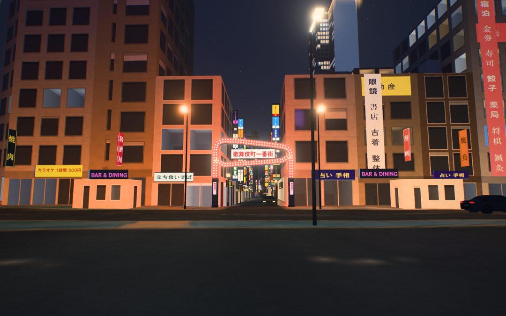 | 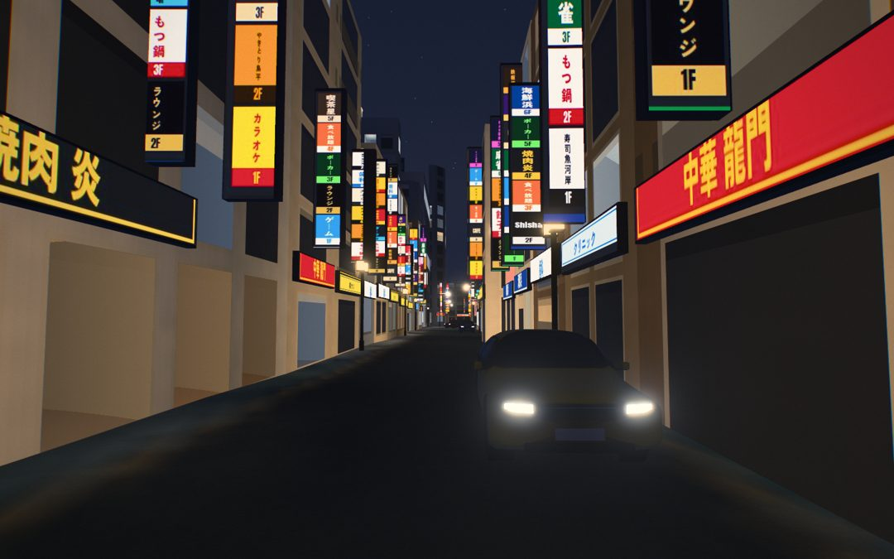 | 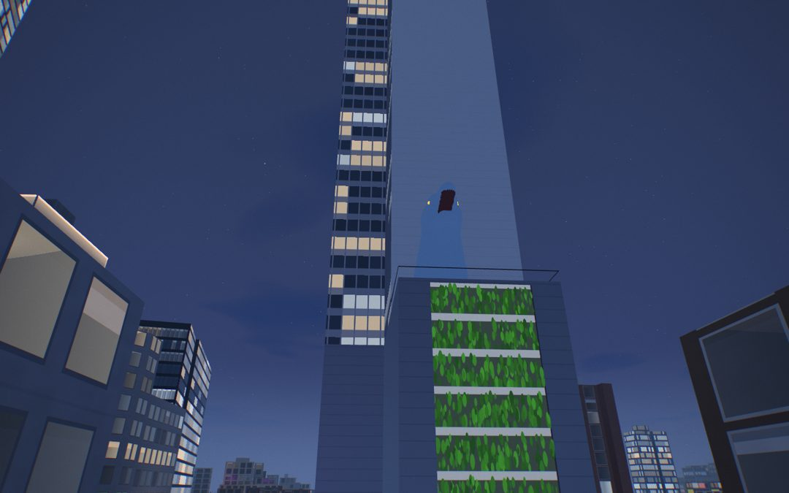 |

`cities/shinjuku/kabukicho.py` draws what a walker sees between the east exit and Cine City Plaza, as
it stands now, on OpenStreetMap's hand-mapped detail (`cities/shinjuku/kabukicho_osm.json`,
`pipeline/osm_detail.py`, ODbL) and photographs (Wikimedia Commons, 2023 to September 2026; looked at,
not copied into the repository). Its signs and screens have an atlas of their own (`kabukicho.jpg`).

| What | As built | Source |
|---|---|---|
| Kabukicho Ichibangai's arch (1969) | Two grey granite pillars 3.3 m high, 8.6 m apart (the street between the corner buildings); on them a red box-section ribbon 0.62 m deep looped over the street, the upper band climbing from 6.75 m at the east post to 7.65 m at the west, the lower band falling the other way under the sign; two rows of bulbs on both faces; the white sign 歌舞伎町一番街 in red, 5.0 × 1.05 m, the same both ways; the pink 劇場通り boxes on the pillars. It stands 11 m up the street from Yasukuni-dori, where the zebra across the mouth of the street ends. OSM maps it as a little building (w820506894), which is not drawn. | Commons photographs of September 2026 (south side, in rain) and 2023 (north side); 55th year in 2025: [Sanshin Shoji](https://san-tatsu.jp/pressrelease/462363/) |
| The canyon: Ichibangai, Central Road, Sakura-dori | A tall tenant sign standing out from each 7 m of front, from the second floor to one under the roof, a panel a floor with its floor (2F ... B1F) in a band; a lit box over each shop front; lantern lamps every 12 m on alternate sides, half a metre in front of the fronts. A front within 9 m of a tenant mapped in OpenStreetMap carries the real names: 64 named shops, restaurants, bars, karaoke boxes and drugstores along the three streets (`cities/shinjuku/kabukicho_tenants.json`, OSM nodes read on 5 November 2026; brothels left out), each a panel on its building's stack with its floor where OSM gives a `level` (18 of them; OSM's level 0 is 1F), and the one on the street floor over the shop front. Colours go by trade, not by brand, and no logo is drawn. Fronts with no mapped tenant keep Kabukicho's trades under invented names. The districts' generic shop signs (`cities/shibuya/city.py`) are left off these fronts. | OSM (ODbL); Commons photographs; OSM maps no lamps there |
| Central Road's trees | OSM's 13 trees along Central Road are drawn as clipped street trees 5.5 m tall, under the sign stacks, so that the head shows over them from the street's south end. The generic mapped tree is drawn 9 to 19 m tall, and those hid the head from most of the street. They are taken out of `places.json` and planted as the landmark's own trees (`cities/shinjuku/city.py`). | OSM tree nodes (ODbL); the height is an estimate (see below) |
| The kaiju on the Shinjuku Toho Building | A head 12 m tall on the eighth-floor terrace, its top about 52 m over the street, looking down Central Road (Godzilla Road). Sculpted for the model (`pipeline/sculptkit.py`): a generic reptile, open-jawed, with plates down its neck; not Toho's figure. The building is redrawn: an eight-storey podium (40 m) whose roof is the terrace, and the hotel tower set back 15 m behind it to the building's 130 m (PLATEAU's outline carries the tower's height over the whole footprint). | [Movie Walker](https://press.moviewalker.jp/news/article/57464/), [eiga.com](https://eiga.com/news/20150409/17/) (April 2015: 12 m, about 52 m up, 80 t) |
| Studio Alta (新宿ダイビル, 1980) | Closed on 28 February 2025, pulled down from 25 April 2025, the lot clear by July 2026. Its solids are left out (`landmark_demolished`); a white hoarding 3 m high stands round the lot, its notice toward the plaza. What goes up next has not been announced. | [WWD](https://www.wwdjapan.com/articles/2050496), [Livedoor News](https://x.com/livedoornews/status/1905396056751579292), [site report, 2026](https://kiichiroyoshimoto.jp/2026/04/27/45%E5%B9%B4%E3%81%AE%E6%AD%B4%E5%8F%B2%E3%81%8C%E3%80%81%E4%BB%8A%E3%81%BE%E3%81%95%E3%81%AB%E6%9B%B4%E5%9C%B0%E3%81%B8%E3%81%A8%E3%83%BB%E6%96%B0%E5%AE%BF%E3%82%A2%E3%83%AB%E3%82%BF1984%E2%87%942026/) |
| The Unica building's names | UNIKA BLDG. over its screens, GOLF5's green flagship box and Alpen TOKYO over the shop floors, on its curved front to Yasukuni-dori: what you see through the arch from the north. | Commons photographs, 2023-2026 |

**Learning from a game, not copying it.** Kabukicho is the model for the Yakuza series' Kamurocho
(Ryu Ga Gotoku Studio). What its streets get right, and what was adopted here: the gate as the
threshold you pass under, read from both sides; the canyon made by tenant signs standing out from
every front, one tenant a floor, which reads as a wall of light at night from far down the street;
a tower and a plaza closing the north end; and a district told in short encounters with the people
on its streets (overheard talk, things to look at, small errands) rather than in a single plot. Its
names, signs, characters and look are not used.

What could not be checked: the arch's heights (scaled from photographs, about ±0.4 m; no published
drawing was found); whether Cross Shinjuku Vision 2 has opened (below); the height of Central Road's
trees against a photograph (Wikimedia Commons refused this session's requests); the tenants of
fronts OSM does not map; the real lamp positions; the exact plan of the Toho building's terrace.

## 4b. Shinjuku Station's faces and the towers round it, autumn 2026

| The west exit's site from the bus terminal, day | The same at dusk | And at night |
|---|---|---|
| 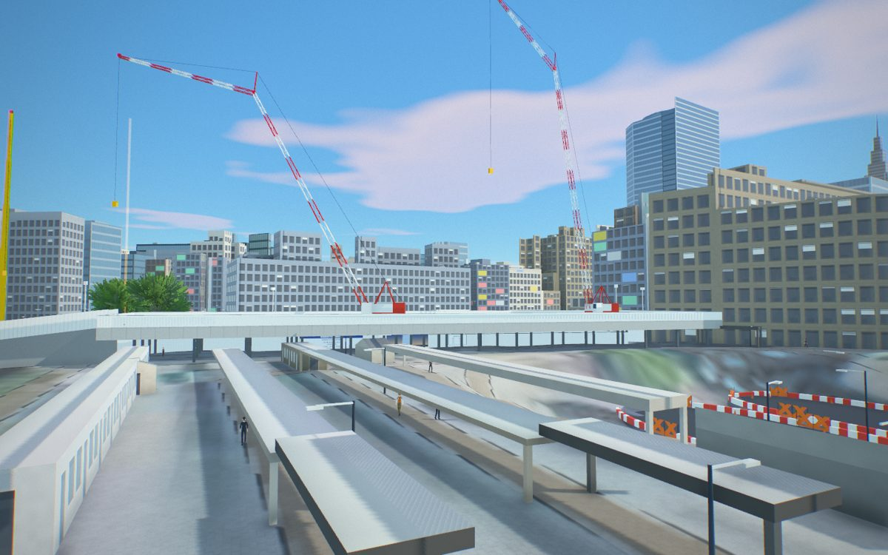 | 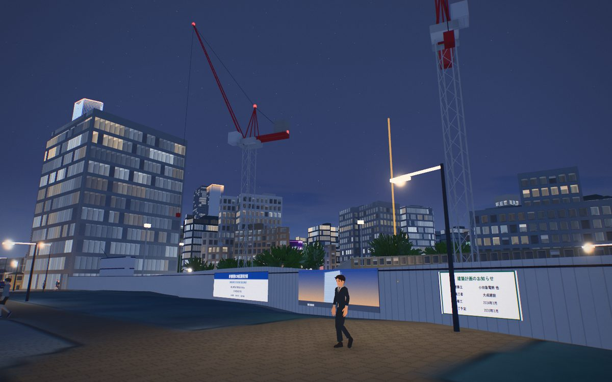 | 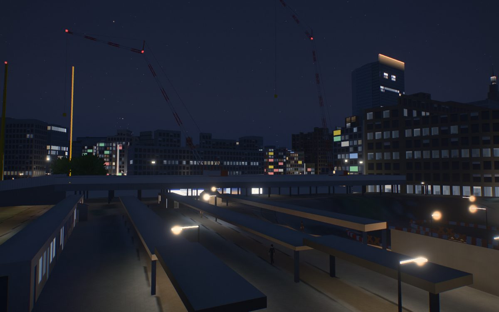 |
| **Tokyu Kabukicho Tower from Cine City Plaza, day** | **Its crown at night** | **Its frit and name at night** |
| 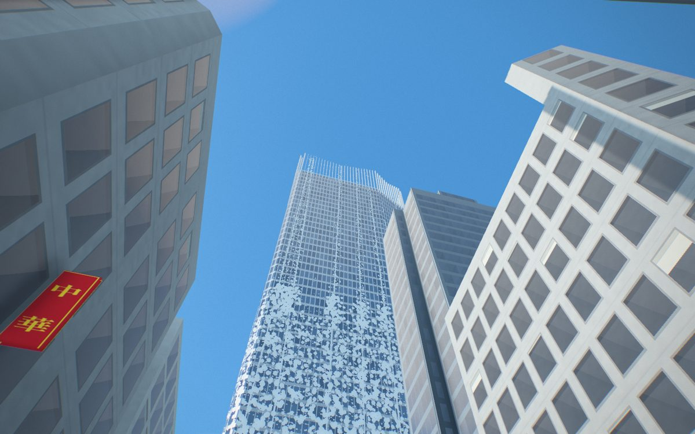 | 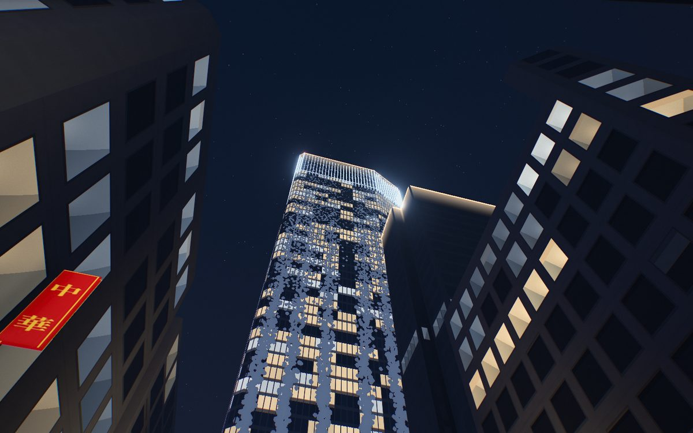 | 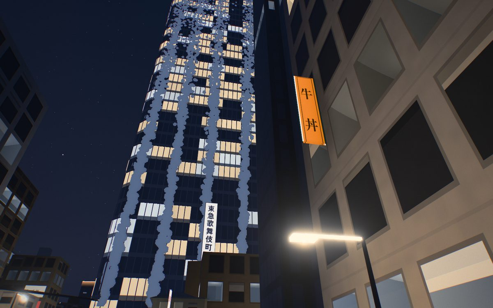 |
| **LUMINE EST and the station's sign** | **Hanao-san in the East Square** | **The west exit's ramps** |
| 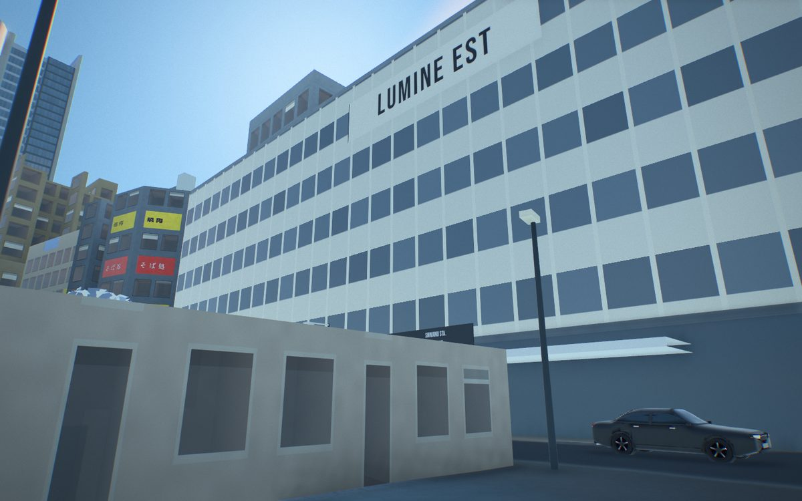 | 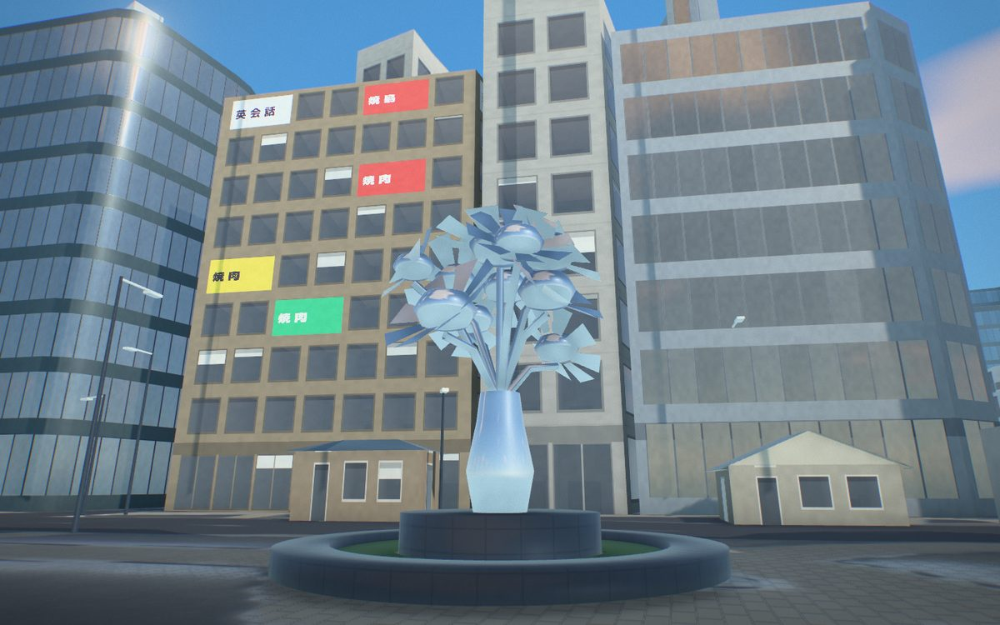 | 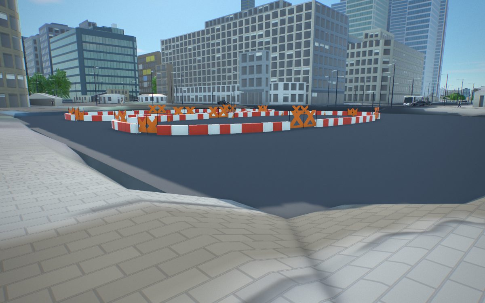 |
| **Central Road: the head over the clipped trees** | **On a phone: the site at dusk** | **On a phone: the tower at night** |
| 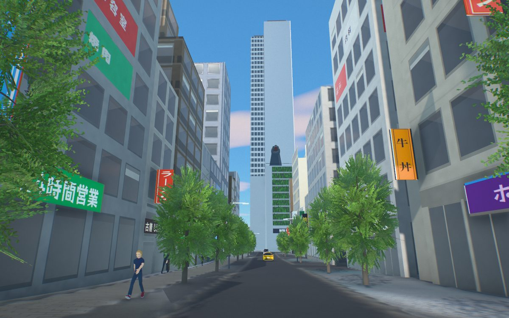 | 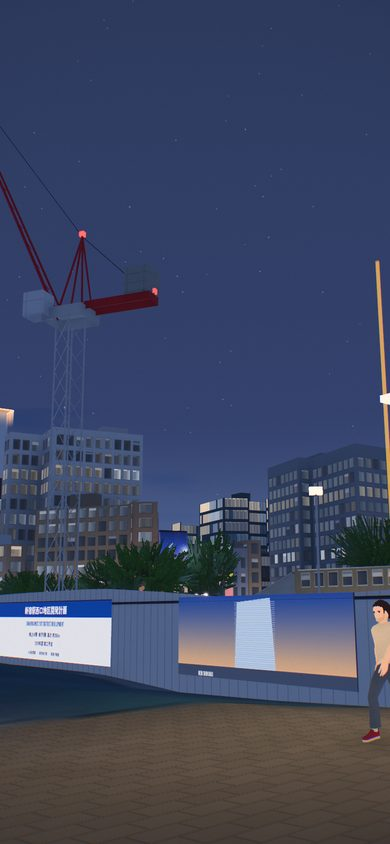 | 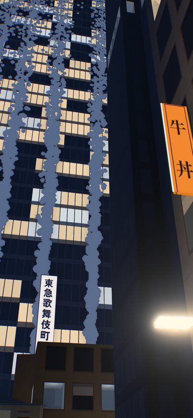 |

`cities/shinjuku/station.py` adds what stands round the station's two exits and over Cine City Plaza,
with an atlas of its own (`station.jpg`) and the tower's frit (`kabukicho_tower.png`). Street-level
stills at day, dusk and night, desktop and phone, are in `docs/images/shinjuku/` (`station-*.jpg`;
viewpoints in `tools/views/shinjuku-station.json`, taken with `tools/scramble_shot.js`).

| What | As built | Source |
|---|---|---|
| The west exit's construction site (新宿駅西口地区開発計画) | The Odakyu department store's main building (Junzo Sakakura, 1967) closed on 2 October 2022 and came down; the new building was begun on 25 March 2024: 48 storeys, five basements, 258.15 m, by Taisei, due at the end of March 2030 (fiscal 2029). PLATEAU surveyed the old building standing: its 15 PLATEAU-only solids over 20 m inside the site are left out (`landmark_demolished`). The site is OSM's construction area (way 1214435033) joined to the old building's footprint. Drawn: white hoarding 3.6 m high along the plaza and the lane, the project's board, a drawing of the tower and the building notice on its face to the plaza; the site office in cabins three high with the contractor's band; floodlights on masts; two luffing-jib tower cranes (white masts, red jibs); the ground-floor deck, the concrete core two storeys up and the first tier of steel columns in red primer under a safety net. In January and July 2026 the work was still mostly below ground, so the steel is drawn short. The cranes' and the office's places, the crane type and the steel's height are illustrative. | [Odakyu, Tokyo Metro and Tokyu Land, 25 March 2024](https://www.odakyu.jp/news/b4fuqs0000000tzh-att/b4fuqs0000000tzo.pdf); [Nikkan Kogyo](https://newswitch.jp/p/41005); site reports of [24 January 2026](https://view.tokyo/?p=75928) and [11 July 2026](https://view.tokyo/?p=83002) |
| Tokyu Kabukicho Tower (2023) | 225 m, 48 storeys, on its OSM outline (w852000385, the solid it replaces is hidden). Blue-silver glass in a 1.5 m grid to 200 m, lit window by window after dark; over it, 0.35 m out, a white frit skin printed as rising jets of water that open into spray toward the top, the fountain Yuko Nagayama drew the facade as; the crown's fins from 197 m to 225 m, taller toward the corners, lit cool white at night; on its faces to Cine City Plaza the lobby glazed and lit to 8.5 m, a steel canopy at 6.2 m on round columns, TOKYU KABUKICHO TOWER over it and 東急歌舞伎町タワー standing up the frit. The frit's picture is drawn for the model, not traced from the building. | [Tokyu Kabukicho Tower](https://www.tokyu-kabukicho-tower.jp/), Nagayama's description of the facade; OSM (height, levels, architect tags) |
| LUMINE EST's front to the East Square | Pale bands between the windows of its upper floors (lit after dark), the street floor glazed and lit, a canopy 28 m long over the doors, LUMINE EST near its top and the station's sign 新宿駅 東口 / Shinjuku Sta. East Exit over the canopy, on the east face of its OSM outline (r16502754). | Photographs; OSM |
| Hanao-san (花尾), Tomokazu Matsuyama, 2020 | At the centre of the East Square (renewed 19 July 2020), in the round of OSM's footways: a granite base 1 m high and 4 m across, and on it a bouquet 7 m tall of open blooms on their stems, every surface a mirror; round it the round bench, 0.45 m high, with planting inside. OSM maps the bench as a 1 m building (relation 16263947) and PLATEAU stands it and two planters at 2.4-2.8 m, which drew them as huts round the sculpture: those three solids are not drawn. The blooms are drawn for the model, not the artist's figure. | [Time Out Tokyo](https://www.timeout.jp/tokyo/ja/ニュース/新宿駅前に7メートルの彫刻が誕生-パブリックアートに親しんで-081120) (7 m); [tabi-mag](https://tabi-mag.jp/hanao-san/) (8 m with the base) |
| The west exit's ramps (Sakakura, 1966) | The two oval loops that take the cars down to the underground plaza, placed on GSI's aerial photograph: their parapets 1.1 m high with a rail on top, open to the east where the roads come up, and the planted islands inside them. The model's ground has no hole, so the ramps' roadway does not go down. | GSI seamless photo (zoom 17); OSM roads |

**Cross Shinjuku Vision 2.** An Con Consulting announced it on 13 February 2025: a vertical screen on
the roof of a new four-storey building (one basement) across the side street from the Cross Shinjuku
building, playing in step with the cat screen, due in 2026. Construction began in February 2025, tenant
leasing in April 2026 and completion was due within 2026. No report of it opening was found by
5 November 2026, so it is not added to `SHINJUKU_SCREENS`; its size and position have not been
published either. Sources: [PR TIMES](https://prtimes.jp/main/html/rd/p/000000009.000055107.html),
[Sign News](https://www.sogohodo.co.jp/display/29502/), [Cross Shinjuku Vision](https://shinjuku.xspace.tokyo/).

**The Shinjuku film.** The film of issue #93 shows Kabukicho and the plaza at night; Tokyu Kabukicho
Tower's crown and frit, the real tenants' stacks and Central Road's lower trees change what those shots
show, so it should be rendered again once both have landed.

## 5. Shinkai's Shinjuku: the pilgrimage sites

Makoto Shinkai's films made central Shinjuku one of the most visited places for film pilgrimages
(聖地巡礼). The map has the places of three of them that are inside its bbox, built in
`pipeline/shinkai.py` (chained after the shared Shibuya hooks in `cities/shinjuku/city.py`). Places
only: no art, frames, characters or logos from the films, and the guide's words are our own.

| The shelter by the pond in late November | Inside the shelter, looking out over the pond |
|---|---|
| 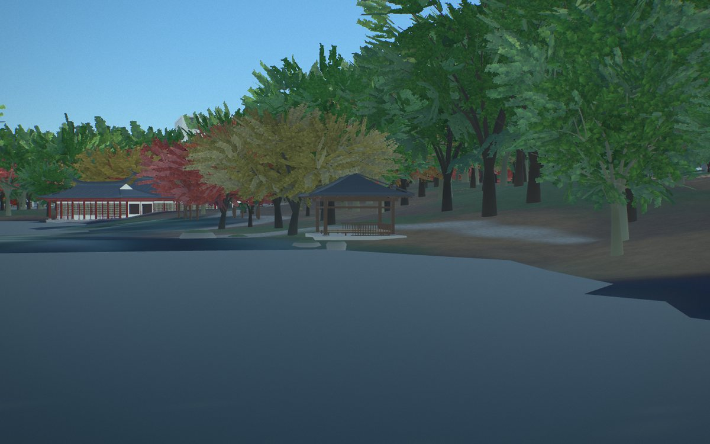 | 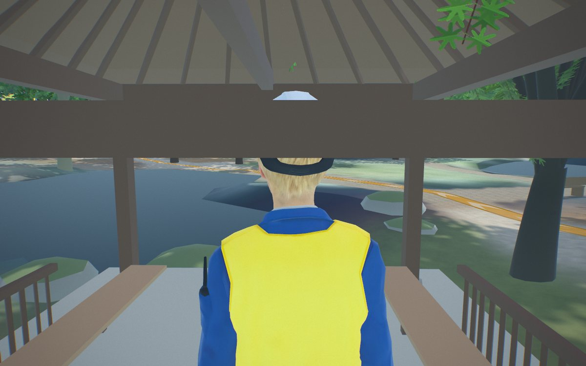 |
| **The Kyu-Goryotei from the pond path, maples turning** | **The Kyu-Goryotei after dark** |
| 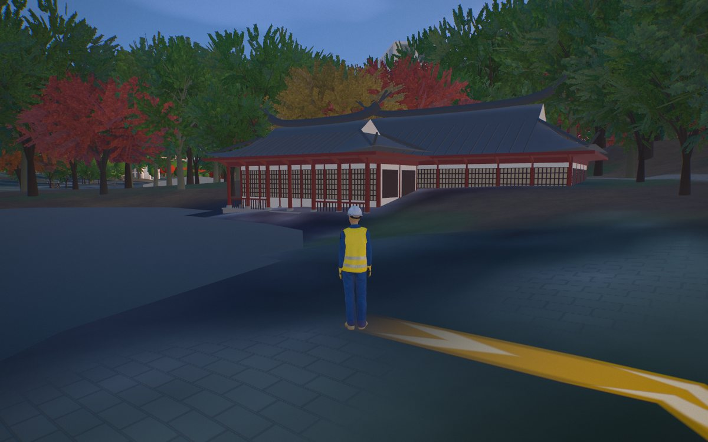 | 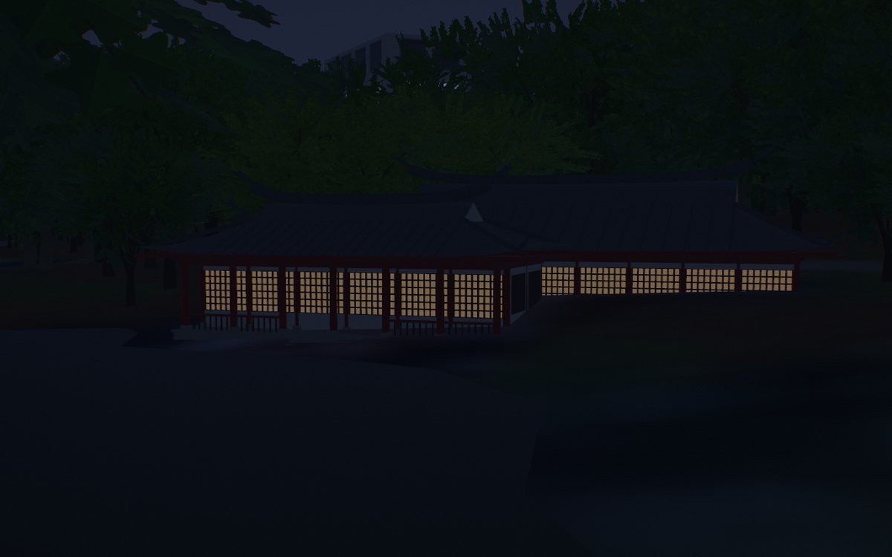 |
| **On the Shinanomachi footbridge at dusk: the Docomo tower up the street** | **The footbridge and its three flights** |
| 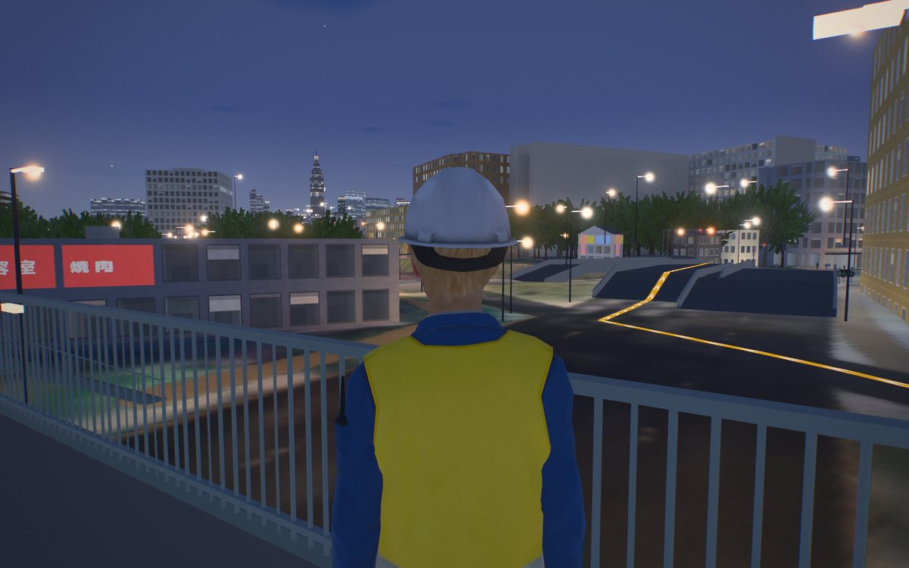 | 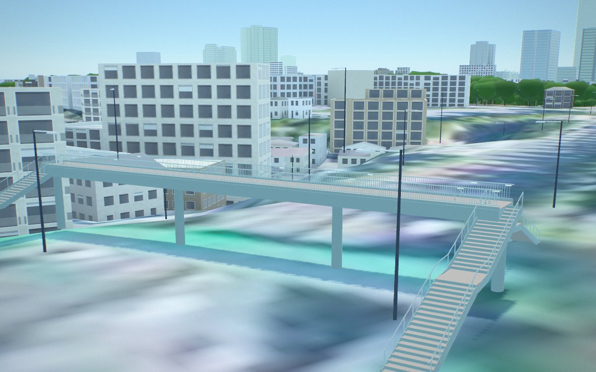 |

### 5.1 Shinjuku Gyoen: The Garden of Words (言の葉の庭, 2013)

- **Where the shelter is.** Pilgrimage guides agree that the film's azumaya (東屋) is the rest shelter by
  the pond of the Japanese garden, near the Kyu-Goryotei, reached from the Sendagaya gate, on the pond's
  shore with the water in front and trees behind (tianlang2's survey; libert; FotoReiser). The garden's
  own map (Ministry of the Environment, 見どころ map) marks a shelter on the south shore of the second
  pool west of the Kyu-Goryotei. OpenStreetMap maps that pond (relation 5362865) but not the shelter, so
  the model stands it on the mapped shore nearest the map's mark (139.7081 E, 35.6848 N), 3.4 m back from
  the water, its open side to the pond.
- **The shelter.** A square timber shelter: four posts on base stones 3.2 m apart, eave and tie beams, a
  pyramidal (hogyo) roof 0.85 m out over the posts on exposed rafters with a bronze finial, benches round
  three sides with slatted backs, and the pond side open; shore stones along the water in front. The form
  is from photographs; the dimensions are a park shelter's, not a survey. The real shelter has had an
  ashtray stand in the middle (removed from the model). It is walkable: its frame is not solid in the
  game's 2 m collision grid.
- **The wisteria trellis (藤棚)** on the pond path between the shelter and the Kyu-Goryotei, as the guides
  place it: 7.2 × 4.8 m of log posts and a pole grid at 2.4 m, three old vines and their leaves (in leaf,
  not in flower: the wisteria blooms in late April and early May).
- **The Kyu-Goryotei (旧御涼亭, the "Taiwan Pavilion").** Given by Japanese residents of Taiwan for the
  Crown Prince's wedding and finished in 1927 (design Moriyama Matsunosuke): a single-storey timber
  pavilion in the Min-nan style of southern Fujian, clay-tiled (honkawara), 165 m², restored in 2002, a
  Tokyo selected historic building (Kanto Regional Development Bureau; Tokyo's register). The model takes
  OpenStreetMap's 276 m² stepped footprint (which includes the veranda), splits it into its three halls,
  each under a hip-and-gable roof of grey tiles with the ridge sweeping up into swallowtails, the main
  ridge at 8 m (PLATEAU's 10.3 m top is capped: it likely includes the trees over it), red columns, lattice
  windows (their paper lit softly after dark) and an open veranda with a low railing on the pond side.
  The proportions are approximate.
- **The ponds.** The viewer's water lies at sea level, so a garden pond 30 m up is drawn here: each pond
  inside the garden (Overture's land use 新宿御苑, 11 ponds) is a sheet of water at its low shore (the
  15th percentile of the ground round it), the grid inside it lowered 0.6 m under that and the bank to
  within a metre or so above (`adjust_terrain`); the laser survey's ground over a pond is the interpolated
  water surface, which the 10 m grid smoothed into mounds. The canopy model's trees are kept out of the
  ponds and off the models (`woods_clear`).
- **The maples.** The shared trees now include a Japanese maple (`blender/build_trees.py`), red from mid
  November to mid December, each tree its own shade from crimson to gold. `trees.areas` plants them round
  the Japanese garden (22% of its trees) and on Momiji-yama by the lower pond (55%), where the garden's map
  names them. Species are not surveyed there either; the shares are a guess.
- **Rain.** The film is set in the June rain. The game has no weather yet, so the guide says when the rainy
  season is instead; rain to go with it is a follow-up (an issue on GitHub).

### 5.2 Your Name (君の名は。, 2016)

- **Suga Shrine's 男坂** is section 3. The travel point `t-stairs` stands you at the foot of the stairs
  looking up them, the view the poster takes; the guides' other view is from the top looking down.
- **The Shinanomachi Station footbridge (信濃町駅前歩道橋).** On OpenStreetMap's line (way 381567526,
  level 1) and its three flights of steps (ways 97195468, 381567525, 97195476): a steel deck 2.4 m wide,
  5.6 m over the highest ground under it (a Tokyo footbridge's 4.7 m clearance plus the girder), railings
  of thin bars open where the flights leave, piers at the nodes, lamps on the rails; flights of 0.3 m
  treads and risers of up to 0.16 m with a landing half way, stringers and handrails. All of it is walkable
  (`game_surfaces`), and `tools/game_check.js` climbs each flight. Looking north-west from the deck, up
  Gaien-higashi-dori, the Docomo tower's clock stands over the street, the view pilgrims come for.
- **Yotsuya.** Yotsuya Station sits in the old outer moat of Edo Castle (外濠), the Chuo line along its
  bottom and Sophia University's sports ground in the drained moat beside it (上智大学真田堀グラウンド). The
  film's commuter town is this one. They are the map's own: Overture's and PLATEAU's buildings, OpenStreetMap's
  station and land use; the walk sends you along the bank and over the tracks.
- **The south side of Shinjuku Station** (Southern Terrace, Busta Shinjuku) is in the map as Overture and
  PLATEAU have it.

### 5.3 Weathering with You (天気の子, 2019)

- **Yoyogi Kaikan (代々木会館)**, Yoyogi 1-35-1 by Yoyogi Station's west exit, was the old block whose roof
  the film gave a shrine. It was pulled down from August 2019 (Business Insider Japan; honichi) and an
  office building stands there now, so it is not modelled: the guide sends you to stand where it was
  (Overture's address point for 代々木一丁目 35).
- **Kabukicho's streets and Shinjuku's rooftops** are the map's own (sections 1 and 4).
- **5 Centimeters per Second (秒速5センチメートル, 2007).** Sangubashi Station on the Odakyu line, at the map's west
  side (OpenStreetMap's station node): the walk ends there, and it puts up its station sign.

### 5.4 In the game

A fourth walk, **Shinkai's Shinjuku**: Kaede, a garden volunteer, meets you by the trellis and sends you to
sit in the shelter, under the trellis and to the pavilion's side of the pond, then to Kenji, a photographer
on the Shinanomachi footbridge, who has you look up the street and sends you on to Haruka, a Sophia student
at Yotsuya Station. She walks you along the moat's bank and over the tracks, and sends you west to where
Yoyogi Kaikan stood and to Sangubashi Station. Stamps 東屋, 歩道橋 and 四ツ谷; travel points `t-gyoen`,
`t-shinano` and `t-yotsuya` (`#play-shinjuku@t-gyoen`); station signs for Yotsuya and Sangubashi.
`tools/game_check.js` travels to each new point, climbs each flight of the footbridge and checks that every
step of the walk can be reached.

## 6. Tokyo Pilgrimage: Shinjuku

Nao, a pilgrimage guide (Aoi's colleague in Shibuya), meets you at the east exit, under the corner
screen; then four lines run side by side, and a report back waits for all of them:

| Line | Who | What you do |
|---|---|---|
| Welcome | Nao at the east exit | Stand under the cat on the corner screen, look across at Studio Alta's cleared lot, walk under the arch and up Ichibangai to Cine City Plaza, meet Officer Ono at the Kabukicho koban (where it stands, at the top of the street) |
| Shinjuku | Mika, a bartender in 2-chome; Officer Ono at the koban; Fumi, who keeps a bar in Golden Gai; Kenta, a yakitori cook in Omoide Yokocho | See the arch after dark; look up at the kaiju over Central Road; find Golden Gai, walk up to Hanazono Shrine (its Tori-no-ichi in November); cross under the railway to Omoide Yokocho, and stand at the west exit where the Odakyu department store's main building came down (2022-) for a 260 m tower (2029) |
| Your Name | Xiaoyu, a pilgrim from Shanghai; Mr Sato, a Yotsuya resident | Climb the 男坂, read an ema, stand at the foot of the stairs (a choice sets the clock to dusk) |
| Aoyama | Rin, a high-school student | Walk the ginkgo avenue at Jingu Gaien |
| Shinkai's Shinjuku | Kaede, a garden volunteer; Kenji, a photographer; Haruka, a Sophia student | Sit in the shelter by the pond, walk under the trellis to the Kyu-Goryotei, stand on the Shinanomachi footbridge, walk Yotsuya's moat, find where Yoyogi Kaikan stood, and Sangubashi Station (section 5) |

Ten areas put up their station signs as you walk in: Shinjuku, Shinjuku-sanchome, Tochomae,
Shinjuku-gyoemmae, Yotsuya-sanchome, Yoyogi, Shinanomachi, Aoyama-itchome, Yotsuya and Sangubashi. The
helipad on Kabukicho's Cine City Plaza, by the Toho building, is a game device; there is no heliport there.
Travel points: the east exit, Tochomae, Suga Shrine and the foot of the 男坂, Kabukicho, Aoyama-itchome,
the shelter in Shinjuku Gyoen, the Shinanomachi footbridge and Yotsuya Station; `#play-shinjuku@t-suga`
starts at the shrine. The people are original characters. None stands for a real shop's staff.
Kabukicho adds things to look at (the arch, the head over Central Road, Studio Alta's lot) and talk
to overhear (`kabukicho.extras`). An NPC added to city.json, or moved there by more than 20 m, stands
where city.json puts it when `pipeline/game_text.py` copies the text, without a full game-data build.

## 7. Sun

Tokyo protects no park's sunlight (see [Tokyo](tokyo.md#5-sun-and-the-rules)). The places carry this
project's lunch-hour window, noon to 13:00, as a thought experiment. `analysis/sun_access.js` gives the
mean share of each place in direct sun over the window, December and June:

| Place | December | June |
|---|---:|---:|
| Shinjuku Gyoen | 91% | 98% |
| Suga Park | 24% | 100% |

Suga Park, a small park in the shrine's neighbourhood, is the case a rule would be about: two buildings
of 9 m put three quarters of it in shade at a winter lunchtime, when the sun is 31° up.

## 8. Limits

- The aerial photos are not true orthophotos, and the towers lean in them.
- The shrine's buildings and the district pieces are built from published figures and photographs, not
  surveys. The 男坂 is the closest: its step count, width, length and handrails are published.
- 10.9% of the footprint area has an estimated height. Look for the green tint under **Height sources**.
- Shop signs and shop fronts are indicative; the screens' programmes are invented.
- The Garden of Words shelter, the trellis and the Kyu-Goryotei are built from photographs and published
  figures, not surveys; the shelter's place is the garden map's mark on a mapped shore. The ponds' levels
  are estimated from the shore's ground.

## 9. Reproducing it

```bash
env -u AWS_ACCESS_KEY_ID -u AWS_SECRET_ACCESS_KEY -u AWS_SESSION_TOKEN \
  python pipeline/fetch_overture.py --city shinjuku
python pipeline/fetch_tiles.py --city shinjuku
python pipeline/fetch_plateau.py --city shinjuku
python pipeline/build_scene.py --city shinjuku
python pipeline/landmarks.py --city shinjuku      # the landmark code is cities/shibuya/city.py and pipeline/shinkai.py
python pipeline/game_data.py --city shinjuku
python pipeline/night_lights.py --city shinjuku   # after game_data.py: it reads game.json
python analysis/data_quality.py --city shinjuku
python analysis/dem_check.py --city shinjuku
node analysis/sun_access.js --city shinjuku
node analysis/uncertainty.js --city shinjuku 40
```

## Sources

- Shinjuku Gyoen and The Garden of Words: the garden's map
  ([Ministry of the Environment](https://policies.env.go.jp/national-garden/shinjukugyoen/guide/map/documents/midokoro_main.pdf)),
  the Kyu-Goryotei ([Kanto Regional Development Bureau](https://www.ktr.mlit.go.jp/eizen/shihon/eizen_shihon00000079.html),
  [Tokyo's selected historic buildings](https://www.toshiseibi.metro.tokyo.lg.jp/kenchiku/keikan/rekiken/re_list06.htm)),
  pilgrimage guides ([tianlang2](http://tianlang2.s206.xrea.com/kotonoha.htm),
  [libert](https://libert.co.jp/pilgrimage-guild/kotonohanoniwa-anime-pilgrimage/),
  [FotoReiser](https://alan-d-haller.info/travel_jp/thegardenofwords/),
  [anime-pilgrimage](https://anime-pilgrimage.com/the-garden-of-words/),
  [想景の地](https://fujisyuu01.hatenablog.jp/entry/2024/09/01/184854),
  [astral-tanbou](https://astral-tanbou.com/entry/2015/02/15/235846)).
- The Shinanomachi footbridge: [LIVE JAPAN](https://livejapan.com/ja/article-a0000790),
  [MATCHA](https://matcha-jp.com/jp/3773); its lines are OpenStreetMap's (ODbL, via Overture).
- Yoyogi Kaikan: [Business Insider Japan](https://www.businessinsider.jp/article/195692/),
  [honichi](https://honichi.com/news/2019/09/03/weatheringwithyou), [ciatr](https://ciatr.jp/topics/323253).

- Suga Shrine: [the shrine](https://sugajinjya.or.jp/), its
  [amulets and ema](https://sugajinjya.or.jp/amulet/),
  [Wikipedia (ja)](https://ja.wikipedia.org/wiki/%E9%A0%88%E8%B3%80%E7%A5%9E%E7%A4%BE),
  [jinja-dego](https://jinja-dego.com/kiminonawa-sugajinja/),
  [Walkerplus](https://www.walkerplus.com/trend/matome/article/142038/),
  [jinjamemo](https://jinjamemo.com/archives/yotsuyasugajinja.html),
  [burariwalking](https://burariwalking.hatenablog.com/entry/2025/01/09/%E3%80%90%E6%9D%B1%E4%BA%AC%E9%83%BD%E6%96%B0%E5%AE%BF%E5%8C%BA_%E9%A0%88%E8%B3%80%E7%A5%9E%E7%A4%BE%E3%80%91%E6%9D%B1%E4%BA%AC%E3%83%BB%E5%9B%9B%E8%B0%B7%E7%B7%8F%E9%8E%AE%E5%AE%88%E3%81%AF),
  [Atlas Obscura](https://www.atlasobscura.com/places/suga-shrine-staircase).
- The 男坂: [Tokyo stairs database, 0008 須賀神社 男坂](https://blog.goo.ne.jp/tokyostair/e/bcf61c460347c8f4d8f87c364500b562).
- *Your Name*'s tenth anniversary: [BSC Kids](https://www.bsckids.com/2026/06/sensation-your-name-to-be-rerelased-for-10th-anniversary/).
- The Docomo tower's clock and mast: [GO TOKYO](https://www.gotokyo.org/en/spot/117/index.html),
  [TV Tokyo](https://www.tv-tokyo.co.jp/adomachi/backnumber/20030201/25809.html),
  [SkyscraperPage](https://skyscraperpage.com/b3286).
- Kabukicho's arch: [Sanshin Shoji](https://san-tatsu.jp/pressrelease/462363/),
  [Wikipedia](https://www.wikiwand.com/en/articles/Kabukicho).
- The ginkgo avenue at Jingu Gaien: [Minato City](https://www.city.minato.tokyo.jp/kouhou/kuse/koho/konjaku/konjaku19.html).
