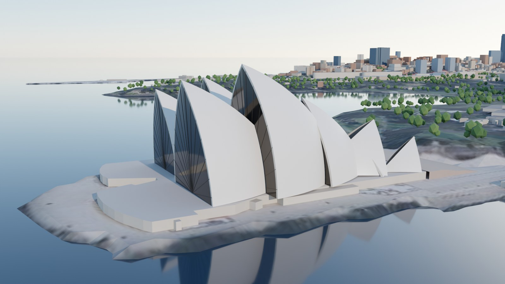
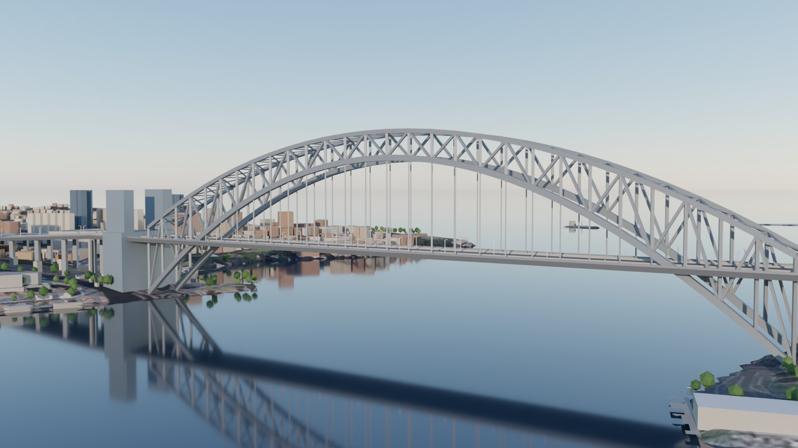
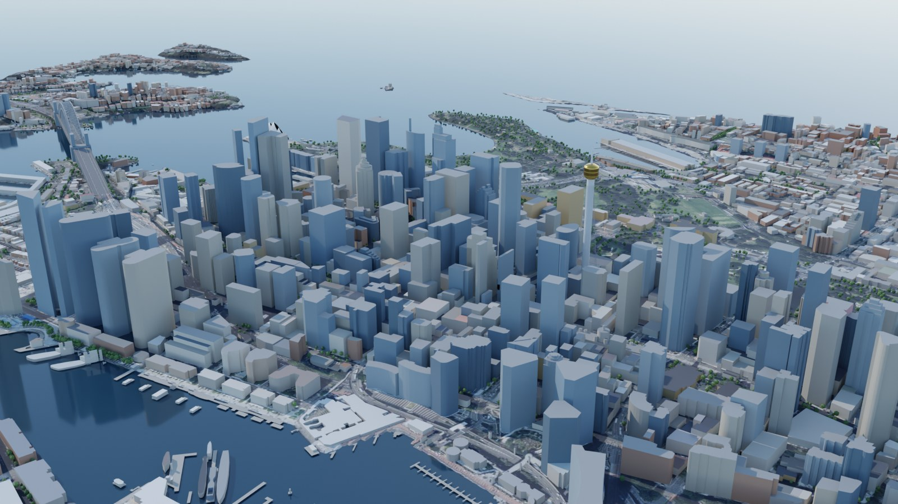

# A 3D Sydney with Opus 5.5 and Blender: can we replicate it, and do better?

> This is the case study that started Open Earth 3D: whether a 3D Sydney made
> with Opus 5.5 and Blender could be replicated from open data, and done better.
> Paths are relative to the repository root; every number here is reproduced by
> the scripts in `analysis/` with `--city sydney`, and their outputs are in
> `cities/sydney/analysis/`.

## 1. The short answer

**Yes to both, but "better" depends on what the model is for.**

- **Replicating it:** the toolchain behind these demos is ordinary and fully
  scriptable. Blender is a pip-installable Python module (`bpy` 5.2.3), and an
  LLM writes the Python that drives it. We rebuilt central Sydney in Blender,
  headless, from one script (section 4).
- **Truthfulness:** the demos are eyeballed from photos. Building positions,
  heights, terrain and sun are approximations nobody measured. Our model puts
  every building on its surveyed footprint, gives each height a stated source,
  and checks it against published figures (median error 4.5% on 35 towers). It
  lights the scene with the true sun for any date and time.
- **Usefulness:** a render answers "does it look like Sydney?". Our model also
  answers planning questions. How much of Martin Place gets sun at lunchtime in
  June? Would a 180 m tower west of Hyde Park break clause 6.18 of the Sydney
  LEP? The answers come in seconds, in a browser.
- **Where the original still wins:** photorealism. Stock assets, hand-tuned
  materials, trees and an hour of Cycles per frame beat our extruded footprints
  and procedural windows as a still image. Section 7 shows how to combine the
  two.
- **Round two (section 9)** went looking for what we did not know we did not
  know, and rebuilt the method from what the answer actually depends on. The
  biggest uncertainty turned out to be legal, not geometric. Whether "12:00"
  means clock or standard time moves one protected place's sun by up to 44
  points. Six cited lookups halved the data uncertainty where it was largest,
  and every sun number now carries a 90% range.

## 2. The original

We searched for the specific "Opus 5.5 + Blender 3D Sydney" post and could
not find it. It was not in two public catalogues of Opus 5.5 3D demos, and the
only Sydney entry we found was a small parametric Opera House demo built
without Blender. **Please send us the link**, and we will add a side-by-side
comparison.

The genre is well documented, though. In the typical workflow:
- Opus drives Blender through a Blender MCP server, writing and running Python
  in the live Blender session.
- It models by composition. It places primitives and stock assets (BlenderKit
  has over 140,000), works from reference photos, and fixes one thing per
  prompt over dozens of turns.
- Final 1080p Cycles renders take one to two hours.
- The output is a `.blend` file and some images. The real "source code" is the
  chat history.

That is impressive for look-alike scenes. Nothing in it is anchored to where
things actually are.

## 3. What we built

```
Overture Maps 2026-10-21.0 ──► buildings + parts, water, land use, piers, addresses
NSW 5 m DEM (bare earth)   ──► terrain            ┐
NSW aerial imagery         ──► ground tiles        ├─► build_scene.py ─► web/data/sydney (6 MB)
published dimensions       ──► landmarks.py        ┘          │
                                                              ├─► web viewer (three.js + sun.js)
Wikipedia tallest list     ──► analysis/heights.py ◄──────────┤
                                                              └─► blender/build_scene.py (bpy, Cycles)
```

- **One local frame:** a transverse Mercator centred on the scene. It has no
  grid rotation. With UTM zone 56 the imagery would sit about 1° off, which
  is up to 85 m at the edges. The extent is 3.0 × 4.8 km.
- **Trees:** 6,096 trees mapped in OSM, as points and tree rows.
- **Buildings:** 7,962 buildings and 8,308 solids. OSM building parts replace
  their outlines, so in the surface model Sydney Tower is a 290 m shaft, a
  240–270 m turret and a spire to 309 m, all from data. Each building records:
  - its height and the source of that height;
  - its footprint source and OSM id, linked from the viewer's inspector;
  - a wall colour, from the mapped facade material or else a class palette;
  - a roof colour, the median aerial-photo colour inside the footprint.

  The viewer gives each one a facade from its class and height: a curtain wall
  for towers, ribbon windows for offices and shops, and punched windows for
  the rest. Each has its mapped storeys, a shopfront at street level, and a
  parapet.
- **Landmarks** (`cities/sydney/city.py`, with the kit in
  `pipeline/meshkit.py`), each from its published dimensions:
  - **The Opera House:** its shells carry the chevron pattern of glossy white
    and matte cream tiles, with tile lids between the ribs. The glass walls
    are fanned between radial mullions. The Monumental Steps run down to the
    forecourt.
  - **The Harbour Bridge:** the deck is laid out in its real strips, west to
    east:
    - the cycleway;
    - the railway, with its sleepers;
    - six lanes;
    - two more lanes on the old tram tracks;
    - the footway.

    It has kerb rails, New Jersey barriers between the strips, railings with
    their bars, and a lamp every 36 m that lights up after dark. Underneath,
    the deck's steel is visible: a cross girder at every panel point, seven
    stringers, and an edge girder behind each fascia. All of it sits within the
    deck's depth, so the published 49 m clearance is kept.
  - **Sydney Tower:** the shaft, the golden turret with its two glazed bands,
    the mast to 309 m, and 36 cable stays twisted into a hyperboloid. It takes
    its sizes from the OSM parts it replaces. Those parts stay in the surface
    model, so the shadow analysis is unchanged.
- **Water** (`web/water.js`): the harbour has FFT waves from a 5 m/s
  north-easterly sea breeze over the 4 km reach to the bridge, which gives a
  significant wave height of 0.19 m. The fetch-limited estimate is 0.16 m.
  The wind is a typical afternoon, not a measured sea state.
  - **Shore foam** follows the kind of shore. Overture's land cover has 220
    rock and 25 sand polygons here, which leaves 93% of the harbour's edge in
    the model built:
    - a lap against the seawalls;
    - splash off rock (5% of the edge);
    - swash on sand (2%).
  - **Reflections:** the city and the bridge show in the water, lit windows
    too at night.
  - **Bottom:** where the water is shallow off a beach, its modelled bottom
    shows through.
- **The same files feed everything.** The browser viewer, the shadow analysis
  and the Blender scene all read the same `web/data/sydney` files. What you see is
  what is analysed.

## 4. Replicating it in Blender

`blender/build_scene.py` imports `bpy`, builds the scene from `web/data/sydney` and
renders Cycles stills from the same camera positions and sun times as the web
tour:
- terrain tiles textured with the imagery;
- one mesh for all buildings, with per-corner colours;
- the landmark meshes;
- the harbour;
- a sun lamp at the NOAA position;
- a physical sky.

| View | Sydney time | Sun (altitude, azimuth) | Cycles render |
|---|---|---|---:|
| Overview from Milsons Point | 21 Mar, 08:50 | 22.0° at 74° | 130 s |
| Opera House | 21 Mar, 17:35 | 17.8° at 283° | 92 s |
| Harbour Bridge | 21 Mar, 18:10 | 10.7° at 278° | 53 s |
| CBD at winter noon | 21 Jun, 12:00 | 32.7° at 359° | 73 s |

Building the scene takes 2.0 s: 18 objects, 601,339 triangles, 7,962 buildings and
6,096 trees. Each render is 1600 × 900 at 48 samples, denoised, on 4 CPU cores. All four take
5.8 minutes, against the one to two hours per 1080p frame reported for the demos.
That is not like for like: they use more samples and heavy stock assets. It does show that this
scene has no hidden manual steps; the script is the whole recipe.






So **replication is easy**. The interesting question is what the scene is
anchored to.

## 5. Where "better" can be measured

### 5.1 Terrain: the global tiles are wrong in the CBD

The default free terrain (AWS Terrarium, used by most web 3D maps) is a
**surface** model in central Sydney. It includes the buildings, smoothed.

| Point | Terrarium | NSW 5 m DEM |
|---|---:|---:|
| Martin Place | 64.9 m | 19.0 m |
| Sydney Tower base | 80.4 m | 21.1 m |
| Hyde Park | 43.3 m | 27.8 m |
| Circular Quay | 13.7 m | 2.2 m |
| Observatory Hill (open ground) | 44.1 m | 43.0 m |

On land across the analysis region (7,350 points every 25 m, from Barangaroo
to the Domain), Terrarium is a median **8.7 m too high**; under building
footprints it is **16.9 m too high** (90th percentile 52.7 m), and in the
core it is 46 m too high at Martin Place and 59 m at the base of Sydney Tower (`analysis/data_quality.py`).
Standing buildings on it would float them by up to fifteen storeys and
double-count their height in any shadow. We use the NSW bare-earth DEM.

### 5.2 Heights: where they come from matters more than how many there are

Overture's buildings carry few heights: 1,104 of 8,460 in this area. Of
those, **1,009 (91%) are Microsoft machine-learning estimates**, and they are
badly biased in a dense CBD:
- 304 buildings have both an ML height and an OSM floor count. For them, the
  ML height is a median **0.48×** the floor-count height, and 56% are less
  than half of it.
- For towers of 15 floors or more, the ratio is **0.26×**. For example, a
  25-floor office is listed at 18 m.

A model that simply uses "the height field" makes the CBD a third of its real
height. We resolve heights in order of evidence:

1. a cited verification or published height, for the few buildings that move
   a sun-access answer (section 9);
2. OSM-surveyed height;
3. OSM floor count × a storey height calibrated on OSM buildings that have
   both values (3.9 m per floor for non-residential; 3.0 m per floor + 2.8 m
   for residential), within 1.07× of the surveyed height at the median;
4. ML height, with its bias removed and blended with the neighbour estimate;
5. an estimate from nearby known heights and footprint size. This replaces
   the building-type defaults, which were biased 23% low (section 9.4).

The source is stored per building and shown in the viewer ("Height sources").

| Height source | Buildings | Share of footprint area |
|---|---:|---:|
| Surveyed in OSM, published or verified | 115 | 4.3% |
| Floor count × storey height | 5,691 | 81.1% |
| Estimated (neighbours, footprint, ML) | 2,156 | 14.0% |
| Parametric (Opera House) | 1 | 0.5% |

### 5.3 Heights: checked against published figures

`analysis/heights.py` takes central Sydney's tallest buildings from Wikipedia
(39 within the scene). It locates each one by its **street address** using
Overture's G-NAF-derived address points, not by name. It then takes the model
building there, preferring a name match, then the footprint holding the
address point, then the nearest.

- 35 matched. Two are ambiguous by address and excluded:
  - One Sydney Harbour Tower 2 shares Tower 1's address.
  - 85 Castlereagh St resolves inside the Westfield / Sydney Tower block.
- Two addresses were not found.

| | Matched | Median abs. error |
|---|---:|---:|
| All | 35 | **4.5%** (median signed −7.2 m) |
| Surveyed OSM heights | 16 | 0.2% |
| Floor count × storey height | 18 | 6.1% |
| Within 10% / within 20% | 23 / 30 | |

Published heights are architectural and include spires. Deutsche Bank Place
shows −33% because its 240 m includes the masts above a roof of about 160 m.
So a short model is not always wrong.

The open data got three towers grossly short (more than 40%):
- **Quay Quarter Tower** (216 m) has no height or floors in OSM, and every
  estimator built from its neighbours puts it at about 7 m. It matched by name, so the build corrects it from the
  published figure and marks its source "reference".
- **Meriton World Tower** and **Westpac Place** matched only to the nearest
  footprint, which may be the wrong building. They are left as they are and
  listed in `cities/sydney/analysis/heights.json`.

Scores always use the uncorrected open-data height, so the correction cannot
improve its own score.

### 5.4 Sun position: validated

`web/sun.js` uses the NOAA solar equations, about 0.01° accuracy, with
Sydney's daylight saving rules. Sunrise and sunset for 21 June 2026 come out
at 07:00 and 16:54 AEST; for 21 December, 05:41 and 20:05 AEDT. These match
published Sydney almanac times to the minute. Noon altitude on the winter
solstice is 32.7°, which is 90° − 33.86° − 23.44°.

### 5.5 Shadows: two independent methods

The 3D view draws shadows with a GPU shadow map, which is good for looking
and resolution-dependent. The numbers come from a separate CPU ray caster:
- It marches toward the sun through a 2 m surface model (terrain plus every
  building solid). The model is built in the browser in about 150 ms.
- It uses 16 m block maxima to skip empty space.
- Against a brute-force march with 0.25 m steps, it agrees on **99.5% of
  218,226 samples**: ten places at three times of day.
- It runs at **about 1.2 µs per ray**, 7× faster than brute force.
- A year of the analysis below is 5.8 million rays in 6.6 s on one CPU core.

### 5.6 Sun on the protected places through the year

Below is the mean share of each place in direct sun across its protected
window, on the 21st of each month (`analysis/sun_access.js`). Values in
brackets fall outside the protected period.

| Place | Protected window | Jan | Feb | Mar | Apr | May | Jun | Jul | Aug | Sep | Oct | Nov | Dec |
|---|---|---:|---:|---:|---:|---:|---:|---:|---:|---:|---:|---:|---:|
| Hyde Park | all year 10:00–14:00 | 99 | 98 | 98 | 94 | 90 | 88 | 91 | 94 | 97 | 99 | 99 | 99 |
| Martin Place | 1 Sep–31 May 12:00–14:00 | 75 | 50 | 21 | 8 | 2 | (2) | (3) | (8) | 23 | 52 | 76 | 84 |
| Macquarie Place | 1 Sep–31 May 10:00–12:00 | 46 | 66 | 84 | 96 | 91 | (89) | (93) | (97) | 99 | 86 | 65 | 56 |
| Wynyard Park | all year 12:00–14:00 | 98 | 93 | 81 | 83 | 71 | 65 | 73 | 84 | 93 | 97 | 100 | 99 |
| Lang Park | all year 12:00–14:00 | 100 | 100 | 100 | 100 | 98 | 93 | 99 | 100 | 98 | 100 | 100 | 100 |

The 90% ranges from height uncertainty are in section 9.6, and the times are
read as clock time here; section 9.8 shows why that reading matters.

Two things stand out:
- **Martin Place is already almost fully shaded at lunchtime from April to
  August.** It gets 2–8% sun from May to August, and the clause leaves it
  unprotected for exactly the three winter months. The model reproduces the
  reasoning behind the clause rather than contradicting it.
- **Macquarie Place behaves the other way.** Its late-morning sun is best in
  autumn and winter and falls to about half in December and January. In
  summer the morning sun comes from the east-north-east, over the towers east
  of the park. In winter it comes from the north, across the open ground
  around Circular Quay.

Pitt Street Mall, Belmore Park, The Domain and the Royal Botanic Garden are
listed in the clause, but we could not verify their windows. The viewer shows
their sun now and leaves them out of the tower test.

### 5.7 A planning question, answered in seconds

In the viewer's "Test a new tower", we placed a 40 × 40 m, 180 m tower on the
block west of Hyde Park, replacing the buildings on its site. The check ran
every 15 minutes through each protected window, on whichever solstice and
equinox dates fall in each period: 194 instants in all. As the clause defines
it (section 9.7), it compares **total** shadow across the protected hours
before and after.

Result: **Hyde Park's total shadow rises by 137,631 m²·h, 111% more than
today**, and the most added at once is 14,850 m² at 13:30 on 21 June. So the
tower fails cl. 6.18, and it fails in all four height-error scenarios too. It
added nothing to the other four places. A Blender scene cannot answer this;
it can only show a picture of it.

## 6. Performance and size

- The whole viewer downloads about 7 MB of data:
  - buildings: 1.5 MB JSON;
  - imagery: 3.8 MB in twelve 1 × 1.2 km JPEG tiles at 1 m;
  - landmarks: 1.3 MB;
  - terrain: 0.4 MB, base64 JSON;
  - the shoreline: 0.26 MB PNG;
  - places, piers and trees: 0.15 MB.

  The game adds 3 MB of walking and path data.
- It builds about 330,000 building vertices on load and runs on a phone. The
  shadow map is 4096² on desktop and 2048² on small screens.
- In headless Chromium with software rendering (SwiftShader), it loads and
  builds in about 10 s. A GPU browser is much faster.

## 7. Where the Opus + Blender approach still wins

- **Still-image realism.** Each building's own facade, real materials,
  proper tree models, street furniture, and an artist's eye on composition.
  Our facades are procedural, chosen from each building's class and height.
  Our roofs are flat behind a parapet, and our trees are low-poly blobs.
- **Unmapped detail.** Things OSM does not hold, such as the Opera House's
  real shell layout, cornices and awnings. The tile pattern and the bridge
  deck are now built from published descriptions, but at approximate sizes.

The sensible combination is to use our scene as the **ground truth layer**
(footprints, heights, terrain, sun) and let Opus and Blender dress it. Load
`blender/build_scene.py`, then ask the agent to:
- replace the generic towers near the camera with detailed models;
- add trees from the OSM tree layer;
- tune the materials.

The geography then stays right while the look improves, and the sun-access
numbers stay valid because the geometry they depend on is unchanged.

## 8. Limitations

- **Opera House shell layout.** The sphere radius and the 67 m height are
  published. The positions, sizes and orientations of the individual shells
  are our approximation, not survey data. The podium is a 6 m extrusion of the
  OSM outline.
- **Trees, roofs and facades.** The 6,096 OSM-mapped trees are drawn with
  guessed heights of 7–14 m. They are not in the shadow analysis, so parks
  read sunnier than they feel. Roof shapes are flat. Facades are chosen by class
  and height, not taken from the buildings themselves.
- **Water.** The water comes from the Port Jackson and bay polygons. Overture's
  "ocean" polygon stops at the Heads and does not cover the harbour at all,
  which is another trap for a naive pipeline. There is no open bathymetry, so
  the bottom is modelled from the distance to each kind of shore, down to 4 m.
  The harbour is deeper than that, but only the first few metres show.
- **Landmark details.** These are approximations:
  - the tile lid size;
  - the widths of the deck strips, which add up to the published 48.8 m;
  - the lamp spacing;
  - the sizes and number of the steel members under the deck;
  - the number of Sydney Tower's cable stays.
- **Landmarks in the shadow analysis.** The surface model leaves out the
  Harbour Bridge and the Opera House shells. Neither shades a protected place.
- **Protected windows and their reading.** The cl. 6.18 windows were
  transcribed from secondary sources because the NSW legislation site refused
  automated access. Whether their times are standard or clock time is
  unresolved (section 9.8). The tower test compares with today's buildings,
  where the clause uses a fixed baseline date. It does not test the separate
  sun access planes (cl. 6.17).
- **Imagery.** It is not a true orthophoto, so tall buildings lean. We do not
  sample roof colours for buildings over 40 m.
- **Reference heights.** These are architectural, and three address matches
  may be wrong (section 5.3).
- **Untagged towers.** The 90% ranges cover measured estimation error, but not
  a tower the data omits entirely. 60 Martin Place was one (section 9.5), and
  there may be others that shade nothing protected.
- **Heritage storeys.** Verified storey counts use the 3.9 m modern storey, so
  Victorian buildings such as the Strand Arcade are probably a few metres too
  short.
- **Tower test.** It samples four dates per period every 15 minutes. That is
  representative, not a full-year proof.

## 9. Round two: unknown unknowns, then first principles

First principle: a sun-access answer depends on only three things:
- the geometry of the few buildings that can shade a protected place in its
  protected hours;
- how well we know those buildings;
- what the clause actually measures.

Everything else is decoration. So round two searched for what we had not
thought to question in those three, measured each one, and fixed the ones that
move answers.

What we found that we did not know we did not know:

1. **The clause measures something else.** It compares *total* shadow across
   the protected hours with the shadow from buildings existing at a fixed
   date. It does not ask whether any point is newly shaded at any instant
   against today's skyline.
2. **"12:00" is ambiguous, and that matters more than any data error.** It
   changes Macquarie Place's protected-hours sun by up to 44 points.
3. **Missing heights are not missing at random.** Cross-validation on
   buildings with known heights cannot see this. The gaps hide low heritage
   buildings among towers *and* whole towers.
4. **A handful of buildings carries the uncertainty.** About 1% of buildings
   cast all the shade on protected places. Six cited lookups halved the
   uncertainty where it was largest.
5. **The data we threw away is a good witness.** The radar surface we rejected
   as terrain confirms the model's bulk heights with no bias. It is blind to
   single towers.
6. **The things we worried about first are not the problem.** Numerical error
   is at most 1.0 point, and the terrain matches LiDAR within 0.15 m.

### 9.1 Numerical error is negligible

`analysis/error_budget.js` recomputes each place's average sun with:
- finer sampling (half spacing);
- a 1 m surface model instead of 2 m;
- 5-minute instead of 15-minute steps;
- all three at once.

| Place | Production | All finer | Difference (points) |
|---|---:|---:|---:|
| Hyde Park | 95.5 | 95.6 | −0.1 |
| Martin Place | 43.4 | 42.5 | +0.9 |
| Macquarie Place | 76.5 | 77.1 | −0.6 |
| Wynyard Park | 86.4 | 87.4 | −1.0 |
| Pitt Street Mall | 52.7 | 52.8 | −0.2 |

No ray that is still lit leaves the 3 × 4.8 km model below the tallest roof.
So nothing outside the model can shade these places in their windows. More
compute buys nothing here.

### 9.2 Terrain is right

`analysis/dem_check.py` compares the NSW 5 m DEM, made by photo matching,
with Geoscience Australia's 5 m LiDAR DEM at 548 open-ground points. The median
difference is 0.05 m and the median absolute difference is 0.15 m; 89% of
points are within 1 m. Building bases and ground-level shadows are not an
error source.

### 9.3 The rejected radar surface checks the building mass

The Terrarium tiles we rejected as terrain are a February 2000 radar surface
model, so they contain the buildings. `analysis/radar_check.py` subtracts the
bare-earth DEM and compares the remainder with the model's mean building
height in city blocks.

| Block size | Blocks | r | Slope | QQT block rank if QQT were missing |
|---|---:|---:|---:|---:|
| 100 m | 445 | 0.75 | 0.77 | 65 |
| 150 m | 194 | 0.87 | 0.99 | 47 |
| 200 m | 112 | 0.89 | 1.02 | 9 |

At the 150–200 m scale, a sensor that knows nothing about OpenStreetMap
agrees with the model's bulk heights. The slope is about 1, so there is no
systematic bias. It cannot find a single missing tower, though: removing
Quay Quarter Tower moves its block only to 47th of 194. Radar layover and
smoothing smear tall buildings across their neighbours.

### 9.4 Height estimates, cross-validated

Each estimator is cross-validated on the 5,798 buildings whose heights are
known. The table gives the typical error factor and the median bias.

| Estimator | Typical error | 90th percentile | Bias |
|---|---:|---:|---:|
| Building-type defaults (round one) | ×1.28 | ×3.28 | −23% |
| Nearby known heights, weighted by footprint similarity | ×1.13 | ×2.27 | 0% |
| Raw Microsoft ML height | ×1.77 | ×3.40 | −43% |
| ML with bias removed, blended with neighbours | ×1.21 | ×2.11 | −1.5% |
| Floor count × storey height vs surveyed height | ×1.07 | | −1.7% |

### 9.5 Unknown unknown: missing heights are not random

OSM mappers tag prominent towers first. So the buildings left without a height
in a tower district are a different population from the known ones, and
cross-validation on known buildings cannot see the difference.

Microsoft's ML heights are an independent measurement inside the unknown
population. Comparing "neighbour estimate ÷ calibrated ML height" for unknown
versus known buildings measures the bias directly:

| Neighbourhood height | Unknown buildings | Bias ratio | Correction applied |
|---|---:|---:|---:|
| under 15 m | 112 | ×1.09 | ×1.08 |
| 15–30 m | 8 | ×1.17 | ×1.07 |
| over 30 m | 6 | ×2.10 | ×1.32 (shrunk: n = 6) |

Two more bounds come from the same evidence:
- No untagged building may exceed the tallest bias-corrected ML height
  measured among untagged buildings, 38.5 m. This capped 33 buildings.
- Canopies, shelters and sheds stay within what known small structures reach,
  11.7 m. This capped 86 buildings.

Before these fixes, a canopy was estimated at 109 m and part of the Queen
Victoria Building at 103 m.

Even so, the gaps cut both ways. 60 Martin Place is untagged in OSM (it even
carries `fixme=levels`) and was estimated at 23.6 m. It is a 137 m, 33-storey
tower completed in 2019. No neighbour-based estimate, and no correction
toward lower heights, can find it.

### 9.6 Shade attribution, a ranked fix list, and six lookups

The ray caster now names the building that blocks each ray
(`analysis/uncertainty.js`). Across the year, a small catchment casts 99.5% of
each place's shade:

| Place | Catchment | Window-mean sun, 90% range before lookups | After lookups |
|---|---:|---:|---:|
| Hyde Park | 20 buildings | 95.5 (93.2–95.7) | 95.5 (93.9–96.0) |
| Martin Place | 17 | 47.7 (43.9–49.8) | 43.4 (39.8–45.8) |
| Macquarie Place | 5 | 75.7 (63.3–79.3) | 76.5 (69.8–77.4) |
| Wynyard Park | 12 | 85.9 (77.4–87.7) | 86.4 (80.4–88.1) |
| Lang Park | 4 | 99.0 (93.5–99.3) | 99.0 (93.7–99.4) |
| Pitt Street Mall | 18 | 45.3 (33.9–49.5) | 52.7 (42.6–55.9) |

The ranges come from a 40-draw Monte Carlo. Each building's height is
perturbed with errors bootstrapped from the cross-validation residuals of its
own height source, plus a shared 3% storey-height error. That makes about 80
of 7,962 buildings, roughly 1%, the whole geometric question.

Setting each catchment building to the low and high end of its plausible
height ranks them by how much they swing an answer. The top three swung
Macquarie Place by 22 and 20 points and Pitt Street Mall by 12. We looked up
the top six (`cities/sydney/verified_heights.csv`, each with its source):

| Building | Shades | Open-data estimate | Verified | Source |
|---|---|---:|---|---|
| Gallipoli Memorial Club | Macquarie Place | 40.9 m | 3 storeys | commercialrealestate.com.au |
| 18 Loftus Street | Macquarie Place | 40.9 m | 41.7 m, 13 floors | CTBUH |
| 9–15 Young Street | Macquarie Place | 26.6 m | 11 storeys | Archello |
| Strand Arcade | Pitt Street Mall | 82.7 m | 3 storeys | Wikipedia; NSW State Heritage Register |
| St Philip's Church | Wynyard Park | 73.9 m | tower 31 m | NSW heritage listing |
| 60 Martin Place | Martin Place | 23.6 m | 137.1 m, 33 floors | CTBUH |

Six lookups did more than any modelling:
- They halved Macquarie Place's range, from 16 points to 8.
- They moved Pitt Street Mall's central value by 7 points.
- They found a missing 137 m tower beside Martin Place.

The new Martin Place value falls just outside its own earlier range, which is
the honest limit of the method: the ranges cover estimation error, not
omissions. The next buildings on the list swing an answer by at most 4.4
points. The viewer's Data tab shows the current list.

### 9.7 Unknown unknown: what the clause measures

A 2012 shadow study in a planning proposal on the NSW Planning Portal quotes
the draft clause:

> "A development causes additional overshadowing if the total overshadowing of
> the relevant location during the specified times is greater after the
> development is carried out than the overshadowing of that location during
> the specified times caused by buildings existing as at 1 January 2010."

A City of Sydney height study (2016) adds two things. There are two separate controls: sun
access planes (a geometric envelope, cl. 6.17) and "no additional
overshadowing" (cl. 6.18). And the old protection period, 14 April to 31
August, was chosen to simplify compliance checking.

That changes the test in three ways:
- The measure is **total** shadow over the protected hours (area × time), not
  any point at any instant.
- A **redevelopment** can remove shadow at one time and add it at another.
- The baseline is a **fixed date**, not today.

The viewer's tower test now:
- compares total shaded area × time;
- replaces the buildings whose footprint centre lies on the tower's site;
- re-runs the verdict on four height-error scenarios.

It still uses today's buildings as the baseline. We cannot reconstruct the
2010 or in-force baseline date from open data, and it does not test the sun
access planes. We could not read the in-force clause directly: the NSW
legislation site and the web archive both refused automated access.

### 9.8 Unknown unknown: standard time or clock time

The old 14 April–31 August protection never overlapped daylight saving. The
2021 amendment extended Martin Place's and Macquarie Place's protection to 1
September–31 May, so from October to April "12:00" now has two readings.
Secondary summaries of the NSW Standard Time Act 1987 say that times in legal
instruments mean standard time unless the instrument says otherwise; we could
not open the Act to confirm. If so, a 12:00–14:00 window is 13:00–15:00 on the
clock during daylight saving (`analysis/time_basis.js`):

| Place | Month | Clock time | Standard time | Difference |
|---|---|---:|---:|---:|
| Macquarie Place | Jan | 46% | 90% | +44 |
| Macquarie Place | Dec | 56% | 97% | +40 |
| Wynyard Park | Mar | 81% | 93% | +12 |
| Martin Place | Oct | 52% | 59% | +7 |
| Lang Park | Oct | 100% | 94% | −6 |

That is larger than every data uncertainty in section 9.6 combined. The
viewer's tower test lets you choose the reading, and defaults to standard
time.

### 9.9 What the first-principles view says to do next

In order of how much each would move an answer:

1. **Settle the legal reading:** the time basis, the baseline date and the
   in-force windows. These can flip a verdict outright.
2. **Find untagged towers that could shade a protected place.** Neither the
   estimators nor the radar can see them; a check of named commercial
   buildings without heights within a few hundred metres of each place would.
3. **Work down the fix list.** The remaining items each swing an answer by 4.4
   points or less.

Things that would not help: finer computation, better terrain, or better
estimates for the 99% of buildings that never shade a protected place.

