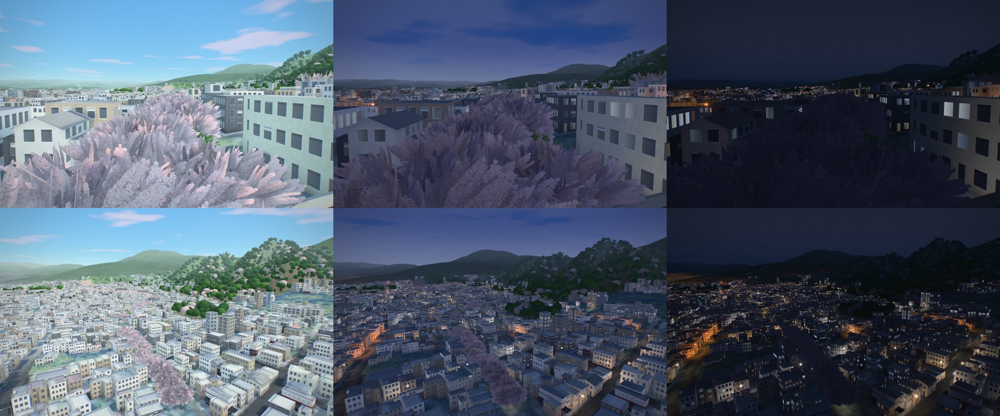
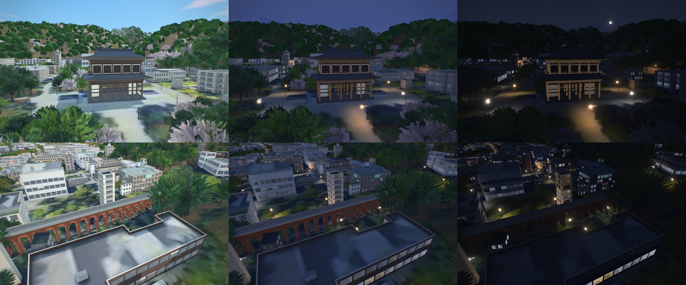
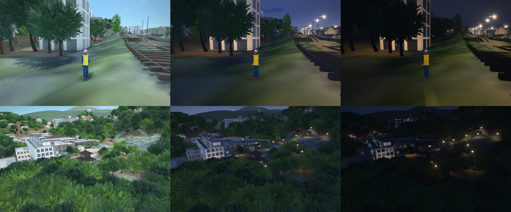
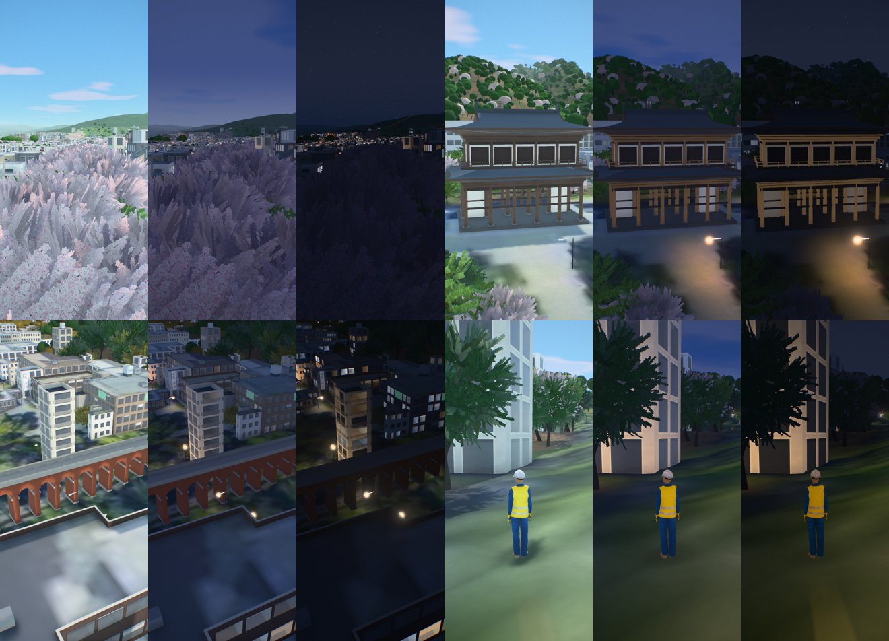
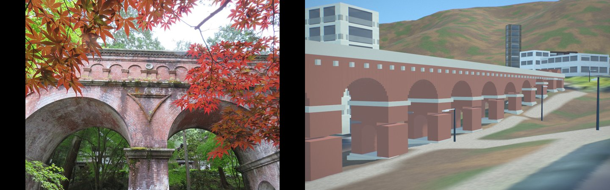
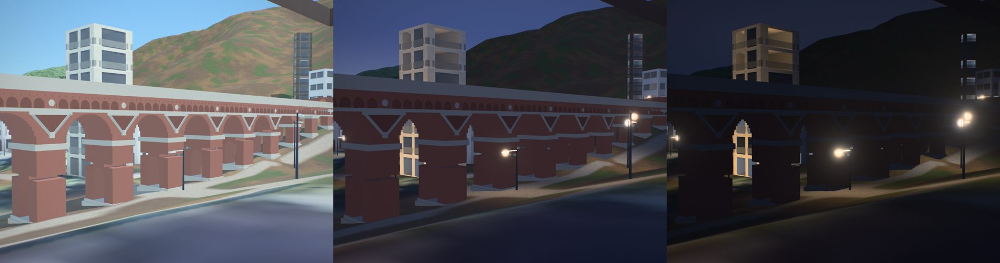
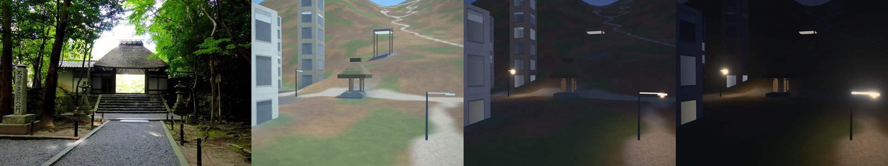
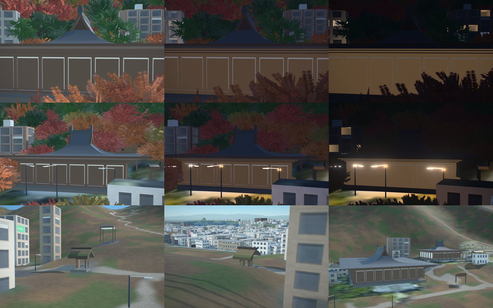
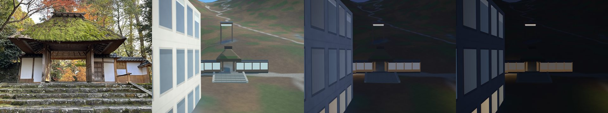

# The Philosopher's Path: the canal walk from Ginkaku-ji to Nanzen-ji

A Kyoto map of its own (#164), next to [Kyoto](kyoto.md), [Higashiyama](higashiyama.md) and
[Fushimi Inari](fushimi-inari.md). It covers about 135.784–135.800 E and 35.006–35.030 N (1.4 × 2.6 km):
the Philosopher's Path (哲学の道) along the Lake Biwa Canal's branch from Ginkaku-ji past Honen-in,
Otoyo-jinja, Nyakuoji and Eikan-do, Nanzen-ji with its Sanmon and the brick aqueduct, and the Keage
Incline.

**Why a map of its own** (recorded in [higashiyama.md](higashiyama.md)): growing Higashiyama to reach the
path would have taken it from about 3.3 to 11.6 km², and every visit to Kiyomizu-dera would have loaded
three times the buildings and ground. A district of its own loads only for those who choose it. The
cost is one more game check on the runs that shared code needs.

## Data

| | |
|---|---|
| Buildings | 10,204 (Overture footprints; 93.7% of the footprint area at a PLATEAU-measured height) |
| Heights and roofs | Project PLATEAU Kyoto City 2022 (MLIT, CC BY 4.0), LOD1 heights and LOD2 roof shapes |
| Terrain | GSI DEM5A, 5 m bare earth from airborne laser survey (GSI terms of use, compatible with CC BY 4.0) |
| Imagery | GSI seamless aerial photographs, zoom 18 |
| Fine detail | OpenStreetMap (ODbL), `cities/tetsugaku/north_osm.json` and `south_osm.json` (`pipeline/osm_detail.py`): the path's named ways, the aqueduct (w190871337), the Sanmon (w190876301), the Keage Incline (w378872665, w378872666), the Kannon-den (銀閣) |
| Far land | Copernicus DEM GLO-30 and ESA WorldCover past the frame (`pipeline/far_land.py`) |

## What is built in code (`cities/tetsugaku/city.py`)

- **The path's cherries**: a cherry every 4 to 5 m along both banks of the path, as photographs show them:
  a single row on each side of the canal and the walk, kept a road's half width off the streets the path
  runs beside (294 trees; `landmarks.json` "trees"). Where OpenStreetMap names the path, and along the six
  stretches between its named pieces that it maps as unnamed lanes and footways (south of Honen-in, by
  Otoyo-jinja and on towards Nyakuoji, 17-88 m each; `city.py` `path_bridges`: the shortest way along the
  mapped ways from the end of one named piece to the next, under 160 m and no more than 1.6 times the
  straight line), which had only the trees the data maps there (#244). The cherries were first planted in 1922 by the painter Hashimoto Kansetsu and his
  wife (関雪桜). A tree area 7 m either side of the path (`trees.areas` "Philosopher's Path cherries")
  makes them, and the trees mapped there, Somei-yoshino with a few maples. They flower with Kyoto's
  cherries (from 26 March). The path is not lit after dark, so they have no yozakura lighting; Maruyama
  Park in Higashiyama has it. Temple areas give Ginkaku-ji, Honen-in, Eikan-do (its maples) and Nanzen-ji
  their own mixes, outlined from OpenStreetMap (`pipeline/tree_areas.py`).
- **Nanzen-ji's Sanmon (三門, 1628)**: five bays and three doors, two storeys, about 22 m high (the temple),
  on its mapped outline: the lower storey's posts, brackets and pent roof of tiles; the upper storey with
  its balcony and railing (where Goemon looks out in the kabuki play), white walls and lattice doors, and
  its hipped-and-gabled roof.
- **The aqueduct (水路閣, 1888)**: brick weathered to a rose grey, about 9 m high, fourteen round arches
  along the mapped line on piers 2.4 m thick, each pier pierced along the line by a small round-headed
  passage (the row of them you see through from the end), the arches springing from granite imposts,
  stepped granite plinths and the canal's channel on top. Compared with photographs for #244: the first
  model had 22 thin arches on 1.1 m piers and no passages. Over the arches (#258, as the photographs show
  them): a granite string course just over the crowns, a blind arcade of small round arches on brick
  pilasters, seven to a bay, with a granite roundel over each pier, a projecting brick band on dentils under
  the coping, and in each spandrel over a pier an inverted triangle of granite strips round a panel of
  darker brick, its keystone at the apex.
- **The Keage Incline (1891–1948)**: its two rails on sleepers down the mapped lines, 2.5 m apart, and a
  boat (三十石舟) on its cradle halfway down.
- **Ginkaku (the Kannon-den, 1489)**: the lower storey in the shoin manner, the upper a Zen hall with its
  bell-shaped windows, under a shingle roof with the bronze phoenix.

- **Eikan-do (永観堂, Zenrin-ji)** (#244), on the outlines OpenStreetMap maps for them, facing west down to
  the gate: the **Miei-do** (御影堂, 1912, the main hall, 16.7 m to its ridge, PLATEAU's top), the
  **Amida-do** (阿弥陀堂, 1597, moved here from Osaka in 1607, home of the Mikaeri Amida; 13.5 m, since
  PLATEAU's 25.1 m is measured from the foot of its slope) and the **Shaka-do** (釈迦堂, the 1530s, 9.2 m):
  halls of bare timber on verandas, posts every 3 m, doors of keyaki across their fronts, bracket bands
  and tiled hipped-and-gabled roofs with lifted corners. The **Tahoto** (多宝塔, 1928) on the hill above:
  its square lower storey under a skirt roof, the white dome (亀腹), the round upper body under its bracket
  ring, the deep square upper roof and a copper finial of nine rings, 15 m in all (PLATEAU's 12.0 m is the
  trees round it).
- **Honen-in's gate (法然院の山門)** (#244): a small gate of bare timber under a deep hipped roof of thatch
  (茅葺の寄棟; a gable until a photograph showed its hips, #258), 0.6 m of miscanthus cut square at the eaves
  all round, moss on its lower courses and a short boxed ridge of cedar bark under battens; two main posts and two behind, the lintel, tie beams and its doors standing open, on stone steps,
  5.4 m to the ridge. PLATEAU measured 19.8 m there (the trees over it), and the gate stood as a box from
  6 m to 19.8 m on its opening.

## The game: The Philosopher's Path on Foot

From the bridge below Ginkaku-ji, a student starts you south along the canal to a retired canal keeper
near Nyakuoji, who sends you on to a photographer at the Keage Incline.

## What is approximate

- The cherries' spacing is read from photographs; the trees are not surveyed one by one.
- Eikan-do's halls: their footprints are the mapped outlines (traced at the eaves), the Miei-do's and the
  Shaka-do's heights are PLATEAU's, the Amida-do's 13.5 m and the Tahoto's 15 m are estimates from
  photographs; the bays and the brackets are generic (`kyotokit.hall`), not drawn from the temple's plans.
  The covered stair (臥龍廊) that climbs from the Miei-do to the Kaisan-do is a roof on posts from the data.
- Honen-in's gate: 5.4 m to its ridge and its proportions are read from photographs.
- Roofs on posts in the temple precincts (bell towers, fonts, shelters, 120 of them) take a temple's aged
  timber, and those in Okazaki-jinja's and Heian-jingu's precincts a shrine's vermilion (`pipeline/arcades.py`,
  [GAME.md](../GAME.md)); a pavilion's height comes from its kind and footprint where PLATEAU took a tree
  over it.
- The Sanmon's width and depth come from its mapped outline (traced at the eaves); its storey heights
  are proportions of the published 22 m.
- The aqueduct's arch count is its mapped length (97 m) over a 7.2 m bay read from photographs; its 9 m
  height is the figure usually quoted.
- The Kannon-den's height (10.5 m) is an estimate from photographs.
- Not checked on: a real GPU, WebGPU, Safari or iOS.

## Reference photographs

From Wikimedia Commons (`tools/commons.py`), compared with stills of the model:

| Subject | File | Author | Licence |
|---|---|---|---|
| The aqueduct, from below | [The Lake Biwa Canal Suirokaku Aqueduct.jpg](https://commons.wikimedia.org/wiki/File:The_Lake_Biwa_Canal_Suirokaku_Aqueduct.jpg) | 鵜飼 実幸 | CC0 |
| The aqueduct's piers and passages | [Suirokaku.JPG](https://commons.wikimedia.org/wiki/File:Suirokaku.JPG) (compared, not copied) | (not given on the file page) | CC BY-SA 3.0 |
| The aqueduct's arcade and spandrels (#258) | [Nanzenji Suirokaku Tx-re.jpg](https://commons.wikimedia.org/wiki/File:Nanzenji_Suirokaku_Tx-re.jpg) (compared, not copied) | Tx-re | CC BY-SA 3.0 |
| Honen-in's gate (#258) | [Gate, Hōnen-in temple, Kyoto - Oct 14, 2016.jpg](https://commons.wikimedia.org/wiki/File:Gate,_H%C5%8Dnen-in_temple,_Kyoto_-_Oct_14,_2016.jpg) | Tetsuhiro Terada | CC BY 2.0 |
| Eikan-do's Tahoto | [Tahoto Pagoda, Eikan-do (Kyoto) (2640404498).jpg](https://commons.wikimedia.org/wiki/File:Tahoto_Pagoda,_Eikan-do_(Kyoto)_(2640404498).jpg) | KimonBerlin | CC BY-SA 2.0 |

## Stills

Desktop (1440×900) and phone (390×844), day, dusk and night (`tools/views/tetsugaku-164.json`).

## Honen-in's walls and steps (#263)

Side by side with a photograph from the lane ([Gate, Hōnen-in temple, Kyoto - Dec 10, 2023.jpg](https://commons.wikimedia.org/wiki/File:Gate,_H%C5%8Dnen-in_temple,_Kyoto_-_Dec_10,_2023.jpg),
lamblukas, CC BY 2.0, compared, not copied): the white plaster walls either side of the gate, between timber posts
on base boards (腰板) under a tile cap, 2.3 m high and running 7 m each way on the line of the gate's main posts,
stepped down the slope (`honen_walls()`); and the flight of worn granite steps up from the lane, wider than the
gate, between sloping kerbs, out from the gate's stone until the ground has fallen the flight's height (4-7 steps
of 0.18 m, `honen_steps()`; walked on the ground under them). The gate's opening is now 2.3 m across, as the
photograph shows it. The walls' length and the steps' count are read from the photograph; the lodge on the right
of the photograph is PLATEAU's block.

