# Tokyo: Marunouchi to Tokyo Tower

Tokyo is the first city here where the open data includes a measured height for
almost every building. This note records what the model is built from, what was
checked and what was not. Every number comes from the scripts in `pipeline/` and
`analysis/` run with `--city tokyo`; outputs are in `cities/tokyo/analysis/`.

## 1. What is in it

- **Area:** 3.2 × 4.8 km, from Nihonbashi and Shimbashi in the east to Tokyo Tower
  in the west, and from the Imperial Palace and Hibiya Park south to Hinode Pier.
- **Buildings:** about 15,400, with 19,000 solids.
- **Heights:** 76% of the footprint area stands at a height measured by Project
  PLATEAU's LOD2 survey. The rest comes from OpenStreetMap, floor counts, or an
  estimate from neighbours (19% of the area, the weakest part; the neighbour
  estimator's cross-validated median error factor is 1.36).
- **Landmark:** Tokyo Tower is built from published dimensions (333 m, decks at
  150 m and 250 m, an 80 m base), anchored at its published coordinates. It is
  an approximation of the lattice, not a scan.

### The National Diet Building

The Diet's 26 mapped solids are drawn in granite by `cities/tokyo/diet.py` and
hidden (they stay in the surface model): courses over a plinth, three storeys of
tall windows between string courses, cornice and parapets, the chambers'
measured skylit roofs, the east porch's square columns, and the tower: a square
base, the colonnade of its upper stage between corner piers and the stepped
pyramid to the lantern at 65.45 m (House of Representatives, the building's
fact sheet: 206.36 by 88.63 m). The storeys and the tower's stages are taken
from photographs.

### The palace moats and their bridges

GSI's laser DEM has no returns from water, and its gaps are filled from the castle's banks, so the
moats read several metres above the streets beside them (the Wadakura moat at 6.8 m against banks of
2.8 m) and Wadakura-bashi and the Seimon Ishibashi ramped down to the banks. `cities/tokyo/moats.py`
makes each moat water at its own level: the twelve Outer Garden moats at the levels the Ministry of
the Environment publishes (Kokyo Gaien National Garden Office, 皇居外苑濠 濠別管理方針, March 2010:
水面標高 T.P. m): Wadakura, Babasaki and Hibiya 1.43 m, Kikyo, Otemachi and Shimizu 1.87 m, Hamaguri
2.37 m, Gaisen 2.85 m, Sakurada and the Nijubashi moat 3.82 m, Hanzo and Chidorigafuchi 15.98 m. The
moats inside the palace, which have no published level, stand at their low bank less 1.7 m, the median
of the Outer Garden moats' banks over their water. The ground under each moat goes down to a bed, the
DEM's fill that bled onto the banks beside them is taken off (a point within 10 m of a moat stands no
higher than the bank 12 m back), dressed stone walls stand from the water to the bank, and the game
treats the moats as water at their level. The bridges over them now meet their banks where they are
(Wadakura-bashi at 2.7 and 2.9 m) instead of a river's 3.5 m embankment.

The Seimon Tetsubashi (二重橋) is level, without a crown, at the Seimon terrace's 16.7 m (GSI's laser over
the flat terrace at its south end; the palace side reads 16.5 to 17 m). The 5 m DEM spreads the Nijubashi
moat's walls over 15 to 18 m of slope, which had set the deck from 15.3 down to 10.1 m. Within 40 m of the
bridge (fading over 30 m more) the walls now stand to the terrace, read 18 m back from the shore, and the
ground behind them is the terrace's (`moats.py` WALLED).

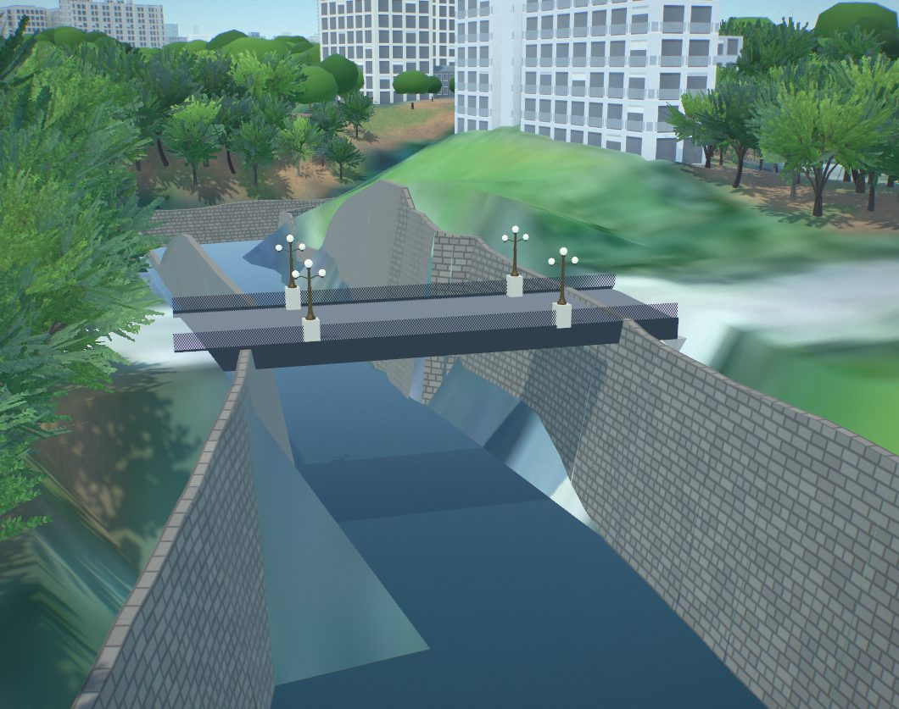 The outlines are
OpenStreetMap's (ODbL); `python cities/tokyo/moats.py` writes `cities/tokyo/moats.json`, and
`pipeline/refresh_terrain.py --city tokyo --hook`, `pipeline/refresh_bridges.py`, `pipeline/landmarks.py`
and `pipeline/game_extras.py` bring a built city up to it.

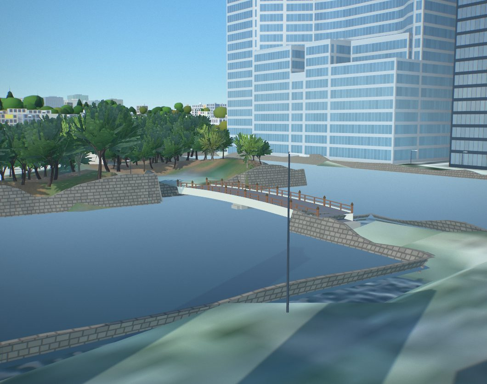
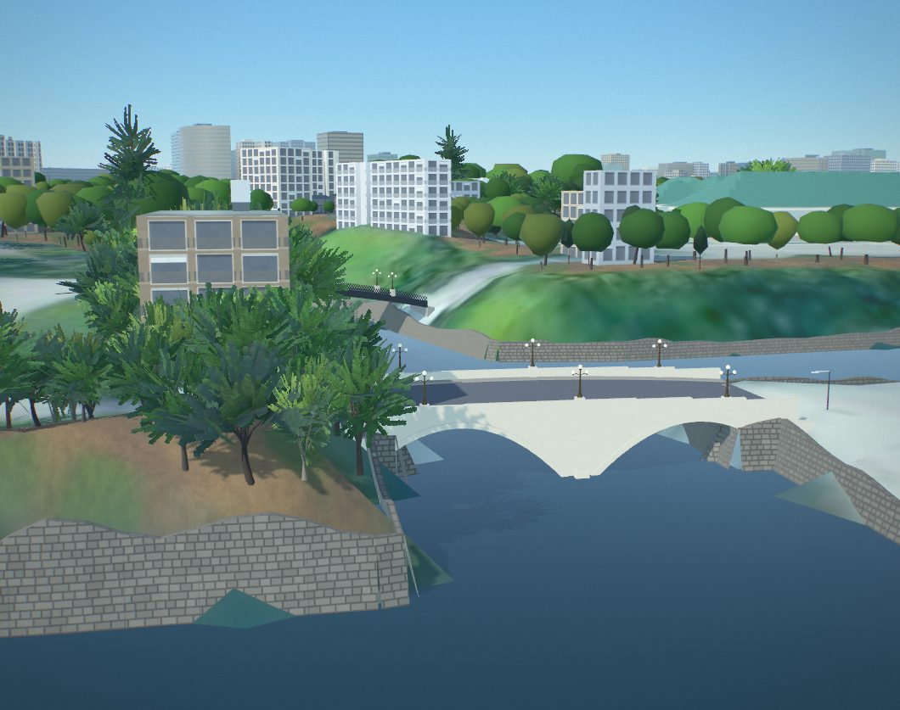

### Nihonbashi's bronzes

Nihonbashi (1911, Tsumaki Yorinaka; the bronzes by Watanabe Osao) carries, from its photographs, the
two lamp standards over its middle pier on granite pedestals, each with a pair of winged kirin back to
back, and at its four ends granite pillars with their lamps and the lions holding the City of Tokyo's
crest. The figures are sculpted fields (`pipeline/sculptkit.py`) in `pipeline/bridges.py` (city.json
bridges forms `"statues"`); every bridge with bronze lamps (Nihonbashi, Tokiwabashi, the Seimon
Ishibashi, the Nijubashi) has turned candelabra with glass globes, and the bridges' lamps glow after
dark. The Shuto Expressway over it is `cities/tokyo/shuto.py` (below).

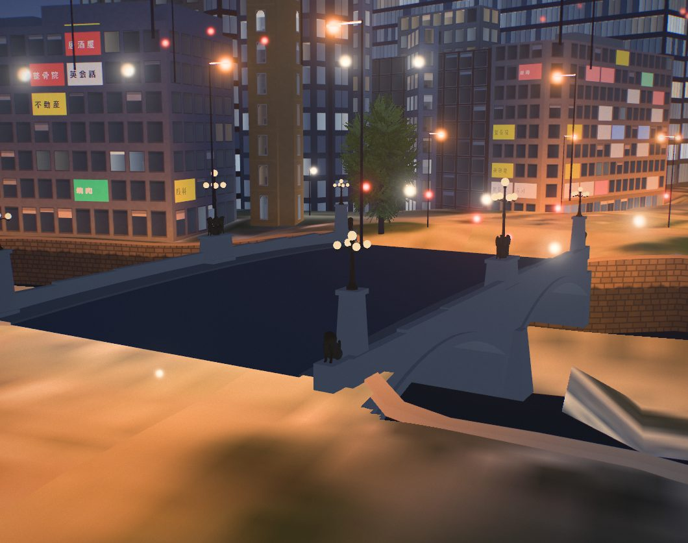

### The Shuto's heights, measured (#234, #272)

No drawing or published height was found for the Inner Circular Route (C1) over the Nihonbashi River, Edobashi
JCT or the stretch west to Kandabashi JCT (the MLIT council documents give lengths and lanes only). They are now
measured from the Tokyo Metropolitan Government's airborne LiDAR (東京都デジタルツイン実現プロジェクト 区部点群データ,
2023 survey, `tokyopc-23ku-2024` on G空間情報センター, CC BY 4.0). `cities/tokyo/shuto_lidar.py` reads the sheet
index from the dataset's vector tiles and fetches only the nine 400 × 300 m sheets under the expressway (about
1 GB of LAS, kept to the 5.3 million points within 14 m of the lines, in `data/raw/tokyo/lidar`, not in the
repository). Along each elevated motorway line it takes, every 6 m, the densest 0.25 m layer of returns within
a lane's width, between 3 m over the ground and 2.5 m over the line's data height: the road's surface (vehicles
are sparse, parapets narrow). Where a ramp passes under another deck the scanner saw only the upper one: a run of
samples that measures the same as a line the data puts a level higher is dropped and interpolated over, and
where two decks overlap outright the lower takes the upper's height less the data's difference. The LiDAR's
ground returns agree with the game's terrain grid near the lines (median 0.00 m, quartiles −0.07 and +0.10 m), so
both are T.P.

What it found:

- The road over Nihonbashi is at **14.1 m** (T.P.), not the 17 m the photographs had suggested. The bridge's deck
  is at 5.4 m by its middle pier and the kirin lamp standards' tops at 12.75 m in the same survey: about a metre
  between the lamps and the road. The girders now shallow over the bridge (0.7 m at least) so that their soffit
  clears the lamps by 0.3 m, and are 2.2 m deep elsewhere.
- Upstream the road falls to 11–12 m by Ichikoku-bashi and climbs again to 18.7 m where the C1 rises over the
  Yaesu ramps; at Edobashi JCT the decks are 12.5–17 m; west of Kandabashi JCT 12–14.6 m.
- OpenStreetMap's layers (6 m a level) had put all these viaducts at 20–25 m, 6–8 m too high.

`shuto.py --relevel` puts `shuto.json`'s stretch on the samples; `shuto.py --game` puts `game.json`'s elevated
expressway lines on them (`web/game/decks.js` draws those viaducts at their lines' heights): a line within 4.5 m
of a sample of a line the data puts within 3 m of it takes the sample's height; inside the survey, a stretch no
sample reached keeps its line's nearest measured height; a ramp coming down to the ground beyond its last sample
runs straight to where it meets it; a line running on out of the survey eases back to its data height over
150 m, through the junctions into the lines joined to it. 958 points moved; no grade over 33% was added (the
steepest new ones are short ramps at Route 1's off-ramp by the map's edge).

| The C1 over the river from upstream (game, day) | Over Nihonbashi from its south end (viewer) |
|---|---|
| 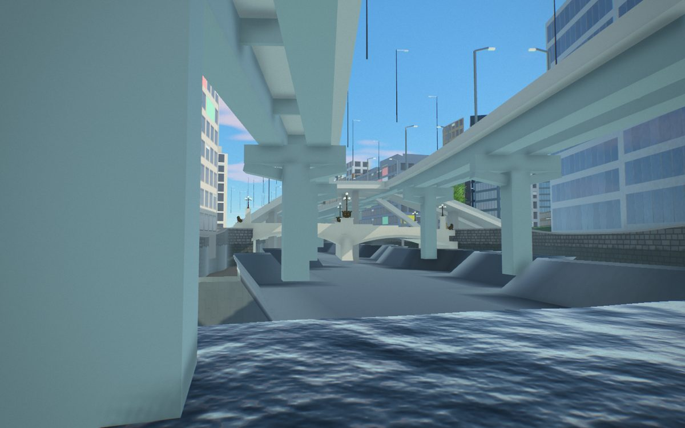 | 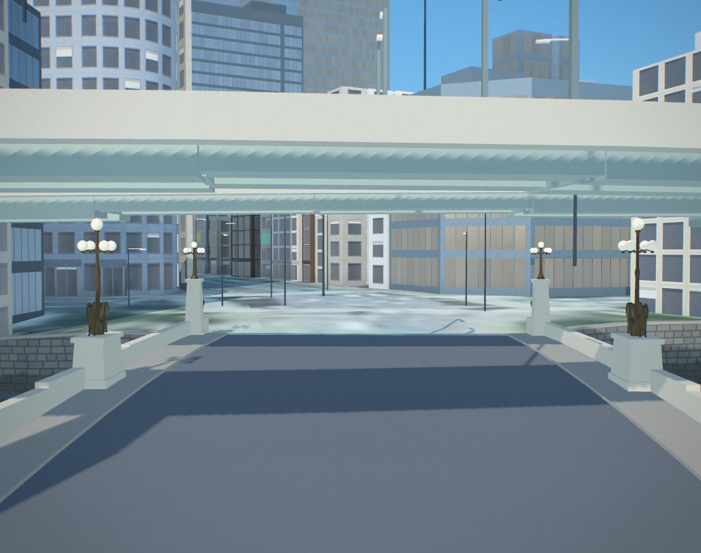 |
| **Edobashi JCT from the air (game)** | **The Yaesu ramps under the C1 (game)** |
| 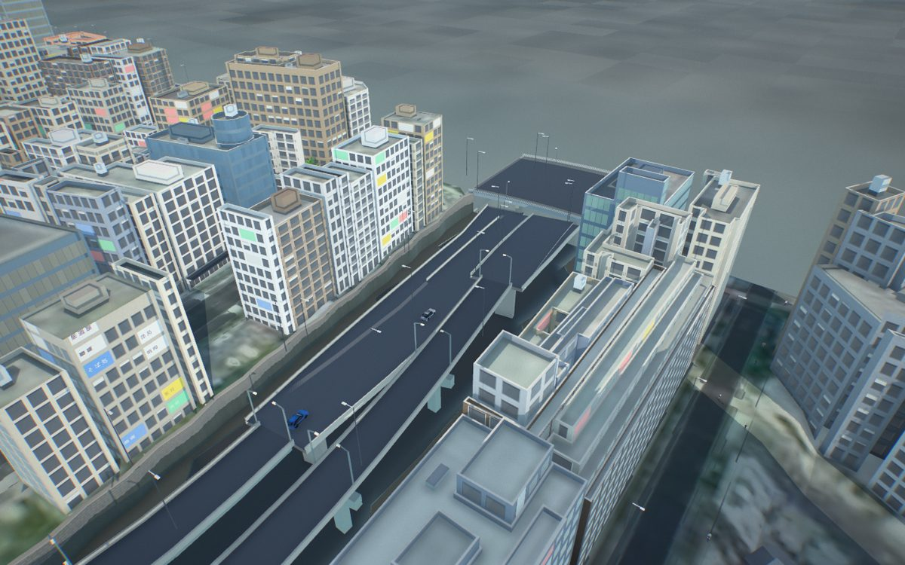 | 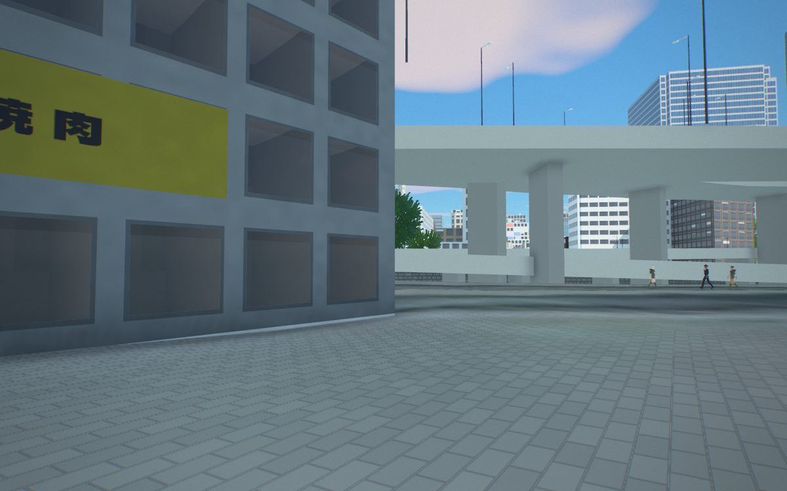 |

**The rest of the Shuto (#290).** `shuto_lidar.py` now measures every elevated line in the map: the C1 west of
Kandabashi JCT and round the palace's moats, and south through Kasumigaseki, Ginza and Shiodome, from 31 sheets
fetched only under those viaducts (13.3 million points kept). The first survey's samples are kept as they were
measured (`FIRST`): game.json's lines there already stand on them, so their heights are no longer the data's, which
the measure needs. Two guards were added: a layer more than 9 m under a line's data height is a road under the deck
(two short decks at the map's east edge measured 11–15 m low, the upper under the lower), and one more than 1 m
over it is a deck over the line (at the junctions by the moats); both are left out. `shuto.py --game` put 2,038
points on the new samples (median 2.8 m down, a quarter of them 4.4 m or more; a few ramps by the junctions up to
2.9 m up, where they meet decks whose measured height is above their data); it leaves the first survey's points as
they are, and eases moved points toward their neighbours to at most 10% between them, so no grade over 12% was made
steeper (`tools/shuto_grades.py`). Not checked against a drawing or a photograph: the junctions by the moats, where
decks stack over tunnels, are the least certain.

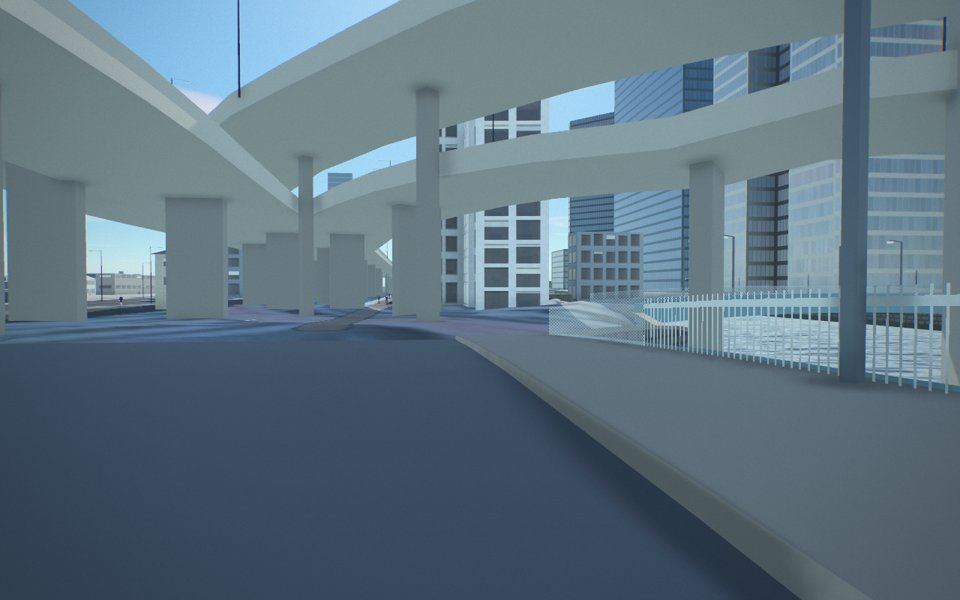

**The junctions by the moats, checked (#307, #322 round).** The result of #290's `shuto.py --game` never reached
`game.json` (the commit carried the samples, not the game data), and the lines' data heights changed in a later
rebuild, so the samples no longer matched the lines they were taken on. `shuto_lidar.py` measured again against the
current lines (3,403 samples) and `shuto.py --game` put 1,506 points on them (median 1.1 m down, a quarter 3.9 m or
more; no grade over 12% made steeper). `tools/shuto_moat_layers.py` then compared every line by Takebashi,
Daikancho, Miyakezaka and Hanzomon with the layers of the survey's points over it (12 m steps, the dense layers of
a road deck): by Daikancho the C1 had stood 2–3 m over the deck the survey sees along the moat and now lies on it;
by Takebashi the Route 5 ramps had stood up to 13 m over their decks, and most of their length now lies on them.
Still off: the middle of one Takebashi ramp (its data 35.7 m; 16 m measured beside it: about 3 m high still, where the
measure reached only 11 of its 47 points), and west of Miyakezaka a line under the ground's rising level towards
Hanzomon, under a deck the survey sees 8 m over the ground there; whether it is Route 4 in its tunnel or on that
deck wants a photograph. Both are in #323.

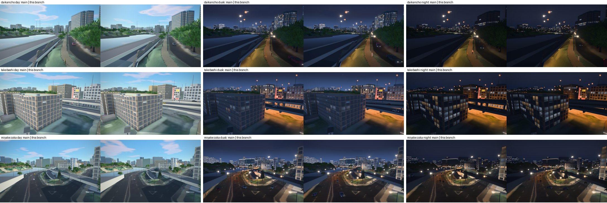

### The Nihonbashi River in the viewer (#246)

In software stills (llvmpipe) the water seemed to add nothing over the Nihonbashi River. Measured again: at
the river's middle (1420, 1565) the ground is below the water (-0.05 m and the bed at -4 m), and hiding the
water changes 17,790 pixels of a 1440 × 900 still; the earlier test was aimed at (1420, 1590), on the
bank, where the ground is 3.9 m up. Under the Shuto's deck the river is in shade, and the water's own colour
there is close to the bed's, so it reads as dark either way. The quays now raise only the grid points by the
bank (`web/quays.js`, [ARCHITECTURE.md](../ARCHITECTURE.md)). Not checked on a real GPU.

### The slab by the M8 exit (#246)

Solid 18776, a PLATEAU block of 15 × 5 m and 2.4 m beside Tokyo Station's M8 exit at (583, 1400), has no
name or class: a vent's or a stair's cover. It was drawn as a one-storey house with windows under the trees;
it is drawn plain now, and so is the M8 exit's own cover (`pipeline/arcades.py`, low structures). Not
checked against a photograph: Wikimedia Commons refused this session's requests. (#290: Commons answered, but its photographs of the Marunouchi north side
show the station's dome and the plaza from far off; none shows the block. GSI's aerial photograph has a pale
rectangle there, consistent with a low cover. Left plain.) (#323: M8 is the stair up to the north bus and taxi stands of the Marunouchi plaza, beside the
Shin-Marunouchi Building (Yahoo! transit's exit list); Commons and Openverse have no photograph of it. Left plain.)

### The Imperial Palace

The Kyūden (1968, Yoshimura Junzō) was 43 mapped parts with flat tops. `cities/tokyo/palace.py` draws
its wings, the union of those footprints with the courts as holes, with pale walls to their eaves at
9 m and green copper hipped roofs that follow every turn of the outline (`archkit.outline_roof`) up to
the mapped tops of 15 to 17 m. An unnamed 64 m² outline in the east court that the build gave its
neighbours' 22 m is left out.

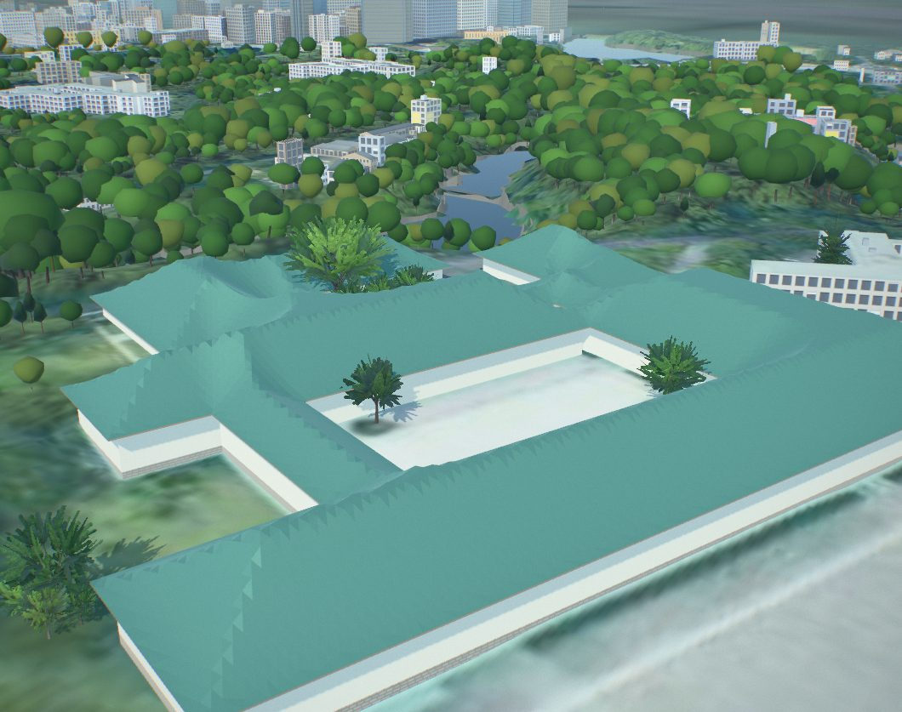

The Kabuki-za's roof garden, with the white PLATEAU block hidden:

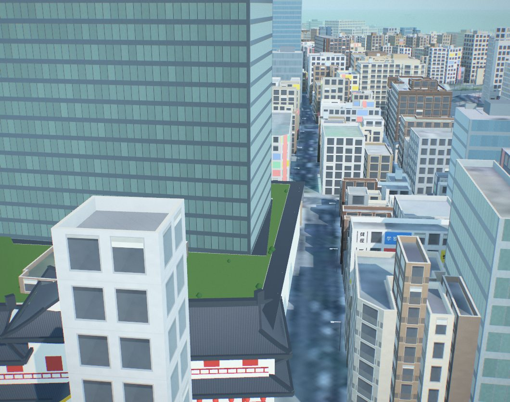

### The JR viaduct and Yurakucho Station

The railway from Tokyo Station to Shimbashi was a strip of track in the aerial photograph, flat on
the ground, with the old station's rooms standing on it as grey boxes. `cities/tokyo/rail.py` builds
it: 1.6 km of viaduct for eight tracks, Yurakucho Station on it, and the courses of the trains.

- **Laid out on the map's own tracks.** `pipeline/rail_osm.py` reads OpenStreetMap's running lines
  above ground (the Yamanote, Keihin-Tohoku, Tokaido Main and Tokaido Shinkansen lines), the platform
  outlines and the stopping points into `cities/tokyo/rail_osm.json`. Each line's pieces join into two
  through tracks. The deck is the ground under the tracks and platforms; the rail is level at
  9.2 m T.P., about six and a half metres over the streets.
- **Under the deck** it is closed where nothing passes: brick arches on the west, the side of the
  1910 elevated line, most of them a lit front (the bars and shops under the tracks), some shuttered;
  a concrete frame on the east, the Shinkansen's side (1964). Every street and footway of the game's
  network that crosses the corridor is an opening, with dressed-stone abutments and plate girders on
  the deck's edges over it.
- **The station.** Two island platforms on OpenStreetMap's outlines, 1.1 m over the rail: 1 and 4 the
  Keihin-Tohoku Line, 2 and 3 the Yamanote Line. Butterfly canopies on a row of columns with two rows
  of tube lights a side, open to the sky for the last 24 m at each end; the yellow tactile strip;
  platform doors along all four edges, their doors set for an 11-car Yamanote train and a 10-car
  Keihin-Tohoku train; JR East's name boards, platform boards and departure boards
  (`rail_signs.webp`, lettered in IPA Gothic); benches and drinks machines. The concourse runs
  straight across under the tracks at the platforms' middle, with an entrance on each side and two
  flights of stairs up to each platform.
- **The overhead line**: portal gantries every 48 m, and a contact wire under its messenger over each
  track, 5.0 m over the rail.
- **Each end** is a train shed's mouth, a roof over the tracks with a dark wall behind it, where the
  trains come from and go to: Tokyo Station's and Shimbashi's own platforms are solids of the city
  model, not modelled inside.
- Ten low solids under the platforms come down (`landmarks.json` "demolished").

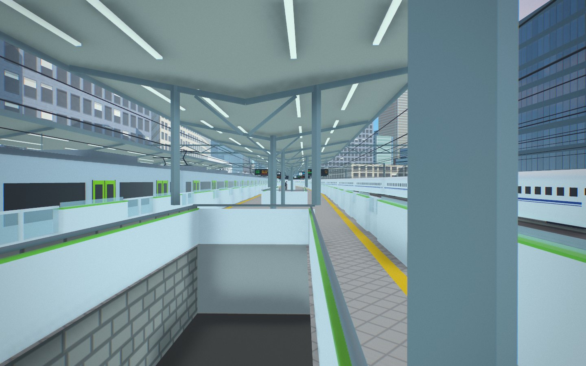

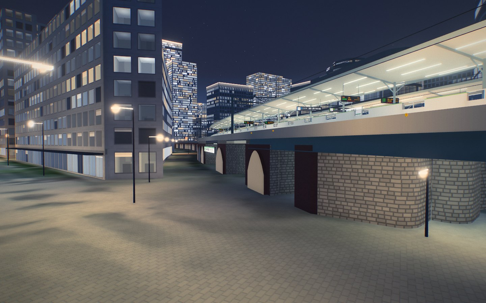

The trains are the game's (section 6).

## 2. Sources

| Layer | Source | Licence |
|---|---|---|
| Building heights, massing | Project PLATEAU Tokyo 23 wards LOD2 (MLIT), read as the vector tiles published by indigo-lab | CC BY 4.0 (PLATEAU), MIT (tiles) |
| Footprints, names, roads, water, parks | Overture Maps, release 2026-10-21.0 (OpenStreetMap) | ODbL |
| Terrain | GSI DEM5A, 5 m airborne laser survey, bare earth (10 m DEM where 5A has no data) | GSI terms of use |
| Aerial photos | GSI seamless photos, zoom 17 | GSI terms of use |
| Shuto Expressway (every elevated line in the map) | Overture Maps segments (OpenStreetMap); road heights from the Tokyo Metropolitan Government's airborne LiDAR (`tokyopc-23ku-2024`, G空間情報センター) | ODbL; CC BY 4.0 |
| JR tracks, platform outlines and stopping points, Tokyo Station to Shimbashi | OpenStreetMap, read track by track (`pipeline/rail_osm.py`) | ODbL |
| Palace moats' water levels | Ministry of the Environment, Kokyo Gaien National Garden Office: 皇居外苑濠 濠別管理方針 (March 2010) | Government publication, cited |

## 3. How PLATEAU is used

PLATEAU's outlines are roof faces: one tower is a podium face and a tower face.
`pipeline/build_scene.py` (class `Plateau`) cuts each Overture footprint along
those faces, tallest first, so a podium and its tower each get their own height.
Faces that are small and only a few metres above the main roof (plant rooms) are
absorbed. A small face more than 8 m above the main roof is kept: it is a spire
or a dome (the Diet's tower, Tokyo Station's domes). PLATEAU buildings that no
Overture footprint covers are added: 1,400 of them.

PLATEAU measures to about 2020. A tower finished since then appears only if
Overture or OpenStreetMap has it.

## 4. Checks

- **PLATEAU against OpenStreetMap:** `analysis/plateau_check.py` compares the two
  on 135 buildings of 20 m and over that carry both. Median disagreement
  2.8%, 96 within 10%, 110 within 20%, 10 more than 40% short and 10 more than 40%
  tall. The big misses are mostly OpenStreetMap tagging a podium or a neighbour's
  height, and new towers that PLATEAU predates. OpenStreetMap is the independent
  source here, but it is not a survey either.
- **Terrain:** GSI DEM5A is airborne laser bare earth. No second independent
  elevation source was compared (Australian cities use a LiDAR identify service),
  so the check in `docs/ADDING_A_CITY.md` for terrain is not met for Tokyo yet.
- **Not done:** published tower heights by street address. Japanese addresses do
  not match `analysis/heights.py`'s Western matching. The checks above stand in.

## 5. Sun and the rules

Tokyo has no rule that protects sun on public places. 日影規制 (Building
Standards Act, art. 56-2) limits hours of shadow on neighbouring land in
designated zones, and does not apply in commercial districts such as Marunouchi.
The places in the model (Hibiya Park, the Palace plaza, Marunouchi Central
Plaza) carry a lunch-hour window of 12:00 to 13:00 that this project chose, so
"test a new tower" answers what a rule would cost. It is not law. Tokyo keeps
standard time all year.

The integrated build runs the sun analysis for Tokyo for the first time
(`analysis/sun_access.js`, `cities/tokyo/analysis/sun_access.json`). Mean share
of each place in direct sun over the window, December and June: Hibiya Park 75%
and 93%, Marunouchi Central Plaza 28% and 98%, Shiba Park 33% and 94%, the
Palace plaza 100% in both. Between its towers, Marunouchi Central Plaza is the
place where a new tower would matter most in winter.

## 6. The game

**Tokyo on Foot** has nine stamps: Tokyo Station, Marunouchi, the Imperial
Palace, Hibiya Park, Ginza, the water bus, a helicopter flight, Tokyo Tower and
the survey itself. The people are Tokyo's: a station attendant who points and
calls, a salaryman who explains the air rights above Tokyo Station, a Palace
runner, a Hibiya Park regular, an office worker, a yakitori master under the
Yurakucho tracks, a water-bus captain, a helicopter pilot, a Tokyo Tower guide
and a schoolgirl. The crowd takes its palette from `OEPeople` style `tokyo`: dark
suits, navy blazers, black hair, many office workers. Names and place labels are
bilingual. The water-bus piers are real (OpenStreetMap), the vessel names are
Tokyo Cruise's, and the timetable is invented. The boats are the shared harbour
ferry in an approximate white and navy. The trees are the shared set's ginkgos,
zelkovas, planes, camphors and pines, and Somei-yoshino cherries in flower from 24 March at
Chidorigafuchi and along its moat walk, in Kitanomaru, Hibiya and Shiba parks and on the
streets. The pads on the Marunouchi plaza (where the game now starts, in front of the station) and in Hibiya Park are game devices; no real
heliport is in the area.

**The railway at Yurakucho** (`web/game/trains.js`, `game.json` "trains"). From the map, travel to
"Yurakucho Station, platform 4", or walk in under the tracks and up the stairs. Four kinds of train
run on the eight tracks, each to its real length. The three commuter kinds wear their lines' colours; the
high-speed train is not a copy of the real one:

| Line | Stock | Cars | At Yurakucho |
|---|---|---|---|
| Yamanote (tracks 2, 3) | E235: steel with yellow-green doors | 11 | stops |
| Keihin-Tohoku (1, 4) | E233-1000: a sky blue band | 10 | stops; its rapid trains run through from 10:30 to 15:30 |
| Tokaido Main | E233-3000: orange over green | 15 | runs past |
| Tokaido Shinkansen | a high-speed train of this project's own design: pearl white, a 9.5 m spearhead nose, an indigo line over a fine vermilion one | 16 (400 m) | runs past |

After dark the cars' windows show their saloons' light. No figures are drawn in them.

A stopping train brakes at 0.9 m/s², stands 26 s and pulls away. The headways are a few times shorter
than the timetable's, so there is always a train to watch. Each train's place is a function of the
time alone. The cars are instanced: one draw call per material of each kind of car.

The platform announces each train as JR East's do, in Japanese and English: a chime and
「まもなく、3番線に、山手線、品川・渋谷方面行きが、まいります」, the station's name as the doors open, a
departure melody, and 「ドアが閉まります」. It is spoken by the browser's own voices where it has them
and always shown as a caption. The melody is this game's own; the railway's melodies are their
composers'. A train near you is heard: its rumble, its wheels over the rail joints, its motors' whine
as it pulls away, a Shinkansen's rush of air. There is no ambient bed: between trains the station is
quiet. Three people stand on the platform: an attendant, a commuter and a train photographer.

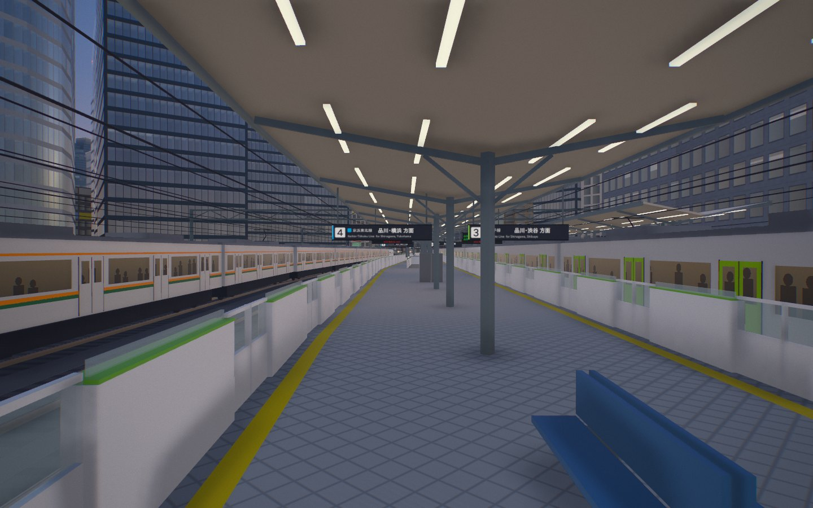

## 7. Limits

- The aerial photos are not true orthophotos, and tall towers lean in them; roof
  colours of towers over 40 m are neutral.
- Tokyo Tower is not a scan. The lattice is regular, the observatories are boxes.
- 19% of the footprint area still has an estimated height. Look for the green
  tint under **Height sources**.
- Names from OpenStreetMap are mostly Japanese; English labels were added by hand
  for about twenty landmarks.
- The viaduct is one level and one height for its whole length. The real one steps between the brick
  arches and the Shinkansen's deck, and carries shops whose fronts are not modelled one by one.
- Yurakucho's platform doors do not open, and you cannot board: the trains are to watch and to hear.
- Tokyo Station's and Shimbashi's platforms are not modelled; the trains run into a shed's mouth
  short of each.
- The announcements' voices are the browser's. A device without a Japanese voice shows the caption
  and plays the chimes only.
